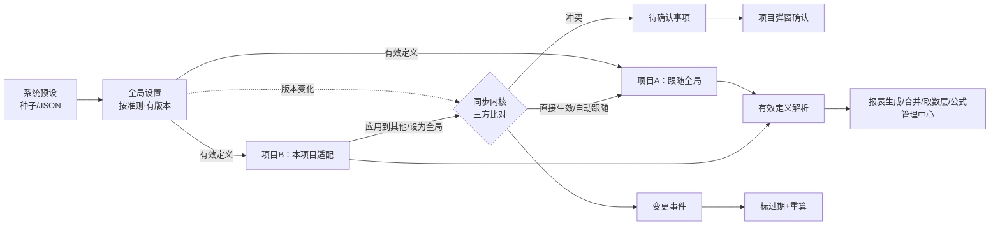

# 设计文档：公式全局设置、项目适配与一处修改全处生效

> spec：`formula-global-settings-sync` · 需求见 requirements.md（R1~R12）
> 原则：复用现有存储与执行器，只加「层」「版本」「基线」「同步内核」；所有写路径经同一内核；新代码放新模块（行数门：Python ≤800、Vue/TS ≤1500，既有大文件只做最小接线）。

## 1. 目标形态

- 一个公式位只有一个有效定义；所有消费方经同一解析函数取（R1.2）。
- 全局变化经同步内核分到每个项目：能自动的自动，冲突进待确认并弹窗（R3~R5）。
- 项目内修改默认只影响本项目；可一步扩散到全局或指定项目，同样经内核（R6~R7）。
- 公式模板是全局与项目之间可选的一层：项目订阅后，模板定义优先于全局；模板更新、订阅、退订都经同一内核与弹窗（§16）。

## 2. 数据模型（一个迁移：实施时现扫最高版本 +1，写作时为 V199；并发 spec partner-manager-edit-permission 也在取号，须错开）

### 2.1 `report_config` 加列（报表域两层都在这张表）

| 列 | 用途 |
|---|---|
| `formula_version INT NOT NULL DEFAULT 1` | 全局行：定义版本；项目行：本地修订号（CAS） |
| `base_version INT NULL` | 项目行：所依据的全局版本；项目独有行为 NULL |
| `base_definition JSONB NULL` | 项目行：所依据的全局定义快照（三方比对） |
| `pinned BOOLEAN NOT NULL DEFAULT false` | 项目行：暂缓/冻结而固定在旧全局 |

回填：项目行按项目派生准则匹配同 `(report_type,row_code)` 全局行，`base_version=1`、`base_definition`=全局行当前定义；无对应全局行的为项目独有（基线空）。真库仅 183 行且逐条与全局相同，回填后全部判为「跟随全局」。

### 2.2 新表 `formula_setting`（非报表域的全局层与项目层）

| 列 | 说明 |
|---|---|
| `id UUID PK` | ORM `default=uuid.uuid4`（PK 必带 default，memory 教训） |
| `domain VARCHAR(32)` | tb_detail / cross_check / wp / note / consol_note |
| `layer VARCHAR(16)` | global / project（CHECK） |
| `scope VARCHAR(40)` | 全局层：准则码或模板类型，`*` 表示通用；项目层存 `''` |
| `project_id UUID NULL FK projects` | 项目层必填，全局层为空（CHECK） |
| `slot_key TEXT` | 公式位身份（§3） |
| `definition JSONB` | 域定义（§3）；`{"disabled": true}` 表示本项目停用该全局公式位 |
| `definition_hash VARCHAR(64)` | 执行字段规范化 JSON 的 sha256 |
| `version INT DEFAULT 1` | 全局：版本；项目：本地修订号 |
| `base_version INT NULL` / `base_definition JSONB NULL` / `pinned BOOL` | 同 2.1 |
| `is_deleted BOOL` / `created_by` / `updated_by` / `created_at` / `updated_at` | 软删与留痕 |

唯一约束（部分索引，PG 与 SQLite 都支持）：全局 `(domain, scope, slot_key) WHERE layer='global' AND NOT is_deleted`；项目 `(domain, project_id, slot_key) WHERE layer='project' AND NOT is_deleted`。

### 2.3 新表 `formula_sync_item`（待确认事项）

`id, project_id, domain, slot_key, slot_label, reason(conflict|deferred), base_definition, upstream_definition（NULL = 全局已删除）, local_definition, upstream_version, publish_id, status(pending|resolved|superseded), resolution(adopt|keep|custom), resolved_definition, resolved_by, resolved_at, created_at, updated_at`。部分唯一索引：`(project_id, domain, slot_key) WHERE status='pending'`（R4.4：同位只保留一条，后续发布更新它）。

### 2.4 新表 `formula_publish`（发布记录）

`id, domain, scope, source(global_edit|promote|apply_to_projects|direct_edit|master_sync), source_project_id, request_id（幂等，唯一）, change_set JSONB（[{slot_key, label, old, new, old_version, new_version}]）, summary JSONB（各分类计数 + 每项目计数）, note, published_by, published_at`。

### 2.5 `wp_formula` 加列

`base_version INT NULL, base_definition JSONB NULL, pinned BOOL DEFAULT false`：底稿域项目层就是 `formula_source='custom'` 的行，复用其 `definition_version` 做 CAS。

### 2.6 `consol_note_formula` 加列

`version INT NOT NULL DEFAULT 1`：合并附注全局层沿用该模板级表，补版本号供 CAS 与三方比对；项目层放 `formula_setting`。

所有 DDL `IF NOT EXISTS`；配对的回滚脚本：删本 spec 新建的全部表（含 §16 三张模板表）、删加列（`DROP COLUMN IF EXISTS`）。迁移只在启动时跑，本地库用 `MigrationRunner(...).run_pending()` 落库（开发服务热重载不跑迁移）。

## 3. 公式位与定义

| 域 | slot_key | 执行字段（参与哈希与冲突判定） | 说明字段（跟随，不判冲突） | 全局 scope 取法 |
|---|---|---|---|---|
| report | `{report_type}:{row_code}` | formula, aje_formula, rje_formula, formula_category | formula_description, formula_source | 项目派生准则（`resolve_applicable_standard`） |
| tb_detail | `{科目编码}`；新增行 `added:{row_code}` | formula, formula_category | formula_description, row_name | `*` |
| cross_check | `{分组key}#{rule_id}` | left_ref, operator, right_ref, tolerance | label, description | 项目派生准则，回退 `*` |
| wp | `{wp_code}|{sheet}|{cell_ref}` | expression, formula_type | description | `*` |
| note | `{note_section}|{target}` | formula, category | description | 项目模板类型（soe/listed） |
| consol_note | `{section_id}|{row}|{col}` | formula | description | 项目模板类型 |

- 规范化：字符串去首尾空白、`None` 与空串统一为 `""`；JSON `sort_keys=True, ensure_ascii=False, separators=(",",":")`；sha256。
- 「定义相等」只比执行字段；说明字段在项目未改时随全局更新，项目改过则保留项目的。
- 表间审核规则旧数据无 `rule_id`：保存时补 `uuid4().hex[:12]`；真库 0 个项目使用，无存量迁移。

## 4. 同步内核（纯函数，`formula_settings/sync.py`）

输入：公式位旧全局定义 `G0`（版本 v0）、新全局 `G1`（v1，`None`=删除）、项目适配 `L`（可空）及其基线 `B`、是否固定 `pinned`、项目是否冻结。

| 条件（自上而下取第一条） | 分类 | 说明 |
|---|---|---|
| 项目已归档 | frozen | 写固定行保持 G0；不重算 |
| 无项目适配 | inherit | 有效定义直接变为 G1 |
| `L` 已固定（pinned） | deferred_existing | 已暂缓：更新待确认事项的新全局 |
| `L == G1` | same | 只把基线更新为 v1 |
| `L == B` | follow | 项目从未改过：适配改为 G1，基线 v1 |
| 其他 | conflict | 三方对比 B / G1 / L |

决策（管理员发布时，或项目处理待确认时）→ 效果：

| 分类 / 决策 | 项目适配 | 基线 | 待确认事项 |
|---|---|---|---|
| inherit + 应用 | 不写 | — | — |
| inherit + 暂缓 | 新建固定行 = G0 | v0 | 新建 deferred |
| follow + 应用 | 改为 G1 | v1 | — |
| follow + 暂缓 | 保持 G0 并标固定 | v0 | 新建 deferred |
| same | 不变 | v1 | — |
| conflict + 采用新全局 | 改为 G1 | v1 | — |
| conflict + 保留本项目 | 不变 | v1（已知悉） | — |
| conflict + 交项目确认（默认） | 不变 | 不变 | 新建或更新 conflict |
| frozen | 新建固定行 = G0（已有则不动） | v0 | 不生成 |

- G1 为删除时：follow → 删除项目适配；conflict 照常三方对比（新全局显示为「已删除」）。
- 待确认事项已存在（同一公式位）：更新 `upstream_definition/upstream_version/publish_id`，保留原 `base_definition` 与 `reason`。
- 项目处理待确认：采用新全局 → 适配 = 最新全局（若与全局结构相同则直接删除适配，回到继承），取消固定；保留本项目 → 基线更新为最新、取消固定；手工修改 → 适配 = 用户给定定义，基线更新为最新。

## 5. 有效定义解析

- 报表域 `load_effective_report_configs(db, project_id, standard=None, report_type=None)`（新模块 `formula_settings/effective_report.py`）：取准则全局行；同 `(report_type,row_code)` 有项目行则用项目行替换（`disabled` 的项目行剔除）；追加项目独有行；按 `(report_type,row_number)` 排序；返回 ORM 对象列表 + 每行层级标签。
- 接入点（R1.2，逐个改为调用它）：`ReportEngine._load_report_configs`（签名加 `project_id`，4 个调用点已在作用域内）、`consol_report_values` 准则行加载、`report_account_mapping` / `four_table.report_line_accounts` / `semantic_account_resolver` / `i_cycle_accounts` 的「项目行优先」三段查询保持逐行语义（已与本解析一致，只补 `disabled` 判断）、公式管理中心读接口。
- 通用域 `effective_settings(db, domain, project_id)`：全局层按 scope 精确匹配，回退 `*`；项目层覆盖；系统预设由各域适配器提供（如底稿的 `prefill_formula_mapping.json`）。

## 6. 发布流程（`formula_settings/service.py`，只 flush；路由统一 commit）

1. 鉴权（admin）；按 `(domain, scope)` 取 PG 咨询事务锁（SQLite 跳过）。
2. 幂等：`request_id` 已存在则直接返回原发布结果。
3. CAS 校验每个变更公式位的 `expected_version`：缺失 428，不一致 409（整批不写）。
4. 找受影响项目：未删除项目中派生准则 = scope（`*` 为全部）；逐项目算分类（§4）。
5. 按管理员决策写：全局定义（版本 +1）→ 各项目适配 / 基线 / 固定 → 待确认事项 → 发布记录 → 审计（全局一条 + 每项目一条）。
6. 返回发布结果（各分类计数、每项目计数、待确认数）；路由 commit 后对每个有效定义变化的项目发变更事件（§8）。

预览 = 步骤 1~4 的只读版本（不取锁、不写库），返回冲突三方对比。

## 7. 项目侧操作

| 操作 | 规则 |
|---|---|
| 保存本项目适配 | 无适配则新建（基线 = 当前全局定义与版本）；有则 CAS（本地修订号）更新；与全局相同也保留（作为跟随副本，§4 follow 能处理） |
| 恢复为全局 | 删除项目适配；有待确认事项则一并标 resolved（adopt） |
| 处理待确认 | §4 末段；需 edit；逐条 CAS（事项未被新发布更新过，否则 409 请刷新） |
| 应用到指定项目 | 对每个目标项目，以其当前有效定义为基线、本项目定义为「新」跑 §4；冲突逐条确认；结果写目标项目适配；需每个目标 edit |
| 设为全局 | admin；把本项目定义作为全局变更走 §6（source=promote）；本项目适配随后变为 same（基线更新） |

## 8. 变更传播（`formula_settings/propagation.py`）

- 事件：复用 `FORMULA_CONFIG_CHANGED`，`extra = {"domain", "slot_keys", "row_codes"(报表域), "source", "row_code": ""}`；`row_code` 置空让旧 handler 只做反向索引失效、不再按单行 BFS（旧 BFS 起点命中率低，见评估）。每个项目一次，路由 commit 后发布。
- 新 handler（注册在 `startup_registry._task_register_phase_handlers`，与公式推送 handler 同处）：
  - 报表域：在新会话里取项目有效配置，求「变化行 ∪ 经 ROW / SUM_ROW 直接或间接引用它们的行」的闭包；把这些行的 `financial_report.is_stale` 置真（该项目全部年度）；项目有审计年度且未归档时调用 `ReportEngine.recalculate_stale_rows(project_id, year)`；随后发 `REPORTS_UPDATED`，交付件与附注沿既有 handler 标过期。
  - 试算表科目明细：无后端消费方，事件即通知前端刷新（SSE）。
  - 表间审核：无持久化执行结果依赖，下次执行即用新规则。
  - 底稿：对使用该 `wp_code` 的底稿标 `prefill_stale=true`。
  - 附注：对应章节 `is_stale=true`。
  - 合并附注：调用既有合并附注填数（`fill_note_sections`）的章节级入口，实施时现读确认签名。
- 失败：handler 内异常记 `log_stale_degraded`，不影响已提交定义（R8.4）。

## 9. 既有写路径收口（R9）

| 写路径 | 改法 |
|---|---|
| `PUT /api/report-config/{id}` 全局行（admin） | 视为一次「全部应用 + 冲突交项目确认」的发布（source=direct_edit），版本 +1 |
| `PUT /api/report-config/{id}` 项目行 | 走项目适配保存（CAS 用 `formula_version`），审计补 project_id |
| `POST /api/report-config`、`DELETE` | 全局：新增 / 删除公式位的发布；项目：项目适配新增 / 停用 |
| `materialize_project_presets` / `clone_report_config` | 写入时同时写基线与版本 |
| `apply_master_update` | 改为对单项目跑 §4（默认决策：follow/inherit 自动、conflict 交项目确认），修 keep_local 缺陷 |
| `review_candidate` 通过 | 走 §6（source=promote） |
| `formula-audit-log` 回滚 | 按源日志的 `resource_id`（配置行 id）定位，经项目适配或全局发布写入；定位不到 404 |
| `report_config_service.update_config` 审计 | project_id 从 `applicable_standard` 解析，审计包 `begin_nested` |
| 试算表明细 / 表间审核规则端点 | 存储改为 `formula_setting`，响应形状不变（多回 `layers` 标签） |

## 10. API（新路由 `routers/formula_settings.py`，注册在 `router_registry/report.py`）

| 方法 路径 | 权限 | 说明 |
|---|---|---|
| GET `/api/formula-settings/domains` | 登录 | 域列表、scope 可选值、是否已接入 |
| GET `/api/formula-settings/{domain}/global?scope=` | 登录 | 全局定义（含系统预设标记、版本） |
| POST `/api/formula-settings/{domain}/global/preview` | admin | 影响预览（不写库） |
| POST `/api/formula-settings/{domain}/global/publish` | admin | 发布（含项目决策、冲突决策、request_id） |
| GET `/api/formula-settings/publishes?domain=&scope=` | 登录 | 发布记录 |
| GET `/api/projects/{pid}/formula-settings/{domain}/effective` | readonly | 有效定义 + 层级标签 + 版本 |
| PUT `/api/projects/{pid}/formula-settings/{domain}/overrides` | edit | 保存本项目适配（批量，单事务，CAS） |
| DELETE `/api/projects/{pid}/formula-settings/{domain}/overrides?slot_key=` | edit | 恢复为全局 |
| GET `/api/projects/{pid}/formula-settings/pending` | readonly | 待确认事项（全部域） |
| POST `/api/projects/{pid}/formula-settings/pending/resolve` | edit | 处理待确认 |
| POST `/api/projects/{pid}/formula-settings/{domain}/apply-preview` | edit | 应用到全局 / 指定项目的预览 |
| POST `/api/projects/{pid}/formula-settings/{domain}/apply` | 全局：admin；指定项目：每个目标 edit | 应用到全局 / 指定项目 |

错误码：`FORMULA_VERSION_REQUIRED`(428)、`FORMULA_VERSION_CONFLICT`(409)、`FORMULA_SYNC_ITEM_STALE`(409)、`FORMULA_SETTING_DOMAIN_UNKNOWN`(404)、`FORMULA_SETTING_FORBIDDEN`(403)。文案中文。

## 11. 前端

| 文件 | 职责 |
|---|---|
| `services/apiPaths/formulaSettings.ts` | 路径常量 |
| `composables/formula/useFormulaSettings.ts` | 类型 + 请求（`_silent` 自管错误提示） |
| `components/formula/settings/FormulaConflictTable.vue` | 三方对比表 + 逐条/批量决策（管理员与项目侧共用） |
| `components/formula/settings/FormulaPublishPreviewDialog.vue` | 发布预览：分类计数、项目勾选、冲突决策、发布 |
| `components/formula/settings/FormulaPendingSyncDialog.vue` | 项目待确认弹窗（进入项目自动弹出，会话内每项目一次）+ 角标 |
| `components/formula/settings/FormulaApplyScopeDialog.vue` | 保存后选择应用范围（仅本项目 / 设为全局 / 指定项目） |
| `views/FormulaGlobalSettings.vue` | 全局设置页：域/准则切换、编辑、发布记录；非 admin 只读 |

接入点（最小接线）：路由 `settings/formula-global`（`router/domains/system.ts`）；`ThreeColumnLayout` 挂待确认弹窗（项目切换时拉取）；`FormulaManagerDialog` 报表行改读有效定义接口、保存走项目适配接口、行上显示层级标签、保存后弹应用范围对话框、顶栏加「⚙ 全局设置」入口。`FormulaManagerDialog.vue` 现 4960 行已超白名单（4268），本 spec 新增逻辑全部放新组件 / composable，对它只做接线，并从中抽出等量既有代码以免继续膨胀（实施时按实际净增决定抽哪块）。

## 12. 域适配器（`formula_settings/adapters/`）

统一接口 `DomainAdapter`：`label`、`scopes()`、`list_global(scope)`、`list_project(project_id)`、`system_presets(scope)`、`write_global(...)`、`write_project(...)`、`affected_projects(scope)`、`changed_payload(project_id, slot_keys)`。通用域共用 `GenericSettingAdapter`（基于 `formula_setting`），差异只在 slot / 字段定义与系统预设来源。

| 域 | 实施批次 | 实施时需现读确认的点 |
|---|---|---|
| report | 第一批 | `consol_report_values` 准则行加载函数签名；`recalculate_stale_rows` 对缺行的行为 |
| tb_detail | 第二批 | 公式管理中心科目明细 `overrides/added` 的读写处 |
| cross_check | 第二批 | 中央弹窗规则表单的 `left_ref/right_ref` 写法（ROW / REPORT / NOTE），据此拼执行表达式；与 7 条内置勾稽同一 run 落库 |
| wp | 第三批 | 预填时「用户公式 > 预设映射 > 模板公式」优先级的落点（`wp_template_init_service` / `prefill_engine`），全局层插在用户公式与映射之间 |
| note | 第三批 | `note_formula_service` 与 `execute_note_formulas` 的 `_user_formulas` 合并点；项目层迁到 `formula_setting`（真库 0 行，无存量） |
| consol_note | 第三批 | `consol_note_formula` 填数入口；全局层沿用该表（加版本列），项目层用 `formula_setting` |

## 13. 测试

- 内核：分类与决策效果逐格单元测试；hypothesis（`max_examples=5`）对拍独立模型；固定样例覆盖六种分类与删除。
- 服务（SQLite）：预览不写库；发布原子（注入写失败 → 全回滚）；幂等；CAS 428/409；待确认更新而非重复；处理三种决策；应用到指定项目；有效配置合并（含停用、项目独有）。
- 端点（TestClient，真实鉴权链，只替换身份与取数下一层）：admin / 非 admin / 项目 edit / readonly / 非成员。
- 报表链：有效配置进入 `generate_all_reports` 与 `recalculate_stale_rows`；传播 handler 标过期闭包与重算。
- 迁移：本地 PG 执行本 spec 迁移与回滚脚本往返。
- 前端：vitest 覆盖三个对话框的决策提交、会话内只弹一次、晚到响应不覆盖新项目。
- 浏览器：R12.4 场景，用【测试】项目，结束后按写入表逐项清理并对账。

## 14. 风险与非目标

- 风险：报表生成改读有效配置后，有项目行且与全局不同的项目报表数字会变——这是期望行为（项目适配生效）。真库唯一有项目行的项目与全局逐条相同，零变化；上线说明里写明。
- 风险：`FormulaManagerDialog` 超行数门；以新组件承载逻辑并等量抽出缓解，不扩白名单。
- 非目标：公式语法与函数集合不变；公式推送规则仍为系统预设；附注表格结构（行列）的全局化不做；集团（中间层）模板留待后续，数据模型已用 `scope` 预留。

## 15. 决策记录

- ADR-FGS-001 报表域不迁表：两层继续在 `report_config`，只加版本 / 基线列（避免双写漂移）。
- ADR-FGS-002 冲突判定用三方比对（基线 / 新全局 / 本项目），只比执行字段。
- ADR-FGS-003 默认决策偏安全：冲突默认交项目确认，暂缓与冻结写固定行，绝不静默覆盖本项目修改。
- ADR-FGS-004 全局写仅 admin，沿用 ADR-FMC-06；角色放宽另议。
- ADR-FGS-005 传播复用 `FORMULA_CONFIG_CHANGED`，新增 handler 直接按有效配置算重算闭包，不依赖静态依赖图。

## 16. 公式模板层（R13 / R14）

### 16.1 数据（并入同一迁移）

| 表 / 列 | 说明 |
|---|---|
| `formula_template` | `id, name, description, share_scope(personal/team/group/firm), owner_user_id, owner_project_id`（team / group 必填）, `applicable_scope`（准则或模板类型，空 = 通用）, `domains JSONB`, `version, status(active/archived), is_deleted`, 创建 / 更新人与时间 |
| `formula_template_version` | 每次发布冻结整套定义：`template_id, version, snapshot JSONB, change_set JSONB, published_by, published_at`；供三方比较、回看与暂缓订阅者读取 |
| `formula_template_subscription` | `project_id, domain, template_id, template_version, pinned, is_active, subscribed_by, subscribed_at`；部分唯一 `(project_id, domain) WHERE is_active` |
| `formula_setting` | `layer` 增 `template`，加 `template_id UUID NULL`；模板行唯一 `(domain, template_id, slot_key)`。报表域模板行也存这里（slot `{report_type}:{row_code}`），不进 `report_config` |
| 基线来源 | `report_config`、`formula_setting`、`wp_formula` 的项目层加 `base_origin VARCHAR(16)`（global / template）与 `base_template_id UUID NULL` |

### 16.2 有效定义与内核复用

- 解析顺序：项目适配 → 订阅模板（`pinned` 订阅读 `formula_template_version` 快照，否则读当前模板行）→ 全局 → 系统预设。§5 两个解析函数各加一层。
- 「上游」= 订阅模板 ?? 全局；项目适配的基线记录上游来源与版本。四个动作都是「上游从 U0 变为 U1」，直接复用 §4 内核：
  - 订阅：U0 = 全局，U1 = 模板（只对模板定义的公式位）；
  - 模板发布新版本：U0 = 旧版本，U1 = 新版本，范围 = 订阅者；
  - 退订并回到全局：U0 = 模板，U1 = 全局；选「保留模板公式」时，把模板定义写成本项目适配（基线 = 全局），不判冲突；
  - 全局发布：对订阅项目，模板已定义的公式位跳过（模板层优先），其余照常。
- 模板与新全局不一致的提示在模板管理界面现算（模板行 vs 当前全局），不落库；「并入模板」= 用全局定义生成模板新版本，走模板发布。

### 16.3 可见性

`visible_templates(user, project_id?)`：personal = 所有者；team = 所属项目的未删除成员；group = 所属项目沿 `parent_project_id` 上溯到集团根（复用 `note_content_template_service` 的根解析），该根及全部下级项目的成员；firm = 全体；admin 全部可见。列表、详情、版本、订阅者四个读接口同一口径。

### 16.4 接口（`routers/formula_templates.py`）

| 方法 路径 | 权限 |
|---|---|
| GET `/api/formula-templates?domain=&scope=` | 登录，按可见性过滤 |
| POST `/api/formula-templates` | firm：admin；team / group：所属项目 edit；personal：登录 |
| GET `/api/formula-templates/{id}`、`/versions` | 可见性 |
| GET `/api/formula-templates/{id}/subscribers` | 所有者或 admin |
| PUT `/api/formula-templates/{id}` | 所有者或 admin（只改名称、说明、共享范围；定义改动走发布） |
| POST `/api/formula-templates/{id}/publish-preview`、`/publish` | 所有者或 admin |
| POST `/api/formula-templates/{id}/promote` | admin = 设为全局（§6，source=promote）；其他人 = 提交全局候选 |
| DELETE `/api/formula-templates/{id}` | 所有者或 admin，且无有效订阅 |
| POST `/api/projects/{pid}/formula-templates/subscribe-preview`、`/subscribe` | 项目 edit |
| POST `/api/projects/{pid}/formula-templates/unsubscribe-preview`、`/unsubscribe` | 项目 edit |

全局候选沿用 `report_config_baseline` 的思路，扩为通用：新表不另建，候选用 `formula_publish` 的 `status=pending` 记录承载（加 `status` 列，默认 published），admin 审核后执行发布。

### 16.5 既有机制收口

- 共享配置模板路由（全部配置类型）补鉴权：POST 校验 `owner_type`（system 仅 admin；group 需 `owner_project_id` 的 edit）；PUT / DELETE 只许所有者或 admin；GET 详情走可见性；`/apply` 与 `/references/{pid}` 需目标项目权限。业务逻辑不动。
- 公式管理中心把 `SharedTemplatePicker config-type="formula_config"` 换成新对话框；共享模板表里 `formula_config` 类型 0 行，不迁移。
- 自定义预设：`POST /api/formula-management/presets/custom` 改为写事务所级模板（admin）或提交全局候选（其他现有角色），不再写 `formula_custom_presets.json`；`build_preset_library` 增 `custom_entries` 参数，异步调用方（草稿刷新、预设浏览路由）先从数据库取再传入；文件只读兼容，空则无。

### 16.6 前端

- 全局设置页加「公式模板」页签：列表（按共享范围分组）、详情（定义、版本、订阅者、与全局不一致提示）、发布。
- `FormulaTemplateSaveDialog.vue`：选域与公式位、共享范围、适用准则。
- `FormulaTemplateSubscribeDialog.vue`：选模板 → 预览 → `FormulaConflictTable` 决策 → 订阅；退订复用同一对话框。
- 公式管理中心顶栏：「保存为模板」「订阅模板」两个按钮接上述对话框；行上层级标签增「模板」。

### 16.7 决策记录

- ADR-FGS-006 模板 = 订阅一层，不是一次性复制；模板更新经同一内核传播，冲突弹窗确认。
- ADR-FGS-007 引用模板只写本项目层；任何模板操作都不得写全局行（全局只经发布）。
- ADR-FGS-008 每个项目每个域最多订阅一个模板，避免多模板同位的优先级问题；需要组合时先在模板层合并。

## 17. 交付勘误（append-only，实施后补）

实施 2026-10-21 与 design 的偏离，逐条声明（代码为准）：

- **ADR-FGS-009 rule_id 生成偏离 §3**：表间审核 rule_id 用 `new_rule_id()`（毫秒时间戳 + 随机），旧数据 `{node}#0NNNN`；落 `cross_check_results.rule_id`（≤30 字符）另用 `result_rule_id(slot)=user:`+sha1(slot)[:16]，杜绝不同节点同规则号撞号（修复前迁入旧数据会撞 `user:00000`，落库先删后插丢一条并配错金额）。
- **ADR-FGS-010 停用语义偏离 §5**：报表域「停用」= 保留项目行、formula 置 None，而非剔除。取数层四读者（`report_account_mapping` / `four_table.report_line_accounts` / `semantic_account_resolver` / `i_cycle_accounts`）与报表生成统一「本项目行存在即以它为准、公式空=停用不回退准则行」。
- **ADR-FGS-011 审计事务偏离 §9**：`update_config` / 发布的审计并入内核事务（R4.2 发布原子），不单独 `begin_nested`。
- **ADR-FGS-012 底稿项目层口径偏离 §12**：`WP_SOURCES=('custom','preset','reference')`；内核把跟随全局副本写成 `preset`，项目层须读回三类。
- **ADR-FGS-013 模板层物化偏离 §16.2**：订阅时把模板定义物化成项目层行（`base_origin='template'`），不在解析函数单独加模板层；层级标签与全局发布跳过逻辑不变。
- **已知限制**：共享配置模板 `is_public` / `allowed_project_ids` 越权（跨全部 config_type 的既有字段语义，本 spec 不动）；R5.3 只读成员靠提交后 403 拦截、界面不提前禁用（既有行为）。

### 验证汇总（2026-10-21）

- 后端：formula_settings 144 passed；同批相关既有测试合计 302 passed / 1 skipped，无新增失败（真库 PG，含 pg_only）。四_table/n-cycle/h1 的 31 处失败经干净 HEAD worktree 确认预存、与本 spec 无关。
- 前端：formula settings 组件 vitest 74 passed；ESLint 新/改文件 0 issue；单区域 vue-tsc 本 spec 文件 0 错 + 注入 TS2322 变异证明。
- 真库残留清理对账：listed_standalone BS-002 全局行复原 + 项目行/sync_item/publish 清零。
- `[ ]*` 唯一外部依赖项：8.2 完整登录态 UI 走查（共享浏览器被并发会话占用，服务端流程已由真库发布记录 + 302 测试佐证）。

### 复盘勘误（2026-10-21，append-only）

- 上节「验证汇总」与 tasks「提交须知」首版所记行数（semantic_account_resolver HEAD 603、FormulaManagerDialog HEAD 4548、「并发会话膨胀 239 行」）是错数：用了跳过空行的 PowerShell `Measure-Object -Line`。门禁同口径（`splitlines()`）现算 HEAD 分别为 842 / 4819，前者与 consol_elimination_sheet_service（1143）都是 HEAD 已超 800 的未登记历史大文件，已按真实行数登记白名单。
- 8.2 首版误标 `[x]*`（被计数脚本算作完成），已改 `[ ]*`：完整登录态 UI 走查确实没做。
- 2.4 首版声称 `fill_all_formulas` 经内核、物化 overwrite 采用全局，但没有对应测试；复盘补 `test_fill_all_formulas_publishes_through_kernel`（变异恢复直改准则行 → 打红）与 `test_materialize_overwrite_adopts_global_and_closes_pending`。
