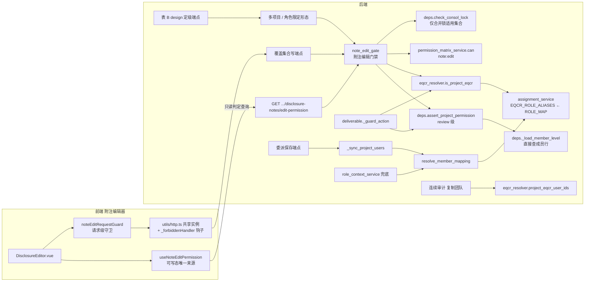
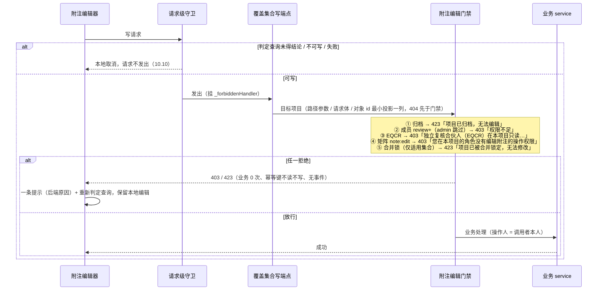
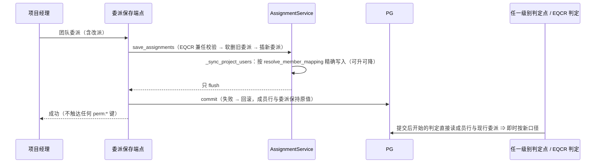

# 设计文档：合伙人与经理的编辑权限（partner-manager-edit-permission）

> 工作流：Requirements-First（feature）。需求见同目录 `requirements.md`；Q1–Q7 与细化时补的全部默认口径一律按「默认」执行，本文不改需求。
> 现读基线：只读参考 worktree `D:\wt_pm_ref` = `origin/spec/disclosure-note-doc-upload-and-batch-fill` @ `c6f14d5eb`（工作树干净）。主工作树与 origin 分叉，**本文引用的代码现状一律以该参考树为准**。
> 文中计数是 2026-10-19 现算快照，只作对账参照，**禁止写进判据**；实施时重算，差异在验收记录逐条说明（需求 12.14）。

## Overview

本 spec 落两条用户指令：

1. 附注编辑器的写端点逐个改走统一的**附注编辑门禁**：本项目 review 及以上成员可写，EQCR 只读，操作矩阵 `note:edit` 照常判定，原先判合并锁的 13 个端点继续判合并锁。
2. `ROLE_MAP` 把合伙人（含签字合伙人）和经理升为 edit 级，全平台生效；质控、EQCR 保持 review。

为让两条指令「真生效、可验证、不留旧权限」，设计同时收口现读确认的配套缺陷：权限缓存读路径恒未命中、两份委派角色映射、委派同步只升不降、EQCR 判定漏中文别名、前端可写态按全局角色推断、附注写端点只校验登录、连续审计复制把 EQCR 变成普通成员。

### 1.1 设计要点

| # | 要点 | 主要落点 |
|---|------|---------|
| 1 | `ROLE_MAP` 是唯一的「委派角色 → 项目角色与级别」映射；EQCR / 合伙人经理别名集合由它推导；新增纯函数 `resolve_member_mapping` 统一多委派合并口径 | `assignment_service.py`、`role_context_service.py` |
| 2 | 新设附注编辑门禁模块，三种挂载形态（路径依赖 / 函数体 / 对象 id 反查）共用一个判定实现 | 新增 `services/note_edit_gate.py` |
| 3 | 新设单一 EQCR 判定：全局角色 `eqcr` ∪ 本项目 EQCR 别名现行委派；不经任何缓存，出错即拒绝 | 新增 `services/eqcr_resolver.py` |
| 4 | 🔴 **移除权限缓存**，级别判定点一律直接查成员行（裁定 D3） | `deps.py`、`ownership_guard.py` |
| 5 | 委派同步按映射精确写入（可升可降）；级别回填迁移 V198 / R198 带回填记录表，可往返、幂等 | `assignment_service.py`、`backend/migrations/` |
| 6 | 两份清单（附注写端点清册、edit 级影响清单）由正式生成脚本现算，带检查模式与内置自检，随后端测试守卫 | 新增 `backend/scripts/gen/` 两脚本 + 共享包 |
| 7 | 判定查询端点 + 前端可写态单一来源 + 请求级守卫，前端不再按全局角色推断 | 新增路由、`views/composables/noteEdit/` |
| 8 | 表 B 26 个仅登录写端点全部补项目级判定（逐个裁定，§4.8） | 9 个附注路由文件 |
| 9 | 连续审计复制团队跳过上年 EQCR 并在响应与界面提示 | `continuous_audit_service.py`、`DetailProjectPanel.vue` |

### 1.2 现状确认（设计前现读 + 实测）

需求 F1–F16 逐条复核成立；下表只列**本设计新增的确认与发现**（N 编号供后文引用）。

| # | 事实 | 怎么确认的 |
|---|------|-----------|
| N1 | 🔴 权限缓存**只写不读**：`redis_client = from_url(..., decode_responses=True)` 取回 `str`，`_get_cached_permission` 对它调 `.decode()` 抛 `AttributeError` 被吞、返回 `None`。每次判定都查库，另白付一次 GET + 一次 SETEX | 实测：参考树代码 + 本地 Redis 7，`_set_cached_permission(u,p,"edit")` 后原始 GET 得 `str 'edit'`，`_get_cached_permission` 得 `None`（探针放仓库外，已清理测试键）。需求 5.7 的推断属实 |
| N2 | `OwnershipGuard._can_access_project` 的「缓存命中即放行」快路径同样从未命中；`authorize_wp_edit` / `authorize_wp_read` 与 `assert_project_permission` 读写同一键 `perm:{user}:{project}`，都经 `_get_cached_permission` | 现读 `deps.py`、`custom_query/ownership_guard.py`；全仓 grep 无第五处读写该键 |
| N3 | `role_context_service` 两处委派兜底按 `scalar()` 只取用户**第一条**人员库记录；真库 2 名用户有多条人员库记录（最多 103 条）⇒ 经其余记录的委派兜底失效 | 现读 + 真库只读查询 |
| N4 | `_sync_project_users` 按 `StaffMember.id` 取 `user_id`，不看人员库记录 `is_deleted` | 现读 |
| N5 | `require_operation` 拒绝时 detail 是 `{"error_code": "OPERATION_NOT_ALLOWED", "operation": ...}`，没有中文原因 | 现读 `deps.py` |
| N6 | 前端全局拦截器对 403 一律弹「权限不足，无法执行此操作」，不显示后端原因；带 `_silent` 的请求跳过全部提示与 5xx 自动重发；GET 去重会取消同键的先发请求 | 现读 `utils/http.ts` |
| N7 | `useWorkpaperAutoSave.doSave` 失败后**立即重发一次**，不区分 403 / 423 | 现读 |
| N8 | 🔴 `note_templates.py` 5 个全局附注模板写端点（含 `validate`）无任何鉴权依赖；`main.py` 的 `FastAPI()` 无全局依赖，已注册的 10 个中间件都不做鉴权，路由注册也不附加依赖 ⇒ **未登录即可增删改全局附注模板** | 现读 `main.py`、`middleware/*`、`router_registry/report.py`（登记风险 R3） |
| N9 | `NoteGroupBaselineDialog` 的「保存为基线」把 `project_id` 放在请求体，后端要求查询参数 ⇒ 现状 422；同组件 `GET /api/group-note-baselines/diff` 后端不存在 | 现读（只登记，进清册表 C / 风险 R8） |
| N10 | 真库迁移现状：`schema_version` 最高已应用 `197`（并发会话的 V197 已落本地库），失败记录 0 ⇒ 本 spec 迁移号写作时取 **V198**，实施时按需求 4.1 再现扫 | postgres MCP 只读查询 |
| N11 | 回填 SQL（§5.2）对真库只读预演：改动 86 行 = 现行项目 2 行（admin，manager+review → manager+edit）+ 已软删测试项目 84 行（auditor+readonly → manager+edit），EQCR 规则 0 行，与 F13 一致 | postgres MCP 只读执行 §5.2 的 `targets` CTE |
| N12 | 附注 26 个路由文件写端点 101 个，按需求 1.2 先后归类：S 1 / C 28 / G 2 / E 27（表 A 24 + `account_note_mapping` 3）/ R 11 / X 1 / I 31（表 B 26 + `note_templates` 5） | 一次性 AST 探针（仓库外，已删）；正式口径由清册脚本固化 |
| N13 | 运行时路由表：`app.router_registry` 五个注册函数共 2489 条 `APIRoute`；导入一次约 15 秒 | 探针实测（只读） |
| N14 | RLS 只覆盖 `working_paper` / `adjustments` / `tb_balance` / `review_records`；附注表无 RLS ⇒ 多项目判定后 RLS 上下文落在哪个项目不影响附注写入 | 现读 `V005__enable_rls.sql` |

## 2. 裁定一览

| # | 裁定 | 理由（要点） | 备选与切换点 |
|---|------|-------------|-------------|
| D1 | 附注编辑门禁放新模块 `app/services/note_edit_gate.py`，提供 3 个挂载形态（`require_note_edit_access` 路径依赖 / `assert_note_edit_access` 函数体 / `assert_note_edit_access_for_object` 对象反查）+ 2 个 design 定级形态（`assert_note_edit_access_on_projects` 多项目 / `assert_note_role_access` 角色限定）；合并锁由**必填**关键字参数 `consol_lock` 以字面量声明 | 门禁被 9 个路由文件复用，放 router 里会形成横向依赖；`consol_lock` 必填字面量让清册能静态读出「是否判合并锁」（需求 1.8、6.6） | 若并发会话新增附注路由，只需挂同一门禁 |
| D2 | 单一 EQCR 判定放新模块 `app/services/eqcr_resolver.py::is_project_eqcr(db, user, project_id)`；别名集合 `EQCR_ROLE_ALIASES` 在 `assignment_service.py` 由 `ROLE_MAP` 推导；判定不经缓存、出错即抛 | 需求 7.1–7.3、7.6、7.9；推导而非复制满足 7.2 | `_is_user_eqcr_on` 保留给正向授权（7.7），不改 |
| D3 | 🔴 **移除权限缓存**（读、写、失效三函数与 `PERM_CACHE_TTL`），级别判定点一律直接查成员行 | 见 §2.1 ROI；N1 实测缓存从未命中 ⇒ 移除不增加数据库负载 | 将来要缓存须以数据库版本戳为准重设计（R6） |
| D4 | 委派同步：按 `resolve_member_mapping` 精确写入（可升可降）；人员库记录已删除视同未关联登录用户（跳过） | 需求 3.1–3.9；跳过已删除记录与「现行委派」术语、EQCR 判定、回填迁移同口径（N4） | 备选：沿用不看 `is_deleted`（会出现「同步写 review、EQCR 判定却不认」的独立性缺口） |
| D5 | 级别回填迁移 `V198__partner_manager_edit_level_backfill.sql` + `R198__...`；回填记录表 `project_user_level_backfill`；单条数据修改型 CTE 完成「记录 + 改写」 | 需求 4；迁移执行器整文件一个事务（现读 `_apply_migration`），失败整体回滚并记失败表 | 号段被占时顺延，提交前再核（需求 4.1） |
| D6 | 两个正式生成脚本 `backend/scripts/gen/gen_note_write_inventory.py`、`gen_edit_level_impact_inventory.py` + 共享包 `backend/scripts/gen/authz_inventory/`；产物 `backend/data/authz/*.json`；端点注册信息取**运行时路由表**（五个注册函数各建一次空 app），函数级识别用 AST | 注册循环里有运行期条件（`workpaper.py` 的 `dedicated_wp_gate`），纯静态解析不了；AST 保证「注释 / docstring 不计」 | 运行时导入约 15 秒（N13），守卫测试按子进程计时预算 |
| D7 | 表 B 26 个写端点逐个定门禁（§4.8）：17 个纳入附注编辑门禁（B1 5 + B2 7 + B3 5），9 个 design 定级（B2 4 + B3 5） | 需求 8.1–8.3 | — |
| D8 | 判定查询端点 `GET /api/projects/{project_id}/disclosure-notes/edit-permission`，新路由文件 `note_edit_permission.py` 在 `router_registry/report.py` 注册 | 需求 10.1；路径避开 `/api/disclosure-notes/{project_id}/{year}` 的匹配 | — |
| D9 | 前端：新 composable `useNoteEditPermission` 是可写态唯一来源；请求级守卫装在共享 `http` 实例上，非可写态拦下覆盖集合写请求；`http.ts` 只加一个通用钩子 `_forbiddenHandler` | 需求 10；把「入口禁用」与「请求不发出」分成两层，程序触发与自动触发也拦得住 | — |
| D10 | 连续审计复制在**同一事务**内先判上年 EQCR、再复制；判定出错不吞，整单失败 | 需求 11；现读确认服务只 flush、路由统一 commit | — |
| D11 | 端点级测试共用一个真库夹具「权限世界」（SQLite 内存库建 6 张表，PG 版同构），只替换当前用户、RLS 设置、业务 service；EQCR 观测用例不替换委派查询 | 需求 12.1 | — |
| D12 | 缓存移除后需求 3.6、5.4、5.5、5.7、12.5④ 的前提不再出现，按 §2.2 改为「不读写缓存」的等价判据，并在验收记录写明本裁定 | 需求 12.5④、12.8 已为移除留口 | 用户若要求保留缓存，回到 §2.1 方案 A |
| D13 | 门禁拒绝文案集中为模块常量，判定查询端点与门禁共用同一取原因函数 | 需求 6.4/6.5/6.12、10.1「原因逐字相同」 | — |

### 2.1 权限缓存裁定（需求 5.7 要求先裁定）

| 方案 | 改动面 | 收益 | 风险 | 对 6000 并发目标 |
|------|-------|------|------|-----------------|
| A 修复读路径、保留缓存 | 读函数改按 `str` 取值；为满足 5.2（在途判定回写旧级别、跨重启残留、失效失败、命令行执行迁移）必须引入**以数据库为准的版本戳**，每次判定先读版本再比缓存；迁移脚本触达不了 Redis ⇒ 启动后清扫；约 6 个生产文件 + 1 个新列或新表 | 省掉成员行查询，但版本戳本身就是一次同量级的点查 ⇒ 净收益约为 0 | 缓存**第一次真正生效**：300 秒陈旧窗口的全部风险面同时出现（降级不即时、改派 EQCR 后的独立性空窗）；Redis 客户端未配 socket 超时，网络黑洞时判定可能挂起 | 数据库读次数不减；Redis 往返仍为 2 次 |
| **B 移除缓存（采纳）** | `deps.py` 删 3 个缓存函数与常量，3 个级别判定点改走新的 `_load_member_level`；`ownership_guard.py` 删快路径；16 个测试文件去掉缓存替身（11 个是「返回未命中」的空替身，直接删；4 个借缓存注入级别的改用真库成员行；`test_phase8.py` 的 3 个缓存用例随缓存删除，§8.6） | 数据库负载与现状**完全相同**（N1：现状每次都查库）；每次判定少 2 次 Redis 往返；5.1–5.3、5.6 由结构保证；Redis 故障不再影响级别判定 | 若将来确需缓存，须按方案 A 带版本戳重做（R6） | 成员行查询命中唯一部分索引 `idx_project_users_project_user`，单行点查；与现状逐请求负载相同，且去掉了 Redis 热点 |

其他读同一键的位置（N2）在方案 B 下的处置：`authorize_wp_edit` / `authorize_wp_read` 与 `assert_project_permission` 共用 `_load_member_level`（只取 `permission_level` 一列，不经 ORM 身份映射，避免同一会话内读到陈旧对象）；`OwnershipGuard._can_access_project` 删除缓存快路径，直接走现有的「成员行 ∪ 现行委派」查询（该快路径从未命中，行为不变）。上线时 Redis 里残留的旧 `perm:*` 键无人读取，最多 300 秒后自然过期，不做清扫。

### 2.2 缓存移除后的需求适用性（D12）

| 需求 | 原前提 | 移除后的等价判据（写进测试与验收记录） |
|------|-------|----------------------------------|
| 3.6 / 5.4 | 委派保存后删受影响键；删除失败的告警与时效 | 不再有权限缓存条目；判据改为：委派保存端点**不读、不写、不删**任何 `perm:*` 键（替身 Redis 记录调用，断言为空），且提交后开始的判定即按新成员行（性质 6） |
| 5.5 | 只删受影响键 | 预置任意 `perm:*` 键（含受影响与不受影响的），委派保存后全部键与剩余 TTL 原样不变（并入性质 6） |
| 5.7 | 经缓存读写函数跑用例 + 命中对照 | 不适用：级别判定点不再有缓存。替代：扫描测试断言 `deps` 与 `ownership_guard` 不再定义、不再引用缓存函数，级别判定点源码不引用 Redis 客户端 |
| 12.1 | 可替换「权限缓存的存储」 | 该替换点消失；端点级测试只替换当前用户、归档守卫、RLS 设置、委派查询（非观测用例）、业务 service |
| 12.5④ | 删缓存失效的磁盘变异 | 不适用，验收记录写明本裁定；改做替代变异：在 `assert_project_permission` 前插入「读到 `perm:*` 键即按其级别放行」的旧逻辑，性质 6 的固定样例②须红在「应拒绝」 |
| 12.8 | 改写 `test_set_and_get_cache` | `TestPermissionCache` 三个用例随缓存删除；删除前先在改动前的树上把该用例收紧为「取回值 == "edit"」跑一次，须红在取回值断言（与 N1 实测互证），结果记入验收记录 |

## Architecture

### 3.1 模块关系



### 3.2 附注写请求的判定顺序



### 3.3 委派保存到判定生效



## Components and Interfaces

### 4.1 角色映射（`app/services/assignment_service.py`）

`ROLE_MAP` 改值（只改合伙人 / 经理五个键，其余原样）：

| 委派角色键 | 改动前 | 改动后 |
|-----------|-------|-------|
| `signing_partner` / `partner` / `合伙人` | (partner, review) | **(partner, edit)** |
| `manager` / `项目经理` | (manager, review) | **(manager, edit)** |
| `qc` / `质控` | (qc, review) | 不变 |
| `eqcr` / `独立复核合伙人` | (partner, review) | 不变 |
| `auditor` / `审计员` / `assistant` / `助理` | (auditor, edit) | 不变 |
| 其他任意字符串（含空串、大小写或首尾空白变体） | 未登记 → (readonly, readonly) | 不变（精确匹配，`dict.get`，不做 `strip` / `lower`） |

紧随 `ROLE_MAP` 新增（同一模块，均由 `ROLE_MAP` 推导，不写字面量副本，需求 7.2）：

```python
UNMAPPED_ROLE: tuple[ProjectUserRole, PermissionLevel] = (ProjectUserRole.readonly, PermissionLevel.readonly)
EQCR_ROLE_ALIASES: frozenset[str] = frozenset(
    k for k, v in ROLE_MAP.items() if v == (ProjectUserRole.partner, PermissionLevel.review))
PARTNER_MANAGER_ROLE_ALIASES: frozenset[str] = frozenset(
    k for k, (r, lv) in ROLE_MAP.items()
    if r in (ProjectUserRole.partner, ProjectUserRole.manager) and lv == PermissionLevel.edit)
_ROLE_TIEBREAK = (ProjectUserRole.partner, ProjectUserRole.manager, ProjectUserRole.qc,
                  ProjectUserRole.auditor, ProjectUserRole.readonly)
_LEVEL_RANK = {PermissionLevel.readonly: 0, PermissionLevel.review: 1, PermissionLevel.edit: 2}

def map_assignment_role(role: str) -> tuple[ProjectUserRole, PermissionLevel]:
    return ROLE_MAP.get(role, UNMAPPED_ROLE)

def resolve_member_mapping(roles: Iterable[str]) -> tuple[ProjectUserRole, PermissionLevel]:
    """同一用户在同一项目的一组委派角色 → 一组成员行取值，与先后顺序无关（需求 3.3、3.8）。"""
    roles = list(roles)
    if not roles:
        raise ValueError("resolve_member_mapping 需要至少一个委派角色")
    if any(r in EQCR_ROLE_ALIASES for r in roles):          # EQCR 优先，强制 (partner, review)
        return ROLE_MAP["eqcr"]
    mapped = [map_assignment_role(r) for r in roles]
    best = max((lv for _, lv in mapped), key=_LEVEL_RANK.__getitem__)  # 最高级别
    cands = {r for r, lv in mapped if lv == best}
    return next(r for r in _ROLE_TIEBREAK if r in cands), best     # 角色按固定先后取第一个
```

`ROLE_MAP["eqcr"]` 的取值本身由需求 2.5 的期望表钉住；`_ROLE_TIEBREAK` 覆盖 `ROLE_MAP` 可写出的全部项目角色（扫描测试断言二者集合相等，防止将来新增项目角色时 `next` 抛 `StopIteration`）。

### 4.2 角色上下文服务（`app/services/role_context_service.py`）

- 删除 `_ASSIGNMENT_ROLE_MAP`，两处兜底改为：按用户**全部**未删除人员库记录 JOIN 现行委派（修 N3），得到该项目的委派角色列表 → `resolve_member_mapping` → 以 `.value` 字符串返回（`role` / `permission_level`）。只有一条委派时等价于 `map_assignment_role(r)`（需求 2.3、2.4）。
- `get_global_context` 的委派补充条目同样改用 `resolve_member_mapping`；`effective_role` 按 `_ROLE_PRIORITY` 取最高（未改）⇒ 需求 2.8 的 `signing_partner` 样例得 partner，审计日志哈希链校验（`audit_logs._ALLOWED_PROJECT_ROLES` 含 partner）放行。
- `scope_cycles`：单条委派取其 `assigned_cycles`；多条时取 `assigned_at` 最早一条（与现状「取第一条记录」同向，不新增语义）。

### 4.3 委派同步（`AssignmentService._sync_project_users`）

```python
async def _sync_project_users(self, project_id, assignments) -> list[MemberChange]:
    staff_ids = {pa.staff_id for pa in assignments}
    linked = dict((await self.db.execute(
        select(StaffMember.id, StaffMember.user_id).where(
            StaffMember.id.in_(staff_ids), StaffMember.is_deleted == False,
            StaffMember.user_id.is_not(None)))).all())                 # D4：已删除 / 未关联 → 跳过（3.9）
    roles_by_user: dict[UUID, list[str]] = defaultdict(list)
    for pa in assignments:
        if (uid := linked.get(pa.staff_id)) is not None:
            roles_by_user[uid].append(pa.role)                       # 多份人员库记录 → 同一用户合并（3.8）
    changes = []
    for uid in sorted(roles_by_user, key=str):                       # 处理顺序与委派先后无关
        role, level = resolve_member_mapping(roles_by_user[uid])     # EQCR 强制 (partner, review)（3.3）
        row = (await self.db.execute(select(ProjectUser).where(
            ProjectUser.project_id == project_id, ProjectUser.user_id == uid,
            ProjectUser.is_deleted == False))).scalar_one_or_none()
        if row is None:
            self.db.add(ProjectUser(project_id=project_id, user_id=uid, role=role, permission_level=level))
            changes.append(MemberChange(uid, None, (role, level)))   # 新建（3.1，已删除行不动）
        elif (row.role, row.permission_level) != (role, level):
            changes.append(MemberChange(uid, (row.role, row.permission_level), (role, level)))
            row.role, row.permission_level = role, level             # 可升可降；范围 / 有效期不动（3.2）
    await self.db.flush()
    return changes
```

- 批次外用户与其他项目的成员行不在查询范围内，天然不动（3.4）；已删除成员行不查不改。
- `save_assignments` 仍只 flush、返回值不变；`_sync_project_users` 返回的 `MemberChange` 列表只用于 info 级日志与测试断言（不再有缓存失效）。router 在 `commit()` 成功后才返回成功（3.7：兼任校验失败已有 `rollback` + 409；写库 / 提交报错由 `get_db` 会话关闭回滚，返回失败响应）。
- 改派为 EQCR 的独立性：委派与成员行同事务落库，提交即生效；EQCR 判定读现行委派，不依赖成员行级别（§4.5）。

### 4.4 级别判定点（`app/deps.py`、`custom_query/ownership_guard.py`）

- 删除 `_get_cached_permission`、`_set_cached_permission`、`invalidate_permission_cache`、`PERM_CACHE_TTL`（D3）。
- 新增唯一的成员级别读取函数（只取一列，绕开 ORM 身份映射，读到的是语句开始时已提交的值）：

```python
async def _load_member_level(db: AsyncSession, user_id: UUID, project_id: UUID) -> str | None:
    level = (await db.execute(select(ProjectUser.permission_level).where(
        ProjectUser.project_id == project_id, ProjectUser.user_id == user_id,
        ProjectUser.is_deleted == False))).scalar_one_or_none()
    return level.value if level is not None else None
```

- `assert_project_permission`：归档守卫（不变）→ admin 跳过（不变）→ `_load_member_level` → 比较 → RLS（不变）；`authorize_wp_edit` / `authorize_wp_read` 的「缓存 → 查库」两段并为一次 `_load_member_level`，全局角色免查与 `WORKPAPER_WRITE` 能力判定原样保留（需求 9.6）。拒绝文案全部不变。
- `require_project_access` 与 `require_wp_edit_permission` docstring 删去「Redis 缓存」描述。
- `OwnershipGuard._can_access_project`：删除 `from app.deps import _get_cached_permission` 与缓存快路径，直接走既有 `_accessible_project_ids`。

### 4.5 EQCR 判定（新增 `app/services/eqcr_resolver.py`）

```python
async def is_project_eqcr(db: AsyncSession, user: User, project_id: UUID) -> bool:
    """本项目 EQCR ⇔ 全局角色为 eqcr ∨ 本项目有 EQCR 别名现行委派（需求 7.1）。不经缓存；出错直接抛。"""
    if user.role.value == UserRole.eqcr.value:
        return True
    return await _count_project_eqcr_assignments(db, user.id, project_id) > 0

async def _count_project_eqcr_assignments(db, user_id: UUID, project_id: UUID) -> int:
    """委派查询（下层取数点；测试只在「不观测 EQCR」的用例里替换它，故障注入也注在这里）。"""
    q = (select(func.count(ProjectAssignment.id))
         .join(StaffMember, ProjectAssignment.staff_id == StaffMember.id)
         .where(ProjectAssignment.project_id == project_id,
                ProjectAssignment.role.in_(sorted(EQCR_ROLE_ALIASES)),      # 精确匹配，VARCHAR(30) 区分大小写与空白
                ProjectAssignment.is_deleted == False,
                StaffMember.user_id == user_id, StaffMember.is_deleted == False))
    return int((await db.execute(q)).scalar() or 0)

async def project_eqcr_user_ids(db: AsyncSession, project_id: UUID) -> set[UUID]:
    """本项目持有 EQCR 别名现行委派的用户集合（连续审计复制用，与上式同一 WHERE 口径）。"""
```

- 两个函数共用一个私有的条件构造函数，保证委派口径只写一处；不 JOIN `projects` / `users` / `project_users` ⇒ 项目软删、人员状态、成员行级别与项目角色都不影响结论（7.1 细则）。
- 调用方：附注编辑门禁、交付中心门禁（`_guard_action` 删掉 `_is_project_eqcr`，改调本函数，7.3）、判定查询端点（10.1）。正向授权位置继续用 `EqcrWorkbenchService._is_user_eqcr_on`，不改（7.7）。
- 出错语义（7.6）：不 `try/except`；异常冒泡成 500，业务一次也没执行，`get_db` 会话关闭即回滚。

### 4.6 附注编辑门禁（新增 `app/services/note_edit_gate.py`）

模块常量（D13）：

```python
NOTE_EDIT_MIN_LEVEL = "review"
NOTE_EDIT_OPERATION = "note:edit"
REASON_FORBIDDEN = "权限不足"                                # assert_project_permission 现有文案，判定查询对拍用
REASON_EQCR_READONLY = "独立复核合伙人（EQCR）在本项目只读，不能编辑附注"
REASON_OPERATION_DENIED = "您在本项目的角色没有编辑附注的操作权限"
```

判定实现（唯一一份）：

```python
async def assert_note_edit_access(db, current_user, project_id: UUID, *, consol_lock: bool) -> User:
    await assert_project_permission(db, current_user, project_id, NOTE_EDIT_MIN_LEVEL)  # ①归档 423 ②成员 403（admin 跳过）
    is_eqcr = await is_project_eqcr(db, current_user, project_id)                       # ③
    if is_eqcr:
        raise HTTPException(403, {"error_code": "NOTE_EDIT_EQCR_READONLY", "message": REASON_EQCR_READONLY})
    project_role = await _resolve_project_role(db, current_user.id, project_id)          # ④ 并集口径
    if not can(current_user.role.value, project_role, NOTE_EDIT_OPERATION):
        raise HTTPException(403, {"error_code": "NOTE_EDIT_OPERATION_DENIED", "message": REASON_OPERATION_DENIED})
    if consol_lock:                                                                      # ⑤ 仅合并锁适用集合
        await check_consol_lock(project_id=project_id, db=db)
    return current_user
```

挂载形态（覆盖集合内端点只用这三种之一，且门禁调用不在条件分支 / 异常处理里、先于一切业务调用）：

| 形态 | 签名 | 目标项目 | 用于 |
|------|------|---------|------|
| 路径依赖 | `require_note_edit_access(*, consol_lock: bool) -> Callable`，内层 `(project_id: UUID, current_user=Depends(get_current_user), db=Depends(get_db))` | 路径参数 | 路径含 `{project_id}` 的端点（多数） |
| 函数体 | `assert_note_edit_access(db, current_user, project_id, *, consol_lock)` | 调用方传入（请求体字段 / 路径参数） | `generate`（请求体）与 A3–A5（沿用函数体写法，改动最小） |
| 对象反查 | `assert_note_edit_access_for_object(db, current_user, *, id_column, project_column, object_id, not_found_detail, consol_lock) -> UUID` | 先 `select(project_column).where(id_column == object_id)` 一列；不存在 → 404 `not_found_detail`；再调判定实现 | `update_note`（`DisclosureNote.id`，「附注章节不存在」）、`confirm_finding`（`NoteValidationResult.id`，「校验结果不存在」） |

对象反查形态不读调用方另附的任何项目标识（6.8）；它把「最小投影一列 → 鉴权」的顺序封装在门禁模块内，端点体内门禁之前 0 次读。

design 定级形态（只给表 B 中 §4.8 声明的端点用，清册把它们识别为独立门禁形态，不计入「挂载附注编辑门禁」）：

| 形态 | 语义 |
|------|------|
| `assert_note_edit_access_on_projects(db, current_user, project_ids, *, consol_lock)` | 去重保序后对每个项目调判定实现，收集 403 / 423；任一失败整单拒绝：有 403 → 403，否则 423；中文 message 列出未通过的项目 id，`detail.project_ids` 给出清单；其他异常原样冒泡。全部通过后把 RLS 上下文重设为首个项目（N14：附注表无 RLS，仅保持可预期） |
| `assert_note_role_access(db, current_user, project_id, *, project_roles: frozenset[str], denied_message: str)` | 先调判定实现（含 EQCR 排除与矩阵）；admin 放行；否则成员行项目角色须属于 `project_roles`，不属于 → 403 `denied_message`。`project_roles` 为空集 = 仅 admin |

拒绝原因提取（门禁与判定查询共用，D13）：`note_edit_rejection_reason(exc: HTTPException) -> str` = `detail` 是字符串则原样；是 dict 则取 `message`。归档的 `detail.message` 为「项目已归档，无法编辑」，合并锁为字符串「项目已被合并锁定，无法修改」。

判定顺序与需求对应（6.13 模型即此表自上而下第一个成立的拒绝）：

| 步 | 条件 | 结论 | 需求 |
|----|------|------|------|
| 0 | 对象 id 端点对象不存在 | 404（沿用中文文案） | 6.8 |
| ① | 项目 `status == archived` | 423 `PROJECT_ARCHIVED`「项目已归档，无法编辑」（含 admin / 非成员 / EQCR） | 6.7 |
| ② | 非 admin，且无未删除成员行或级别为 readonly | 403「权限不足」 | 6.4 |
| ③ | `is_project_eqcr` 为真（admin 不豁免） | 403 `NOTE_EDIT_EQCR_READONLY` | 6.5、7.1 |
| ④ | 非 admin，`ROLE_OPERATIONS[全局] ∪ PROJECT_ROLE_OPERATIONS[项目角色]` 不含 `note:edit` | 403 `NOTE_EDIT_OPERATION_DENIED` | 6.12（Q1：矩阵不改） |
| ⑤ | `consol_lock=True` 且 `projects.consol_lock` 为真 | 423「项目已被合并锁定，无法修改」 | 6.6 |
| — | 以上都不成立 | 放行；业务以调用者本人为操作人 | 6.2、6.3 |

两处守卫的可伪证断言（6.10，按语法树）：`assert_note_edit_access` 在**函数体顶层语句序列**（不在 `if` / `try` / 循环内）调用 `assert_project_permission`，级别实参（第 4 个位置实参或 `min_permission=`）是值为 `"review"` 的同文件常量或字面量；且函数体调用 `is_project_eqcr`。契约守卫 `test_disclosure_notes_project_gate_contract.py` 与基线守卫 `test_project_endpoint_authorization_baseline.py` 各放一条，后者同时把 `require_note_edit_access`、`assert_note_edit_access`（前缀匹配覆盖 `_for_object` / `_on_projects`）、`assert_note_role_access` 登记进 `_PROJECT_LEVEL_TOKENS`。

### 4.7 覆盖集合端点改造清单（写作时 41 个）

覆盖集合 = 清册 E、I 两类中目标门禁为附注编辑门禁的端点（需求 1.9）= 表 A 24 + 表 B 中纳入附注编辑门禁的 17。改造同时删掉这些端点上原有的 `require_project_access(...)`、`require_operation("note:edit")`、`check_consol_lock`、`_assert_project_edit`、`_assert_validation_project_access`（6.1 第二项）。

| 端点（文件::函数） | 改动前 | 改动后 | 合并锁 | 项目来源 |
|-------------------|-------|-------|:-----:|---------|
| A1 `disclosure_notes::generate_notes` | `_assert_project_edit` | 函数体 | ✓ | 请求体 `project_id` |
| A2 `disclosure_notes::update_note` | 内联反查 + `_assert_project_edit` | 对象反查 | ✓ | `DisclosureNote.id` |
| A3–A5 `delete_section` / `patch_section` / `restore_section` | `_assert_project_edit` | 函数体 | ✓ | 路径 |
| A6 `pull_from_workpapers`、A7 `validate_notes` | `require_project_access("edit")` | 路径依赖 | ✗ | 路径 |
| A8 `confirm_finding` | `_assert_validation_project_access(edit)` | 对象反查 | ✗ | `NoteValidationResult.id` |
| A9–A12 `clear_formulas` / `restore_auto_mode` / `apply_formulas` / `upsert_note_formulas` | edit + `Depends(check_consol_lock)` | 路径依赖 | ✓ | 路径 |
| A13 `note_offline::execute_import` | `get_current_user` + `_=Depends(require_project_access("edit"))` | 路径依赖 | ✗ | 路径 |
| A14–A17 `note_text_batch` 四个写端点 | edit + `note:edit` + 合并锁三个依赖 | 路径依赖 | ✓ | 路径 |
| A18–A20 `note_content_templates` 三个写端点 | edit | 路径依赖 | ✗ | 路径 |
| A21–A23 `note_advanced` 三个写端点 | edit | 路径依赖 | ✗ | 路径 |
| A24 `note_wp_mapping::toggle_mode` | edit | 路径依赖 | ✗ | 路径 |
| B1 ×5（`note_custom_template` save / restore、`note_wp_mapping` 两个刷新、`group_note_baseline::apply_group_baseline`） | 仅登录 | 路径依赖 | ✗ | 路径（基线应用只判被写入项目，8.1） |
| B2 ×7（`note_wp_mapping` `update_mapping` / `refresh_all_bindings`、`note_trim` 两个、`note_custom_section` 三个） | 仅登录 | 路径依赖 | ✗ | 路径 |
| B3 ×5（章节锁 acquire / heartbeat、数据快照 snapshot、集团模板 save / detach） | 仅登录 | 路径依赖 | ✗ | 路径 |

- 合并锁适用集合 = 改造前清册中「现门禁含合并锁判定」的覆盖集合端点 = A1–A5、A9–A12、A14–A17（13 个）；新纳入的端点一律 `consol_lock=False`（6.6）。改造后由守卫测试把这 13 个（方法，完整路径）冻结为期望集合，与清册逐个比对。
- `note_custom_section::save_as_template` 的章节 id 在请求体：门禁按路径项目判定**之后**，再校验「章节属于路径项目」，不属于返回 404「附注章节不存在」（被拒调用者拿不到对象存在性，8.1 同理；越项目读他项目章节被堵上）。
- 被删的帮助函数：`disclosure_notes._assert_project_edit`、`_assert_validation_project_access`；`_assert_object_project_access` / `_assert_note_project_access` 只剩 `trace_cell`（读）使用，保留。`disclosure_notes.py` 的 `require_operation`、`check_consol_lock` 导入随之删除，文件净减行数。
- A6 / A7 / A9–A13 / A18–A24 与 B 类此前不判操作矩阵：改造后全局角色与项目角色都不含 `note:edit` 的成员由放行变拒绝（6.12 末项；F13 真库受影响 0 人）。

### 4.8 表 B 逐端点裁定（需求 8.1–8.3、8.5）

「前端调用」为设计期 grep 初核（全仓非测试源码），实施时以清册生成结果为准，差异逐条写进验收记录。

| 端点 | 写入什么 | 前端调用（初核） | 目标门禁 | 判定项目 | EQCR | 理由 |
|------|---------|----------------|---------|---------|:---:|------|
| B1 `POST /projects/{pid}/note-template/save` | 自定义附注模板新版本 | `useNoteCustomTemplate` 两处 | 附注编辑门禁 | 路径 | 拒 | 8.1 |
| B1 `POST /projects/{pid}/note-template/restore` | 同上（回滚产生新版本） | `StructureEditor.vue` | 附注编辑门禁 | 路径 | 拒 | 8.1 |
| B1 `POST /disclosure-notes/{pid}/{year}/refresh-from-workpapers` | 附注表格数据 | 编辑器刷新 / 恢复自动提数 / 底稿保存事件 | 附注编辑门禁 | 路径 | 拒 | 8.1 |
| B1 `POST /disclosure-notes/{pid}/{year}/{sec}/refresh-from-workpaper` | 本章表格数据 | `useNoteRefresh` | 附注编辑门禁 | 路径 | 拒 | 8.1 |
| B1 `POST /projects/{pid}/apply-group-baseline` | 子项目附注章节 | `NoteGroupBaselineDialog` | 附注编辑门禁 | 路径（不判基线母项目） | 拒 | 8.1 默认口径 |
| B2 `PUT /disclosure-notes/{pid}/wp-mapping` | 附注↔底稿取数映射（附注数据） | 未发现 | 附注编辑门禁 | 路径 | 拒 | 8.2 写附注数据 |
| B2 `POST /disclosure-notes/{pid}/{year}/refresh-all-bindings` | 附注表格（含公式二次求值） | 未发现 | 附注编辑门禁 | 路径 | 拒 | 8.2 |
| B2 `PUT /disclosure-notes/{pid}/sections/trim` | 裁剪状态 | `NoteTrimPanel.vue` | 附注编辑门禁 | 路径 | 拒 | 8.2 |
| B2 `POST /disclosure-notes/{pid}/{year}/auto-trim` | 裁剪状态 | 未发现 | 附注编辑门禁 | 路径 | 拒 | 8.2 |
| B2 `POST /projects/{pid}/notes/custom-sections/create` | 新附注章节 | 未发现 | 附注编辑门禁 | 路径 | 拒 | 8.2 |
| B2 `POST .../custom-sections/save-as-template` | 共享章节模板库（非附注数据） | 未发现 | 附注编辑门禁 + 章节归属校验（§4.7） | 路径；章节须属于路径项目 | 拒 | design 定级：发布模板的主体与编辑主体一致；同时堵住跨项目读章节 |
| B2 `POST .../custom-sections/apply-template` | 附注章节 | 未发现 | 附注编辑门禁 | 路径 | 拒 | 8.2 |
| B2 `POST /projects/{pid}/notes/conversion/preview` | 不落库（预览） | 未发现（`NoteTemplateSwitch` 调的是不存在的 `template-conversion/*`，表 C） | `require_project_access("readonly")` | 路径 | 放 | 只读计算；实施时现读确认不落库，若落库改按附注编辑门禁 |
| B2 `POST .../conversion/execute`、`/rollback` | 附注章节 **+ `projects.template_type`** | 未发现 | `assert_note_role_access(project_roles={partner, manager}, denied_message="仅本项目经理或合伙人可切换附注模板类型")` | 路径 | 拒 | 8.2 允许更严：模板类型影响报表口径，质控 / 审计员不宜改 |
| B2 `POST /api/group-note-baselines?project_id=` | 共享集团基线（读来源项目附注） | `NoteGroupBaselineDialog`（现状把 `project_id` 放请求体 ⇒ 422，N9） | `assert_note_edit_access_on_projects([project_id])` | 查询参数（来源项目） | 拒 | 8.5：项目不在路径；读来源项目附注并对外发布 |
| B3 `POST /projects/{pid}/notes/locks/acquire`、`/heartbeat` | 章节编辑锁 | 未发现（`NoteSectionLockBadge` 调的 `force-lock` 不存在，表 C） | 附注编辑门禁 | 路径 | 拒 | 持锁即编辑意图；不能编辑的人持锁会挡住真正的编辑者 |
| B3 `POST .../locks/release` | 释放**本人**的锁（service 按 user_id 过滤） | 未发现 | `require_project_access("readonly")` | 路径 | 放 | 降级后仍须能释放自己遗留的锁；只影响本人 |
| B3 `POST .../locks/force-release` | 释放他人锁 | 未发现 | `assert_note_role_access({manager, partner}, "仅本项目经理或合伙人可强制释放章节锁")` | 路径 | 拒 | 落实 docstring「项目经理」；合伙人在项目内职级高于经理一并放行（若要严格只经理，把 `partner` 从集合去掉即可） |
| B3 `POST /projects/{pid}/data-lock/lock` | 报表附注签字锁定 | 未发现 | `assert_note_role_access({partner, manager}, "仅本项目经理或合伙人可锁定报表附注数据")` | 路径 | 拒 | 锁定是签字收尾动作 |
| B3 `POST .../data-lock/unlock` | 解除锁定（需原因） | 未发现 | `assert_note_role_access(frozenset(), "仅管理员可解除报表附注数据锁定")` | 路径 | 拒 | 落实 docstring「管理员」；含项目级判定（归档 423） |
| B3 `POST .../data-lock/snapshot` | 版本快照 | 未发现 | 附注编辑门禁 | 路径 | 拒 | 编辑过程的版本留存 |
| B3 `POST /projects/{pid}/notes/group-template/save` | 共享集团模板（读本项目结构） | 未发现 | 附注编辑门禁 | 路径 | 拒 | 同 save-as-template |
| B3 `POST .../group-template/distribute` | **每个目标项目**的附注 | 未发现 | `assert_note_edit_access_on_projects([pid, *target_project_ids])` | 路径 + 请求体每个目标 | 拒 | 8.5：整单拒绝，错误信息列未通过项目 |
| B3 `POST .../group-template/detach` | 本项目与集团模板的继承关系 | 未发现 | 附注编辑门禁 | 路径 | 拒 | 改本项目附注结构归属 |

- 「读取」类模板（集团基线、集团模板、章节模板库）不触发对来源项目的判定（8.5 第二项）；`apply-group-baseline` 不判基线母项目（8.1 默认）。
- 这些文件里的读方法端点（`wp-mapping` GET、`note-template` GET、`locks/active` 等）档位保持不变（8.4 默认口径）。

### 4.9 交付中心门禁（`app/routers/deliverable.py::_guard_action`）

```python
await assert_project_permission(db, user, project_id, "readonly" if action in READ_ACTIONS else "review")
is_eqcr = await is_project_eqcr(db, user, project_id)          # 原 _is_project_eqcr（只认 'eqcr' 委派）删除
if not can_deliverable(user.role.value, action, task_status=task_status, is_eqcr_assignment=is_eqcr):
    raise HTTPException(status_code=403, detail="权限不足")
```

- 结论变化只有两类：以 `独立复核合伙人` 委派的人写操作由放行变拒绝（7.4）；全局角色 `eqcr` 的人此前已被 `can_deliverable` 的角色集合（`AUDITOR_PLUS` 不含 eqcr）拒绝写、放行读，改后 `is_eqcr=True` 结论相同（7.3 第三项）。
- docstring 改写：删去「合伙人 / 经理 / 质控 / EQCR 在项目里是 review 级」，改为「review 门禁放行 review 级的质控与 EQCR 的读与非写动作；合伙人 / 经理为 edit 级同样满足」（2.6）。`deliverable.py` 净减约 5 行（1949 → ≈1944，上限 1979）。
- 可伪证断言（7.3）：函数体调用 `is_project_eqcr`，且不含与字面量 `"eqcr"` 的比较。

### 4.10 判定查询端点（新增 `app/routers/note_edit_permission.py`）

```python
router = APIRouter(prefix="/api/projects/{project_id}/disclosure-notes", tags=["note-edit-permission"])

@router.get("/edit-permission")
async def get_note_edit_permission(project_id: UUID, db: AsyncSession = Depends(get_db),
                                   current_user: User = Depends(require_project_access("readonly"))):
    is_eqcr = await is_project_eqcr(db, current_user, project_id)        # 一律给出（10.1）
    try:
        await assert_note_edit_access(db, current_user, project_id, consol_lock=False)  # 同一判定函数
    except HTTPException as exc:
        if exc.status_code in (403, 423):
            return {"can_edit": False, "reason": note_edit_rejection_reason(exc), "is_eqcr": is_eqcr}
        raise
    return {"can_edit": True, "reason": None, "is_eqcr": is_eqcr}
```

- 自身鉴权 readonly 级：readonly 判定跳过归档守卫，故已归档项目照常返回「不能编辑 + 归档原因」而不是 423；非成员 → 403「权限不足」（前端视同不能编辑）。
- 合并锁不参与（`consol_lock=False`，10.1 默认口径）；其他异常（含 EQCR 判定出错）冒泡为失败响应，不返回「能编辑」。
- 在 `router_registry/report.py` §106 之后注册；FastAPI 不热加载 router ⇒ 实测前全量重启。
- 可伪证断言（10.1）：函数体调用 `assert_note_edit_access` 与 `is_project_eqcr`；除签名里的 `require_project_access("readonly")` 外不调用 `assert_project_permission`，不查委派表，不与 `"eqcr"` 比较。

### 4.11 连续审计复制团队（`continuous_audit_service.create_next_year` 第 4 步）

```python
if copy_team:
    skip = await project_eqcr_user_ids(db, prior_project_id)     # 出错不吞 ⇒ 整单失败（11.5）
    rows = 上年未删除成员行
    copied = [u for u in rows if u.user_id not in skip]           # 原样复制角色 / 级别 / 循环 / 科目，不复制有效期
    skipped = len(rows) - len(copied)
    items_copied["team_assignments"] = len(copied)
    items_copied["team_skipped_eqcr"] = skipped
    if skipped:
        notices.append(f"已跳过 {skipped} 名成员：独立复核合伙人需在新项目重新委派")
```

- 响应顶层新增 `notices: list[str]`（无跳过时为空列表；`copy_team=False` 时不含 `team_skipped_eqcr` 且 `notices` 不含该提示）。只看上年项目现行委派，全局角色 `eqcr` 但无 EQCR 委派的成员照常复制（11.1 默认）。
- 事务边界（现读确认）：service 只 flush，路由在成功后 `commit`；判定查询抛错时路由未 commit，`get_db` 会话关闭回滚 ⇒ 新项目、科目映射、成员行全部不生效，重试不会撞「下年项目已存在」（11.5）。
- 前端 `DetailProjectPanel.vue`：保留现有成功提示与跳转；`items_copied.team_skipped_eqcr >= 1` 时追加 `ElNotification({ type: 'warning', title: '团队复制提示', message: notices[0], duration: 0 })`（挂在 body 上，跳转项目向导后仍显示，手动关闭，11.4）。文案用纯字符串，不用 `h()`。

### 4.12 两份清单的生成脚本（需求 1、9.1、9.8、12.12）

| 项 | 附注写端点清册 | edit 级影响清单 |
|----|---------------|----------------|
| 脚本 | `backend/scripts/gen/gen_note_write_inventory.py` | `backend/scripts/gen/gen_edit_level_impact_inventory.py` |
| 产物 | `backend/data/authz/note_write_inventory.json` | `backend/data/authz/edit_level_impact_inventory.json` |
| 人工输入 | `backend/data/authz/note_write_target_declarations.json`（逐条目标门禁声明 + 理由） | 无 |
| 扫描范围 | `backend/app/routers/` **直接子文件**中匹配 `note*` / `*note*` / `disclosure*` 的 `.py`（去重）；前端 `audit-platform/frontend/src/` 非测试源码 | `backend/app/` 下全部 `.py`（递归，不含测试） |
| CLI | `[--check] [--out PATH] [--root REPO]` | 同左 |

共享包 `backend/scripts/gen/authz_inventory/`（无 `_` 前缀 = 正式工具；按职责拆模块，单文件不超 800 行）：

| 模块 | 职责 |
|------|------|
| `routes.py` | 运行时路由表：把 `--root` 的 `backend` 放到 `sys.path[0]`，对 `app.router_registry` 的五个 `register_*_routers` 各建一个空 `FastAPI()` 调一次，收集每条 `APIRoute` 的（方法，完整路径，端点函数所在文件与函数名，路由与注册附加的依赖，所属注册分组）；扫描文件中有路由装饰器但不在表里的端点记「未注册」 |
| `gates.py` | 门禁登记表 + AST 识别器：签名参数默认值（不论参数名，含 `_`）里的 `Depends(...)`、装饰器 / 路由器 `dependencies=`、注册附加依赖、函数体调用（含同文件辅助函数的间接调用，标注辅助函数名与「条件执行」）；级别取字面量或同文件常量；注释 / docstring / 其他字符串一律不计（只认 `ast.Name` / `ast.Attribute` 调用节点） |
| `frontend.py` | 附注编辑器 import 传递闭包与写方法调用扫描（见下） |
| `classify.py` | 需求 1.2 的 S → C → G → E → R → X → I 归类与 1.9 目标门禁合并 |
| `render.py` | 确定性 JSON：键排序、条目按（文件，完整路径，方法）排序，`ensure_ascii=False`、`indent=2`、末尾换行；不含时间、机器名、绝对路径、行号 |
| `selfcheck.py` | 内置合成样例与期望结果（需求 1.6、9.8），每次生成 / 检查前先跑 |

门禁登记表（`gates.py`，未登记的 `Depends(X)` 一律报「未识别依赖」并失败，需求 1.7）：

| 识别名 | 类别 | 级别来源 | 叠加信息 |
|-------|------|---------|---------|
| `require_project_access`、`assert_project_permission`、`require_project_permission`（固定 review） | 项目级 | 实参（字面量 / 同文件常量；经同文件辅助函数参数传入的按调用方逐个记录） | — |
| `authorize_wp_edit`、`require_wp_edit_permission`（固定 edit）、`authorize_wp_read`（固定 readonly） | 项目级（按底稿反查） | 固定 | 全局 admin / partner 免查；`WORKPAPER_WRITE` 能力 |
| `_assert_project_edit`（改造后消失）、`_assert_note_project_access`、`_assert_object_project_access`、`_assert_validation_project_access` | 项目级（对象反查） | 实参 / 默认值 | — |
| `require_note_edit_access`、`assert_note_edit_access`、`assert_note_edit_access_for_object` | **附注编辑门禁** | 固定 review | EQCR 排除、`note:edit`、`consol_lock` 字面量 |
| `assert_note_edit_access_on_projects`、`assert_note_role_access` | design 定级门禁 | 固定 review | 多项目 / 角色集合 |
| `_guard_action` | 交付中心门禁（G） | 按动作 | EQCR 只读 |
| `require_operation` | 操作矩阵 | — | 权限点 |
| `check_consol_lock` | 合并锁 | — | — |
| `require_role` | 全局角色（X） | — | 角色名单 |
| `get_current_user`、`get_current_user_sse` | 仅登录 | — | — |
| `get_db`、`get_sync_db`、`get_redis`、请求参数类（`Query` / `Path` / `Body` / `Header` / `File` / `Form`）等 | 中性依赖 | — | 实施时按现扫补全，逐个登记 |

清册生成流程（`gen_note_write_inventory.py`）：

1. 自检：`selfcheck.py` 的样例全部按期望归类（需求 1.6 列出的 9 个样例，含「挂载未登记依赖 → 报未识别」），任一判错 → 中文列出样例名 / 期望 / 实际，退出码 1，不写文件。
2. 端点：运行时路由表 ∩ 扫描文件；一个函数多条路由 / 多方法各记一条；未注册的标「未注册」。
3. 现门禁：按登记表识别全部项目级判定，最高级别 + 逐项列出矩阵权限点、合并锁、全局角色、仅登录判定（1.8）。
4. 归类：S（只 `raise` 410/501 且签名无 db / 上传 / 后台任务）→ C（`consol_` 前缀文件）→ G → E（附注编辑门禁或最高级别 edit / review）→ R → X → I（1.2）。
5. 目标门禁：E 默认附注编辑门禁，G / R / S / C / X 默认保持现门禁，I 无默认；与默认不同的取 `note_write_target_declarations.json` 中的声明（`target` ∈ `note_edit_gate` / `design_gate`（附门禁名、参数、判定项目来源、EQCR 是否放行）/ `keep_current` / `pending_design_review`，必带 `reason`）。本 spec 完成时 I 类 26 个表 B 端点无 `pending_design_review`，`note_templates.py` 5 个与 `account_note_mapping.py` 3 个声明 `keep_current`（理由指向范围外条目）。每条标注「现门禁已等于目标门禁」。
6. 前端调用点（1.3、1.4，`frontend.py`）：
   - 范围：`src/views/DisclosureEditor.vue` 的 import 传递闭包（静态 `import` / `export … from` / 字面量动态 `import()`；`@/` → `src/`；补 `.ts` / `.vue` / `/index.ts`；排除 `__tests__`、`*.spec.*`、`*.test.*`；`.vue` 只扫 `<script>` 块）。
   - 调用形态：`api` / `http` / `axios` 的 `post|put|patch|delete(...)`（客户端标识按 import 来源确认）；URL 为字符串字面量、模板字符串（`${}` = 插值段）、`apiPaths` 路径常量（解析 `services/apiPaths/*.ts` 的对象字面量与箭头函数返回的模板字符串）、`+` 拼接；同模块内「函数体恰含一个写请求」的导出函数登记为封装函数，范围内调用它的位置为调用点。
   - 匹配：方法相同 + 去查询串后逐段对应（插值段对任一段；`{x:path}` 对一段及以上）；多个命中取字面段最多者，仍并列全列出并标「歧义」。
   - 未命中扫描端点的平台后端写调用：与全部已注册路由比对分入表 C（路径不存在 / 方法不符注明现有方法）、表 D（命中扫描范围外的已注册端点，记文件与现门禁）、未解析（方法或路径无法静态确定，逐个列位置）；绝对地址与其他服务请求不计。
   - 调用点键 = `文件#外层函数名#METHOD 路径模板#序号`（同函数同键按出现先后编号），不含行号。
7. 校验（1.5）：类别计数和 = 写端点总数；（方法，完整路径）唯一；范围内写调用数 = 命中 + 表 C + 表 D + 未解析；每条非默认声明都对应现存写端点。任一不成立、扫描文件数或写端点数为 0、文件无法解析、出现未登记依赖 / 级别无法静态确定 / 不支持的路由声明写法、某端点无法归类 → 中文逐项报错，退出码 1，不写文件，已提交文件不动（1.7）。
8. 输出：生成模式写 `--out`（默认产物路径）；检查模式不写任何文件，逐条比对（方法、完整路径、文件与函数、现门禁、类别、目标门禁、调用点、表 C / D / 未解析），不一致或产物缺失 → 中文列出新增 / 消失 / 变化，退出码 2；一致 → 打印「附注写端点清册与仓库现状一致」，退出码 0（1.10，沿用本仓 `--check` 漂移 exit 2 的约定）。

影响清单（`gen_edit_level_impact_inventory.py`，9.1、9.8）：同一识别器扫 `backend/app/` 全部文件，记录 edit 级**门禁调用点**（每处调用或依赖挂载一处；门禁定义不计；门禁内部固定级别的调用记「门禁内部」）与**直接比较位置**（属性访问或 `getattr` 字面量读取成员行 `permission_level` 并以比较结果拒绝请求；按调用方逐个记录实际级别，只有 edit 计入合计）；展示 / 同步 / 复制用途的读取列附录（写作时：角色上下文、委派同步、连续审计复制）。每条记录文件、函数、形态、级别、条件执行、所门禁端点（方法 + 完整路径；路由器 / 注册依赖记该路由器全部端点；同文件辅助函数记全部调用方端点）、业务域（五个注册分组 / 未注册 / 门禁内部）、叠加判定、是否属附注编辑门禁覆盖集合（读清册产物）。按业务域给小计与合计。自检样例为需求 9.8 所列 10 项；失败条件、检查模式与退出码同上。

守卫测试 `backend/tests/test_authz_inventories_check_mode.py`：子进程（`env` 传 `PYTHONIOENCODING=utf-8`，`errors="replace"` 解码后断言无替换字符）分别跑两脚本 `--check`，同时断言退出码 0 与输出含中文结论；再各以 `--out` 写两次临时文件，断言与已提交产物逐字节相同（12.12）。运行时导入约 15 秒（N13），本测试预计 60–90 秒；**不加任何跳过或慢测排除标记**，随全量后端测试执行（否则需求 12.12 的「后端测试套件运行时」不成立）。

### 4.13 前端（需求 8.7、10）

新增目录 `audit-platform/frontend/src/views/composables/noteEdit/`：

| 文件 | 职责 |
|------|------|
| `useNoteEditPermission.ts` | 可写态**唯一来源**：对当前项目发判定查询，输出 `status`（`pending` / `ok` / `failed`）、`decision`（`canEdit` / `reason` / `isEqcr`）与派生值 `canWrite`、`canWriteLocked`、`showReadonlyBadge`、`showNonEqcrEntries`、`disabledReason`，以及 `ready()`（等到当前项目得出结论或失败）、`markRejected()`、`refresh()` |
| `noteEditPresentation.ts` | 纯函数模型 `presentEntry(state, entry)` → `{ operable, rendered, disabled, tooltip }`，即需求 10.11 的模型；组件与性质测试都调用它 |
| `noteEditRequestGuard.ts` | 请求级守卫：编辑器挂载时在共享 `http` 实例上装一对拦截器，卸载时卸下 |
| `noteEditCoverage.ts` | 覆盖集合（方法 + 路径模板）与章节拖拽排序路径；vitest 守卫与清册产物逐条相等 |
| `noteEditWriteEntries.ts` | 写入口清单：`{ id, label, trigger, lockConstrained, eqcrHidden, callPoints[] }`；入口元素带 `data-note-write="<id>"` |

判定查询与状态机（10.2、10.6）：

- `watch(projectId, refresh, { immediate: true })`。每次 `refresh` 先 `abort` 上一次（`AbortController`），序号递增；请求带 `_silent: true`、`_dedupe: false`（避开 GET 去重取消，N6）、`timeout: 15000`、`signal`。
- 只采用「项目 = 当前项目 且 序号 = 最新」的结论；被取消（去重 / 卸载 / 换项目）不算失败、不提示。
- 失败（403、其他失败响应、网络错误、超时、成功响应缺 `can_edit` 或 `is_eqcr`、不能编辑却无 `reason`）→ `status = failed`，恰好一条 `ElMessage.warning`：「无法确认编辑权限，已按只读打开」，403 时追加后端原因。
- `canWrite = status === 'ok' && decision.canEdit && !isArchived`；`canWriteLocked = canWrite && !forcedReadonly`（受多窗口锁约束的入口：编辑、两处保存、一键清除公式、正文批量写入三入口，10.3 默认）；`showReadonlyBadge = status === 'ok' && decision.isEqcr`；`showNonEqcrEntries = status === 'ok' && !decision.isEqcr`（未得结论或失败时按 EQCR 隐藏，10.8 默认）。
- `disabledReason` 只给一条当前成立的原因，优先级：未得结论「正在确认编辑权限…」→ 失败「无法确认编辑权限」（403 带原因）→ 判定不能编辑时后端 `reason` → 项目已归档「项目已归档，无法编辑」→ 多窗口锁「他人正在编辑，当前为只读」。

请求级守卫（10.7、10.10）：

- 请求拦截器（axios 请求拦截器后装先执行，先于 `http.ts` 自身的去重拦截器）：方法 + 路径命中 `noteEditCoverage` 且（`!canWrite` 或判定后被标记拒绝）→ 以 `axios.Cancel('note-edit-readonly')` 拒绝，请求不发出、不进去重表；`http.ts` 对取消不提示。命中但可写 → 在 config 上挂 `_forbiddenHandler`。
- `http.ts` 只加一个通用钩子：403 且 config 带 `_forbiddenHandler` 时调用它并跳过「权限不足，无法执行此操作」通用提示。423 仍走现有提示（合并锁定提示 + `consol-lock:detected`；归档提示）。
- `_forbiddenHandler`：同步 `markRejected()`（立刻视为不可写，同一操作尚未发出的后续请求被守卫拦下）→ 一条 `ElMessage.error(后端原因)` → `refresh()`；423 的响应拦截器分支同样 `markRejected()` + `refresh()`，不另弹提示。
- 不重发：`useWorkpaperAutoSave` 增可选 `shouldRetry(err)`（缺省恒真，其他页面行为不变）；编辑器传入「403 / 423 / 守卫取消 ⇒ 不重试」。

编辑器接线（`DisclosureEditor.vue`，行数基线 3281、上限 3445，现 3259；本次净增预计 < 20 行）：

- 删除 `authStore` 推断的 `isEqcrRole`、未使用的 `canOp` / `whyCannot`、`useAuditContext` 的 `canEdit` 解构；`effectiveCanEdit` 改为 `noteEdit.canWriteLocked`，原 `canEdit` 用处改为 `noteEdit.canWrite`；`📋 只读副本` 用 `showReadonlyBadge`；原 `v-if="!isEqcrRole"` 改 `v-if="noteEdit.showNonEqcrEntries"`；写入口 `:disabled` 与 `:title` 取 `presentEntry`。
- 子组件 / composable 同源（10.8）：`:draggable` 与 `useNoteTree` 新增的 `canWrite` 选项取 `canWrite`，`isEqcrRole` 选项改传 `!showNonEqcrEntries`；`DisclosureNoteContentTools :can-write="canWriteLocked"` 且组件内删掉 `can('note:edit')`（保留合并锁隐藏）；`NoteMappingDialog :can-edit="canWrite"`。
- 自动触发（10.10）：挂载 / 切年度后「无章节自动生成」与切模板重新生成改为 `await noteEdit.ready()` 后仅在 `canWrite` 时执行；定时自动保存回调、快捷键保存先判 `canWriteLocked`；`useNoteRefresh` 新增 `canWrite` 选项，底稿保存事件仅可写时刷新，403 时不置 `syncError`（8.7）。
- 写请求被拒后保留本地状态（10.7）：`onClearAllFormulas` 的 catch 区分「门禁拒绝 / 守卫取消」与其他失败，前者不做本地手动模式降级；批量删除 / 恢复 / 导出设置的逐章循环每轮先判 `canWrite`，一次拒绝即 `break`；拒绝路径不 `fetchDetailFresh`、不关弹窗、不清脏标记。

### 4.14 EQCR 消费方清单（需求 7.7、7.8）

产出形式：守卫测试 `backend/tests/test_eqcr_consumer_inventory.py` 内一张登记表（键 `文件::函数`，值：用途 / 是否识别 `独立复核合伙人` / 处置 / 理由）+ AST 扫描（三种检索口径：委派角色值与字面量 `eqcr` 作相等 / 不等 / 成员判断；把 `eqcr` 列入委派角色名单；以委派角色为键取 EQCR 专属权限）。扫描结果与登记表键集合必须相等：新增位置未登记、登记位置已消失都打红。写作时快照（实施时重算，差异逐条说明）：

| 位置 | 用途 | 认中文别名 | 处置 |
|------|------|:---------:|------|
| `deliverable._is_project_eqcr`（经 `_is_user_eqcr_on`） | EQCR 只读排除 | 否 | **改用 `is_project_eqcr` 并删除**（7.3） |
| `EqcrWorkbenchService._is_user_eqcr_on` 及调用方：`eqcr/gate.py` 审批 / 意见解锁、`eqcr/memo.py` 定稿 / 版本历史、`eqcr/time_tracking.py` 开始 / 结束、`get_project_overview` 本人已确认 | EQCR 本人正向授权 | 否 | 保持（7.7：只会多拒绝不会多放行；前端委派下拉只提交 `eqcr`；真库 EQCR 委派 0 条） |
| `EqcrWorkbenchService.list_my_projects` | 正向授权（本人 EQCR 项目列表） | 否 | 保持 |
| `eqcr_judgment.py` 结构化判断提交 | 正向授权（admin 照旧放行） | 否 | 保持 |
| `review_rbac_guard`「A25 → eqcr」、`project_permissions` 的 `eqcr` 专属权限 | 正向授权 | 否 | 保持 |
| `EqcrIndependenceRule.check` 与批内预检 | 独立性控制 | 否 | 保持，范围外（9.5 不变量） |
| `rotation_check_service` 轮换检查、`independence_signing_service` 复核人查询、`gate_rules_phase14` 独立性声明必需角色、`routers/independence.py` 核心角色项目列表 | 独立性控制 | 否 | 保持，范围外（各自角色口径另有缺口，如轮换不含 `partner` / `合伙人`） |
| `eqcr_issues` 问题单可见角色、`wp_permission_service` 主管角色、`wp_editor_router` 签字回退角色、`wp_visibility/role_classifier` | 含 EQCR 的宽权限名单 | 否 | 保持，范围外 |
| `eqcr/metrics.py` 仪表盘 | 统计 | 否 | 保持，范围外 |

扫描只认**委派角色**比较：`audit_logs._ALLOWED_PROJECT_ROLES` 比的是角色上下文返回的项目角色、`ai_chat` / `mcp_token` / `evidence_governance` 等比的是全局角色，不入清单；口径存疑的位置（`a21_a25_version_selector`、`event_handlers/_impl.py`、`wp_cell_lock_service`）实施时按扫描结果逐个判读后登记。

### 4.15 既有守卫与新增扫描测试

| 文件 | 改动 |
|------|------|
| `test_disclosure_notes_project_gate_contract.py` | `BODY_GATES` 换成 `assert_note_edit_access` / `assert_note_edit_access_for_object`，`DEPENDS_GATES` 加 `require_note_edit_access`；`CASES` 三个函数改期望门禁；「反查先于鉴权」改看 `assert_note_edit_access_for_object`（`select` 先于 `assert_note_edit_access`）；四项判据强度不降；新增 6.10 可伪证断言 |
| `test_project_endpoint_authorization_baseline.py` | `_PROJECT_LEVEL_TOKENS` 加三个门禁名；新增 6.10 可伪证断言与 `assert_note_role_access` 必调附注判定的断言；两个基线常量下调为将要提交的树上的现算值（8.4） |
| `test_project_access_level_registry.py` | 「曾被降级的写端点必须 edit」改为：附注两例必须挂附注编辑门禁（且门禁本身满足 6.10 断言），`wp_editor_router.update_sign_status` 仍须 edit；「统一门禁要求 edit」改为「附注编辑门禁要求 review + EQCR + `note:edit` + `consol_lock` 字面量」 |
| 新 `test_role_map_single_source.py` | 2.7：后端（AST）与前端（`typescript` 解析）中以四个别名集合 ≥2 个键为键、取值给出级别的映射只有 `ROLE_MAP`；磁盘变异：在角色上下文服务写回等价映射须红在「映射不唯一」 |
| 新 `test_eqcr_alias_single_source.py` | 7.2：EQCR 别名全集的字面量集合 / 映射只在 `ROLE_MAP`；`独立复核合伙人` 作委派角色取值只在 `ROLE_MAP` |
| 新 `test_permission_cache_removed.py` | D12：`deps` / `ownership_guard` 不定义也不引用三个缓存函数；`_load_member_level`、`assert_project_permission`、`authorize_wp_*` 函数体不引用 Redis 客户端 |
| 新 `test_no_false_green_scan.py` | 12.13 六条写法（扫描清单 = 改动前后两棵树的 diff 中新增 / 改动的测试函数，由验收脚本生成并提交为测试数据） |

## Data Models

### 5.1 既有表（不改结构）

| 表 | 本 spec 用到的列 | 说明 |
|----|----------------|------|
| `project_users` | `id`、`project_id`、`user_id`、`role`（PG 枚举 `projectuserrole`：partner / manager / auditor / qc / readonly / eqcr）、`permission_level`（`permissionlevel`：edit / review / readonly）、`scope_cycles`、`scope_accounts`、`valid_from`、`valid_to`、`is_deleted` | 唯一部分索引 `(project_id, user_id) WHERE is_deleted = false` |
| `project_assignments` | `project_id`、`staff_id`、`role`（`VARCHAR(30)`，精确比较）、`is_deleted`、`assigned_at` | 唯一部分索引 `(project_id, staff_id) WHERE is_deleted = false` |
| `staff_members` | `id`、`user_id`（可空，无唯一约束）、`is_deleted` | 一个用户可有多条记录（N3） |
| `users` | `role`（`userrole`：admin / partner / manager / auditor / qc / readonly / eqcr） | 全局角色 |
| `projects` | `status`（archived 判归档）、`consol_lock`、`is_deleted` | — |

### 5.2 级别回填迁移（V198 / R198，PG 专用）

`backend/migrations/V198__partner_manager_edit_level_backfill.sql`（执行器整文件一个事务；无 `EXCEPTION` 吞错，4.10）：

```sql
CREATE TABLE IF NOT EXISTS project_user_level_backfill (
    project_user_id         UUID PRIMARY KEY,
    prior_role              projectuserrole NOT NULL,
    prior_permission_level  permissionlevel NOT NULL,
    target_role             projectuserrole NOT NULL,
    target_permission_level permissionlevel NOT NULL,
    rule                    VARCHAR(20) NOT NULL,          -- partner_manager | eqcr
    recorded_at             TIMESTAMPTZ NOT NULL DEFAULT now()
);

WITH live_assign AS (           -- 现行委派：委派与人员库记录都未删除且已关联用户；不看项目是否软删、不看全局角色
    SELECT pa.project_id, sm.user_id, pa.role
    FROM project_assignments pa JOIN staff_members sm ON sm.id = pa.staff_id
    WHERE pa.is_deleted = false AND sm.is_deleted = false AND sm.user_id IS NOT NULL
), eqcr_users AS (
    SELECT DISTINCT project_id, user_id FROM live_assign WHERE role IN ('eqcr', '独立复核合伙人')
), pm_users AS (
    SELECT project_id, user_id, bool_or(role IN ('signing_partner', 'partner', '合伙人')) AS has_partner
    FROM live_assign WHERE role IN ('signing_partner', 'partner', '合伙人', 'manager', '项目经理')
    GROUP BY project_id, user_id
), targets AS (
    SELECT pu.id AS pu_id, pu.role AS prior_role, pu.permission_level AS prior_level,
           CASE WHEN e.user_id IS NOT NULL THEN pu.role                      -- 4.3：项目角色不动
                WHEN p.has_partner THEN 'partner'::projectuserrole           -- 4.2：同时持有合伙人与经理取 partner
                ELSE 'manager'::projectuserrole END AS target_role,
           CASE WHEN e.user_id IS NOT NULL THEN 'review'::permissionlevel ELSE 'edit'::permissionlevel END AS target_level,
           CASE WHEN e.user_id IS NOT NULL THEN 'eqcr' ELSE 'partner_manager' END AS rule
    FROM project_users pu
    LEFT JOIN eqcr_users e ON e.project_id = pu.project_id AND e.user_id = pu.user_id
    LEFT JOIN pm_users p ON p.project_id = pu.project_id AND p.user_id = pu.user_id
    WHERE pu.is_deleted = false AND (e.user_id IS NOT NULL OR p.user_id IS NOT NULL)
), changed AS (
    SELECT * FROM targets WHERE (prior_role, prior_level) IS DISTINCT FROM (target_role, target_level)
), logged AS (
    INSERT INTO project_user_level_backfill
        (project_user_id, prior_role, prior_permission_level, target_role, target_permission_level, rule)
    SELECT pu_id, prior_role, prior_level, target_role, target_level, rule FROM changed
    ON CONFLICT (project_user_id) DO NOTHING                               -- 4.5：已有记录不覆盖
    RETURNING project_user_id
)
UPDATE project_users pu SET role = c.target_role, permission_level = c.target_level
FROM changed c WHERE pu.id = c.pu_id;
```

`backend/migrations/R198__rollback_partner_manager_edit_level_backfill.sql`：

```sql
CREATE TABLE IF NOT EXISTS project_user_level_backfill (    -- 正向从未执行时也能跑通（4.1）
    project_user_id UUID PRIMARY KEY, prior_role projectuserrole NOT NULL,
    prior_permission_level permissionlevel NOT NULL, target_role projectuserrole NOT NULL,
    target_permission_level permissionlevel NOT NULL, rule VARCHAR(20) NOT NULL,
    recorded_at TIMESTAMPTZ NOT NULL DEFAULT now()
);
UPDATE project_users pu
SET role = b.prior_role, permission_level = b.prior_permission_level
FROM project_user_level_backfill b
WHERE pu.id = b.project_user_id
  AND pu.role = b.target_role AND pu.permission_level = b.target_permission_level;  -- 4.9：已被他途改动的行保持现值
DROP TABLE IF EXISTS project_user_level_backfill;                                     -- 不保留任何回填记录
```

性质与约束：

- 只改 `role` / `permission_level` 两列，不动 `updated_at` 等其他列，不增删、不恢复成员行，不碰委派 / 人员 / 用户 / 项目（4.4）。有现行委派但没有成员行的用户不补建。
- 幂等（4.7）：第二次执行 `changed` 为空 ⇒ 不改行、不插记录；`ON CONFLICT DO NOTHING` 保证即便有改动也不覆盖第一次的迁移前值。
- 往返（4.6）：V198（一次或两次）→ R198 ⇒ 全部成员行回到迁移前，回填表不存在。
- 失败语义（4.10）：任一语句报错 ⇒ 执行器事务回滚、写 `schema_migration_failures`、不登记 198，下次全量启动重试；R198 由 `rollback_to` 在单事务内执行，报错时 `schema_version` 不删 198。
- 别名字面量只能写死在 SQL 里（迁移脚本引用不了 Python）；由 `pg_only` 对账测试（12.7）逐别名比对迁移结果与 `ROLE_MAP`，`ROLE_MAP` 改值而 SQL 不改即打红。
- 号段：写作时 V198（N10）；提交前按 4.1 现扫「主工作树磁盘 ∪ 目标分支最新提交」最高号 + 1，同号会让启动整轮迁移报错。
- 执行器按半角分号分句：注释里只用全角标点，不写半角分号；PG 专用语法（`::` 枚举转换、数据修改型 CTE、`bool_or`）只出现在迁移文件里，Python 侧不需要 SQLite 方言分支（迁移只在 PG 上跑，相关测试标 `pg_only`）。

### 5.3 附注写端点清册产物（`backend/data/authz/note_write_inventory.json`）

```json
{
  "schema": "note_write_inventory/v1",
  "scan": { "files": ["account_note_mapping.py", "…"], "write_endpoint_total": 101 },
  "counts": { "S": 1, "C": 28, "G": 2, "E": 27, "R": 11, "X": 1, "I": 31 },
  "endpoints": [{
    "file": "disclosure_notes.py", "function": "update_note", "method": "PUT",
    "path": "/api/disclosure-notes/{note_id}", "registered": true, "registry_group": "report",
    "current_gate": {
      "forms": [{ "name": "assert_note_edit_access_for_object", "via": "body", "conditional": false, "helper": null }],
      "max_level": "review", "operations": ["note:edit"], "consol_lock": true, "eqcr_exclusion": true,
      "global_roles": [], "identity_only": false
    },
    "category": "E",
    "target_gate": { "kind": "note_edit_gate", "declared": false, "reason": null, "project_from": "object_id" },
    "current_equals_target": true,
    "editor_call_points": [{ "key": "src/views/composables/useNotePersist.ts#onSave#PUT /api/disclosure-notes/{}#1",
                             "form": "wrapper", "wrapper": "updateDisclosureNote", "ambiguous": false }],
    "outside_editor_files": []
  }],
  "editor_unmatched": { "table_c": [], "table_d": [], "unresolved": [] },
  "editor_write_call_total": 0
}
```

示例中的计数是写作时快照（N12），调用点键里的 `{}` 表示插值段。覆盖集合 = `category ∈ {E, I}` 且 `target_gate.kind == "note_edit_gate"` 的条目；端点级测试与影响清单的「是否属覆盖集合」直接读本文件。前端打包不能引用后端目录，`noteEditCoverage.ts` 是它的抄录，由 vitest 读本文件逐条比对（多一条、少一条都打红）。

### 5.4 目标门禁声明（`backend/data/authz/note_write_target_declarations.json`，人工维护）

```json
{ "schema": "note_write_target_declarations/v1",
  "declarations": [
    { "method": "POST", "path": "/api/projects/{project_id}/note-template/save",
      "target": "note_edit_gate", "reason": "需求 8.1（B1）" },
    { "method": "POST", "path": "/api/projects/{project_id}/notes/conversion/execute",
      "target": "design_gate", "gate": "assert_note_role_access",
      "params": { "project_roles": ["manager", "partner"] }, "project_from": ["path"], "eqcr": "deny",
      "reason": "需求 8.2：同时改 projects.template_type" },
    { "method": "PUT", "path": "/api/disclosure-notes/{project_id}/account-note-mapping/…",
      "target": "keep_current", "reason": "范围外：account_note_mapping.py 前端零调用点" } ] }
```

`target` 只允许 `note_edit_gate` / `design_gate` / `keep_current` / `pending_design_review`；`design_gate` 必填 `gate`、`project_from`、`eqcr`；每条必填 `reason`。生成脚本校验每条声明对应现存写端点（1.5 第四项），并校验 `design_gate` 声明与代码里实际挂载的门禁形态与参数一致（不一致 ⇒「现门禁未等于目标门禁」）。

### 5.5 edit 级影响清单产物（`backend/data/authz/edit_level_impact_inventory.json`）

```json
{ "schema": "edit_level_impact_inventory/v1",
  "gate_points": [{
    "file": "app/routers/adjustments.py", "function": "update_adjustment", "form": "require_project_access",
    "level": "edit", "ordinal": 1, "conditional": false, "via_helper": null, "gate_internal": null,
    "endpoints": ["PUT /api/projects/{project_id}/adjustments/{entry_id}"], "domain": "workpaper",
    "overlays": { "global_role_bypass": [], "global_capability": null, "operations": [], "consol_lock": false },
    "in_note_coverage": false }],
  "direct_comparisons": [{ "file": "app/routers/attachments.py", "function": "…", "read": "attribute",
                           "levels_by_caller": { "…": "edit" }, "counted": true }],
  "appendix_non_auth_reads": [{ "file": "app/services/role_context_service.py", "function": "get_project_role",
                                "purpose": "展示" }],
  "subtotals": { "workpaper": { "gate_points": 0, "direct_comparisons": 0, "endpoints": 0, "files": 0 } },
  "totals": { "gate_points": 0, "direct_comparisons": 0, "endpoints": 0, "files": 0 } }
```

`domain` ∈ 五个注册分组（`workpaper` / `report` / `collaboration` / `system` / `cycle_engines`）∪ `unregistered` ∪ `gate_internal`。排序：文件 → 函数 → 形态；同函数同形态同级别按出现先后编 `ordinal`。

### 5.6 接口响应

| 接口 | 响应 `data`（经 `ResponseWrapperMiddleware` 包成 `{code,message,data}`） |
|------|------|
| `GET /api/projects/{pid}/disclosure-notes/edit-permission` | `{ "can_edit": bool, "reason": str \| null, "is_eqcr": bool }`；`can_edit=false` 时 `reason` 非空且与写请求拒绝原因逐字相同 |
| 附注编辑门禁拒绝 | 403 `"权限不足"`（字符串）；403 `{error_code: "NOTE_EDIT_EQCR_READONLY" \| "NOTE_EDIT_OPERATION_DENIED", message}`；423 `{error_code: "PROJECT_ARCHIVED", message: "项目已归档，无法编辑", ...}`（沿用）；423 `"项目已被合并锁定，无法修改"`（沿用） |
| 多项目判定拒绝 | 403 / 423 `{error_code: "NOTE_EDIT_MULTI_PROJECT_DENIED", message: "以下项目未通过附注编辑权限判定：…", project_ids: [...]}` |
| 角色限定拒绝 | 403 `{error_code: "NOTE_ROLE_REQUIRED", message: <声明的中文文案>}` |
| `POST /api/projects/{pid}/create-next-year` | 原字段不变；`items_copied.team_skipped_eqcr: int`（仅 `copy_team` 开启时出现）；顶层 `notices: list[str]` |

### 5.7 前端写入口清单（`noteEditWriteEntries.ts`）

```ts
export interface NoteWriteEntry {
  id: string                       // 与 DOM 上 data-note-write 一致
  label: string                    // 中文名，如「💾 保存」
  trigger: 'button' | 'menu' | 'switch' | 'tree' | 'context-menu' | 'shortcut' | 'auto' | 'input'
  coverage: boolean                // true = 写入口（目标属覆盖集合，或章节拖拽排序）；false = 仅按 EQCR 显隐的非覆盖入口
  lockConstrained: boolean         // 受多窗口锁约束（10.3 默认四类）
  eqcrHidden: boolean              // 现状按 EQCR 隐藏（AI 填充 / 参照文档填充 / 批量预填充 / 数据操作组 / 新增）
  callPoints: string[]             // 清册 editor_call_points[].key；拖拽排序记死链路径
}
```

`coverage: false` 的条目（如 AI 填充、参照文档填充、批量预填充，其请求是 readonly 级预览）只受「按 EQCR 显隐改用查询结论」约束（10.3 末项、10.8），不受可写态禁用约束。对账（vitest）：清册中范围内、目标属覆盖集合的每个调用点至少归属一个 `coverage: true` 入口；每个入口的 `callPoints` 都在清册里（无失效条目）；`data-note-write` 在编辑器模板里出现的集合 = 清单 `id` 集合。

## Correctness Properties

*性质是系统在所有合法执行中都应成立的特征或行为，即对「系统应当做什么」的形式化陈述；它把人读的需求连到机器可验证的正确性保证上。*

迭代次数按用户约定：hypothesis 每个性质测试显式 `@settings(max_examples=5)`，fast-check 显式 `{ numRuns: 5 }`（需求 12.6，覆盖通用的「至少 100 次」默认）；每个性质另带所属需求列出的固定样例（`@example` / 显式用例），应红断言只依赖固定样例。

### Property 1: 角色上下文兜底与角色映射对拍

*对任意*委派角色字符串 r（角色映射全部键、它们的大小写 / 首尾空白变体、长度 0–30 的任意字符串），对「在未删除项目上没有未删除成员行、只有一条角色为 r 的现行委派」的用户，`get_project_role` 与 `get_global_context` 两处兜底返回的（项目角色，项目级别）都等于 `ROLE_MAP.get(r, (readonly, readonly))` 的字符串取值。

**Validates: Requirements 2.2, 2.3, 2.4**

### Property 2: 委派同步按映射精确写入，且与委派顺序无关

*对任意*委派批次（0–6 条，角色取已登记别名与随机串，含未关联用户的人员、经两份人员库记录出现两次的用户），*对任意*批次内用户的既有成员行（无 / readonly / review / edit）与批次外、他项目成员行，同步完成后：批次内每个已关联用户在该项目恰有一条未删除成员行且取值等于 `resolve_member_mapping(该用户的委派角色)` 的独立模型（EQCR 别名 ⇒ (partner, review)；否则最高级别 + 固定先后取角色）；范围、科目、有效期不变；批次外与他项目成员行逐值不变；打乱委派顺序结果相同。

**Validates: Requirements 3.1, 3.2, 3.3, 3.4, 3.5, 3.8, 3.9**

### Property 3: 回填结果等于逐行推导，改动行即记录行

*对任意*迁移前数据集（成员行 / 委派 / 人员库记录的删除标记，委派角色取四个别名集合与变体，同一用户多条人员库记录，项目现行 / 已软删），执行一次 V198 后每个成员行的（项目角色，级别）等于按需求 4.2–4.4 由迁移前数据独立推导的期望值，且被改动行集合 = 回填记录覆盖的成员行集合，其余表不变。

**Validates: Requirements 4.2, 4.3, 4.4, 4.5, 4.11**

### Property 4: 回填幂等

*对任意*迁移前数据集，V198 执行两次后的成员行与回填记录和执行一次后完全相同（第二次不改行、不加记录、不覆盖迁移前值）。

**Validates: Requirements 4.5, 4.7**

### Property 5: 回填往返

*对任意*迁移前数据集与*任意*「回滚前被他途改成非目标值」的成员行子集，执行 V198（一次或两次）再执行 R198 后：未被他途改动的行回到迁移前值，被他途改动的行保持现值，回填记录表不存在。

**Validates: Requirements 4.6, 4.9**

### Property 6: 变更提交后开始的判定即时按新数据

*对任意*由「一次级别或 EQCR 委派变更的提交」「0–3 个提交前已开始的在途判定」「1–3 个提交后开始的判定」任意交错构成的时序，以及*任意*预置在 Redis 中的 `perm:*` 键（含与成员行矛盾的旧级别），每个提交后开始的级别判定与 EQCR 判定的结论都等于直接按提交后的成员行与现行委派判定的结论；委派保存过程对 `perm:*` 键零读、零写、零删，键集合与剩余 TTL 不变。

**Validates: Requirements 3.6, 5.1, 5.2, 5.4, 5.5, 5.6, 7.9**

### Property 7: 附注编辑门禁结论等于模型，拒绝零业务效果

*对任意*判定输入组合（项目是否归档、是否合并锁定、端点是否属合并锁适用集合与其项目确定方式、全局角色 7 个取值、成员行无 / 已删除 / 未删除 × 级别 × 项目角色、是否持有本项目 EQCR 别名委派），附注编辑门禁的结论等于按「归档 423 → 权限不足 403（admin 跳过）→ EQCR 403 → 矩阵 403（admin 恒放行）→ 合并锁 423」取第一个成立的拒绝，否则放行；拒绝时业务桩调用 0 次、业务数据与请求前逐值相同、不发布事件、不读写幂等记录，响应原因为固定中文文本。

**Validates: Requirements 6.2, 6.3, 6.4, 6.5, 6.6, 6.7, 6.11, 6.12, 6.13**

### Property 8: 多项目判定整单拒绝

*对任意* 1–4 个涉及项目及每个项目上调用者的任意身份情形，`assert_note_edit_access_on_projects` 放行当且仅当每个项目单独判定都放行；拒绝时：有任一 403 则为 403，否则为该类单独判定的状态码；错误信息列出的项目集合恰为未通过判定的项目；任何项目都没有数据写入。

**Validates: Requirements 8.5**

### Property 9: EQCR 判定等于模型

*对任意*全局角色、被测用户经 1–2 条人员库记录持有的 0–4 条委派（项目取 P 或他项目，委派与记录各自删 / 未删，角色取映射全部键、变体与任意串，遵守 F4），以及干扰数据（他人在 P 的 EQCR 委派、未关联用户的记录、被测用户在 P 的任意成员行），`is_project_eqcr(用户, P)` 等于「全局角色为 eqcr ∨ 存在 P 上关联到该用户、未删除、角色属于期望表推导的 EQCR 别名集合的委派」。

**Validates: Requirements 7.1, 7.5**

### Property 10: 判定查询与写端点结论一致

*对所有*八种身份情形（需求 12.2 的五种 + 归档项目上的 edit 级成员 + 全局与项目角色均为 qc 的 review 级成员 + 非成员 admin）与覆盖集合中所有不属于合并锁适用集合的端点（属于的在未锁定项目上同样适用），判定查询的「能否编辑」为真当且仅当写请求放行；为假时查询原因（查询本身 403 时取其信息）与写请求拒绝原因逐字相同；「是否 EQCR」只对本项目 EQCR 为真；查询前后业务数据不变。

**Validates: Requirements 10.1, 12.4**

### Property 11: 职责分离判定与成员行无关

*对任意*操作人在项目中的成员行（任意级别、任意项目角色或无成员行），`SoDGuardService.check` 对同一底稿编制人 / 复核人 / 合伙人审批人、操作人与目标角色给出的结论（是否允许、冲突描述、策略码）不变，且等于改动前代码实测写入的固定样例表。

**Validates: Requirements 9.5**

### Property 12: edit 级判定点结论等于模型

*对任意*全局角色（7 个取值）与成员行（无 / 已删除 / 未删除 × 级别 × 项目角色），清单中出现的每种 edit 级门禁形态（含每个直接比较位置）在其代表端点上的结论等于：admin → 放行；免查名单内 → 放行；不具所需全局能力 → 拒绝；成员行未删除且级别不低于要求 → 放行；其余 → 拒绝。放行时业务桩恰 1 次，拒绝时 0 次并返回该形态现有文案；项目角色不影响结论。

**Validates: Requirements 9.9**

### Property 13: 连续审计复制等于模型

*对任意*上年项目数据（0–6 名有未删除成员行的用户、0–2 名只有已删除成员行的用户、各用户任意全局角色与 0–3 条委派及干扰数据），开启复制团队后：新项目成员行用户集合 = 上年未删除成员行用户集合 − 上年持有 EQCR 别名现行委派的用户集合；每行项目角色 / 级别 / 循环 / 科目与上年逐值相同、有效期为空、未建委派；复制人数 + 跳过人数 = 上年未删除成员行数；提示存在当且仅当跳过人数 ≥ 1；上年与他项目数据不变。

**Validates: Requirements 11.1, 11.2, 11.3, 11.6**

### Property 14: 编辑器呈现等于模型

*对任意*判定查询状态（未得结论 / 失败 / 成功且只生成可能组合）、是否归档、是否被多窗口锁强制只读与写入口清单中的任一入口，入口可操作 ⇔ 查询成功 ∧ 能编辑 ∧ 未归档 ∧（入口不受锁约束 ∨ 未被强制只读）；不可操作时，成功且判为 EQCR ⇒ 隐藏或禁用，否则可见且禁用、悬停提示恰为一项当前成立的原因；「📋 只读副本」显示 ⇔ 成功 ∧ 判为 EQCR；按 EQCR 隐藏的入口显示 ⇔ 成功 ∧ 非 EQCR（fast-check，`numRuns: 5`）。

**Validates: Requirements 10.3, 10.4, 10.5, 10.11**

### Property 15: 不可编辑态不发出写请求

*对所有*不可编辑态（未得结论、查询失败、判定不能编辑、判为 EQCR）与写入口清单中的所有入口及自动触发（定时保存、快捷键保存、无章节自动生成、切模板重新生成、底稿保存事件刷新、程序派发点击），目标属于覆盖集合的写方法请求与章节拖拽排序请求的发出数为 0；可编辑态下每个有调用点的入口在满足业务前置条件后都发出其调用点的请求。

**Validates: Requirements 8.7, 10.10**

### Property 16: 识别结果不受注释与字符串影响

*对任意*合成端点源码，向其注释、docstring、字符串常量中插入任意门禁名称后，两份清单的识别结果（门禁形态、级别、类别、所门禁端点）不变；把门禁调用移入 `if` / `try` / 循环后，结果只多出「条件执行」标注。

**Validates: Requirements 1.8, 9.1**

### Property 17: 清册归类唯一且计数守恒

*对任意*由登记门禁形态随机组合而成的合成写端点集合，每个端点恰被归入一类且等于「按 S → C → G → E → R → X → I 取第一个满足定义」的模型，各类计数之和等于写端点总数，（方法，完整路径）各出现一次。

**Validates: Requirements 1.2, 1.5**

### Property 18: 前端调用匹配取字面段最多者

*对任意*后端路由模板集合与前端调用（方法 + 含插值段的路径，可带查询串），匹配结果为方法相同、逐段对应的模板中字面段对应数最大者；最大者并列时全部列出并标「歧义」；附加或改变查询串不改变结果。

**Validates: Requirements 1.3**

## Error Handling

| 场景 | 后端结论 | 事务与副作用 | 前端呈现 |
|------|---------|-------------|---------|
| 对象 id 端点对象不存在 | 404（「附注章节不存在」/「校验结果不存在」） | 只执行了一列最小投影 | 现有错误提示 |
| 项目已归档（任何身份） | 423 `PROJECT_ARCHIVED` | 业务 0 次 | 现有归档提示；`markRejected` + 重查 ⇒ 写入口禁用，原因「项目已归档，无法编辑」 |
| 非成员 / readonly 成员 | 403「权限不足」 | 业务 0 次，不读幂等记录 | `_forbiddenHandler` 一条「权限不足」+ 重查；本地编辑保留 |
| 本项目 EQCR（含 admin） | 403 `NOTE_EDIT_EQCR_READONLY` | 同上 | 一条 EQCR 只读原因；重查后显示「📋 只读副本」 |
| 矩阵不放行 `note:edit` | 403 `NOTE_EDIT_OPERATION_DENIED` | 同上 | 一条原因；写入口可见禁用 |
| 合并锁定（仅适用集合） | 423「项目已被合并锁定，无法修改」 | 同上 | 现有合并锁提示 + `consol-lock:detected` 刷新锁定态；正文批量写入三入口照常隐藏 |
| EQCR 判定 / 成员级别查询出错 | 异常冒泡 → 500「服务器内部错误」 | 业务 0 次；会话关闭回滚 | 写请求：现有 5xx 提示；判定查询：`failed` ⇒ 只读 + 一条「无法确认编辑权限」 |
| 多项目判定任一不通过 | 403 / 423 `NOTE_EDIT_MULTI_PROJECT_DENIED`，列出项目 id | 任何项目都不写 | 一条原因 |
| 角色限定不满足 | 403 `NOTE_ROLE_REQUIRED`（声明文案） | 业务 0 次 | 一条原因 |
| 委派保存：兼任校验失败 | 409（沿用 `error_code` / `message`） | `rollback`，委派与成员行原样 | 现有 |
| 委派保存：写库 / 提交报错 | 500 | 会话关闭回滚 | 现有 |
| Redis 不可用 | 级别判定与 EQCR 判定**不受影响**（不再访问 Redis） | — | — |
| 回填迁移任一语句报错 | 启动日志 ERROR；版本 198 不登记，写 `schema_migration_failures`，下次全量启动重试 | 执行器单事务回滚 | — |
| 回滚脚本报错 | `rollback_to` 抛 `RuntimeError` | 单事务回滚，198 保持已应用 | — |
| 连续审计复制：EQCR 查询出错 | 500 | 路由未 commit ⇒ 新项目、映射、成员行全部不生效，可重试 | 现有失败提示 |
| 清单脚本：自检判错 / 未识别依赖 / 级别无法静态确定 / 校验不成立 | 退出码 1，中文逐项原因 | 不写产物，已提交文件不动 | — |
| 清单脚本检查模式漂移 | 退出码 2，列出新增 / 消失 / 变化条目 | 不写任何文件 | — |
| 前端：判定查询被取消（换项目 / 卸载 / 去重） | — | — | 不提示，不进入失败态 |
| 前端：非可写态触发覆盖集合写请求 | 请求不发出（`axios.Cancel`） | — | 不提示；调用方 catch 用 `isRequestCancelled` 识别，不做本地降级 |

拒绝信息只含固定中文原因与 `error_code`，不含附注正文、表格或其他业务内容（6.11）。新增与改动的用户可见文案全部中文，技术术语 EQCR / Word / API 保留英文（10.9）。

## Testing Strategy

### 8.1 分层与工具

| 层 | 工具 | 用途 |
|----|------|------|
| 性质测试（后端） | pytest + hypothesis，`@settings(max_examples=5)` 显式声明，`@example` 带固定样例 | 性质 1–13、16–18 |
| 性质测试（前端） | vitest + fast-check，`fc.assert(..., { numRuns: 5 })` | 性质 14；性质 15 用枚举参数化 |
| 端点级测试 | FastAPI `TestClient` 真发请求，真实 `assert_project_permission` / 附注编辑门禁 / EQCR 判定 / 交付中心门禁作判定 | 需求 6、7.4、8.6、9.2–9.4、12.2–12.4 |
| 真 PG | `pg_only` 标记，验收运行中实际执行、跳过数为 0 | 性质 3–5、迁移对账（12.7）、只有已删除成员行（3.1）、带删除条件的唯一索引 |
| 扫描 / 结构 | AST（Python `ast`；前端 `typescript` 与 `vue-eslint-parser`） | 2.7、6.10、7.2、7.3、7.8、10.1、10.8、12.13、D12 |
| 子进程 | 清单脚本 `--check` 与两次生成 | 12.12 |
| 浏览器 | chrome-devtools（不用 Playwright，避免与并发会话共用标签页） | 12.10 |

PBT 不适用的部分（UI 文案、清单的仓库快照内容、迁移的真库验收）用示例、扫描或验收记录覆盖，不硬套性质测试。

### 8.2 端点级夹具「权限世界」（D11）

新增 `backend/tests/authz_world.py`（夹具模块，不是测试文件）：

- 数据：SQLite 内存库建 `users` / `projects` / `project_users` / `staff_members` / `project_assignments` / `disclosure_notes`（含 `projects.consol_lock` / `status`）；PG 版同构 schema 供 `pg_only` 用例。提供建身份的工厂：`member(level, role)`、`eqcr_assignment(alias)`、`non_member_with_other_project()` 等，五种标准身份（12.2）与三种补充情形（12.4）各一个函数。
- 可替换（且只有这些）：当前用户（override `get_current_user`，返回世界里的真实 `User` 行）、RLS 设置（`deps.set_rls_context` / `core.database.set_rls_context` 置空，SQLite 不支持 `set_config`）、归档守卫（仅在不观测归档的用例里）、委派查询 `_count_project_eqcr_assignments`（仅在不观测 EQCR 的用例里）、端点业务 service（打桩计数）。
- 禁止：`dependency_overrides` 或 monkeypatch 替换 `require_project_access`、`assert_project_permission`、附注编辑门禁各形态、`is_project_eqcr`、`_guard_action`（依赖工厂每次返回新函数对象，override 会静默失效；替换门禁本身则测不到门禁）。故障注入只注在下一层（委派查询、`_load_member_level` 的 `db.execute`）。由 `test_no_false_green_scan.py` 钉住。
- 每个端点级测试文件至少一条放行用例（业务桩恰 1 次且 2xx）；只有拒绝用例的文件不算端点级测试。
- 覆盖集合参数化：`backend/tests/test_note_edit_gate_endpoints.py` 读清册产物取覆盖集合，配一张「请求配方」表（`backend/tests/note_edit_gate_recipes.py`：方法、填好参数的路径、请求体、业务桩目标）；先断言配方键集合 = 覆盖集合（12.3），再对每个端点跑五身份 + 未登录 401 + 对象 id 端点另附项目样例（12.2）。配方表与测试分文件，单文件均不超 800 行。

### 8.3 性质测试清单

每个性质一个测试函数，带标签注释 `# Feature: partner-manager-edit-permission, Property N: <标题>`；模型按需求原文与需求 2.5 期望表独立计算，不调用被测生产判定函数（性质 1、2 以 `ROLE_MAP` 为对拍对象，属需求 12.6 明文例外）。运行中发现的反例先固化为 `@example` 再修实现。

| 性质 | 测试文件 | 生成器要点 | 必带固定样例 |
|------|---------|-----------|-------------|
| 1 | `test_role_map_and_context.py` | `ROLE_MAP` 全部键 + 变体 + `text(max_size=30)` | 空串、`Manager`、` manager `、`readonly`、`观察员`、`signing_partner`（2.8） |
| 2 | `test_assignment_sync_property.py` | 0–6 条委派、既有行四态、未关联人员、重复用户、批外与他项目行；`permutations` 打乱 | edit→EQCR、edit→未登记、同一用户 manager + eqcr |
| 3 / 4 / 5 | `test_level_backfill_migration_pg.py`（`pg_only`） | 维度同需求 4.6；性质 5 随机挑行在回滚前改成他值 | 含被 4.2、4.3 改动的行；只持有质控 / 审计员 / 未登记委派的行 |
| 6 | `test_permission_effect_timing.py` | 交错时序：用 `asyncio.Event` 把在途判定停在「读成员行之后」；变更类型取改派 EQCR、edit→review、edit→readonly、review→readonly、级别提高；预置随机 `perm:*` 键 | ① 在途判定读到 edit 后暂停 → 改派 EQCR 提交 → 恢复 → 随后 edit 级判定 403；② 重启前写旧 `perm:` 键 edit + 启动流程中迁移降级 → 首个 edit 级判定 403；③ 委派保存时替身 Redis 抛错 → 保存成功且随后 edit 级判定 403；④ 质控改派 EQCR（级别不变）→ 附注写 403 EQCR |
| 7 | `test_note_edit_gate_model.py` | 维度同需求 6.13，端点取覆盖集合中路径 / 请求体 / 对象 id 三种方式各至少一个、属 / 不属锁集合各一个 | 需求 6.13 列出的 7 个 |
| 8 | `test_note_multi_project_gate.py` | 1–4 个项目，每个项目身份情形随机（含归档、EQCR、非成员） | 全通过；一个 403 + 一个 423 ⇒ 403；只有 423 ⇒ 423 |
| 9 | `test_eqcr_resolver_property.py` | 维度同需求 7.5 | 需求 7.5 的 ①–⑩ |
| 10 | `test_note_edit_permission_query.py` | 八种身份 × 覆盖集合穷举（非随机，参数化） | — |
| 11 | `test_sod_unchanged.py` | 成员行级别与项目角色任意 | 改动前代码实测写入的样例表（互斥矩阵每键、`eqcr` × 冲突角色双向、`独立复核合伙人` + `manager` 同批、`eqcr` + `qc` 同批） |
| 12 | `test_edit_level_gate_forms.py` | 全局角色 7 值 × 成员行；形态集合从影响清单读取并断言 = 参数化集合 | 每种形态 7 个（质控 / EQCR / 未登记 / 无成员行拒；合伙人 / 经理 / 审计员放） |
| 13 | `test_continuous_audit_eqcr_skip.py` | 维度同需求 11.6 | 需求 11.6 的 ①–⑩（⑩ 走真创建接口） |
| 14 | `noteEditPresentation.property.spec.ts` | 查询状态 × 归档 × 多窗口锁 × 入口 | P / Q 项目样例、五身份、未得结论、失败、归档、强制只读 |
| 15 | `noteEditNoWriteWhenReadonly.spec.ts` | 五身份 + 两状态 × 写入口清单 × 自动触发（枚举） | — |
| 16 | `test_authz_inventory_recognition.py` | 合成端点 + 噪声注入（注释 / docstring / 字符串）+ 包进 `if` / `try` | 需求 1.6、9.8 的自检样例 |
| 17 | 同上 | 登记形态的随机组合 | 每类一个 |
| 18 | `test_authz_inventory_matching.py` | 路由模板集合 + 调用路径 + 查询串 | 插值段、`{x:path}`、并列歧义 |

### 8.4 示例、边界与集成测试

| 需求 | 测试 |
|------|------|
| 1.4、1.5、1.7、1.9、1.10、9.8 | `test_authz_inventory_failures.py`：每种失败条件一个合成输入（退出码、中文原因、不写文件）；合成清册 + 声明验证目标门禁合并与「现门禁已等于目标门禁」 |
| 1.6、9.8 自检 | 两脚本启动即跑；变异：关掉「签名默认值依赖」识别 ⇒ 生成与检查都非零退出并列出样例名、不写文件（12.12） |
| 2.1、2.5 | 两处前提测试按期望表逐键断言（项目角色 + 级别），键集合相等，(partner, review) 键集 = EQCR 别名集合 |
| 2.8 | 端到端：`signing_partner` 委派用户的两处兜底、最高角色、审计日志哈希链校验放行 |
| 3.7 | 兼任校验拒绝 / 写库报错 / 提交报错三种注入：失败响应，委派与成员行原样 |
| 4.1、4.10、12.7 | `pg_only`：经 `MigrationRunner` 跑正向（与启动同一路径）与回滚；无记录与从未正向两种情况下回滚成功；预建冲突对象制造失败 ⇒ 198 未登记、失败表有记录；逐别名对账 `ROLE_MAP` |
| 5.3 | 替身 Redis 抛连接错误 / 阻塞 5 秒：级别判定结论正确、耗时不受影响 |
| 6.6 | 清册中「覆盖集合 ∩ 合并锁」= 冻结的 13 个（方法，完整路径） |
| 6.8、8.1 | 对象不存在 404 且业务 0 次；身份④另附有权项目仍 403；非成员请求不存在的版本 / 基线得 403 而非 404 |
| 6.9、7.3 | AST：导出 Word 两端点只调 `_guard_action`；`_guard_action` 调 `is_project_eqcr` 且无 `"eqcr"` 比较；全局 eqcr 无委派用户在交付中心各操作结论与改动前相同 |
| 7.4 | 覆盖集合每端点 × 全局角色 partner / auditor / admin × `独立复核合伙人` 与 `eqcr` 委派：403；交付中心写操作 403、读操作放行 |
| 7.6、11.5 | 委派查询注入异常：两门禁各一写操作、连续审计创建下年：非成功响应、业务 0 次、无残留数据、重试成功 |
| 7.7 | 全局 eqcr 无委派用户访问 EQCR 审批 / 定稿 / 工时等仍被拒，本人 EQCR 项目列表不含该项目；`独立复核合伙人` 委派在这些位置结论不变 |
| 7.9 | 全局 auditor 的 `manager` 委派改派 `eqcr` 后附注写与交付中心写都 403，改回后放行；预置旧 `perm:` 键为 edit 不影响 |
| 8.3、8.6 | design 定级 9 端点逐个：非成员 403、写附注数据者 readonly 与 EQCR 也 403、`release` 放行 EQCR 与 readonly、强制释放 / 锁定只放经理合伙人、解锁只放 admin、至少一种身份放行；参数化集合 = 清册 design 定级集合；逐端点磁盘变异回「仅登录」须红 |
| 8.4 | 基线常量 = 将要提交的树上的现算值；表 B 写端点不在仅登录与无鉴权清单 |
| 9.2、9.3 | 端到端（真委派保存 → 真同步 → 真判定）：五别名 × 两个代表端点（调整分录写、`authorize_wp_edit` 底稿保存）× 全局 auditor / manager 放行；`qc` / `质控` / `eqcr` / `独立复核合伙人` / `观察员` 与「(manager, edit) 改派」拒绝 |
| 9.4 | 改写后的 `test_phase8_endpoint_role_levels.py` 六端点 × 身份；交付中心生成类结论与改动前相同 |
| 9.6 | 全局 partner 无成员行经 `authorize_wp_edit` 放行；全局 qc + (manager, edit) 得「无底稿编辑权限」 |
| 10.2、10.6、10.7、11.4 | vitest：晚到响应样例；六种失败与三种取消；保存 / 一键清除公式 / 批量删除首条 / 自动保存各遇 403；详情面板 `ElNotification(duration: 0)` |
| 10.8 | TS AST 扫描（范围内独占模块不比较 `'eqcr'`、不读 `useAuditContext().canEdit`、不调 `canDo` / `can`）+ 五身份与两状态下各开关取值断言 + 磁盘变异 |
| 10.9 | `npx eslint` 对改动文件 `gt-audit/no-english-ui-text` 零新增告警 |

### 8.5 磁盘变异清单（在临时 worktree 进行，变异前后记哈希，逐字节恢复后复跑全绿）

| # | 变异 | 应红（确定性用例） | 应绿 |
|---|------|------------------|------|
| ① | 门禁中 `NOTE_EDIT_MIN_LEVEL` 改回 `"edit"` | 身份②每端点「应放行」；身份⑤原因断言（变为「权限不足」）；6.10 断言① | 身份①③④；性质 10（查询与写端点同步变化） |
| ② | 删去门禁对 `is_project_eqcr` 的调用 | 身份⑤每端点「应拒绝」；6.10 断言② | 身份①–④ |
| ③ | `ROLE_MAP` 的 `manager` / `项目经理` 改回 (manager, review) | 前提测试这两键；12.7 对账这两别名；9.2 这两别名的端到端 | 其余别名；12.2 五身份（成员行为预置值） |
| ④ | 不适用（D12）；替代：`assert_project_permission` 前插入「读到 `perm:*` 键即按其级别放行」 | 性质 6 固定样例② | 性质 6 其余样例 |
| ⑤ | 角色上下文服务写回一份等价映射 | 2.7 扫描「映射不唯一」 | — |
| ⑥ | EQCR 判定所在模块写回 EQCR 别名字面量集合；`ROLE_MAP` 的 `独立复核合伙人` 改为 (partner, edit) | 7.2 扫描「来源不唯一」；7.4 `独立复核合伙人` 用例「应拒绝」 | `eqcr` 用例 |
| ⑦ | EQCR 判定委派条件改回只认 `eqcr` | 7.4 与性质 13 样例②「应拒绝 / 不应有成员行」 | `eqcr` 样例 |
| ⑧ | 删连续审计的跳过判定 | 性质 13 样例①「新项目不应有该用户的成员行」 | 样例⑨ |
| ⑨ | 覆盖集合一端点换回 `require_project_access("edit")` | 清册检查模式「变化条目」 | — |
| ⑩ | 新增挂附注编辑门禁的写端点并重生成清册 | 12.3「集合不等」点名该端点 | — |
| ⑪ | 非覆盖端点 edit 门禁改 review；读端点新挂 edit 门禁 | 影响清单检查模式列为消失 / 新增条目（9.7） | — |
| ⑫ | `assert_project_permission` / `authorize_wp_edit` / 各直接比较位置的 edit 比较改为 review（逐个） | 性质 12 质控固定样例「应拒绝」 | 其余样例 |
| ⑬ | 前端一处开关改回按全局角色；任一写入口忽略可写态 | 10.8 扫描与取值断言；性质 14 该入口 | — |
| ⑭ | 被扫描测试文件写入一处 override 附注编辑门禁 | 12.13 扫描该条 | — |
| ⑮ | 判定查询改为直接判 edit 级；`_guard_action` 删 EQCR 调用 | 10.1 / 7.3 可伪证断言 | — |

失败必须落在指定断言、信息可辨认；收集 / 导入 / 语法 / 夹具错误与超时不算变红。每次变异记录（文件与改动、命令、变红测试标识与断言信息、应绿证据、恢复前后哈希、复跑结果）写入验收记录。

### 8.6 既有测试改写清单（需求 12.8，验收记录逐函数对照，断言强度不降、不新增 skip / xfail）

| 文件 | 原因 | 改写方式 |
|------|------|---------|
| `test_phase8_endpoint_role_levels.py` | 前提断言合伙人 / 经理为 review；借 `_get_cached_permission` 注入级别 | 前提改为期望表逐键（2.5）；身份改由权限世界成员行给出（`ROLE_MAP` 值），review 级（质控 / EQCR）与 edit 级（合伙人 / 经理 / 审计员）都断言放行，readonly 与非成员断言 403；docstring 与失败信息改写（2.6） |
| `test_deliverable_generation_membership_auth.py` | 同上 + 替身 `_is_project_eqcr` | 同上；EQCR 由真委派给出 |
| `ledger_import/test_sign_convention_api.py`、`test_wp_disclosure_sync.py` | 借缓存注入 edit / readonly | 改用权限世界成员行；原「readonly 被 edit 门禁拒绝」断言保留 |
| 11 个只放「缓存未命中」空替身的文件（`test_consol_scope_confirmation`、`test_disclosure_note_edit_stamp`、`test_note_ai_knowledge_context`、`test_note_content_template_endpoints`、`test_note_edit_stamp_writers`、`test_note_prior_year_import_stamp`、`test_note_text_batch_endpoints`、`test_ownership_guard_pbt`、`test_phase4_endpoints`、`test_signoff_checklist_service`、`test_wp_trace`） | 被替换的函数已删除 | 只删替身行（行为本就是查库）；`test_phase4_endpoints.py` 净减行数（现 1167，上限 1177） |
| `test_phase8.py::TestPermissionCache` 三例 | 缓存删除 | 删除前在改动前的树上把 `test_set_and_get_cache` 收紧为「== "edit"」实跑一次，须红在取回值断言（N1 互证）；接替测试 `test_permission_cache_removed.py` |
| `test_disclosure_notes_hardening.py` | 约 20 个用例替身 `_assert_project_edit`、2 个用例断言 `project_edit → note_edit → lock` 调用序列且断言级别 == edit | 业务路径用例改用权限世界里的 admin（门禁真实跑：归档守卫、EQCR 委派查询、合并锁都读世界数据），不再替换门禁；调用序列用例改为逐项断言门禁按「归档 → 成员 review → EQCR → 矩阵 → 合并锁」执行（替身只装在各步的下一层取数点上记录顺序） |
| `test_disclosure_notes_project_gate_contract.py`、`test_project_endpoint_authorization_baseline.py`、`test_project_access_level_registry.py` | 见 §4.15 | 见 §4.15 |
| `test_export_endpoints_acceptance.py`、`test_full_deliverables_notes_gate.py` | 替身 `deliverable._is_project_eqcr` | 改为替换委派查询 `_count_project_eqcr_assignments`（这些用例不观测 EQCR） |

实施时以「第 9 条干净检出运行中因本 spec 口径变化而失败的测试」为准补全本表；其余失败按 §8.7 归因。

### 8.7 干净检出验证与预存失败归因（需求 12.9）

1. 临时 worktree（**不放 `D:\_gt_*`**，用其他前缀并 `git worktree lock --reason`）干净检出「将要提交的那棵树」：只含本次提交的文件（新增模块、迁移、清册产物、测试），不含其他会话的未提交改动；底层 git 环境变量只在子进程里传，不在共享终端设置。
2. 后端全量 `python -m pytest backend/tests/`（不加 `-x`）；`pg_only` 在真 PG 上执行且本 spec 新增的跳过数为 0；前端 `npx vitest run` 全量；本 spec 新增 / 改动的前端测试再以 `GT_TEST_NETWORK_AUDIT=1` 跑一次（无真实网络连接、不新增泄漏清单条目）。
3. 前端类型检查：全量 vue-tsc 在本仓库内存耗尽，改用单区域临时 tsconfig 只查改动文件；先注入一处 `number = string` 确认报 TS2322，恢复后确认通过；输出含崩溃信息不算通过。
4. 同一批测试在目标分支最新提交的干净检出上运行；一条失败只有以同一测试标识、同一异常类型与断言位置复现才算预存，逐条登记；其余都算本 spec 引入，修完重跑。
5. 守卫测试另以 `-W error::pytest.PytestUnhandledThreadExceptionWarning` 复跑一次（排除子进程解码异常被吞）。
6. 结束后 `git worktree unlock` → 删目录 → `git worktree prune`。

### 8.8 浏览器实测（需求 12.10）

- 前置：全量重启 `start-dev.bat`（迁移与新路由不随热重载生效）；开发服务所跑代码在本 spec 改动文件上与将要提交的树逐字节相同；实测期间不改附注编辑器及其子组件源码（热更新重挂载会触发自动保存的真实写入）。
- 数据：名称带「【测试】」、未归档、未合并锁定的项目；新建五个全局角色 auditor 的临时账号，经委派保存端点委派为 `manager` / `partner` / `qc` / `eqcr` / `观察员`，成员行由委派同步写出。
- 断言：经理、合伙人、质控写入口可操作、无「📋 只读副本」，各改一处正文保存，刷新后保持、「最近一次编辑」为本人；EQCR 写入口不可操作且显示标识；readonly 写入口可见禁用、悬停「权限不足」；EQCR 与 readonly 用页面脚本发与保存相同的请求，分别得 6.5 / 6.4 的 403 原因、附注不变；页面无英文报错。
- 清理：按写过的表逐项恢复并核对行数（临时账号、人员库记录、委派、成员行、附注改动）；审计日志等只追加留痕不删，登记在验收记录。

### 8.9 验收记录与闭合检查（需求 12.11、12.14）

验收记录放 `.kiro/specs/partner-manager-edit-permission/acceptance.md`（实施期创建）。最后一项任务勾选前，用闭合检查脚本核对：需求 1–12 每条验收标准至少对应一个测试标识或验收条目（脚本核对，不靠人工）；§8.5 全部变异逐项登记；§8.3 每个性质测试的标识、样例数与固定样例名；清册、影响清单、基线常量的现算值与需求正文快照（F10、F12、F15、6.6 的 13 个）逐项对账；§8.6 改写对照、§8.7 预存失败登记、§8.8 实测与清理对账齐全。任务只在「提交的树已含代码与测试、干净检出运行通过、变异记录已写」时标 `[x]`；依赖外部环境未实测的标 `[ ]*` 并写明「代码已改但未实测」，不用 `[~]`。

## 9. 风险与范围外登记

| # | 事项 | 级别 | 本 spec 处置 |
|---|------|:---:|------------|
| R1 | 委派端点 `GET` / `POST /api/projects/{pid}/assignments` 只校验登录（F16、Q7）。改造前自封审计员得 edit、自封经理得 review + 经理项目操作；改造后**自封经理一次即同时得到 edit 级与经理项目操作权限**，组合是新的 | 🔴 高 | 不改（Q7 默认）；建议紧接着另立 spec 先定「谁有权委派」（本项目经理 / 合伙人 / admin） |
| R2 | 委派被移除后成员行不撤销。本 spec 让 review 级非 EQCR 成员可编辑附注 ⇒ **被移出团队的前 EQCR**（成员行留 (partner, review)、委派已删、不再判为 EQCR）由「附注只读」变为「可编辑附注」；被移出的经理 / 合伙人保留 edit | 🔴 高 | 范围外（需求原登记）；本条把影响如实写明，建议与 R1 同一 spec 处理（移除委派时撤销或降级成员行） |
| R3 | `note_templates.py` 5 个全局附注模板写端点无任何鉴权，经核实**没有全局中间件或注册依赖兜底**（N8）⇒ 未登录即可增删改全局模板 | 🔴 高 | 清册声明 `keep_current`（范围外），另立 spec |
| R4 | 创建下年项目接口只校验登录（11.3）：任意登录用户可对任意项目建下年项目并复制团队 | 中 | 不改，登记 |
| R5 | EQCR 正向授权、独立性控制、宽权限名单等位置不识别 `独立复核合伙人`（§4.14） | 低 | 正向授权只会多拒绝；其余保持现状，清单守卫防新增 |
| R6 | 权限缓存移除：将来若确需缓存，必须以数据库版本戳为准重新设计；`get_current_user` 的令牌黑名单 / SoD 撤销检查仍访问 Redis（客户端未配 socket 超时），不属级别判定点，Redis 网络黑洞时仍可能拖慢请求 | 中 | 记录；不在本 spec 修 |
| R7 | `authorize_wp_edit` 对全局 partner 跨项目放行；`custom_query` 两处回写准入对全局 admin / partner 免查 | 中 | 保持现行为（9.6），固定样例钉住 |
| R8 | 前端与后端契约不符：`NoteGroupBaselineDialog` 保存基线把 `project_id` 放请求体（现状 422，N9）、`GET /api/group-note-baselines/diff` 不存在；表 C 其余死链（拖拽 `move`、`fork`、`template-conversion/*`、`force-lock`、`preview-text` / `text-template-vars`、`ai/suggest-dynamic-rows` / `ai/check-consistency`） | 低 | 只登记（清册表 C）；拖拽排序仍按写入口受可写态约束 |
| R9 | 有现行委派却没有成员行的用户：后端一律 403，角色上下文兜底按委派显示级别（真库 0 例） | 低 | 登记 |
| R10 | 合并附注 14 个 edit 级写端点（Q5 默认不放开，经理 / 合伙人靠映射升级已可用，质控不可用）与 9 个仅登录写端点；`account_note_mapping.py` 3 个 edit 端点（前端零调用点） | 低 | 不改；清册 C 类保持现门禁、`account_note_mapping` 声明 `keep_current` |
| R11 | `EqcrIndependenceRule.CONFLICT_ROLES` 不含中文别名与 `partner` | 低 | 保持（9.5 不变量） |
| R12 | 顺带发现：`main.py` 的 `/api/_debug/a51-capability` 临时诊断端点无鉴权 | 低 | 与本 spec 无关，只登记 |
| R13 | 清单脚本依赖运行时导入（单次约 15 秒），守卫测试 60–90 秒；前端写调用变化须同步重生成清册（检查模式会点名） | 低 | 接受；脚本报错信息给出重生成命令 |
| R14 | 多项目判定后 RLS 上下文落在首个项目；附注表无 RLS 不受影响，若将来集团模板下发写 RLS 表需改为逐项目设置 | 低 | 记录 |

需求原「范围外」各条与上表对应：委派移除不撤销 → R2；`CONFLICT_ROLES` → R11；合并附注与 `account_note_mapping` → R10；平台其余仅登录端点 → 鉴权基线守卫棘轮冻结；`note_templates.py` → R3（核实结论：无兜底）；表 C → R8；有委派无成员行 → R9；`authorize_wp_edit` 全局 partner → R7；F16 → R1。

## 10. 文件清单与行数门

| 文件 | 动作 | 行数（现 → 预计） | 门槛 |
|------|------|------------------|------|
| `backend/app/services/note_edit_gate.py` | 新增 | ≈ 180 | ≤ 800 |
| `backend/app/services/eqcr_resolver.py` | 新增 | ≈ 70 | ≤ 800 |
| `backend/app/routers/note_edit_permission.py` | 新增 + `router_registry/report.py` 注册 | ≈ 45 | ≤ 800 |
| `backend/migrations/V198__*.sql` / `R198__*.sql` | 新增 | ≈ 60 / 15 | — |
| `backend/scripts/gen/gen_note_write_inventory.py`、`gen_edit_level_impact_inventory.py`、`authz_inventory/` 7 个模块 | 新增 | 单文件 ≤ 500 | ≤ 800 |
| `backend/data/authz/*.json` | 新增（生成 2 + 人工 1） | — | — |
| `backend/app/routers/disclosure_notes.py` | 改 | 1861 → ≈ 1845 | 白名单 1809 × 1.05 = 1899 |
| `backend/app/routers/deliverable.py` | 改 | 1949 → ≈ 1944 | 1885 × 1.05 = 1979 |
| `backend/app/deps.py` | 改 | 728 → ≈ 690 | ≤ 800 |
| `assignment_service.py`、`role_context_service.py`、`continuous_audit_service.py`、`ownership_guard.py`、9 个附注路由文件 | 改 | 各 ± 40 以内 | 原门槛 |
| `backend/tests/test_phase4_endpoints.py` | 删替身 | 1167 → 1165 | 1121 × 1.05 = 1177 |
| `audit-platform/frontend/src/views/DisclosureEditor.vue` | 改 | 3259 → < 3280 | 3281 × 1.05 = 3445 |
| `views/composables/noteEdit/` 5 个模块 + 测试 | 新增 | 单文件 ≤ 300 | ≤ 800 |
| `utils/http.ts`、`useWorkpaperAutoSave.ts`、`useNoteRefresh.ts`、`useNoteTree.ts`、`DisclosureNoteContentTools.vue`、`DetailProjectPanel.vue` | 改 | 各 + 10 以内 | 原门槛 |
| 注释 / docstring 改写（2.6）：`review_workflow.py`、`wp_procedures.py`、`wp_cross_check.py`、`_guard_action`、`export_word`、两处前提测试、`.kiro/steering/memory.md` 定级条 | 改 | — | — |

新增文件若超 800 行须登记 `backend/scripts/file_size_whitelist.txt`（写明拆分轴）；改写后的既有测试若超其白名单基线 × 1.05，按同规则处理。新 router 必须在 `router_registry/` 注册；开发服务器热重载不跑迁移、不加载新 router，实测前全量重启。
