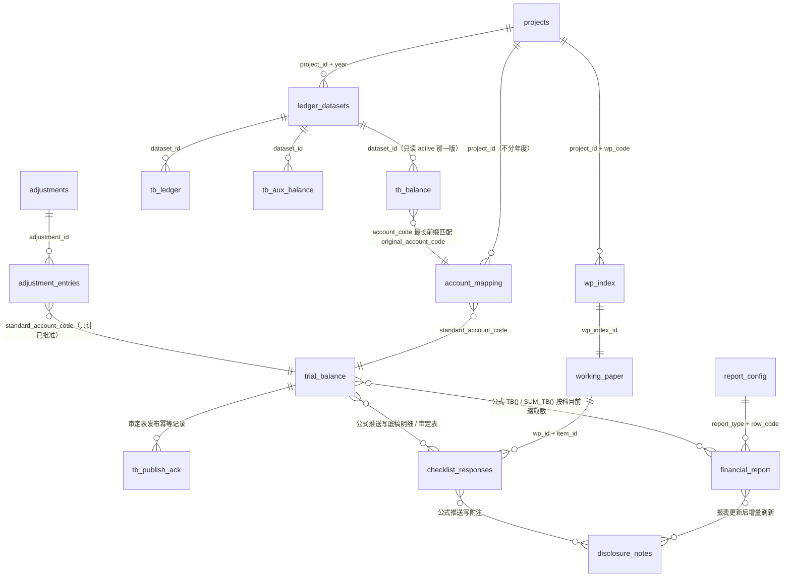
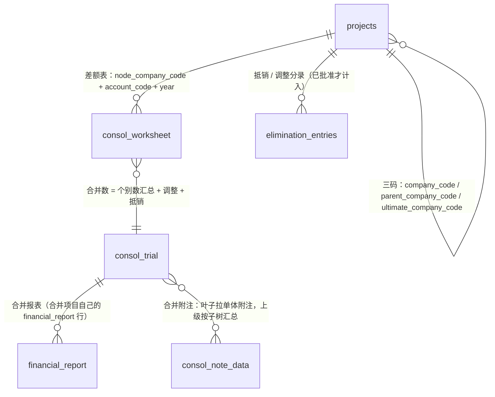

# 一、数据表与表关系

> 口径：从代码静态抽取（ORM 模型 + 迁移脚本 + 代码里的建表语句），本机没有连生产库。
> 生产库的实际表、行数和索引，要在生产库上用 `information_schema` 现查一次再定稿。
> 全部 400 张表的逐表清单见 [附录 A](appendix-a-tables.md)。

## 1. 规模

| 指标 | 数量 | 怎么得来的 |
|---|---:|---|
| 数据表 | 400 | ORM 声明 374 张 + 只在迁移里建的 26 张（其中 5 张已被后续迁移删除） |
| 带 `project_id` 的表 | 240 | ORM 列名 |
| 表与表之间的外键关系 | 728 对 | ORM `ForeignKey` |
| 只有 ORM、迁移里没有建表语句的表 | 146 | 这些表在新环境靠 ORM `create_all` 建出来 |
| 只在迁移里、没有 ORM 模型的表 | 26 | 例如 `checklist_responses`（底稿程序表 / 检查表的填写内容，全靠裸 SQL 读写） |
| 代码里懒建的表（`CREATE TABLE IF NOT EXISTS`） | 6 张基础设施表 | 见 `docs/lazy-create-tables-inventory.md` |
| 静态扫描找不到写入方的表 | 74 | 可能经通用函数写入，也可能已经没人用，需要逐张核对 |

表结构有三个来源：`backend/migrations/V*.sql`（启动时由 `MigrationRunner` 执行）、`backend/app/models/`（ORM，空库引导时 `create_all`）、少量代码里的懒建表。**生产环境的回滚脚本（`R*.sql`）只覆盖迁移建的表**，146 张只靠 ORM 建的表改结构时没有现成的回退脚本，这一点和老总要求的「改前备份、出错回滚」直接相关。

## 2. 按业务域分组

| 业务域 | 表数 | 主要的表 |
|---|---:|---|
| D01 用户、组织与权限 | 20 | `users`、`project_users`、`staff_members`、`project_assignments`、`sys_role`、`sys_dept` |
| D02 项目与项目管理 | 27 | `projects`、`issue_tickets`、`pbc_checklist`、`audit_plans` |
| D03 账表导入与数据集 | 16 | `ledger_datasets`、`import_jobs`、`tb_balance`、`tb_ledger`、`tb_aux_balance`、`tb_aux_ledger` |
| D04 科目映射与试算表 | 13 | `account_chart`、`account_mapping`、`trial_balance`、`report_line_mapping`、`tb_publish_ack`、`materiality` |
| D05 调整分录与错报 | 11 | `adjustments`、`adjustment_entries`、`adjustment_review_tasks`、`unadjusted_misstatements` |
| D06 报表、审计报告与交付件 | 21 | `report_config`、`financial_report`、`report_generation_run`、`audit_report`、`word_export_task` |
| D07 附注 | 15 | `disclosure_notes`、`note_validation_results`、`note_content_templates` |
| D08 公式、取数与查询配置 | 21 | `formula_setting`、`formula_push_state`、`formula_push_run`、`wp_formula` |
| D09 底稿 | 60 | `wp_index`、`working_paper`、`checklist_responses`、`procedure_instances`、`wp_template_set` |
| D10 底稿在线编辑同步（OnlyOffice） | 30 | `working_paper_content_version`、`working_paper_oo_room`、`working_paper_sync_operation` |
| D11 合并 | 36 | `consol_worksheet`、`consol_trial`、`elimination_entries`、`consol_note_data`、`consol_operation` |
| D12 附件、证据、函证与归档 | 47 | `attachments`、`evidence_links`、`confirmations`、`archive_jobs`、`ocr_jobs` |
| D13 复核、质控与签字门禁 | 29 | `review_records`、`wp_qc_results`、`gate_decisions`、`cross_check_results`、`eqcr_opinions` |
| D14 AI 与知识库 | 33 | `ai_chat_session`、`ai_content_log`、`knowledge_documents`、`ai_task_jobs` |
| D15 后台任务、事件与基础设施 | 21 | `platform_jobs`、`audit_log_entries`、`schema_version`、`acnr_invalidation_outbox` |

## 3. 核心数据链的表关系

这条链覆盖老总说的「导数、映射、取数、计算、生成」。图里的连线大多是**逻辑关联**（同一个 `project_id` + `year` + 科目编码），不是数据库外键，所以只看外键画不出这张图。

合并部分：

企业树没有单独的表，每次运行都从 `projects` 的三码现算（`backend/app/services/consol_group_tree.py::build_group_tree`）。

## 4. 贯穿全链的几个约定

1. **数据按「项目 + 年度」隔离**。四张账表、试算表、报表、附注都带 `project_id` 和 `year`。会上提过的「被审计单位 ID + 项目 ID 双主键」现在没有落到表结构上，同一家单位的不同项目会各存一份账。
2. **账表的可见性由数据集状态决定**。每次导入建一个 `ledger_datasets`（staged → active → superseded / rolled_back），四表行带 `dataset_id`；读账表一律经 `backend/app/services/dataset_query.py::get_active_filter` 只取 active 那一版，物理行不删。
3. **标准科目编码是串联键**。客户科目经 `account_mapping` 映射到 `standard_account_code`，试算表、调整分录明细、报表公式 `TB('1122')`、公式推送都按它关联；报表取数按前缀匹配（`TB('2221')` 含所有 `2221xx` 子科目，只计叶子）。
4. **科目映射不分年度**。`account_mapping` 只有 `project_id`，没有 `year` 和 `dataset_id`，同一项目跨年度共用一套映射。
5. **底稿内容主要存两处**：程序表 / 检查表 / 审定表等结构化表单写 `checklist_responses`（`wp_id + item_id` 唯一，没有 ORM 模型）；Excel 形态的内容在 `working_paper.parsed_data`（JSONB）和底稿文件里，在线编辑版本另存于 D10 那 30 张表。
6. **附注内容是 JSON**。`disclosure_notes.table_data`（JSONB）里同时放表格、单元格模式（自动 / 手工 / 锁定）、来源标记和校验规则；表结构上看不出具体数字，要按章节读 JSON。

## 5. 核心表字段

🔑 = 主键，→ = 外键指向。

**`ledger_datasets`**（数据集版本，15 列）：`id`🔑、`tenant_id`、`project_id`→projects、`year`、`status`、`source_type`、`source_summary`、`record_summary`、`validation_summary`、`job_id`→import_jobs、`previous_dataset_id`→ledger_datasets、`created_by`→users、`created_at`、`activated_by`→users、`activated_at`

**`tb_balance`**（科目余额表，32 列）：`id`🔑、`tenant_id`、`project_id`→projects、`year`、`company_code`、`account_code`、`account_name`、`level`、`opening_balance`、`opening_debit`、`opening_credit`、`opening_qty`、`opening_fc`、`debit_amount`、`credit_amount`、`closing_balance`、`closing_debit`、`closing_credit`、`currency_code`、`raw_extra`、`import_batch_id`→import_batches、`dataset_id`、`opening_direction`、`opening_direction_source`、`closing_direction`、`closing_direction_source`、`sign_convention_version`、`sign_anomaly_flags`、`is_deleted`、`deleted_at`、`created_at`、`updated_at`

**`account_mapping`**（科目映射，11 列）：`id`🔑、`project_id`→projects、`original_account_code`、`original_account_name`、`standard_account_code`、`mapping_type`（auto_exact / auto_fuzzy / 人工）、`is_deleted`、`deleted_at`、`created_by`→users、`created_at`、`updated_at`

**`trial_balance`**（试算表，20 列）：`id`🔑、`project_id`→projects、`year`、`company_code`、`standard_account_code`、`account_name`、`account_category`、`unadjusted_amount`（未审数）、`rje_adjustment`、`aje_adjustment`、`audited_amount`（审定数）、`wp_adjustment`（底稿发布带来的差额）、`wp_publish_base`、`wp_published_at`、`opening_balance`、`currency_code`、`is_deleted`、`deleted_at`、`created_at`、`updated_at`

**`adjustments`**（调整分录头，每行一条分录，同一笔共享 `entry_group_id`，30 列）：`id`🔑、`project_id`→projects、`year`、`company_code`、`adjustment_no`、`adjustment_type`（aje / rje）、`description`、`account_code`、`account_name`、`debit_amount`、`credit_amount`、`entry_group_id`、`content_revision`、`audit_phase`、`external_reference`、`import_batch_id`、`review_status`、`reviewer_id`→users、`reviewed_at`、`rejection_reason`、`passed_reason`、`passed_communication_date`、`origin`（manual / workpaper …）、`source_ref`、`is_deleted`、`deleted_at`、`created_by`、`updated_by`、`created_at`、`updated_at`

**`adjustment_entries`**（调整分录明细，14 列）：`id`🔑、`adjustment_id`→adjustments、`entry_group_id`、`line_no`、`standard_account_code`、`detail_account_code`、`account_name`、`report_line_code`、`debit_amount`、`credit_amount`、`is_deleted`、`deleted_at`、`created_at`、`updated_at`

**`tb_publish_ack`**（审定表发布到试算表的幂等记录，8 列）：`id`🔑、`project_id`、`year`、`wp_code`、`publish_token`、`confirmed_by`、`accounts_updated`、`created_at`

**`report_config`**（报表行次与取数公式，26 列）：`id`🔑、`report_type`、`row_number`、`row_code`、`row_name`、`indent_level`、`formula`、`formula_category`、`formula_description`、`formula_source`、`applicable_standard`（准则行如 `soe_standalone`，项目行为 `project:{id}`）、`is_total_row`、`parent_row_code`、`is_deleted`、`aje_formula`、`rje_formula`、`is_stale`、`formula_version`、`created_at`、`updated_at`、`updated_by`、`base_version`、`base_definition`、`pinned`、`base_origin`、`base_template_id`

**`financial_report`**（生成的报表数据，22 列）：`id`🔑、`project_id`→projects、`year`、`report_type`、`row_code`、`row_name`、`current_period_amount`、`prior_period_amount`、`formula_used`、`source_accounts`、`generated_at`、`indent_level`、`is_total_row`、`is_stale`、`blank_reason`、`calc_version`、`calc_error`、`run_id`→report_generation_run、`provenance`、`is_deleted`、`created_at`、`updated_at`

**`disclosure_notes`**（附注，38 列，节选）：`id`🔑、`project_id`、`year`、`note_section`（章节号）、`section_title`、`section_id`、`content_type`、`table_data`（JSONB）、`text_content`、`source_template`、`status`、`is_stale`、`stale_source`、`bound_dataset_id`→ledger_datasets、`is_local_override`、`last_sync_source`、`last_sync_wp_id`→working_paper、`last_sync_at`、`updated_by`

**`wp_index`**（底稿索引，12 列）：`id`🔑、`project_id`、`wp_code`、`wp_name`、`audit_cycle`、`assigned_to`、`reviewer`、`status`、`cross_ref_codes`、`is_deleted`、`created_at`、`updated_at`

**`working_paper`**（底稿，34 列，节选）：`id`🔑、`project_id`、`wp_index_id`→wp_index、`file_path`、`source_type`、`status`、`review_status`、`file_version`、`content_revision`、`parsed_data`（JSONB）、`prefill_stale`、`consistency_status`、`bound_dataset_id`→ledger_datasets、`is_deleted`

**`checklist_responses`**（底稿表单填写内容，没有 ORM，见 `V085__checklist_responses.sql`）：`id`🔑、`project_id`→projects、`wp_id`→working_paper、`item_id`（如 `S01-001`，章节适用性用 `TOC-S01` 前缀）、`conclusion`、`remark`、`wp_ref`、`updated_by`、`content_version`、`created_at`、`updated_at`；`(wp_id, item_id)` 唯一

**`formula_push_state`**（公式推送目标状态，16 列）：`id`🔑、`project_id`、`year`、`addr_id`、`rule_id`、`domain`、`wp_id`→working_paper、`note_section`、`last_pushed_value`、`last_formula_value`、`current_value`、`provenance`、`state`、`last_run_id`→formula_push_run、`updated_at`、`updated_by`

**`formula_setting`**（公式设置三层，21 列）：`id`🔑、`domain`（report / tb_detail / cross_check / wp / note / consol_note / push）、`layer`（global / project / template）、`scope`、`project_id`、`template_id`、`slot_key`、`definition`、`definition_hash`、`version`、`base_version`、`pinned`、`is_deleted` 等

**`consol_worksheet`**（合并差额表，16 列）：`id`🔑、`project_id`、`node_company_code`、`account_code`、`year`、`adjustment_debit`、`adjustment_credit`、`elimination_debit`、`elimination_credit`、`net_difference`、`children_amount_sum`、`consolidated_amount`、`is_deleted` 等

**`consol_trial`**（合并试算表，16 列）：`id`🔑、`project_id`、`year`、`standard_account_code`、`account_name`、`account_category`、`individual_sum`（个别数汇总）、`consol_adjustment`、`consol_elimination`、`consol_amount`（合并数）、`consolidation_breakdown`、`is_stale` 等

**`elimination_entries`**（抵销分录，29 列，节选）：`id`🔑、`project_id`、`year`、`entry_no`、`entry_type`、`account_code`、`debit_amount`、`credit_amount`、`lines`、`entry_group_id`、`related_company_codes`、`origin`、`review_status`、`is_continuous`、`prior_year_entry_id`

**`consol_note_data`**（合并附注数据，18 列）：`id`🔑、`project_id`、`year`、`section_id`、`node_key`、`data`、`is_stale`、`cell_state`、`locked_cells`、`last_formula_value`、`source_mode`、`source_digest` 等
