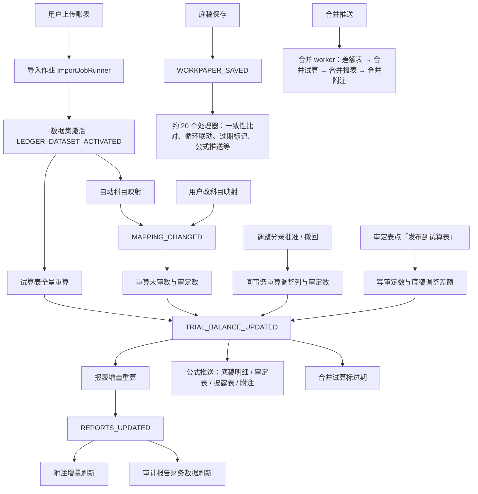

# 二、规则清单

> 口径：「规则」= 系统里会导入、映射、取数、处理、更新、计算、生成数据的一段逻辑。每条列出触发时点、读哪些表、写哪些表、代码位置、写死在代码里还是写在配置里。
> 代码位置省略前缀 `backend/app/`，格式为 `文件::函数`。条数为 2026-11-18 现算（脚本见 README）。
> 标「待核」的条目只读到入口、没有逐行读完实现。

## 0. 触发顺序总图

事件的完整发布 / 订阅关系见 [附录 B](appendix-b-events.md)。现算：58 个事件类型，123 处订阅，其中 10 个事件有人订阅、全后端没人发（见 [三、发现](03-findings.md) F1）。

---

## R1 账表导入

| 编号 | 规则 | 触发 | 读 | 写 | 代码位置 | 写死 / 配置 |
|---|---|---|---|---|---|---|
| R1.1 | 文件识别（sheet 类型、表头、列映射建议） | `POST /api/projects/{pid}/ledger-import/detect` | 上传文件 | 无 | `routers/ledger_import_v2.py::detect_files` | 识别规则 `backend/data/ledger_recognition_rules.json` |
| R1.2 | 列映射自动采纳 | 识别时 | 文件表头 | 无 | `services/ledger_import/detection_types.py`、`services/ledger_import/pipeline.py`（约 520 行） | 写死：关键列置信度 ≥ 80、推荐列 ≥ 50 自动采纳；整体自动应用阈值 `LEDGER_IMPORT_AUTO_APPLY_CONFIDENCE_THRESHOLD = 0.85` |
| R1.3 | 列映射历史复用 | 识别时 | `import_column_mapping_history` | 同左 | `services/ledger_import/orchestrator.py::_apply_history_reuse`、`services/ledger_import/column_mapping_service.py` | 同项目 30 天内按文件指纹复用；跨项目按财务软件指纹取最近一次 |
| R1.4 | 提交导入作业 | `POST .../ledger-import/submit` | `import_jobs` | `import_jobs` | `routers/ledger_import_v2.py::submit_import` | 规模预警未确认 400；同项目同年度已有作业 409 |
| R1.5 | 后台执行：建 staged 数据集 → 解析 → 校验 → 写四表 | 入队即执行；`import_recover_worker` 每 30 秒兜底 | 上传产物 | `ledger_datasets`、`tb_balance`、`tb_ledger`、`tb_aux_balance`、`tb_aux_ledger` | `services/import_job_runner.py::ImportJobRunner._execute_v2`、`services/ledger_import/pipeline.py::execute_pipeline` | 写死；50 万行以上改用 openpyxl 解析 |
| R1.6 | 激活闸门 | 写完四表后 | 校验结果 | 有阻塞错误时数据集标 failed、删 staged 行 | `pipeline.py`（约 730–760 行）`validator.evaluate_activation` | 写死；`force_activate` 可跳过阻塞错误 |
| R1.7 | 方向覆盖 | 用户确认 / 修正借贷方向 | `tb_balance` | `direction_override`（不改原始四表行） | `models/audit_platform_models.py::DirectionOverride` 及其服务（待核） | 人工 |

## R2 数据集版本

| 编号 | 规则 | 触发 | 读 | 写 | 代码位置 | 写死 / 配置 |
|---|---|---|---|---|---|---|
| R2.1 | 激活：新版 active、旧版 superseded | 导入管线末尾 | `ledger_datasets`、四表行数 | `ledger_datasets`、`activation_records`、`import_event_outbox`（`LEDGER_DATASET_ACTIVATED`） | `services/dataset_service.py::DatasetService.activate` | 写死；四表实际行数与预期不符即拒绝激活 |
| R2.2 | 回滚：当前版 rolled_back、上一版恢复 active | `POST .../ledger-import/datasets/{id}/rollback` | `ledger_datasets`、`audit_report` | 同上，事件 `LEDGER_DATASET_ROLLED_BACK` | `DatasetService.rollback` | 写死；被已定稿 / EQCR 复核报表绑定的数据集禁止回滚（409） |
| R2.3 | 只读当前生效版本 | 所有读四表的地方 | `ledger_datasets` | 无 | `services/dataset_query.py::get_active_filter` | 写死；见 F5 |
| R2.4 | 清理 | 后台 | 数据集 | 删超过保留数的旧版本、超 24 小时没有作业的 staged | `workers/dataset_purge_worker.py`、`workers/staged_orphan_cleaner.py`（每小时） | 写死 |

## R3 科目映射

| 编号 | 规则 | 触发 | 读 | 写 | 代码位置 | 写死 / 配置 |
|---|---|---|---|---|---|---|
| R3.1 | 自动匹配 | 数据集激活后自动执行；也可手动调用 | `account_chart`、`tb_balance` | `account_mapping`；缺客户科目表时从余额表生成 `account_chart`；标准科目少于客户科目 1/5 时从客户一级码补齐 | `services/mapping_service.py::auto_match`、`_match_single`；`services/event_handlers/_impl.py::_auto_map_on_dataset_activated` | 写死，匹配顺序与置信度：坏账准备子科目按名称 0.97 → 编码完全相同 1.0 → 前 4 位 0.98 → 一级码 0.96 → 名称相同 0.95 → 去后缀名称 0.92 → 模糊匹配 ≥ 0.7；≥ 0.92 记 auto_exact，其余 auto_fuzzy，**直接入库** |
| R3.2 | 人工保存 / 修改 / 批量确认 | 科目映射页 | `account_mapping` | `account_mapping`，发 `MAPPING_CHANGED` | `mapping_service.save_mapping`、`update_mapping`、`batch_confirm` | 人工 |
| R3.3 | 映射结果回报 | 自动匹配后 | 匹配结果 | `ledger_datasets.validation_summary.auto_map`；失败推 SSE | `_impl.py::classify_auto_map_outcome` | 映射率 < 80% 记「需关注」 |
| R3.4 | 报表行次映射（标准科目 → 报表行） | 报表映射页；AI 建议 `POST .../report-line-mapping/ai-suggest` | `report_line_mapping` | 同左 | `routers/report_line_mapping.py` | 只取 `is_confirmed` 的映射参与汇总 |
| R3.5 | 底稿 ↔ 科目 ↔ 报表行对照 | 生成底稿、标报表过期、调整影响预览 | `backend/data/wp_account_mapping.json`（1025 条） | 无 | `mapping_service.get_codes_by_cycles`、`services/report_stale_service.py` | 配置文件 |

## R4 试算表

| 编号 | 规则 | 触发 | 读 | 写 | 代码位置 | 写死 / 配置 |
|---|---|---|---|---|---|---|
| R4.1 | 未审数 | 全量重算、映射变化 | `tb_balance`（active 版）、`account_mapping`、`account_chart` | `trial_balance.unadjusted_amount`、`opening_balance`、`audited_amount` | `services/trial_balance_service.py::recalc_unadjusted` | 写死：只汇总叶子科目；没有映射的叶子继承最近已映射父科目；按方向转借正贷负后求和；5、6 开头按损益类取借方或贷方发生额；贷方类取绝对值存正数；全量时汇总里没有的旧行清零 |
| R4.2 | 调整列（AJE / RJE） | 调整分录变化、批准 / 撤回 | `adjustment_entries` + `adjustments` | `trial_balance.aje_adjustment`、`rje_adjustment` | `trial_balance_service.py::recalc_adjustments` | 写死：只计 `review_status = approved`、排除 `origin = workpaper`；净额 = 借 − 贷，贷方类取反；**只更新已有试算表行** |
| R4.3 | 审定数 | 每次重算最后一步 | `trial_balance` | `audited_amount` | `trial_balance_service.py::recalc_audited` | 写死：审定数 = 未审数 + RJE + AJE + 底稿调整差额 |
| R4.4 | 事件驱动重算 | `ADJUSTMENT_CREATED/UPDATED/DELETED/BATCH_COMMITTED`、`MAPPING_CHANGED`、`DATA_IMPORTED`、`LEDGER_DATASET_ACTIVATED`、`LEDGER_DATASET_ROLLED_BACK`、`IMPORT_ROLLED_BACK` | 同上 | 同上；提交后发 `TRIAL_BALANCE_UPDATED` | `_impl.py::register_event_handlers`、`_make_tb_handler`；`TrialBalanceService.on_*` | 写死；事件缺年度时跳过并记日志 |
| R4.5 | 一致性校验 | 调用时 | `trial_balance` | 无 | `trial_balance_service.py::check_consistency` | 写死 |
| R4.6 | 按报表行次汇总展示 | 试算平衡表页 | `report_config`、`report_line_mapping`、`trial_balance` | 无 | `TrialBalanceService.get_summary_with_adjustments` | 行次按名称匹配，匹配不上用包含关系 |

## R5 调整分录

| 编号 | 规则 | 触发 | 读 | 写 | 代码位置 | 写死 / 配置 |
|---|---|---|---|---|---|---|
| R5.1 | 录入校验与编号 | `POST /api/projects/{pid}/adjustments` | `adjustments`、`account_chart` | 无 | `services/adjustment_service.py::create_entry`、`services/adjustment_entry_rules.py::entry_rule_errors` | 写死：科目必填、金额非负、同一行不能同时有借贷、借贷平衡且不为零（按分比较）、手填编号同年度不重复 |
| R5.2 | 新增 / 修改 / 删除 / 批量提交 | 调整分录大厅 | 同上 | `adjustments`、`adjustment_entries`（状态 draft），发对应事件 | `adjustment_service.py::create_entry`、`update_entry`、`delete_entry`、`batch_commit` | 写死；草稿不影响试算表金额 |
| R5.3 | 提交复核、批准、驳回、撤回 | `POST .../adjustments/submit-review`、`/review-batch`、`/{gid}/revoke-review` 等 | `adjustments`、复核任务、风险投影、证据 | `adjustments.review_status`、`adjustment_review_tasks`、`trial_balance`、outbox | `services/adjustment_review_coordinator.py::decide`、`revoke` | 写死：只有待复核能批准 / 驳回；风险等级提交后变化需重新提交；按风险要求附证据；内容版本号防并发；批准且不是底稿来源时同事务重算试算表 |
| R5.4 | 底稿来源的分录 | 底稿推送 `POST .../adjustments/sync-from-workpaper` | 底稿分录 | `adjustments`（`origin = workpaper`，按来源幂等） | `routers/adjustments.py::sync_from_workpaper` | 写死：不进 AJE / RJE 列，金额只能经审定表发布进试算表 |
| R5.5 | 文件导入 | `POST .../adjustments/import/preview`、`/import` | 文件 | `adjustments`、`adjustment_import_batches` | `routers/adjustment_import.py`、`services/adjustment_import_service.py` | 覆盖模式跳过待复核分录（待核） |
| R5.6 | 客户已入账 / 不予更正 | 大厅操作 | `adjustment_client_bookings`、`adjustment_treatment_events` | 同左 | `services/adjustment_treatment_service.py::effective_groups_clause` | 写死；试算表与 ADJ() 取数共用同一口径 |

## R6 审定数发布到试算表

| 编号 | 规则 | 触发 | 读 | 写 | 代码位置 | 写死 / 配置 |
|---|---|---|---|---|---|---|
| R6.1 | 显式发布门 | 审定表点「发布到试算表」并二次确认：`POST /api/workpapers/{wp_id}/audit-determination/publish-to-tb` | 底稿、`trial_balance`、调整分录 | `trial_balance.audited_amount`、`wp_adjustment`（= 审定数 − 未审 − RJE − AJE）、`wp_publish_base`、`tb_publish_ack`；提交后发 `WORKPAPER_SAVED`、`TRIAL_BALANCE_UPDATED` | `routers/wp_html_save.py::publish_determination_to_tb` → `services/tb_publish_service.py::publish_workpaper_rows` → `services/tb_audited_writer.py::publish_rows` | 写死：需底稿编辑权；合并锁定 423；sheet 须是审定表（`[D-N]n-1`）；来源底稿的调整分录须先在大厅批准；客户已入账分录未确认 409；发布令牌幂等 |
| R6.2 | 普通保存不动试算表 | 审定表保存 | `trial_balance` | 不写试算表，只发不带确认标志的 `WORKPAPER_SAVED` | `wp_html_save.py::_maybe_publish_determination_writeback` | 写死 |
| R6.3 | 旧发布路径（事件处理器） | `WORKPAPER_SAVED` 且带 `publish_confirmed` | 同上 | 同上 | `services/event_handlers_cycle_linkage.py::_on_d_audit_determination_saved` | 写死；新发布门已写完时跳过（`tb_write_committed`） |

## R7 财务报表

| 编号 | 规则 | 触发 | 读 | 写 | 代码位置 | 写死 / 配置 |
|---|---|---|---|---|---|---|
| R7.1 | 报表公式种子 | `POST /api/report-config/seed`（admin） | `backend/data/report_config_seed.json` | `report_config` | `services/report_config_service.py::load_seed_data` | 配置：22 套（国企 / 上市 × 单体 / 合并 × 四张主表，加现金流补充资料、减值准备表），共 1191 行 |
| R7.2 | 有效配置合并 | 每次生成 | `report_config`（准则行 + `project:{id}` 项目行） | 无 | `services/formula_settings/effective_report.py::load_effective_report_configs` | 数据库配置；项目行覆盖准则行 |
| R7.3 | 全量生成 | `POST .../reports/generate`；全链刷新；事件不带科目时 | `trial_balance`、`tb_balance`、`account_mapping`、调整分录、`disclosure_notes`、`working_paper`、上年项目 | 先跑一次试算表全量重算；写 `financial_report`、`report_generation_run`；Redis 缓存 10 分钟 | `services/report_engine.py::ReportEngine.generate_all_reports`、`services/report_row_compute.py::compute_row` | 公式来自配置；取数口径写死；表间按资产负债表 → 利润表 → 现金流 → 权益变动 → 补充资料 → 减值表的顺序，表内按公式依赖排序 |
| R7.4 | 公式函数与取数口径 | 每行求值 | 同上 | 无 | `report_engine.py::ReportFormulaParser`、`evaluate_formula_result`；`services/formula_engine.py` | 写死：`TB` / `SUM_TB` 按科目前缀只计叶子；`ROW` / `SUM_ROW` / `REPORT` / `WP` / `NOTE` / `ADJ` / `IF` / `ABS` / `ROUND` / `MAX` / `MIN`；报表里不支持 `PREV` / `AUX`；缺科目按 0 计（见 F6），`WP` / `NOTE` 缺数报错 |
| R7.5 | 试算表更新后增量重算 | `TRIAL_BALANCE_UPDATED` | `report_config`、`trial_balance`、`financial_report` | 只更新已存在的报表行；提交后发 `REPORTS_UPDATED` | `ReportEngine.on_trial_balance_updated`、`regenerate_affected`、`_is_affected` | 写死：按公式引用的科目找受影响行，再沿 `ROW` 引用求闭包 |
| R7.6 | 权益变动表「上年年末余额」 | 读取 / 导出时 | `financial_report`（资产负债表上期） | 不写库，读时回填 | `report_engine.py::enrich_equity_statement_rows` | 写死：14 个权益列对应的行名关键字 |
| R7.7 | 现金流量表工作底稿 | `routers/cfs_worksheet.py` 的 generate / auto-generate | 待核 | `cfs_adjustments`（待核） | `routers/cfs_worksheet.py` | 配置 `cf_verification_formulas.json`（经营 7、投资 5、筹资 4、勾稽 3） |
| R7.8 | 报表平衡校验 | 调用时 | `financial_report` | 无 | `ReportEngine.check_balance` | 写死（资产 = 负债 + 权益等） |

## R8 公式设置与传播

| 编号 | 规则 | 触发 | 读 | 写 | 代码位置 | 写死 / 配置 |
|---|---|---|---|---|---|---|
| R8.1 | 有效公式定义 | 公式面板读取、执行时 | `formula_setting`、`formula_sync_item`、系统预设 | 无 | `services/formula_settings/effective.py` | 数据库配置：本项目适配 → 订阅模板 → 全局 → 系统预设 |
| R8.2 | 全局发布 / 项目适配 / 模板订阅 | 公式管理页 | 同上 | `formula_setting`、`formula_publish`、`formula_template*`、`formula_sync_item`；报表域写 `report_config` 项目行 | `services/formula_settings/publish.py`、`sync.py`、`project_ops.py` | 数据库配置 |
| R8.3 | 改公式后的传播 | `FORMULA_CONFIG_CHANGED` | 各域配置 | 报表：先标过期并提交，再重算、发 `REPORTS_UPDATED`；底稿：`working_paper.prefill_stale`；附注：`disclosure_notes.is_stale`；合并附注：`consol_note_data` 过期并进合并任务 | `services/formula_settings/propagation.py::on_formula_config_changed` 及 `propagate_*` | 写死 |

## R9 公式推送（试算表 → 底稿 → 附注）

| 编号 | 规则 | 触发 | 读 | 写 | 代码位置 | 写死 / 配置 |
|---|---|---|---|---|---|---|
| R9.1 | 推送规则 | 每次推送加载 | `backend/data/formula_push_rules.json` | 无 | `services/formula_push/engine.py::load_push_rules` | 配置：268 条（取数 97、派生 85、附注 86）；接入 81 个底稿编码（`services/formula_push/bindings/__init__.py::_REGISTRY`） |
| R9.2 | 事件触发推送 | `TRIAL_BALANCE_UPDATED`（只单体项目，事件科目命中接入科目才跑）；`WORKPAPER_SAVED`（底稿编码已接入才跑） | 四表 / 试算表 | `checklist_responses`（底稿明细、审定表）、`disclosure_notes.table_data`、`formula_push_state`、`formula_push_run`；推 SSE | `services/formula_push/triggers.py::on_trial_balance_updated`、`on_workpaper_saved`；`engine.py::run_and_commit` | 规则配置 + 接入清单写死；合并项目跳过 |
| R9.3 | 手工推送 | `POST /api/projects/{pid}/formula-push/run` | 同上 | 同上 | `routers/formula_push.py` | 同上 |

## R10 底稿生成

| 编号 | 规则 | 触发 | 读 | 写 | 代码位置 | 写死 / 配置 |
|---|---|---|---|---|---|---|
| R10.1 | 按模板集生成 | `POST /api/projects/{pid}/working-papers/generate` | 模板集、`procedure_instances`、`wp_index` | `wp_index`、`working_paper`、生成操作记录 | `routers/wp_template.py::generate_project_workpapers` → `services/template_engine.py::TemplateEngine.generate_project_workpapers_detailed` | 内置模板集编码来自 `wp_account_mapping.json` |
| R10.2 | 按编码生成 | `POST .../working-papers/generate-from-codes` | `gt_template_library.json`（331 个）、`backend/wp_templates/` 模板文件 | `wp_index`、`working_paper`、底稿文件；每条一个保存点 | `wp_template.py::generate_from_codes`；`services/wp_generate_file.py::materialize_workpaper_file` | 找不到模板建空白底稿，列入回执 |
| R10.3 | 程序裁剪决定生成范围 | 所有生成入口之前 | `procedure_instances`、`wp_index`（回收站） | 只读，项目级锁 | `services/procedure_scope_retention.py::plan_generation` | 数据驱动；读不到裁剪结果 503 |
| R10.4 | 表头自动填写 | 按编码生成时 | 项目、人员信息 | 底稿文件单元格 | `services/wp_header_service.py::fill_generated_workpaper_header` | 写死：只认带冒号的标签，扫前 10 行 × 12 列 |
| R10.5 | 高风险自动补底稿 | `WORKPAPER_SAVED`：B51-5 高风险补 D4-22~32；B51-4 补 F2-61~72 | 保存内容 | `wp_index`、`working_paper`（待核） | `_impl.py::_on_b515_high_risk`、`_on_b514_high_risk` | 写死编码与条件 |
| R10.6 | 打开底稿时预填 | `POST .../working-papers/{wp_id}/prefill`、批量预填 | 模板里的 `=TB()` / `=SUM_TB()` / `=AUX()` / `=PREV()` / `=WP()` | `working_paper.parsed_data.univer_snapshot`、`cell_provenance` | `services/prefill_engine.py::prefill_workpaper_real` | 公式在模板里；映射清单 `prefill_formula_mapping.json`（306 条）、三参 PREV 定位表 `prev3_prefill_locator.json`（83 条） |
| R10.7 | 程序表自动取数 | 渲染程序表步骤时 | `trial_balance`、`materiality`、`tb_ledger`、`checklist_responses` 等 | 不写库 | `services/auto_data_resolvers/__init__.py::resolve_auto_data_source` | 写死：96 个取数函数（`@auto_resolver`） |

## R11 底稿保存后的联动

`WORKPAPER_SAVED` 一共约 20 个订阅者，各自按底稿编码过滤。

| 编号 | 规则 | 过滤条件 | 写 | 代码位置 |
|---|---|---|---|---|
| R11.1 | 表单保存 | — | `checklist_responses`（`ON CONFLICT (wp_id, item_id) DO UPDATE`） | `routers/checklist_responses.py::_do_batch_save` |
| R11.2 | 结构化保存（含跨底稿引用检测、报表标过期） | — | `working_paper` 内容版本；`financial_report.is_stale` | `routers/wp_html_save.py`（Step 8~10）、`services/report_stale_service.py::mark_if_mapped` |
| R11.3 | 审定数与试算表比对 | 带 `wp_id` | 一致性状态（落哪个字段待核） | `_impl.py::_on_workpaper_saved` → `ConsistencyCheckService.update_workpaper_consistency` |
| R11.4 | 控制测试结论 | `C2`~`C15` | `workpaper_field_overrides`（`control_test_result:{循环}`） | `event_handlers_cycle_linkage.py::_on_c_control_test_saved` |
| R11.5 | 控制偏差 | `C{n}-2` | 问题单 + 覆写结论 | `_on_c_deviation_saved` |
| R11.6 | ITGC 缺陷 | `C22` | `workpaper_field_overrides`（`c21_1_findings`） | `_on_c22_itgc_saved` |
| R11.7 | 采购存货步骤状态 | F2 子底稿 | `workpaper_field_overrides` | `_on_f_workpaper_conclusion_saved` |
| R11.8 | 附注标过期（兜底） | 受 `DISCLOSURE_AUTO_SYNC_ENABLED` 控制，默认关 | `disclosure_notes.is_stale` | `services/disclosure_stale_marker.py::handle_workpaper_saved_for_disclosure` |
| R11.9 | 用户公式 `WP()` 引用方标过期 | 全部 | `working_paper.prefill_stale`、`wp_formula` 状态 | `_on_workpaper_saved_wp_formula_stale` |
| R11.10 | 公式推送 | 编码已接入 | 见 R9 | `formula_push/triggers.py::on_workpaper_saved` |
| R11.11 | 其他：租赁 / 研发反向回填、B23 / B50 / B2 / A13 联动、程序表缓存失效 | 按编码 | 待核 | `_impl.py` 的 `_on_h_lease_reverse_backfill` 等；`services/a13_event_handler.py` |

## R12 底稿在线编辑回写（OnlyOffice ↔ 网页表单）

| 编号 | 规则 | 触发 | 写 | 代码位置 | 写死 / 配置 |
|---|---|---|---|---|---|
| R12.1 | 保存回调先落库再合并 | `POST /api/workpaper-sync/rooms/{room_id}/onlyoffice-callback` | D10 的 30 张表；合并后镜像回 `checklist_responses` | `routers/wp_sync_router.py::post_room_onlyoffice_callback`、`_apply_durable_incoming` | 契约文件 `backend/data/workpaper_sync_contracts/`（94 个） |
| R12.2 | 三方合并（基线 / 当前 / OO 改动） | 每次回写 | 冲突记录 | `services/workpaper_sync/merge.py` | 写死：只有 OO 改的采纳 OO；公式格值变但公式没改按重算采纳；公式被改成数字记冲突；删行撞改值记冲突 |
| R12.3 | 冲突裁决 / 回滚 / 重试 | `.../operations/{id}/resolve`、`.../versions/{id}/rollback`、`.../operations/{id}/retry` | 裁决结果 | `wp_sync_router.py::resolve_conflicts` 等 | 人工 |
| R12.4 | 中断重驱 | `oo_apply_redrive_worker` 每 60 秒 | 同 R12.1 | `workers/oo_apply_redrive_worker.py` | 写死 |

## R13 附注

| 编号 | 规则 | 触发 | 读 | 写 | 代码位置 | 写死 / 配置 |
|---|---|---|---|---|---|---|
| R13.1 | 附注模板 | 生成、刷新时加载 | `note_template_soe.json`（190 节）、`note_template_listed.json`（206 节）、项目自定义模板 | 无 | `services/disclosure_engine.py::_load_templates` | 配置；读文件失败时退回 6 条旧种子，不报错（见 F12） |
| R13.2 | 生成附注初稿 | `POST /api/disclosure-notes/generate` | `trial_balance`、底稿、上年附注 | `disclosure_notes`；生成后跑一次校验 | `DisclosureEngine.generate_notes` | 正文：上年正文超过 20 字用上年，否则用模板；不调大模型 |
| R13.3 | 写权判定 | 每次写附注单元格 | 写权矩阵、推送状态 | 被拒的写入记 `blocked_writes` | `services/note_write_ownership.py::WriteGate.check` | 配置 `note_write_ownership_matrix.json`；判定顺序写死：锁定 → 手工 → 推送只写声明格 → 治理域外放行 → 容器 → 推送写定的格 → 基础条目 |
| R13.4 | 报表更新后增量刷新 | `REPORTS_UPDATED` | 模板、`trial_balance` | `disclosure_notes.table_data`（自动格） | `DisclosureEngine.on_reports_updated` → `update_note_values` | 按变化科目过滤章节；底稿同步来源的章节只追加缺失子表 |
| R13.5 | 整项目标过期 + 后台重算 | `LEDGER_DATASET_ACTIVATED`、`ADJUSTMENT_APPROVED`、`ADJUSTMENT_REVIEW_REVOKED`、`WORKPAPER_REVIEW_PASSED` | `projects` | `disclosure_notes.is_stale` | `_impl.py::_mark_disclosure_notes_stale_for_project_year` | 写死；合并项目跳过；`WORKPAPER_REVIEW_PASSED` 没有发布方（F1） |
| R13.6 | 从底稿拉数 | 附注「刷新 / 全部刷新 / 生成」先调 `POST /api/disclosure-notes/{pid}/{year}/pull-from-workpapers` | 试算表、底稿 | `disclosure_notes` | `services/note_workpaper_pull_service.py::pull_sections` | 配置：推送规则 + `note_workpaper_sync_registry.json`（78 条） |
| R13.7 | 离屏披露同步 | `POST /api/disclosure-notes/{pid}/{year}/headless-refresh`（只能手动） | 前端披露表计算逻辑（Node 执行） | 同各端点 | `services/note_headless_refresh_service.py::run_headless_refresh` | 写死 |
| R13.8 | 上年附注导入、正文批量编制、AI 填写 | 各自端点 | 上传文件 / 知识库 / 会话 | `disclosure_notes`、`note_text_batch_applications`、`ai_content_log`（待确认后才写回） | `note_prior_year_import_service`、`note_text_batch_service`、`ai_chat/adopt.py` | 写死可写范围 |
| R13.9 | 附注校验 | `POST /api/disclosure-notes/{pid}/{year}/validate`；生成后自动 | `disclosure_notes` | `note_validation_results` | `services/note_validation_engine.py` | 配置：`note_check_preset_formulas.json`（国企 757、上市 804） |

## R14 合并

| 编号 | 规则 | 触发 | 读 | 写 | 代码位置 | 写死 / 配置 |
|---|---|---|---|---|---|---|
| R14.1 | 企业树 | 每次合并运算现算 | `projects` 三码、`report_scope`、审计年度 | 不落库，推送时记树版本 | `services/consol_group_tree.py::build_group_tree` | 写死：断环、按最终控制方挂靠、分公司并入母公司汇总 |
| R14.2 | 合并推送四步 | 推送端点入队；`ELIMINATION_APPROVED/REVOKED`；公式变化 | 各步 | `consol_operation`、`consol_push_run` | `services/consol_push_service.py::push`、`_push_one`；`workers/consol_operation_worker.py`（每 0.5 秒） | 写死：差额表 → 合并试算 → 合并报表 → 合并附注；关键步骤失败后续跳过 |
| R14.3 | 差额表 | 第 1 步 | 子企业审定数、`elimination_entries` | `consol_worksheet` | `services/consol_worksheet_engine.py::recalc_full` | 写死；找不到归属节点的分录不计入并告警 |
| R14.4 | 合并试算 | 第 2 步 | 企业树叶子审定数、已归属分录 | `consol_trial` | `services/consol_trial_service.py::recalculate_trial` | 写死：合并数 = 个别数汇总 + 调整 + 抵销；「其他调整」进调整列，其余进抵销列 |
| R14.5 | 合并报表 | 第 3 步 | `consol_trial`、报表配置 | `financial_report`、`consol_artifact` | `services/consol_report_service.py::generate_consol_reports` | 公式配置同单体 |
| R14.6 | 合并附注 | 第 4 步；「按公式填入」；「重新汇总」 | `consol_note_formula`、明细映射绑定、子企业单体附注 | `consol_note_data` | `consol_push_service._refresh_notes`；`services/consol_note_formula_service.py::fill_by_formula`；`services/consol_note_subtree_reaggregate.py::reaggregate_subtree` | 配置 `consol_note_sections_soe.json`（251）/ `_listed.json`（422）；重新汇总：叶子拉数、差额节点按公式、上级 = 直接下级之和 + 差额 |
| R14.7 | 子企业变化标过期 | 子企业 `TRIAL_BALANCE_UPDATED`、`NOTE_SECTION_SAVED` | — | `consol_trial.is_stale`、合并附注过期 | `services/consol_trial_stale_handler.py`、`services/consol_note_stale_handler.py` | 写死 |
| R14.8 | 抵销分录录入 / 审批 | 抵销分录页 | — | `elimination_entries` | 待核（入口未定位） | — |

## R15 校验、勾稽与签字门禁

全部校对来源登记在 `services/formula_check_catalog.py::SOURCES`（12 个来源，每个写了执行入口和结果表）。

| 编号 | 规则 | 何时执行 | 规则来源与条数 | 结果写哪 |
|---|---|---|---|---|
| R15.1 | 报表内置勾稽 | 表间审核「执行校验」 | 代码 `logic_check.py::_CROSS_CHECK_SEEDS`（约 7~8 条） | `cross_check_results` |
| R15.2 | 表间审核用户规则 | 同上 | `formula_setting`（cross_check 域）；预置模板 `cross_check_preset_rules.json` 6 条 | `cross_check_results` |
| R15.3 | 报表审核公式 | 报表页「审核」 | `report_config` 中逻辑审核 / 合理性类行 | 不落库 |
| R15.4 | 附注预置勾稽 | 附注「执行公式」 | `note_check_preset_formulas.json` | 只进问题清单 |
| R15.5 | 合并附注勾稽 | 合并附注页 | `consol_note_sections_*.json` | 不落库 |
| R15.6 | 底稿跨科目校验 | 底稿校验、签字门禁 | `cross_account_rules.json` 8 条 | `cross_check_results` |
| R15.7 | 质控规则 | 底稿自检 | `qc_rule_definitions` 表（种子 22 条） | `wp_qc_results` |
| R15.8 | 签字前一致性门禁 | `GET/POST /{pid}/consistency-check` | 代码 `services/consistency_gate/_impl.py::ConsistencyGate.run_all_checks`：5 项基础 + 各循环勾稽，共 40 项 | `gate_decisions`（待核）；阻断类检查出异常时记「未执行」，整体判不通过 |
| R15.9 | 只展示、不执行的「规则」 | — | `*_cycle_validation_rules.json`（表达式无求值器）、`note_disclosure_balance_rules.json`（无调用方） | — |

## R16 过期（stale）标记

| 编号 | 规则 | 触发 | 写 | 代码位置 |
|---|---|---|---|---|
| R16.1 | 统一过期引擎 | 调整批准 / 撤回、导入、底稿保存、映射变化 | `working_paper.prefill_stale`、`financial_report.is_stale`、`disclosure_notes.is_stale`、`deliverable_section_state.is_stale`；传播日志写 `linkage_audit_log`（仓库里没有这张表的建表语句，见 F11） | `services/stale_propagation_engine.py::on_change`；出错降级 `_fallback_mark_stale` |
| R16.2 | 函证回函 → 下游底稿过期 | `CONFIRMATION_RECEIVED` | 同上 | `event_handlers_cycle_linkage.py::_on_confirmation_received` |
| R16.3 | 过期清除 | 预填重跑、附注重算、`routers/tb_sync.py` | 清标记 | `prefill_engine.py`、`stale_state.py::clear_note_stale` |

## R17 后台任务（18 个 worker + 导入执行器）

登记在 `core/startup_registry.py::_WORKER_BINDINGS`。

| worker | 做什么 | 周期 |
|---|---|---|
| `sla_worker` | 问题单超时升级与预警 | 15 分钟 |
| `event_loop_lag_worker` | 采样事件循环延迟 | 1 秒 |
| `capacity_queue_worker` | 采样任务队列快照 | 15 秒 |
| `import_recover_worker` | 恢复中断的导入作业 | 30 秒 |
| `outbox_replay_worker` | 重放导入事件 outbox | 可配，失败退避 |
| `audit_log_writer_worker` | 审计日志批量落库 | 2 秒 |
| `budget_alert_worker` | 工时预算预警 | 24 小时 |
| `dataset_purge_worker` | 清理旧数据集 | 待核 |
| `staged_orphan_cleaner` | 清理孤立 staged 数据集 | 1 小时 |
| `export_cleanup_worker` | 清过期导出文件、查询记录 | 1 小时 |
| `time_machine_cleanup_worker` | 删 7 天前快照 | 24 小时 |
| `procedure_dispatcher_worker` | 程序任务通知派发（开关控制） | 2 秒 |
| `invalidation_dispatcher_worker` | 可见性失效推 Redis（开关控制） | 1 秒 |
| `knowledge_ocr_worker` | 知识库扫描件 OCR（开关控制） | 30 秒 |
| `ai_task_worker` | 附注批量预填、底稿 AI 复核 | 3 秒 |
| `platform_job_worker` | 耐久任务（批量导入、导出包、合并附注重新汇总、公式推送） | 1 秒 |
| `oo_apply_redrive_worker` | 在线编辑回写中断重驱 | 60 秒 |
| `consol_operation_worker` | 合并推送任务 | 0.5 秒 |
| `ImportJobRunner.run_forever` | 账表导入作业 | 入队即跑 |

## R18 启动时会改数据的任务

登记在 `core/startup_registry.py::STARTUP_TASKS`。

| 任务 | 做什么 |
|---|---|
| `run_migrations` | 执行未跑过的 `backend/migrations/V*.sql`（**发版即改库**） |
| `replay_startup_events` | 重放未处理事件，会真实重跑过期标记、公式推送、循环联动等写库处理 |
| `seed_builtin_template_sets` | 写内置模板集 |
| `recover_ai_chat_runs` | AI 对话租约过期的重新入队 |

---

## 附：写在配置里的规则（按条数）

| 配置 | 条数 | 用途 |
|---|---:|---|
| `backend/data/report_config_seed.json` | 22 套 / 1191 行 | 报表行次与公式种子（入库后在 `report_config`） |
| `backend/data/formula_push_rules.json` | 268 | 公式推送 |
| `backend/data/wp_account_mapping.json` | 1025 | 底稿 ↔ 科目 ↔ 报表行 |
| `backend/app/data/wp_code_overrides.json` | 1531 | 底稿编码 → 渲染组件 |
| `backend/data/note_check_preset_formulas.json` | 国企 757 / 上市 804 | 附注预置公式 |
| `backend/data/cross_wp_references.json` | 425 | 跨底稿取数关系 |
| `backend/data/prefill_formula_mapping.json` | 306 | 底稿预填公式 |
| `backend/data/note_template_soe.json` / `_listed.json` | 190 / 206 节 | 附注模板 |
| `backend/data/consol_note_sections_soe.json` / `_listed.json` | 251 / 422 | 合并附注章节与勾稽 |
| `backend/data/note_workpaper_sync_registry.json` | 78 | 底稿 → 附注同步登记 |
| `backend/data/qc_rule_definitions_seed.json` | 22 | 质控规则种子 |
| 数据库：`report_config`、`formula_setting`、`account_mapping`、`report_line_mapping`、`qc_rule_definitions`、`consol_note_formula` | 按项目 | 运行时规则 |

写死在代码里的主要规则：试算表口径（叶子、前缀继承、方向、损益类取发生额、审定数公式）、科目自动匹配算法与阈值、报表取数口径与函数集、96 个底稿取数函数、81 个推送接入编码、40 项一致性门禁、附注写权判定顺序、合并数公式与推送步骤、三方合并真值表、各循环联动的编码过滤。完整配置文件清单见 [附录 C](appendix-c-configs.md)。
