# 五、关系图：表与表、表与业务

> 由脚本从 ORM 外键与代码静态扫描生成，图用 Mermaid 写（Obsidian、GitHub、Kiro 都能直接渲染）。
> 「表与表」只画数据库外键；靠「项目 + 年度 + 科目编码」关联的逻辑关系见 [01 第 3 节](01-tables-and-relations.md) 与本文 5.1 的虚线。
> 几乎所有表都有外键指向 `projects`（212 张）或 `users`（189 张），图里不画这两类，否则全是指向它们的线。

## 5.1 业务域之间的关系总图

实线 = 外键（箭头从引用方指向被引用方，数字 = 表对数）；虚线 = 主要的逻辑数据流（没有外键，靠科目编码或事件串联）。

> 读图要点：除去指向 `projects` / `users` 的外键，全库只有 327 对表之间有外键，其中跨业务域的只有 56 对。核心链「账表 → 试算表 → 报表 → 附注」上几乎没有外键，全靠「项目 + 年度 + 科目编码 / 章节号」逻辑关联，所以数据库层面不会阻止这些表之间出现不一致，一致性完全靠代码里的规则保证（逻辑关联见 5.5）。

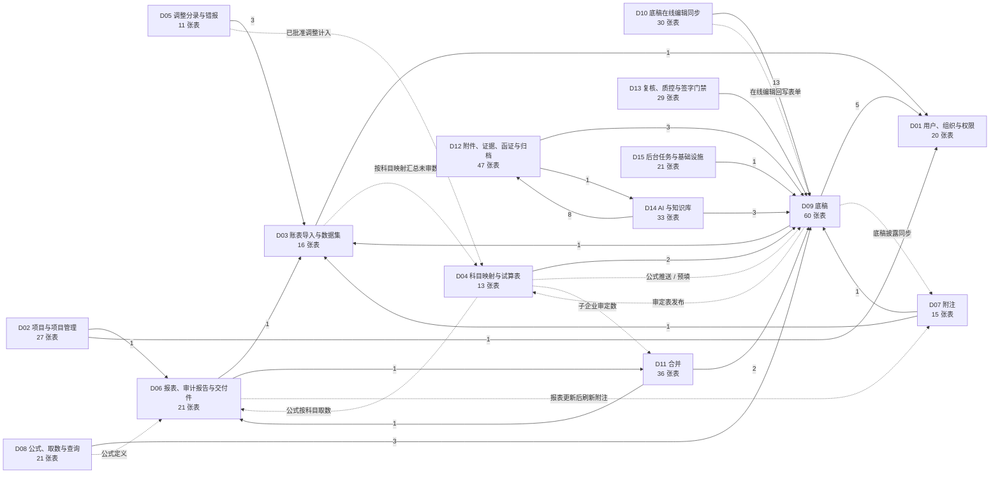

| 引用方 → 被引用方 | 外键表对数 |
|---|---:|
| D10 底稿在线编辑同步 → D09 底稿 | 13 |
| D14 AI 与知识库 → D12 附件、证据、函证与归档 | 8 |
| D09 底稿 → D01 用户、组织与权限 | 5 |
| D05 调整分录与错报 → D03 账表导入与数据集 | 3 |
| D13 复核、质控与签字门禁 → D09 底稿 | 3 |
| D08 公式、取数与查询 → D09 底稿 | 3 |
| D12 附件、证据、函证与归档 → D09 底稿 | 3 |
| D14 AI 与知识库 → D09 底稿 | 3 |
| D04 科目映射与试算表 → D09 底稿 | 2 |
| D11 合并 → D09 底稿 | 2 |
| D02 项目与项目管理 → D06 报表、审计报告与交付件 | 1 |
| D03 账表导入与数据集 → D01 用户、组织与权限 | 1 |
| D07 附注 → D03 账表导入与数据集 | 1 |
| D07 附注 → D09 底稿 | 1 |
| D06 报表、审计报告与交付件 → D03 账表导入与数据集 | 1 |
| D06 报表、审计报告与交付件 → D11 合并 | 1 |
| D11 合并 → D06 报表、审计报告与交付件 | 1 |
| D09 底稿 → D03 账表导入与数据集 | 1 |
| D12 附件、证据、函证与归档 → D14 AI 与知识库 | 1 |
| D02 项目与项目管理 → D01 用户、组织与权限 | 1 |
| D15 后台任务与基础设施 → D09 底稿 | 1 |

## 5.2 核心业务功能与表（谁写、谁读）

按 [02 规则清单](02-rules.md) 人工整理。实线 = 写，虚线 = 读。

```mermaid
flowchart LR
  subgraph 业务功能
    B1[账表导入]
    B2[数据集激活 / 回滚]
    B3[科目映射]
    B4[试算表重算]
    B5[调整分录录入与复核]
    B6[审定表发布到试算表]
    B7[报表生成]
    B8[公式设置]
    B9[公式推送]
    B10[底稿生成]
    B11[底稿保存]
    B12[在线编辑回写]
    B13[附注生成与刷新]
    B14[合并推送]
    B15[签字一致性门禁]
  end
  subgraph 账表与数据集
    t_ds[(ledger_datasets)]
    t_bal[(tb_balance)]
    t_led[(tb_ledger)]
    t_aux[(tb_aux_balance)]
    t_job[(import_jobs)]
  end
  subgraph 映射与试算
    t_chart[(account_chart)]
    t_map[(account_mapping)]
    t_tb[(trial_balance)]
    t_ack[(tb_publish_ack)]
    t_rlm[(report_line_mapping)]
  end
  subgraph 调整
    t_adj[(adjustments)]
    t_adje[(adjustment_entries)]
    t_rt[(adjustment_review_tasks)]
  end
  subgraph 报表与公式
    t_rc[(report_config)]
    t_fr[(financial_report)]
    t_fs[(formula_setting)]
    t_fps[(formula_push_state)]
  end
  subgraph 底稿
    t_wi[(wp_index)]
    t_wp[(working_paper)]
    t_cr[(checklist_responses)]
    t_pi[(procedure_instances)]
    t_cv[(working_paper_content_version)]
  end
  subgraph 附注
    t_dn[(disclosure_notes)]
  end
  subgraph 合并
    t_cw[(consol_worksheet)]
    t_ct[(consol_trial)]
    t_ee[(elimination_entries)]
    t_cnd[(consol_note_data)]
  end
  B1 --> t_job
  B1 --> t_bal
  B1 --> t_led
  B1 --> t_aux
  B1 --> t_ds
  B2 --> t_ds
  B3 -.-> t_bal
  B3 --> t_chart
  B3 --> t_map
  B4 -.-> t_bal
  B4 -.-> t_map
  B4 -.-> t_adje
  B4 --> t_tb
  B5 --> t_adj
  B5 --> t_adje
  B5 --> t_rt
  B5 --> t_tb
  B6 -.-> t_cr
  B6 --> t_tb
  B6 --> t_ack
  B7 -.-> t_rc
  B7 -.-> t_tb
  B7 -.-> t_rlm
  B7 --> t_fr
  B8 --> t_fs
  B8 --> t_rc
  B9 -.-> t_tb
  B9 --> t_cr
  B9 --> t_dn
  B9 --> t_fps
  B10 -.-> t_pi
  B10 --> t_wi
  B10 --> t_wp
  B11 --> t_cr
  B11 --> t_wp
  B12 --> t_cv
  B12 --> t_cr
  B13 -.-> t_tb
  B13 -.-> t_fr
  B13 --> t_dn
  B14 -.-> t_tb
  B14 -.-> t_ee
  B14 --> t_cw
  B14 --> t_ct
  B14 --> t_fr
  B14 --> t_cnd
  B15 -.-> t_tb
  B15 -.-> t_fr
  B15 -.-> t_dn
```

## 5.3 业务代码写哪些域的表（矩阵）

行 = 代码所属业务（按代码目录和文件名归类），列 = 表所属业务域，格子 = 该业务代码写入的表数。
对角线外的数字就是「跨业务写表」。逐表明细见 [附录 E](appendix-e-table-business.md)。

| 业务代码 \ 表所属域 | D01 | D02 | D03 | D04 | D05 | D06 | D07 | D08 | D09 | D10 | D11 | D12 | D13 | D14 | D15 |
|---|---:|---:|---:|---:|---:|---:|---:|---:|---:|---:|---:|---:|---:|---:|---:|
| D01 用户、组织与权限 | **14** | 1 |  |  |  |  |  |  | 1 |  |  |  |  |  | 1 |
| D02 项目与项目管理 | 1 | **6** |  |  |  |  |  |  | 1 |  | 1 |  | 1 | 2 | 2 |
| D03 账表导入与数据集 | 1 |  | **11** | 2 |  |  |  |  | 3 |  |  |  |  |  |  |
| D04 科目映射与试算表 |  |  | 1 | **12** |  |  |  |  | 3 |  |  |  |  |  |  |
| D05 调整分录与错报 | 2 |  |  | 1 | **8** |  |  |  |  |  |  |  |  |  |  |
| D06 报表、审计报告与交付件 |  | 1 |  |  |  | **19** |  |  |  |  |  | 2 |  |  |  |
| D07 附注 |  | 2 |  |  |  |  | **15** |  |  |  |  |  |  | 1 | 2 |
| D08 公式、取数与查询 |  | 1 |  |  |  | 2 |  | **16** | 1 |  | 2 |  | 1 |  | 2 |
| D09 底稿 | 2 | 3 |  | 2 | 2 | 2 |  |  | **26** |  |  |  | 2 | 2 |  |
| D10 底稿在线编辑同步 | 2 |  | 2 |  |  |  |  |  | 2 | **27** |  |  |  |  |  |
| D11 合并 |  | 1 |  |  |  | 2 |  |  | 2 |  | **30** |  |  |  |  |
| D12 附件、证据、函证与归档 |  |  |  |  |  |  |  |  | 3 |  |  | **31** |  | 1 |  |
| D13 复核、质控与签字门禁 | 6 | 3 |  |  |  |  |  |  | 2 |  |  | 2 | **21** | 1 | 1 |
| D14 AI 与知识库 |  |  |  |  |  |  |  |  | 1 |  |  | 2 | 1 | **18** |  |
| D15 后台任务与基础设施 | 5 | 6 | 1 | 4 | 2 | 6 | 2 | 9 | 16 |  | 1 | 2 | 2 | 3 | **15** |

### 被最多业务写入的表

同一张表被很多业务的代码写，是「数为什么变了」最难解释的地方。下表列出被 4 个及以上业务写入的表。

| 表 | 所属域 | 写入它的业务（文件数） |
|---|---|---|
| `working_paper` | D09 | D09 底稿（19）、D08 公式、取数与查询（6）、D15 后台任务与基础设施（3）、D12 附件、证据、函证与归档（1）、D11 合并（1）、D01 用户、组织与权限（1）、D10 底稿在线编辑同步（1）、D14 AI 与知识库（1） |
| `projects` | D02 | D07 附注（3）、D15 后台任务与基础设施（2）、D02 项目与项目管理（2）、D08 公式、取数与查询（1）、D11 合并（1） |
| `logs` | D01 | D15 后台任务与基础设施（4）、D09 底稿（2）、D05 调整分录与错报（1）、D03 账表导入与数据集（1）、D10 底稿在线编辑同步（1） |
| `notifications` | D01 | D02 项目与项目管理（2）、D09 底稿（2）、D05 调整分录与错报（1）、D13 复核、质控与签字门禁（1）、D15 后台任务与基础设施（1） |
| `trial_balance` | D04 | D09 底稿（4）、D15 后台任务与基础设施（3）、D04 科目映射与试算表（3）、D05 调整分录与错报（1）、D03 账表导入与数据集（1） |
| `ai_content` | D14 | D13 复核、质控与签字门禁（5）、D14 AI 与知识库（1）、D09 底稿（1）、D15 后台任务与基础设施（1）、D07 附注（1） |
| `issue_tickets` | D02 | D09 底稿（3）、D13 复核、质控与签字门禁（2）、D15 后台任务与基础设施（2）、D02 项目与项目管理（2）、D01 用户、组织与权限（1） |
| `checklist_responses` | D09 | D09 底稿（65）、D10 底稿在线编辑同步（5）、D13 复核、质控与签字门禁（2）、D15 后台任务与基础设施（2）、D03 账表导入与数据集（1） |
| `financial_report` | D06 | D06 报表、审计报告与交付件（5）、D15 后台任务与基础设施（2）、D11 合并（1）、D08 公式、取数与查询（1） |

## 5.4 各业务域内的表关系（ER 图）

每张图画出本域的表引用了哪些表（含其他域的表）；连线文字是外键列名。`||--o{` = 必填外键，`|o--o{` = 可空外键。

### D01 用户、组织与权限（20 张表）

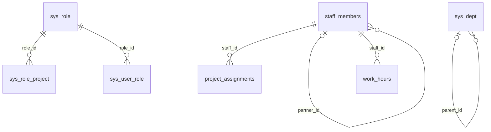

没有画出的表（只引用 `projects` / `users`，或没有外键）：`annual_independence_declarations`、`dispatch_records`、`handover_records`、`logs`、`notifications`、`partner_rotation_overrides`、`project_creation_grants`、`project_user_level_backfill`、`project_users`、`temporary_grants`、`user_display_preferences`、`users`、`work_hour_entries`

### D02 项目与项目管理（27 张表）

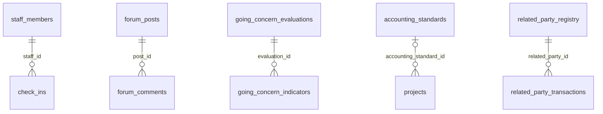

图中来自其他域的表：`accounting_standards`（D06）、`staff_members`（D01）

没有画出的表（只引用 `projects` / `users`，或没有外键）：`audit_findings`、`audit_plans`、`audit_procedures`、`budget_hours`、`interim_survival_checks`、`issue_tickets`、`management_letters`、`pbc_checklist`、`project_batch_import_plans`、`project_classification_v219_backup`、`project_sync`、`project_timeline`、`risk_assessments`、`risk_matrix_records`、`se_checklist`、`subsequent_events`、`sync_logs`、`task_events`、`task_tree_nodes`

### D03 账表导入与数据集（16 张表）

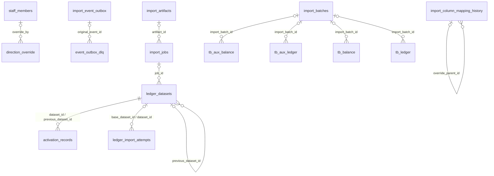

图中来自其他域的表：`staff_members`（D01）

没有画出的表（只引用 `projects` / `users`，或没有外键）：`import_event_consumptions`、`tb_aux_balance_summary`

### D04 科目映射与试算表（13 张表）

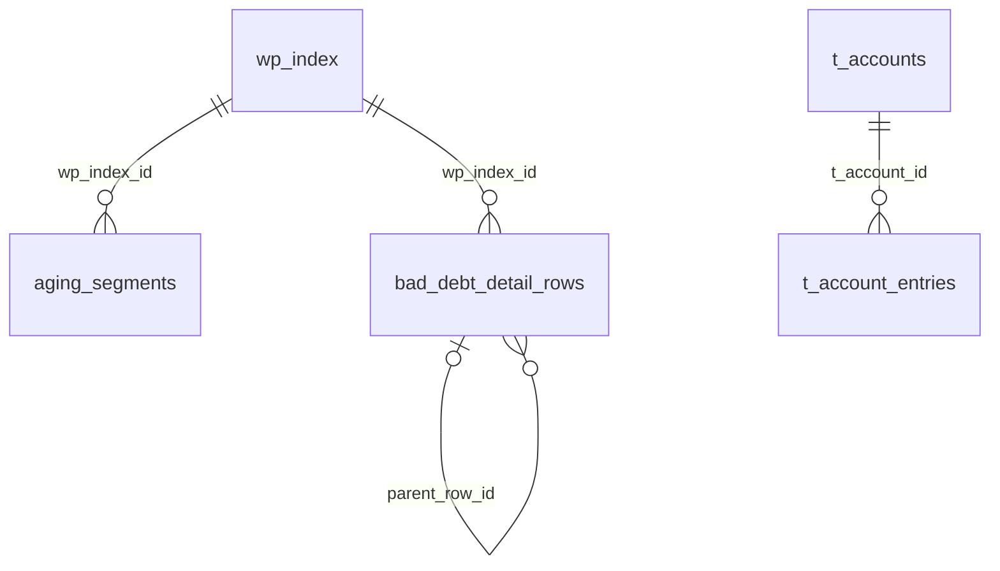

图中来自其他域的表：`wp_index`（D09）

没有画出的表（只引用 `projects` / `users`，或没有外键）：`account_chart`、`account_mapping`、`custom_account_packages`、`materiality`、`report_line_mapping`、`tb_change_history`、`tb_publish_ack`、`trial_balance`、`trial_balance_snapshots`

### D05 调整分录与错报（11 张表）

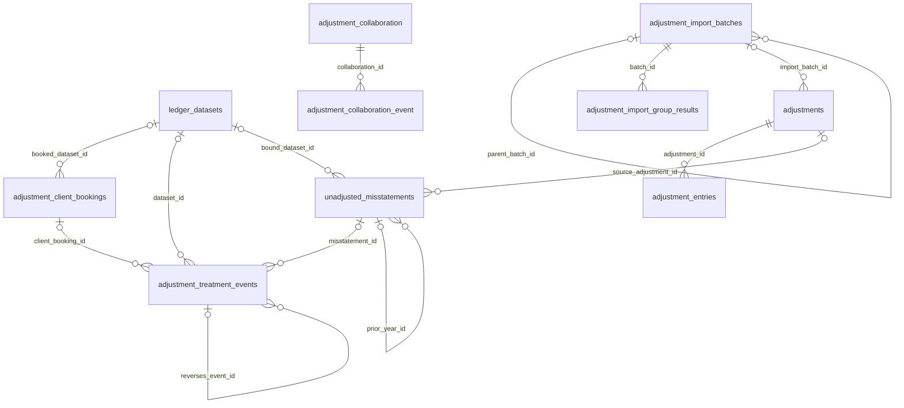

图中来自其他域的表：`ledger_datasets`（D03）

没有画出的表（只引用 `projects` / `users`，或没有外键）：`adjustment_editing_locks`、`adjustment_review_tasks`

### D06 报表、审计报告与交付件（21 张表）

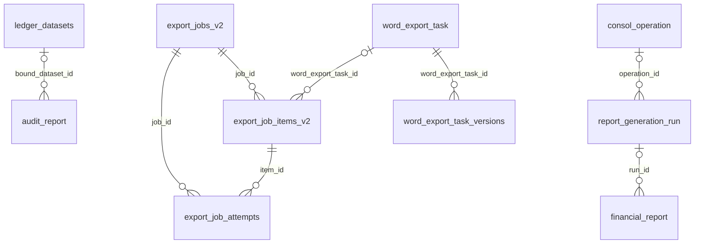

图中来自其他域的表：`consol_operation`（D11）、`ledger_datasets`（D03）

没有画出的表（只引用 `projects` / `users`，或没有外键）：`accounting_standards`、`audit_report_template`、`cf_verification_results`、`cfs_adjustments`、`deliverable_section_state`、`deliverable_snapshots`、`export_tasks`、`fill_preview_sessions`、`regulatory_filing`、`report_config`、`report_config_baseline`、`report_format_templates`、`report_snapshot`

### D07 附注（15 张表）

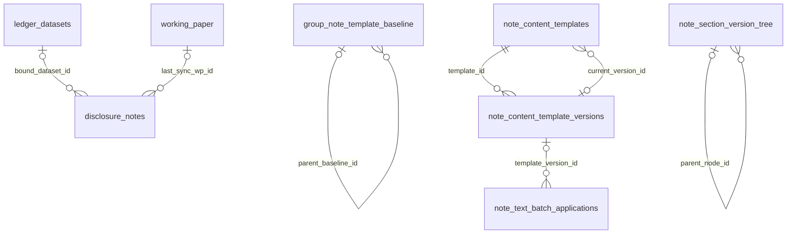

图中来自其他域的表：`ledger_datasets`（D03）、`working_paper`（D09）

没有画出的表（只引用 `projects` / `users`，或没有外键）：`account_note_mapping`、`group_note_templates`、`note_account_mappings`、`note_formula_run`、`note_section_instances`、`note_section_locks`、`note_section_templates`、`note_trim_schemes`、`note_validation_results`

### D08 公式、取数与查询（21 张表）

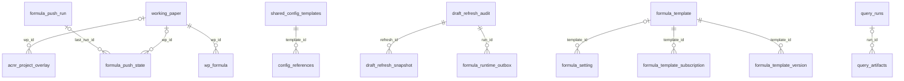

图中来自其他域的表：`working_paper`（D09）

没有画出的表（只引用 `projects` / `users`，或没有外键）：`advanced_query_writeback`、`custom_query_templates`、`draft_marker`、`enum_dict_overrides`、`formula_publish`、`formula_sync_item`

### D09 底稿（60 张表）

```mermaid
erDiagram
  staff_members |o--o{ account_package_program_status : "reviewer / updated_by"
  working_paper ||--o{ custom_workbook_unit_authorities : "working_paper_id"
  guidance_publication |o--o{ guidance_publication : "superseded_by"
  guidance_publication ||--o{ guidance_publication_event : "publication_id"
  procedure_instances |o--o{ procedure_instances : "parent_id"
  staff_members |o--o{ procedure_instances : "assigned_to"
  procedure_row_definitions ||--o{ procedure_row_definition_revisions : "definition_key"
  procedure_row_tasks ||--o{ procedure_row_task_history : "task_id"
  staff_members |o--o{ procedure_row_task_history : "new_assignee_staff_id / new_reviewer_staff_id / old_assignee_staff_id / old_reviewer_staff_id"
  procedure_row_definitions ||--o{ procedure_row_tasks : "definition_key"
  staff_members |o--o{ procedure_row_tasks : "assignee_staff_id / reviewer_staff_id"
  working_paper |o--o{ procedure_row_tasks : "wp_id"
  wp_index ||--o{ procedure_row_tasks : "wp_index_id"
  procedure_operation_previews ||--o{ procedure_trim_cycle_confirmations : "source_preview_id"
  guidance_publication |o--o{ project_guidance_supplement : "base_publication_id"
  template_library ||--o{ project_template_selections : "template_id"
  sampling_config |o--o{ sampling_records : "sampling_config_id"
  working_paper |o--o{ sampling_records : "working_paper_id"
  template_library |o--o{ template_library : "source_template_id"
  ledger_datasets |o--o{ working_paper : "bound_dataset_id"
  wp_index ||--o{ working_paper : "wp_index_id"
  procedure_row_tasks |o--o{ workpaper_delegation_history : "task_id"
  staff_members |o--o{ workpaper_delegation_history : "new_staff_id / old_staff_id"
  working_paper |o--o{ workpaper_delegation_history : "wp_id"
  wp_index ||--o{ workpaper_delegation_history : "wp_index_id"
  working_paper ||--o{ workpaper_extraction_log : "workpaper_id"
  workpaper_generation_operations ||--o{ workpaper_generation_items : "operation_id"
  wp_template_set |o--o{ workpaper_generation_operations : "template_set_id"
  working_paper ||--o{ workpaper_procedures : "wp_id"
  workpaper_row_name_mapping |o--o{ workpaper_row_name_mapping : "superseded_from"
  workpaper_row_name_mapping ||--o{ workpaper_row_name_mapping_target : "mapping_id"
  workpaper_template_version |o--o{ workpaper_sheet_classification : "template_version_id"
  working_paper ||--o{ workpaper_snapshots : "workpaper_id"
  workpaper_template_version |o--o{ workpaper_template_version : "parent_version_id"
  working_paper |o--o{ wp_access_security_outbox : "wp_id"
  wp_index |o--o{ wp_access_security_outbox : "wp_index_id"
  working_paper ||--o{ wp_cross_ref : "source_wp_id"
  working_paper ||--o{ wp_edit_sessions : "wp_id"
  working_paper ||--o{ wp_export_snapshot : "working_paper_id"
  wp_template ||--o{ wp_template_meta : "template_id"
  wp_template |o--o{ wp_template_metadata : "template_id"
  working_paper ||--o{ wp_version_archive : "working_paper_id"
```

图中来自其他域的表：`ledger_datasets`（D03）、`staff_members`（D01）

没有画出的表（只引用 `projects` / `users`，或没有外键）：`checklist_responses`、`editing_locks`、`gt_wp_coding`、`guidance_consumer_ack`、`guidance_exemption_record`、`guidance_handoff_visibility`、`procedure_instance_identity_v217_backup`、`procedure_template_revisions`、`procedure_trim_schemes`、`project_workbook_instance`、`project_workbook_sheet_entry`、`project_workpaper_sheet_override`、`sampled_vouchers`、`workpaper_editing_locks`、`workpaper_field_overrides`、`workpaper_lifecycle_events`、`workpaper_template_override_version`、`wp_migration_snapshots`、`wp_recommendation_feedback`、`wp_sheet_locks`、`wp_template_custom`、`wp_visibility_invalidation_outbox`、`wp_visibility_policy_epoch`

### D10 底稿在线编辑同步（30 张表）

```mermaid
erDiagram
  working_paper ||--o{ working_paper_artifact : "wp_id"
  working_paper_callback_delivery |o--o{ working_paper_artifact : "source_delivery_id"
  working_paper_sync_operation |o--o{ working_paper_artifact : "created_by_operation_id"
  working_paper ||--o{ working_paper_callback_delivery : "wp_id"
  working_paper_artifact |o--o{ working_paper_callback_delivery : "incoming_artifact_id"
  working_paper_callback_recovery_case |o--o{ working_paper_callback_delivery : "callback_recovery_case_id"
  working_paper_content_application |o--o{ working_paper_callback_delivery : "application_id"
  working_paper_forcesave_request |o--o{ working_paper_callback_delivery : "forcesave_request_id"
  working_paper_oo_room ||--o{ working_paper_callback_delivery : "room_id"
  working_paper_sync_operation |o--o{ working_paper_callback_delivery : "operation_id"
  working_paper ||--o{ working_paper_callback_recovery_case : "wp_id"
  working_paper_artifact ||--o{ working_paper_callback_recovery_case : "incoming_artifact_id"
  working_paper_content_application |o--o{ working_paper_callback_recovery_case : "application_id"
  working_paper_forcesave_request |o--o{ working_paper_callback_recovery_case : "recovery_request_id"
  working_paper_oo_client_confirmation |o--o{ working_paper_callback_recovery_case : "prior_confirmation_id"
  working_paper_oo_participant |o--o{ working_paper_callback_recovery_case : "claimed_by_participant_id"
  working_paper_oo_room ||--o{ working_paper_callback_recovery_case : "room_id"
  working_paper_sync_definition_bundle |o--o{ working_paper_callback_recovery_case : "claimed_definition_bundle_id"
  working_paper_sync_operation |o--o{ working_paper_callback_recovery_case : "operation_id"
  working_paper_callback_recovery_case ||--o{ working_paper_callback_recovery_case_event : "case_id"
  working_paper_oo_client_confirmation |o--o{ working_paper_callback_recovery_case_event : "prior_confirmation_id"
  working_paper ||--o{ working_paper_content_application : "wp_id"
  working_paper_artifact ||--o{ working_paper_content_application : "incoming_artifact_id"
  working_paper_content_application |o--o{ working_paper_content_application : "superseded_by_application_id"
  working_paper_content_representation ||--o{ working_paper_content_application : "base_representation_id / result_representation_id"
  working_paper_content_version ||--o{ working_paper_content_application : "base_version_id"
  working_paper_forcesave_request ||--o{ working_paper_content_application : "origin_request_id"
  working_paper_oo_room ||--o{ working_paper_content_application : "room_id"
  working_paper_sync_definition_artifact ||--o{ working_paper_content_application : "authority_model_definition_id"
  working_paper_sync_definition_bundle ||--o{ working_paper_content_application : "definition_bundle_id"
  working_paper_content_application ||--o{ working_paper_content_application_event : "application_id"
  working_paper_forcesave_request |o--o{ working_paper_content_application_event : "folded_request_id"
  working_paper ||--o{ working_paper_content_representation : "wp_id"
  working_paper_artifact ||--o{ working_paper_content_representation : "artifact_id"
  working_paper_content_representation |o--o{ working_paper_content_representation : "parent_representation_id"
  working_paper_content_version ||--o{ working_paper_content_representation : "content_version_id"
  working_paper_sync_definition_artifact ||--o{ working_paper_content_representation : "authority_model_definition_id"
  working_paper_sync_definition_bundle ||--o{ working_paper_content_representation : "definition_bundle_id"
  working_paper ||--o{ working_paper_content_revision_backfill_ledger : "wp_id"
  working_paper ||--o{ working_paper_content_version : "wp_id"
  working_paper_artifact |o--o{ working_paper_content_version : "authoritative_artifact_id / projection_artifact_id"
  working_paper_content_version |o--o{ working_paper_content_version : "parent_version_id"
  working_paper_sync_operation |o--o{ working_paper_content_version : "operation_id"
  working_paper_artifact ||--o{ working_paper_entry_evidence_scenario : "trace_bundle_artifact_id"
  working_paper_sync_test_run ||--o{ working_paper_entry_evidence_scenario : "run_id"
  working_paper_content_representation ||--o{ working_paper_forcesave_request : "client_base_representation_id"
  working_paper_content_version ||--o{ working_paper_forcesave_request : "client_base_version_id"
  working_paper_oo_participant ||--o{ working_paper_forcesave_request : "initiated_by_participant_id"
  working_paper_oo_room ||--o{ working_paper_forcesave_request : "room_id"
  working_paper_sync_definition_artifact ||--o{ working_paper_forcesave_request : "authority_model_definition_id"
  working_paper_sync_definition_bundle ||--o{ working_paper_forcesave_request : "definition_bundle_id"
  working_paper_content_representation ||--o{ working_paper_oo_client_confirmation : "representation_id"
  working_paper_content_version ||--o{ working_paper_oo_client_confirmation : "content_version_id"
  working_paper_oo_participant ||--o{ working_paper_oo_client_confirmation : "participant_id"
  working_paper_oo_room ||--o{ working_paper_oo_client_confirmation : "room_id"
  working_paper_sync_definition_bundle ||--o{ working_paper_oo_client_confirmation : "definition_bundle_id"
  working_paper_forcesave_request |o--o{ working_paper_oo_close_intent : "ordinary_forcesave_request_id / promoted_request_id"
  working_paper_oo_client_confirmation ||--o{ working_paper_oo_close_intent : "client_confirmation_id"
  working_paper_oo_participant ||--o{ working_paper_oo_close_intent : "participant_id"
  working_paper_oo_room ||--o{ working_paper_oo_close_intent : "room_id"
  working_paper_oo_close_intent ||--o{ working_paper_oo_close_intent_event : "intent_id"
  working_paper_oo_room ||--o{ working_paper_oo_participant : "room_id"
  working_paper ||--o{ working_paper_oo_room : "wp_id"
  working_paper_content_application |o--o{ working_paper_oo_room : "latest_durable_application_id"
  working_paper_content_representation |o--o{ working_paper_oo_room : "client_confirmed_representation_id"
  working_paper_content_version ||--o{ working_paper_oo_room : "client_confirmed_base_version_id / last_applied_version_id / opened_base_version_id"
  working_paper_oo_close_intent |o--o{ working_paper_oo_room : "close_leader_intent_id"
  working_paper_sync_definition_bundle |o--o{ working_paper_oo_room : "client_confirmed_definition_bundle_id"
  working_paper ||--o{ working_paper_pending_mutation : "wp_id"
  working_paper_artifact ||--o{ working_paper_pending_mutation : "payload_artifact_id"
  working_paper_content_version |o--o{ working_paper_pending_mutation : "result_content_version_id"
  working_paper_sync_operation |o--o{ working_paper_pending_mutation : "result_operation_id"
  working_paper_representation_upgrade_candidate ||--o{ working_paper_representation_candidate_event : "candidate_id"
  working_paper_sync_definition_artifact |o--o{ working_paper_representation_candidate_event : "contract_definition_id"
  working_paper_sync_definition_bundle |o--o{ working_paper_representation_candidate_event : "definition_bundle_id"
  working_paper ||--o{ working_paper_representation_upgrade_candidate : "wp_id"
  working_paper_artifact ||--o{ working_paper_representation_upgrade_candidate : "staged_artifact_id"
  working_paper_content_representation ||--o{ working_paper_representation_upgrade_candidate : "finalized_representation_id / source_representation_id"
  working_paper_content_version ||--o{ working_paper_representation_upgrade_candidate : "content_version_id"
  working_paper_sync_definition_artifact ||--o{ working_paper_representation_upgrade_candidate : "instrumentation_definition_id / target_contract_definition_id / template_definition_id"
  working_paper_sync_definition_bundle |o--o{ working_paper_representation_upgrade_candidate : "target_definition_bundle_id"
  working_paper_content_application |o--o{ working_paper_sync_conflict : "canonical_application_id"
  working_paper_sync_operation ||--o{ working_paper_sync_conflict : "operation_id"
  working_paper_artifact ||--o{ working_paper_sync_definition_artifact : "blob_artifact_id"
  working_paper_sync_definition_artifact |o--o{ working_paper_sync_definition_artifact : "supersedes_id"
  working_paper_artifact ||--o{ working_paper_sync_definition_bundle : "canonical_payload_artifact_id"
  working_paper_sync_definition_artifact ||--o{ working_paper_sync_definition_bundle : "authority_model_definition_id"
  working_paper ||--o{ working_paper_sync_entry_state : "wp_id"
  working_paper_content_representation ||--o{ working_paper_sync_entry_state : "current_representation_id"
  working_paper ||--o{ working_paper_sync_operation : "wp_id"
  working_paper_content_application |o--o{ working_paper_sync_operation : "application_id"
  working_paper_forcesave_request |o--o{ working_paper_sync_operation : "forcesave_request_id"
  working_paper_oo_participant |o--o{ working_paper_sync_operation : "initiated_by_participant_id"
  working_paper_oo_room |o--o{ working_paper_sync_operation : "room_id"
  working_paper_sync_definition_artifact ||--o{ working_paper_sync_operation : "authority_model_definition_id"
  working_paper_sync_definition_bundle ||--o{ working_paper_sync_operation : "definition_bundle_id"
  working_paper_sync_operation |o--o{ working_paper_sync_operation : "duplicate_of_operation_id"
  working_paper_oo_participant ||--o{ working_paper_sync_operation_contributor : "participant_id"
  working_paper_sync_operation ||--o{ working_paper_sync_operation_contributor : "operation_id"
  working_paper_sync_operation ||--o{ working_paper_sync_operation_event : "operation_id"
  working_paper ||--o{ working_paper_sync_scope_index : "wp_id"
  working_paper_artifact ||--o{ working_paper_sync_test_run : "run_manifest_artifact_id"
```

图中来自其他域的表：`working_paper`（D09）

没有画出的表（只引用 `projects` / `users`，或没有外键）：`working_paper_oo_content_revision`、`working_paper_sync_definition_null_marker`

### D11 合并（36 张表）

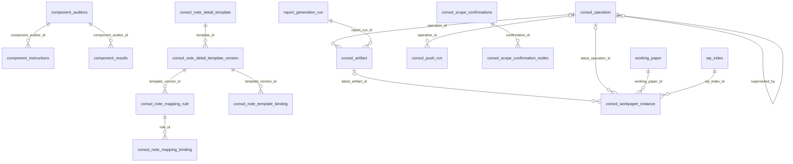

图中来自其他域的表：`report_generation_run`（D06）、`working_paper`（D09）、`wp_index`（D09）

没有画出的表（只引用 `projects` / `users`，或没有外键）：`companies`、`consol_cell_comments`、`consol_note_data`、`consol_note_formula`、`consol_note_mapping_rule_template`、`consol_note_structure_lock`、`consol_note_structure_lock_entity`、`consol_note_template_push_log`、`consol_note_value_confirmation`、`consol_query_template`、`consol_scope`、`consol_snapshots`、`consol_trial`、`consol_worksheet`、`consol_worksheet_data`、`elimination_entries`、`forex_translation`、`goodwill_calc`、`internal_ar_ap`、`internal_trade`、`minority_interest`、`share_change_event`

### D12 附件、证据、函证与归档（47 张表）

```mermaid
erDiagram
  ai_content_governance |o--o{ ai_content_governance : "previous_version_id"
  service_identities |o--o{ ai_content_governance : "actor_service_identity_id"
  archive_manifests ||--o{ archive_manifest_edges : "archive_manifest_id"
  archive_manifests ||--o{ archive_manifest_entries : "archive_manifest_id"
  service_identities |o--o{ archive_manifests : "actor_service_identity_id"
  service_identities |o--o{ asset_blobs : "actor_service_identity_id"
  asset_blobs |o--o{ attachment_versions : "blob_id"
  service_identities |o--o{ attachment_versions : "actor_service_identity_id"
  attachments ||--o{ attachment_working_paper : "attachment_id"
  working_paper ||--o{ attachment_working_paper : "wp_id"
  service_identities |o--o{ attachments : "actor_service_identity_id"
  ai_content_log ||--o{ citation_snapshots : "ai_content_log_id"
  evidence_refs ||--o{ citation_snapshots : "evidence_ref_id"
  service_identities |o--o{ citation_snapshots : "actor_service_identity_id"
  confirmation_lists ||--o{ confirmation_ai_check : "confirmation_list_id"
  attachments ||--o{ confirmation_attachment_link : "attachment_id"
  confirmations ||--o{ confirmation_attachment_link : "confirmation_id"
  confirmation_lists ||--o{ confirmation_attachments : "confirmation_list_id"
  confirmation_lists ||--o{ confirmation_letters : "confirmation_list_id"
  confirmation_lists ||--o{ confirmation_results : "confirmation_list_id"
  confirmation_lists ||--o{ confirmation_summaries : "confirmation_list_id"
  working_paper |o--o{ confirmations : "wp_id"
  service_identities |o--o{ evidence_audit_command_roots : "actor_service_identity_id"
  evidence_audit_command_roots ||--o{ evidence_audit_transitions : "command_root_id"
  service_identities |o--o{ evidence_audit_transitions : "actor_service_identity_id"
  evidence_refs |o--o{ evidence_dependencies : "evidence_ref_id"
  service_identities |o--o{ evidence_dependencies : "actor_service_identity_id"
  service_identities |o--o{ evidence_inbox : "actor_service_identity_id"
  attachments ||--o{ evidence_links : "attachment_id"
  working_paper ||--o{ evidence_links : "wp_id"
  service_identities |o--o{ evidence_migration_checkpoints : "actor_service_identity_id"
  evidence_audit_command_roots |o--o{ evidence_outbox : "command_root_id"
  service_identities |o--o{ evidence_outbox : "actor_service_identity_id"
  service_identities |o--o{ evidence_quality_snapshots : "actor_service_identity_id"
  evidence_upload_attempts ||--o{ evidence_quarantine_handles : "upload_attempt_id"
  service_identities |o--o{ evidence_quarantine_handles : "actor_service_identity_id"
  attachment_versions |o--o{ evidence_refs : "attachment_version_id"
  service_identities |o--o{ evidence_refs : "actor_service_identity_id"
  service_identities |o--o{ evidence_upload_attempts : "actor_service_identity_id"
  legal_holds ||--o{ legal_hold_scopes : "legal_hold_id"
  service_identities |o--o{ legal_holds : "actor_service_identity_id"
  ocr_jobs ||--o{ ocr_confirmations : "ocr_job_id"
  ocr_results ||--o{ ocr_confirmations : "ocr_result_id"
  evidence_audit_command_roots |o--o{ ocr_job_transitions : "command_root_id"
  ocr_jobs ||--o{ ocr_job_transitions : "ocr_job_id"
  service_identities |o--o{ ocr_job_transitions : "actor_service_identity_id"
  attachment_versions ||--o{ ocr_jobs : "attachment_version_id"
  evidence_audit_command_roots |o--o{ ocr_jobs : "command_root_id"
  service_identities |o--o{ ocr_jobs : "actor_service_identity_id"
  attachment_versions ||--o{ ocr_results : "attachment_version_id"
  ocr_jobs ||--o{ ocr_results : "ocr_job_id"
  service_identities |o--o{ ocr_results : "actor_service_identity_id"
  ocr_writebacks ||--o{ ocr_writeback_staging : "ocr_writeback_id"
  evidence_audit_command_roots |o--o{ ocr_writebacks : "command_root_id"
  ocr_jobs ||--o{ ocr_writebacks : "ocr_job_id"
  evidence_audit_command_roots |o--o{ review_closes : "command_root_id"
  evidence_refs ||--o{ review_evidence_snapshots : "evidence_ref_id"
  service_identities |o--o{ review_evidence_snapshots : "actor_service_identity_id"
```

图中来自其他域的表：`ai_content_log`（D14）、`working_paper`（D09）

没有画出的表（只引用 `projects` / `users`，或没有外键）：`archive_checklists`、`archive_jobs`、`archive_modifications`、`attachment_lineage`、`confirmation_action_log`、`evidence_hash_checks`、`evidence_tombstones`、`legacy_attachment_alias`

### D13 复核、质控与签字门禁（29 张表）

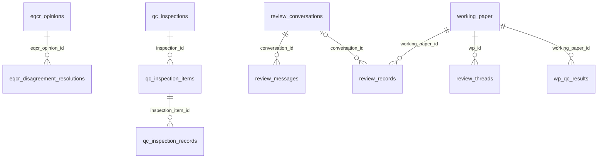

图中来自其他域的表：`working_paper`（D09）

没有画出的表（只引用 `projects` / `users`，或没有外键）：`audit_check_signoff`、`cell_annotations`、`consistency_gate_acknowledgements`、`cross_check_results`、`eqcr_review_notes`、`eqcr_shadow_computations`、`eqcr_snapshots`、`gate_decisions`、`gate_rule_configs`、`independence_signing_tasks`、`project_quality_ratings`、`qc_case_library`、`qc_rule_definitions`、`review_checklist_records`、`review_templates`、`reviewer_metrics_snapshots`、`signature_records`、`trace_events`、`workpaper_review_records`

### D14 AI 与知识库（33 张表）

```mermaid
erDiagram
  ai_analysis_report ||--o{ ai_analysis_item : "report_id"
  ai_chat_session ||--o{ ai_chat_action_receipts : "session_id"
  ai_chat_runs |o--o{ ai_chat_attachments : "run_id"
  ai_chat_session ||--o{ ai_chat_attachments : "session_id"
  ai_chat_runs |o--o{ ai_chat_message : "run_id"
  ai_chat_session ||--o{ ai_chat_message : "session_id"
  ai_chat_runs ||--o{ ai_chat_run_resources : "run_id"
  ai_chat_session ||--o{ ai_chat_run_resources : "session_id"
  asset_blobs |o--o{ ai_chat_run_resources : "blob_id"
  attachment_versions |o--o{ ai_chat_run_resources : "attachment_version_id"
  ai_chat_session ||--o{ ai_chat_runs : "session_id"
  ai_chat_runs ||--o{ ai_chat_tool_calls : "run_id"
  ai_chat_tool_calls |o--o{ ai_chat_tool_calls : "parent_call_id"
  ai_chat_message |o--o{ ai_content_log : "source_message_id"
  citation_snapshots |o--o{ ai_content_log : "citation_snapshot_id"
  evidence_refs |o--o{ ai_content_log : "evidence_ref_id"
  ai_evidence_chains ||--o{ ai_evidence_items : "chain_id"
  ai_chat_message |o--o{ ai_task_items : "message_id"
  ai_task_jobs ||--o{ ai_task_items : "job_id"
  ai_workpaper_tasks |o--o{ ai_workpaper_fills : "task_id"
  working_paper ||--o{ ai_workpaper_fills : "workpaper_id"
  working_paper ||--o{ ai_workpaper_tasks : "workpaper_id"
  document_scan ||--o{ document_extracted : "document_scan_id"
  document_scan ||--o{ document_match : "document_scan_id"
  asset_blobs |o--o{ knowledge_documents : "blob_id"
  knowledge_folders ||--o{ knowledge_documents : "folder_id"
  asset_blobs ||--o{ knowledge_evidence_promotions : "source_blob_id"
  attachment_versions ||--o{ knowledge_evidence_promotions : "target_attachment_version_id"
  attachments ||--o{ knowledge_evidence_promotions : "target_attachment_id"
  knowledge_documents ||--o{ knowledge_evidence_promotions : "source_document_id"
  knowledge_folders |o--o{ knowledge_folders : "parent_id"
  working_paper ||--o{ wp_ai_generations : "wp_id"
```

图中来自其他域的表：`asset_blobs`（D12）、`attachment_versions`（D12）、`attachments`（D12）、`citation_snapshots`（D12）、`evidence_refs`（D12）、`working_paper`（D09）

没有画出的表（只引用 `projects` / `users`，或没有外键）：`ai_chat_history`、`ai_chat_mcp_call_log`、`ai_chat_mcp_token_revocations`、`ai_confirmation_audit`、`ai_content`、`ai_knowledge_base`、`ai_model_config`、`ai_plugins`、`evidence_chain`、`knowledge_index`

### D15 后台任务与基础设施（21 张表）

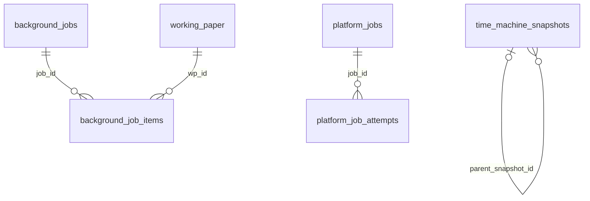

图中来自其他域的表：`working_paper`（D09）

没有画出的表（只引用 `projects` / `users`，或没有外键）：`acnr_invalidation_epoch`、`acnr_invalidation_outbox`、`app_audit_log`、`audit_chain_head`、`audit_log_entries`、`chain_executions`、`cross_module_conflicts`、`data_snapshots`、`event_cascade_log`、`feature_flags`、`offline_conflicts`、`schema_drift_log`、`schema_migration_failures`、`schema_version`、`system_settings`、`version_line_stamps`

## 5.5 核心业务的逻辑关联（没有外键的那部分）

下图是代码里实际使用的关联键，大部分在数据库里没有外键约束。连线文字是关联方式。

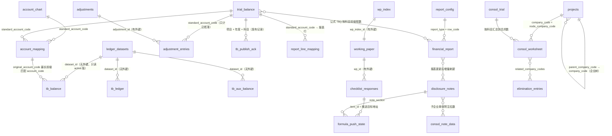

