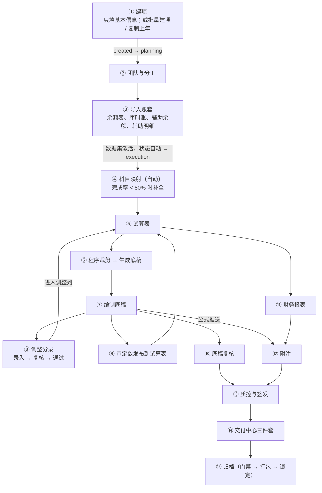

# 致同审计作业平台 · 项目流程

| 文档信息 | 内容 |
|---|---|
| 依据来源 | 平台当前代码 `dev1.0`（v1.0.261），按实际实现梳理 |
| 描述对象 | 一个审计项目从**建项到归档**的完整流程 |
| 环节写法 | 每个环节统一写明：**在哪操作 · 谁来做 · 系统自动做什么 · 怎样算完成** |
| 配套文档 | 《audit-project-workflow-可视化.html》（本文档的可视化版） |
| 更新日期 | 2026-11-18（结构重构） |

**查阅方式**：
- 想知道某环节怎么操作 → 直接查 **第二部分** 对应编号环节；
- 想知道自己能做什么、别人不能做什么 → 查 **1.2 角色与权限**；
- 项目卡在某个状态不动 → 查 **1.3 状态机**；
- 出了问题要排查 → 查 **第五部分**。

---

## 第一部分 · 总则

### 1.1 角色与权限

| 角色 | 主要职责 | 项目内权限 |
|---|---|---|
| 管理员 admin | 账号、权限、部门、AI 模型、全局配置 | 全部 |
| 签字合伙人 partner | 重大判断、审计意见、签发 | 编辑 |
| 项目经理 manager | 建项、分工、进度、一级复核 | 编辑 |
| 审计员 auditor | 导入数据、编制底稿、录入调整 | 编辑 |
| 质控 qc | 质量复核 | 复核 |
| EQCR | 项目质量控制复核（独立技术复核） | 复核（只读编辑内容） |

> **受限操作**：程序委派、调整审批、审计阶段切换只有 **经理 / 合伙人 / 管理员** 可以操作。

### 1.2 项目状态机

| 状态 | 含义 | 由谁 / 什么推进 |
|---|---|---|
| created 新建 | 刚创建（复制上年时） | 系统 |
| planning 计划中 | 已保存基本信息 | 建项向导确认 |
| execution 执行中 | 已导入账套 | **账套数据集激活时自动推进**（只会从新建 / 计划中往前推，不会回退） |
| completion 完成阶段 | 底稿基本完成 | ⚠ 代码中没有自动推进（见附录） |
| reporting 报告阶段 | 报表已出、编附注、出报告 | ⚠ 代码中没有自动推进（见附录） |
| archived 已归档 | 已锁定 | 归档「锁定」步骤；解除归档后回到 execution |

> 另有独立的「审计阶段」字段：**预审 / 年审**（默认年审），由经理以上在项目设置里切换，影响抽凭等功能。

---

## 第二部分 · 项目主流程（15 环节 · 5 阶段）

15 个环节按数据流顺序编号 ①-⑮，归入 5 个阶段。阶段只是阅读分组，**平台不锁定操作顺序**（导入页等个别页面除外）。

### 2.0 流程总览

阶段划分与依赖关系：

| 阶段 | 环节 | 一句话概括 |
|---|---|---|
| A 建项与准备 | ①② | 把项目建起来、把人分好 |
| B 数据准备 | ③④⑤ | 客户数据进来、对上标准科目、算出未审数 |
| C 审计作业 | ⑥⑦⑧⑨⑩ | 生成底稿 → 编制 → 调整 → 发布审定数 → 复核 |
| D 成果编制 | ⑪⑫ | 按审定数出报表和附注 |
| E 质控交付与归档 | ⑬⑭⑮ | 复核签发 → 出三件套 → 归档锁定 |

---

### 阶段 A · 建项与准备

#### ① 建项

| 在哪操作 | 项目 → 新建项目 `/projects/new`；或批量建项 |
|---|---|
| 谁做 | 经理 |
| 系统自动 | 保存后项目进入「计划中」 |
| 完成标志 | 项目卡片出现 |

要点：
- 新建项目只有一步「基本信息」：客户名称、企业代码（统一社会信用代码）、简称、**审计年度**、项目类型、会计准则、报表标准（国企 / 上市）、报表类型（单户 / 合并）、团队、集团架构（上级企业及代码）。
- 科目导入、映射、重要性水平、团队分工都改在项目内各自的页面完成（旧版「向导六步」已停用，见附录）。
- **批量建项**：下载模板 → 上传校验 → 确认创建；支持合并集团批量建项。
- **复制上年**：项目详情 →「创建下年项目」，继承科目映射、团队、审定数等配置。
- 经理建项要求事先获得该企业代码的建项授权（管理员配置）；合伙人、管理员不受限。

#### ② 团队与分工

| 在哪操作 | 项目详情 → 团队；人员档案 |
|---|---|
| 谁做 | 经理 |
| 系统自动 | — |
| 完成标志 | 成员与签字合伙人已指定 |

---

### 阶段 B · 数据准备

#### ③ 导入账套

| 在哪操作 | 项目 → 账套导入 `/ledger-import` |
|---|---|
| 谁做 | 审计员 |
| 系统自动 | 识别文件、列映射、校验、入库四表；激活数据集 |
| 完成标志 | 数据集「生效」，项目状态自动变「执行中」 |

要点：
- 支持一个文件含余额表、序时账、辅助余额、辅助明细四张表。
- 步骤：上传 → 自动识别表类型和列 → 核对列映射 → 校验 → 入库 → 数据集生效。
- ⚠ **账套年度必须和项目审计年度一致**，否则查账、试算表都看不到数据。
- 导入失败可重试 / 接管；可在导入历史里回滚到上一个数据集。

#### ④ 科目映射

| 在哪操作 | 导入后自动；必要时到 `/mapping` 补全 |
|---|---|
| 谁做 | 审计员 |
| 系统自动 | 导入后自动匹配客户科目 → 标准科目，并重算试算表 |
| 完成标志 | 完成率 ≥ 80%，试算表无漏科目 |

要点：
- 完成率 **< 80%** 时，试算表页顶部会提示，需要到科目映射页补全。
- 科目映射页可筛选「未映射有余额」，并支持「按上级补全下级」、编辑上级时一并映射下级。
- 客户自建的费用归集科目（如 6600「成本费用」）系统认不出，需要人工指定。

#### ⑤ 试算表

| 在哪操作 | `/trial-balance` |
|---|---|
| 谁做 | 审计员 |
| 系统自动 | 按映射汇总未审数；调整变化后自动重算 |
| 完成标志 | 借贷平衡、一致性校验通过 |

要点：
- 试算表 = 未审数 + 审计调整（AJE）+ 重分类调整（RJE）= 审定数。
- 调整分录：录入 → 提交复核（选复核人）→ 通过 / 驳回；可从 Excel 导入。草稿不进试算表。
- **审定数只有一个入口写入试算表**：审定表上的「发布到试算表」，需二次确认（见环节⑨）。

---

### 阶段 C · 审计作业

#### ⑥ 程序裁剪 / 生成底稿

| 在哪操作 | `/procedures` → 生成 |
|---|---|
| 谁做 | 经理 |
| 系统自动 | 按循环与裁剪结果生成底稿清单 |
| 完成标志 | 底稿列表生成 |

要点：
- 底稿按审计循环组织：承接与计划（Q、B）、控制测试（C）、实质性程序（D～N、S）、完成与报告（A）。
- 先在程序裁剪页选择执行 / 不执行的程序，再按「生成计划」生成底稿；裁剪掉的底稿进回收站，可恢复。

#### ⑦ 编制底稿

| 在哪操作 | `/workpapers` → 编辑 |
|---|---|
| 谁做 | 审计员 |
| 系统自动 | 取数、公式计算、跨底稿引用 |
| 完成标志 | 底稿「编制完成」 |

要点：
- 编辑方式：网页表单（默认）或在线编辑（OnlyOffice，与表单双向同步）。
- 底稿状态：编制中 → 编制完成 → 复核中 →（退回修改）→ 复核通过 → 归档。
- 底稿里的证据、附件可就地上传和预览。

#### ⑧ 调整分录

| 在哪操作 | `/adjustments` |
|---|---|
| 谁做 | 审计员录入，经理复核 |
| 系统自动 | 审批通过后进入试算表调整列，通知相关底稿负责人 |
| 完成标志 | 无待复核分录 |

#### ⑨ 审定数发布

| 在哪操作 | 审定表 → 发布到试算表 |
|---|---|
| 谁做 | 审计员 |
| 系统自动 | 二次确认后写入试算表审定数 |
| 完成标志 | 审定数与审定表一致 |

> 审定数**只有这一个入口**写入试算表。

#### ⑩ 底稿复核

| 在哪操作 | 底稿 → 提交复核；复核收件箱 |
|---|---|
| 谁做 | 现场负责人 / 经理 / 合伙人 |
| 系统自动 | 复核意见、退回修改 |
| 完成标志 | 底稿「复核通过」 |

---

### 阶段 D · 成果编制

#### ⑪ 财务报表

| 在哪操作 | `/reports` |
|---|---|
| 谁做 | 审计员 / 经理 |
| 系统自动 | 按试算表审定数生成报表 |
| 完成标志 | 报表与试算表勾稽一致 |

要点：
- 报表：资产负债表、利润表、现金流量表、所有者权益变动表、现金流量表补充资料；国企版另有资产减值准备表。

#### ⑫ 附注

| 在哪操作 | `/disclosure-notes` |
|---|---|
| 谁做 | 审计员 |
| 系统自动 | 底稿披露表经公式推送到附注；勾稽校验 |
| 完成标志 | 附注章节无「待更新」 |

要点：
- 附注按准则模板生成；支持上传附注 Word、批量编制、内容模板、AI 续写 / 改写。

---

### 阶段 E · 质控交付与归档

#### ⑬ 质控与签发

| 在哪操作 | QC 看板、EQCR、签发检查表 |
|---|---|
| 谁做 | QC / EQCR / 合伙人 |
| 系统自动 | 签发检查：未审调整、待确认 AI 内容、报告状态 |
| 完成标志 | 检查表全部通过 |

#### ⑭ 交付件

| 在哪操作 | 交付中心 `/deliverable-center`、审计报告 |
|---|---|
| 谁做 | 经理 / 合伙人 |
| 系统自动 | 生成审计报告、报表、附注三件套（Word/PDF） |
| 完成标志 | 交付件审批、签字 |

#### ⑮ 归档

| 在哪操作 | `/archive` 归档向导 |
|---|---|
| 谁做 | 经理 / 合伙人 |
| 系统自动 | 门禁 → 打包 → 锁定（可选上传云端、清理本地） |
| 完成标志 | 状态「已归档」，底稿锁定 |

要点：
- 归档门禁检查与向导同一口径；打包按清单逐文件校验。
- 锁定后保留期 10 年；可解除归档，需填写原因并输入项目名称确认。

---

## 第三部分 · 合并项目

| 步骤 | 说明 |
|---|---|
| 1. 建项 | 报表类型选「合并」；子企业项目填上级企业代码 |
| 2. 企业树 | 按企业代码自动构建，可拖拽调整上级 |
| 3. 子企业 | 各子企业按单体流程完成试算表、报表、附注 |
| 4. 合并试算表 | **合并数 = 各子企业个别数汇总 + 差额（调整、抵销分录，一般以负数填列）** |
| 5. 抵销分录 | 在差额节点录入；与抵销分录汇总表同源 |
| 6. 合并报表 / 附注 | 合并附注从子企业附注拉数，再按企业树「重新汇总」 |

---

## 第四部分 · 辅助功能

| 模块 | 用途 |
|---|---|
| 函证 | 函证管理、回函识别比对、替代程序 |
| 附件 | 全项目附件、OCR 识别、证据关联 |
| 知识库 / 私人库 | 文档存储与检索，可作为 AI 对话的参考资料 |
| 模板库 / 全局公式 | 底稿、附注、报告模板；全局公式与项目适配 |
| 工时 / 看板 | 工时填报审批；经理、合伙人、管理层看板 |
| AI 模型 / AI 对话 | 管理员配置模型；在底稿、附注、全局对话中使用 |
| 智能体商店 | 访谈、OCR、审计、标书、人力助手（外部链接） |

---

## 第五部分 · 使用前提与常见问题

| 问题 | 原因与处理 |
|---|---|
| 导入后查账没数据 | 账套年度 ≠ 项目审计年度；或数据集未生效 |
| 试算表漏科目 | 科目映射完成率 < 80%，到科目映射页补全 |
| 在线编辑报契约不一致 | 回写契约改过后，需重新发布该底稿的定义（运维工具补发） |
| AI 提示「AI 服务未启用」 | 服务器未打开 `WP_AI_SERVICE_ENABLED` |
| AI 对话「引擎不可用」 | 模型的信任域 / 客户数据设置不符合数据政策 |
| 录入模型 Key 报未配置 ENCRYPTION_KEY | 服务器未配置加密密钥（配好后不可更换） |

---

## 附录 · 已知缺口与待确认

1. 「完成阶段」「报告阶段」两个状态在代码里**没有任何地方自动推进**，项目会一直停在「执行中」直到归档。需要决定：按条件自动推进（例如全部底稿复核通过 → 完成阶段），还是提供手动切换。
2. 项目向导里的科目导入、科目映射、重要性、团队分工几步已停用，旧文档里「向导六步」的说法已不适用。
