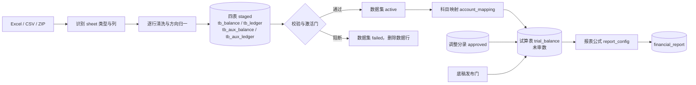

# 数据处理规则（导入 → 试算表 → 报表）

> 整理日期：2026-11-18。来源：源码 `backend/app/services/ledger_import/`、`mapping_service.py`、`trial_balance_service.py`、`report_engine.py`、`formula_engine.py`、`report_prior_period.py`，以及本地开发库 `report_config` 的只读查询。
> 配套：表结构 `database-tables.md`，表关系 `database-relationships.md`。
> 【未找到】= 本次在代码里没定位到；【需复核】= 代码行为可能与会计口径不符，需要业务确认。

## 0. 总体数据流



---

## 1. Excel 解析后的直接落库规则

### 1.1 流水线

入口 `ledger_import/pipeline.execute_pipeline`，由后台 Worker（`import_job_runner._execute_v2`）调用，不在 HTTP 请求里同步执行。顺序：

1. 识别文件结构：`detect_file_from_path` + 每个 sheet `identify()`。
2. 建 staged 数据集：`DatasetService.create_staged`（年度、金额单位写进 `source_summary`）。
3. 逐 sheet 流式读取：xlsx/xlsm 用 calamine 或 openpyxl，csv/tsv 按检测到的编码读。
4. 每批：列映射 → 未映射列放 `raw_extra` → L1 校验。
5. 序时账、辅助明细：每批转换后立即写库。
6. 余额表、辅助余额：整个 sheet 读完再转换（要跨行去重）；主表行等所有 sheet 处理完再跨 sheet 去重后写入。
7. 激活门 `evaluate_activation` → `activate_dataset` → 发布 `LEDGER_DATASET_ACTIVATED` → 重建辅助余额汇总。

| 参数 | 值 | 位置 |
|------|----|------|
| 解析批大小 | 50,000 行；系统内存占用 >80% 时降为 10,000 行并改用 openpyxl | `pipeline.py:316-329` |
| 写库方式 | <10,000 行用 INSERT（每批 1000 行），否则 PG COPY，COPY 失败退回 INSERT | `writer.py` |
| 余额表 | 不分批写；累计超过 100,000 行只告警 | `pipeline.py:565` |
| 取消 | 每 5 批检查一次；取消时清理 staged 数据集 | `pipeline.py:361-373` |

### 1.2 文件与 sheet 识别

- 支持 `xlsx / xlsm / csv / tsv / zip`（zip 递归解包）。`.xls` 直接报错 `XLS_NOT_SUPPORTED`，其他扩展名报 `UNSUPPORTED_FILE_TYPE`。
- 识别只读前 20 行。
- sheet 类型（余额表 / 序时账 / 辅助余额 / 辅助明细 / 科目表）由三级打分加权决定（`identifier.identify`）：

| 级别 | 依据 | 权重 |
|------|------|------|
| L1 | sheet 名正则（如「科目余额 / 余额表 / 试算平衡」「凭证 / 序时 / 明细账」「辅助余额」「辅助明细」）；sheet 名没信号时看文件名 | 0.2 |
| L2 | 表头别名命中的关键列（全部命中才算），推荐列加分 | 0.5 |
| L3 | 内容特征 | 0.3 |

  - L1 置信度 ≥85 时锁定 L1 的结果；例外是 L2 识别出它的辅助变体（余额表→辅助余额、序时账→辅助明细）且 L2 ≥60，此时用 L2。
  - 判为 `unknown` 的 sheet 跳过，不落库。
- 表头行：按行间取值多样性判断；上行 2~4 个分组名、下行 ≥3 个子列名时，合成「组.子列」（如「期末余额.借方」）。
- 科目编码、科目名称两列向下填充，处理合并单元格。

### 1.3 列识别

- 别名词典：优先 `backend/data/ledger_recognition_rules.json` 的 `column_aliases`，缺失时用 `identifier.py` 内置 `_RAW_HEADER_ALIASES`。
- 匹配顺序：合并表头「组.子列」 → 归一化后精确匹配（置信度 95） → 子串包含取最长别名（70） → 编辑距离 ≤2 取最近（70）。归一化 = 去空白和标点、转小写。
- 用户确认过的列映射优先；没有时自动采用置信度 ≥50 的列（`pipeline.py:519-523`）。
- 合并表头映射（`identifier._MERGED_HEADER_MAPPING`）：

| 分组 | 借方 | 贷方 | 单列 |
|------|------|------|------|
| 年初余额 | year_opening_debit | year_opening_credit | opening_balance |
| 期初余额 | opening_debit | opening_credit | opening_balance |
| 本期发生额 | debit_amount | credit_amount | debit_amount |
| 本年累计 / 累计发生额 | year_debit | year_credit | year_debit |
| 期末余额 | closing_debit | closing_credit | closing_balance |

### 1.4 字段落库规则（`ledger_import/converter.py`）

| 目标列 | 规则 |
|--------|------|
| `account_code` / `account_name` | 只做 `strip()`；编码为空的行跳过。「1001 库存现金」这种编码名称合在一列的拆分【未找到】 |
| `level`（仅余额主表） | 编码去掉 `.` `-` 后按长度：≤4→1，≤6→2，≤8→3，≤10→4，更长→5 |
| 金额 | 去空白和英文逗号后转 Decimal；空串、`None`、无法解析 → NULL。括号负数、中文逗号不识别（得 NULL） |
| 期初取数优先级 | 年初借/贷 → 期初借/贷 → 期初单列余额 |
| 发生额取数优先级 | 本年累计借/贷 → 本期借/贷。0 算有值，不会跳到下一候选 |
| `voucher_date` | 日期对象；`YYYY-MM-DD`、`YYYY/MM/DD`、`YYYYMMDD`、`YYYY.MM.DD`（可带时分秒）；Excel 序列号（1~100000，基准 1899-12-30） |
| `accounting_period` | 「N期」或 1~12 的整数；取不到用凭证日期的月份 |
| 序时账必填 | 缺凭证日期或凭证号的行跳过 |
| `voucher_no` / `voucher_type` / `summary` / `preparer` | strip；空值存 NULL |
| `company_code` | 缺省 `default`。单体试算表重算不按这一列过滤，试算表统一写 `'001'` |
| `currency_code` | 缺省 `CNY` |
| `year` | 来自导入参数；未传时 `2025`（`pipeline.py:422`）。年度识别 `year_detector` 按文件名(95) → sheet 名(90) → 元信息(85) → 内容众数取，来源冲突标 `conflict` |
| `project_id` / `dataset_id` / `is_deleted` | 写库时统一填入（`bulk_write_staged`），`is_deleted=false` |
| `raw_extra` | 未映射列的 `{原表头: 原值}`，只留非空值；超过 8KB 按列顺序截断并告警 `EXTRA_TRUNCATED` |
| 金额单位 | 识别结果记进数据集 `source_summary`；按单位换算金额【未找到】 |

### 1.5 余额的借贷方向与符号（条件取值）

余额表有两种格式，先都换算成「借正贷负」净额，再按科目方向存成「自然正数」（v2 口径 `v2_category_natural_positive`）。

**第一步：换算净额与源文件方向**（`convert_balance_rows`）

| 源格式 | 净额 | 源文件方向 |
|--------|------|------------|
| 借贷分列（期初借/贷、期末借/贷） | 借 − 贷 | 只有借方有值→借；只有贷方有值→贷；两边都有值→看净额正负；都为 0 或空→借 |
| 单列余额 + 方向列 | 方向为「借 / 借方 / D / debit」取 +\|余额\|；「贷 / 贷方 / C / credit」取 −\|余额\| | 方向列的值；无法识别（如「平」）时为空 |
| 单列余额、无方向列 | 原值 | 空 |

方向列优先取 `opening_direction` / `closing_direction`，没有再用通用的 `direction`。

**第二步：归一为自然正数**（`_apply_sign_convention`）

```text
方向 = 源文件方向 ?? 科目类别方向（resolve_account_direction）
存储值 = 方向为借 ? 净额 : −净额
实际方向 = 存储值 ≥ 0 ? 方向 : 相反方向
```

- 写入 `opening_balance / closing_balance`（存储值）、`opening_direction / closing_direction`（实际方向）、`*_direction_source`、`sign_convention_version='v2_category_natural_positive'`。
- 存储值为负（例如负债出现借方余额）时保留负号，并在 `sign_anomaly_flags` 记 `{normal_direction, conflicts:[{period, actual_direction, stored_amount}]}`。
- `opening_debit / opening_credit / closing_debit / closing_credit / debit_amount / credit_amount` 按源文件原值保存，不做归一。

**序时账分录方向**（`_resolve_entry_direction`）：显式方向列 → 借贷哪边非零 → 两边都非零或都为空时按科目类别推断。**分录金额不归一**，借贷金额原样存。

**科目类别方向**（`direction_resolver.resolve_account_direction`）：
1. 名称含「累计折旧 / 累计摊销 / 坏账准备 / 减值准备 / 跌价准备 / 折耗 / 减值损失准备 / 未实现融资收益」→ 贷方（备抵）。
2. 名称含「库存股」→ 借方。
3. 否则按 `_infer_category`（名称关键词优先，编码兜底）：资产、费用 → 借方；负债、权益、收入 → 贷方；其余 → 借方。
4. 备抵只按名称判断；名称为空时只靠编码，来源标低置信度。

### 1.6 辅助核算拆分（`aux_dimension.parse_aux_dimension`）

- 识别的写法（依次尝试）：JSON 对象、`类型:编码,名称`、`类型:编码 名称`、`类型/编码/名称`、`类型|编码|名称`、`类型: 名称`、`编码 名称`、`类型 -> 名称`。
- 多维度：有 `;` 或 `；` 时按它切；否则只在「逗号后紧跟 `xxx:`」处切。
- 也支持辅助类型、编码、名称分三列，先拼成 `类型:编码 名称` 再解析。
- 落库：每个维度一行写进 `tb_aux_balance` / `tb_aux_ledger`，带原串 `aux_dimensions_raw`。

### 1.7 去重

| 场景 | 规则 |
|------|------|
| 余额表同一 (company_code, account_code) 有不带维度的汇总行 | 主表用第一条汇总行 |
| 只有带维度的明细行 | 聚合出一条虚拟汇总行，`raw_extra._aggregated_from_aux=true` |
| 同一余额按多个辅助类型各列一遍（各类型四项合计相等，容差 0.01） | 只取一个类型的行，避免翻倍 |
| 「科目余额表」与「辅助余额表」两个 sheet 都给出同一科目 | 跨 sheet 去重，真实汇总行优先于虚拟行 |
| 同一次导入已有序时账 sheet | 辅助明细 sheet 不再写 `tb_ledger` 主表 |
| 序时账 | 不去重 |

### 1.8 校验与激活门（`ledger_import/validator.py`）

| 代码 | 层级 | 规则 | 结果 |
|------|------|------|------|
| `ROW_SKIPPED_KEY_EMPTY` | L1 | 关键列为空 | 警告，行跳过 |
| `AMOUNT_NOT_NUMERIC_KEY` / `DATE_INVALID_KEY` | L1 | 关键列金额 / 日期无法解析 | 阻断 |
| `AMOUNT_NOT_NUMERIC_RECOMMENDED` / `DATE_INVALID_RECOMMENDED` | L1 | 次关键列无法解析 | 警告，置 NULL |
| `BALANCE_UNBALANCED` | L2 | 序时账借方合计 ≠ 贷方合计（容差 0.01） | 阻断，可强制跳过 |
| `L2_LEDGER_YEAR_OUT_OF_RANGE` | L2 | 凭证日期不在 `[year-01-01, year-12-31]` | 阻断，**不可**强制跳过 |
| `ACCOUNT_NOT_IN_CHART` | L2 | 序时账科目不在本数据集科目表（仅导入了科目表时检查） | 阻断，可强制跳过 |
| `BALANCE_LEDGER_MISMATCH` | L3 | 每个科目：期末 ≠ 期初 + 自然方向净发生额，超出容差 `min(1 + 量级 × 0.00001, 100)` | 阻断，可强制跳过 |
| `AUX_ACCOUNT_MISMATCH` | L3 | 辅助表科目不在主表 | 警告 |

- L3 的净发生额：v2 口径且期末方向为贷时 = Σ贷 − Σ借，否则 = Σ借 − Σ贷。量级 = max(|期初|, |期末|, |Σ借|, |Σ贷|, 1)。
- 激活门：L1 阻断永远拦截；L2/L3 阻断可用 `force_activate` 跳过（`L2_LEDGER_YEAR_OUT_OF_RANGE` 除外）；警告不拦截。被拦截时数据集标 failed 并删除数据行。
- 管线里能直接看到的调用只有 L1；L2/L3 的调用位置【未找到】。

### 1.9 激活

`DatasetService.activate`（在项目锁内）：
- 同项目同年度的旧 active 数据集改为 `superseded`，新数据集改为 `active`；四表物理行不改 `is_deleted`，可见性只由数据集状态决定。
- 写 `activation_records`；入队并内联发布 `LEDGER_DATASET_ACTIVATED`，失败由 outbox 重放补发。
- 下游订阅：科目自动映射 → 试算表未审数 → 报表；底稿、附注、地址库标记过期。

---

## 2. 科目映射的生成规则（`mapping_service.auto_match`）

1. 项目没有客户科目时，从生效数据集的 `tb_balance` 提取去重后的编码和名称，生成 `account_chart(source='client')`。年度解析不到就跳过。
2. 标准科目数少于客户科目数的 1/5 时，用客户科目的一级编码补生成标准科目。
3. 对每个客户科目按优先级找标准科目（`auto_suggest`）：
   - 客户编码前 4 位 = 标准编码；
   - 名称完全相同；
   - 名称相似度 `max(Jaccard, SequenceMatcher)` ≥ 0.7。
   - 一级编码提取：按 `. - / _ \ 空格` 取第一段，纯数字取前 4 位。坏账准备按名称关键词映射到 `1231-01~05`。
4. 已有映射的科目跳过；新映射置信度 ≥0.92 记 `auto_exact`，否则 `auto_fuzzy`。
5. 返回映射完成率 = 已映射数 / 客户科目数 × 100，并发布 `MAPPING_CHANGED` 触发试算表重算。

---

## 3. 跨表计算与条件取值

### 3.1 余额表 → 试算表未审数（`TrialBalanceService.recalc_unadjusted`）

```text
对生效数据集 tb_balance 的每个「叶子」客户科目：
  标准码 = 最长前缀匹配 account_mapping（自身有映射用自身，否则用最近已映射祖先；都没有则丢弃）
  有符号期末 = closing_direction='credit' ? −|closing_balance|
             : closing_direction='debit'  ? +|closing_balance|
             : closing_balance                       （旧数据无方向时用原值）
  有符号期初 同理
按标准码 SUM(有符号期末)、SUM(有符号期初)
```

然后按科目分两类写进 `trial_balance.unadjusted_amount / opening_balance`：

| 科目类型 | 未审数 `unadjusted_amount` | 期初 `opening_balance` |
|----------|----------------------------|------------------------|
| 资产、费用等借方类（非损益） | 有符号合计 | 有符号合计 |
| 负债、权益等贷方类（非损益） | \|有符号合计\| | \|有符号合计\| |
| 损益类（标准码首位 5 或 6），收入（贷方类） | 本期**贷方**发生额合计 | 0 |
| 损益类，费用 / 成本（借方类） | 本期**借方**发生额合计 | 0 |
| 损益类但余额表没有发生额 | 退回期末：贷方类取 \|期末\|，借方类取原值；记入告警清单 | 0 |

- 「叶子」= 同项目、同年度、同数据集下没有以它为前缀的子科目（`tb_balance_rollup.leaf_condition`），避免父子重复计算。
- 发生额来自 `tb_balance.debit_amount / credit_amount`（导入时优先本年累计），不是 `tb_ledger`。
- 科目名称：余额表同码名称（取下划线前部分）→ 下级科目名称 → `account_chart` 标准科目名称。
- 全量重算时，汇总结果里没有、但试算表已有的科目被清零。
- 试算表写入键：`(project_id, year, company_code='001', standard_account_code)`。

### 3.2 调整分录 → 试算表调整列（`recalc_adjustments`）

```text
净额(科目, 类型) = Σ adjustment_entries.debit_amount − Σ credit_amount
  条件：adjustments.project_id/year 匹配、is_deleted=false、review_status='approved'、
        origin 不是 'workpaper'、满足客户已入账 / 不予更正的处理口径
符号 = 科目方向为贷 ? −1 : +1
aje_adjustment = 符号 × 净额(AJE)，rje_adjustment = 符号 × 净额(RJE)
```

借方类科目借记增加审定数，贷方类科目贷记增加审定数。

### 3.3 审定数（`recalc_audited`）

```text
audited_amount = unadjusted_amount + rje_adjustment + aje_adjustment + wp_adjustment
```

- `wp_adjustment` 只由底稿发布门 `publish-to-tb` 写入（带确认令牌、`tb_publish_ack` 幂等）；重导入和调整重算时保留不清除。
- 全量重算顺序：未审数 → 调整列 → 审定数（`full_recalc`）。

### 3.4 报表行级调整列（试算平衡表视图，`trial_balance_service.py:754-845`）

- 报表行配了 `aje_formula / rje_formula` 时，以公式算出的净额为准：净额 >0 显示在借方列，<0 取绝对值显示在贷方列。
- 都没配时，按行公式里引用的科目汇总各科目调整的借、贷、净额。
- 行审定数 = 行未审数 + AJE 净额 + RJE 净额 + 底稿调整（用归一后的净额相加，不用原始借减贷）。

### 3.5 其他计算规则

| 计算 | 公式 | 位置 |
|------|------|------|
| 整体重要性 | 基准金额 × 整体百分比 ÷ 100，保留 2 位 | `materiality_service.calculate:62-86` |
| 实际执行重要性 | 整体重要性 × 执行比例 ÷ 100，保留 2 位 | 同上 |
| 明显微小错报 | 整体重要性 × 微小比例 ÷ 100，保留 2 位 | 同上；手工覆盖时 `is_override=true` |
| 合并数 | `consol_amount = individual_sum + consol_adjustment + consol_elimination` | `consol_calc_basis.py:762-767` |
| 商誉 | 收购成本 − 可辨认净资产公允价值 × 母公司持股比例 ÷ 100；结果 <0 记负商誉 | `goodwill_service.py:31-34` |
| 公式 `ROUND` | ROUND_HALF_UP（1.005→1.01，−1.005→−1.01），默认 2 位 | `formula_engine.py:632-643` |

少数股东权益、现金流量表工作底稿法（`cfs_adjustments`）的计算代码【未找到】。

---

## 4. 报表生成的映射逻辑

### 4.1 选哪套报表配置

```text
准则 = projects.template_type + '_' + projects.report_scope   （默认 soe_standalone）
有效配置 = report_config[applicable_standard=准则]
           ⊕ report_config[applicable_standard='project:{项目 id}']   （按 report_type + row_code 合并，项目层只覆盖公式字段）
```

本地库四套准则的配置行数与有公式的行数：

| 报表 | 国企（soe） | 上市（listed） |
|------|-------------|----------------|
| 资产负债表 | 129 行 / 69 有公式 | 88 / 65 |
| 利润表 | 78 / 22 | 55 / 16 |
| 现金流量表 | 63 / 7 | 41 / 7 |
| 所有者权益变动表 | 33 / 2 | 29~30 / 2 |
| 现金流量表补充资料 | 30 / 5 | 30 / 5 |
| 资产减值准备表 | 19 / 13 | 无 |

单体和合并两套行数相同。没有公式的行包括标题行、「其中」类明细行和需要人工填写的行；现金流量表和权益变动表大部分靠人工编制。

### 4.2 公式语法与取数口径（`report_engine.ReportFormulaParser` + `formula_engine`）

| 写法 | 取什么 | 口径 |
|------|--------|------|
| `TB('科目','列')` | `trial_balance` | `standard_account_code LIKE '科目%'`（本科目及全部下级），父子并存时只加叶子；条件 `project_id + year + is_deleted=false` |
| `SUM_TB('起~止','列')` | `trial_balance` | 编码 ≥ 起，且 ≤ 止或以止为前缀；只加叶子 |
| `ROW('行码')` / `SUM_ROW('起','止')` | 已算出的报表行 | 跨报表可引用，按依赖拓扑序计算 |
| `REPORT('行码','本期/上期')` | 本期或上期的报表行 | 期间写错或行不存在时报错 |
| `ADJ('科目','aje/rje')` | 实时调整汇总的净额 | approved、排除底稿来源；只给净额 |
| `ABS / ROUND / MAX / MIN / IF` | 数学与条件 | `IF(条件, 真值, 假值)` 只算被选中的分支 |
| `PREV / AUX` | 上年数、辅助核算 | **报表公式里禁用**；上年数走「上期列」机制（4.4） |

`TB` 的列名（未注册的列名直接报错，不会退回期末余额）：

| 列名 | 来源 |
|------|------|
| 期末余额、审定数 | `audited_amount`（未审模式下改取 `unadjusted_amount`；期初模式下改取 `opening_balance`） |
| 年初余额、期初余额 | `opening_balance` |
| 未审数 | `unadjusted_amount` |
| RJE调整 / AJE调整 | `rje_adjustment` / `aje_adjustment` |
| 本期发生额 | 当期列（审定或未审）− `opening_balance`；损益类期初为 0，所以等于单边发生额 |
| 本期借方 / 本期贷方（及「借方发生额」等同义词） | 生效数据集 `tb_balance.debit_amount / credit_amount`，按叶子客户科目经 `account_mapping` 归集到标准码 |

### 4.3 映射示例（本地库 `soe_standalone` 实际配置）

| 报表行 | 公式 | 含义 |
|--------|------|------|
| BS-002 货币资金 | `TB('1001','期末余额')+TB('1002','期末余额')+TB('1012','期末余额')` | 库存现金 + 银行存款 + 其他货币资金 |
| BS-008 应收账款 | `TB('1122','期末余额')-TB('1231','期末余额')` | 应收账款 − 坏账准备 |
| BS-037 固定资产 | `TB('1601',…)-TB('1602',…)-TB('1603',…)+TB('1606',…)` | 原价 − 累计折旧 − 减值准备 + 固定资产清理 |
| BS-053 资产总计 | `ROW('BS-009')+ROW('BS-014')` | 流动资产合计 + 非流动资产合计 |
| BS-125 未分配利润 | `TB('4104','期末余额')` | 利润分配 |
| IS-002 营业收入 | `TB('6001','本期发生额')+TB('6051','本期发生额')` | 主营 + 其他业务收入 |
| IMP-011 固定资产减值准备 | `TB('1603','期末余额')` | 减值准备余额 |
| CFSS-002 净利润 | `ROW('IS-019')` | 引用利润表行 |

备抵科目（累计折旧、坏账准备、减值准备）在试算表里按贷方类存成正数，报表公式里用减号扣除。

### 4.4 生成流程（`ReportEngine.generate_all_reports`）

1. 默认先 `full_recalc` 重算试算表；失败则阻断生成。
2. 加载有效配置（4.1）。
3. 对全部报表行做依赖拓扑排序，识别循环引用；报表类型顺序：资产负债表 → 利润表 → 现金流量表 → 权益变动表 → 现金流量表补充资料 → 资产减值准备表，`ROW()` 跨表引用共享同一份行缓存。
4. 逐行计算 `compute_row`：
   - 循环引用的行判失败；无公式的行取固定值；
   - 成功写行缓存，失败的行从缓存删除，引用它的行报「引用行未就绪」；
   - 结果为 0 而本级科目有余额时追加告警。
5. 写 `financial_report`（唯一键 `project_id, year, report_type, row_code`）：
   - 成功：写 `current_period_amount`、`formula_used`、`source_accounts`、`generated_at`、`calc_version`，清 `calc_error`、`is_stale=false`。
   - 失败：保留旧金额，只写 `calc_error` 并置 `is_stale=true`；新行金额为 NULL，**不写 0**。
   - 写 `prior_period_amount`（4.5）。
6. `mode='unadjusted'` 时用未审数生成（`financial_report` 没有审定、未审两套列，靠模式切换）。
7. 写报表缓存（Redis 10 分钟）、版本戳，发布 `REPORT_ROW_CHANGED`。

### 4.5 上期数（`report_prior_period.PriorPeriodResolver`）

| 报表 | 上期取数顺序 |
|------|--------------|
| 资产负债表、资产减值准备表 | 用本年试算表 `opening_balance` 按同一公式计算（ADJ 记 0）；本年试算表期初全为 0 时留空 |
| 利润表、现金流量表等期间报表 | ① 本项目有上年试算表 → 用上年试算表按同一公式算 ② 找上年项目 → 读上年 `financial_report.current_period_amount`（行码相同且行名一致，或行名唯一匹配） ③ 用上年项目的试算表算 ④ 都没有 → 留空 |

单行上期计算失败时留空，不写 0。

### 4.6 各报表特点

- **利润表**：主要 `TB(…,'本期发生额')`；损益类未审数已是单边发生额。结果上会附「试算表口径陈旧」提示。
- **所有者权益变动表**：不在生成时写矩阵；导出或接口读取时 `enrich_equity_statement_rows` 在内存里回填。「上年年末余额」(EQ-001) 各列按行名关键字取资产负债表权益行的上期数（如「实收资本 / 股本」「资本公积」「未分配利润」，排除含「投资」的资产侧同名行）；变动明细行由人工编制。
- **现金流量表**：配置里只有 7 行有公式，主体靠手工；工作底稿法计算【未找到】。
- **合并报表**：同一套公式，但 `TB / SUM_TB` 改由 `ConsolTrialResolver` 读 `consol_trial.consol_amount`。

### 4.7 报表审核

按 `report_config.formula_category` 分两类：
- `reasonability`（提示性审核）：该行有值且非 0 即通过。
- `logic_check`（逻辑审核）：当前实现**一律判通过**（代码注释「需要公式引擎执行后才能判断」，`report_engine.py:2536-2548`）。
- 资产 = 负债 + 所有者权益：试算表页「🔍 数据质量检查」里的 `report_balance` 检查（`data_quality_service._check_report_balance`，容差 1 元）；报表生成本身不校验平衡。


---

## 5. 端到端示例

以「应付账款 2202」为例（贷方类科目），客户科目 `2202.01`、`2202.02` 都映射到标准码 `2202`。

| 步骤 | 数据 | 结果 |
|------|------|------|
| Excel 余额表 | 2202.01 期末贷方 800；2202.02 期末贷方 300、期末借方 100 | — |
| 导入换算净额 | 2202.01：0 − 800 = −800（贷）；2202.02：100 − 300 = −200（两边有值，看净额 → 贷） | — |
| v2 归一落库 | 贷方科目取反 | `closing_balance` 800 / 200，`closing_direction='credit'` |
| 试算表有符号汇总 | 贷 → −\|余额\| | −800 + (−200) = −1000 |
| 未审数 | 贷方类取绝对值 | `unadjusted_amount` = 1000 |
| 调整分录（approved AJE） | 借 应付账款 150 / 贷 其他应付款 150 | 2202 净额 = 150 − 0 = 150；贷方类 × (−1) → `aje_adjustment` = −150 |
| 审定数 | 1000 + 0 − 150 + 0 | `audited_amount` = 850 |
| 报表 | 资产负债表「应付账款」行 `TB('2202','期末余额')` | `current_period_amount` = 850 |
| 上期 | 资产负债表用本年 `opening_balance` 按同一公式算 | `prior_period_amount` |

---

## 6. 发现的问题（需业务确认）

| 编号 | 问题 | 影响 | 位置 |
|------|------|------|------|
| 1 | 贷方类科目把汇总后的有符号金额直接取绝对值；借方类保留符号 | 负债、权益科目出现借方净余额时（如预收账款被冲成借方），未审数被翻成正数，方向错【需复核】 | `trial_balance_service.py:263-268` |
| 2 | 损益类只取单边发生额：收入只取贷方、费用只取借方 | 收入科目里的借方冲减（如销售退回直接冲收入）、费用科目里的贷方冲减不会扣除【需复核】；注释写「从 tb_ledger 取」，实际取的是余额表发生额列 | `trial_balance_service.py:231-262` |
| 3 | 报表「逻辑审核」一律判通过 | 审核结果没有参考价值 | `report_engine.py:2536-2548` |
| 4 | 资产 = 负债 + 所有者权益只在手动点「数据质量检查」时校验，报表生成时不校验 | 不点检查就发现不了报表不平 | `data_quality_service._check_report_balance` |
| 5 | 本地库国企单体配置里利润表「营业利润」「净利润」等行没有公式 | 这些行生成后为空，引用它们的行（如补充资料净利润）也拿不到数 | `report_config` 查询 |
| 6 | 金额里的括号负数、中文逗号解析成 NULL；次关键金额列无法解析时只告警并置空 | 这类数据静默变成空值 | `converter.safe_decimal`、`validator.validate_l1` |
| 7 | 未传年度时导入年度默认 2025 | 年度识别失败时数据可能落到错误年度 | `pipeline.py:422` |
| 8 | 识别了金额单位但不换算 | 以「万元」导出的账套会按元入库 | `pipeline.py:427-450` |
| 9 | 不支持 `.xls` | 老格式文件需先另存为 xlsx | `detector.py` |

本次只做梳理，没有修改代码或数据。
