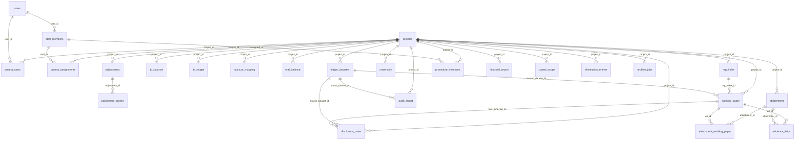

# 数据表结构梳理（概览）

> 生成日期：2026-11-18。来源：`backend/app/models/*.py` 的 SQLAlchemy ORM 元数据 + `backend/migrations/V*.sql`，
> 并与本地开发库 `audit_platform`（public schema）只读比对。字段明细见 `database-tables-columns.md`。
> 表说明取自 ORM 类文档字符串首行；类没写文档字符串的，按表名和模块注释补写并标「（据名称）」。

## 1. 总量与来源

| 项 | 数量 | 说明 |
|----|------|------|
| ORM 定义的表 | 374 | 分布在 `backend/app/models/` 的 98 个模块，共 5429 个字段、802 个外键 |
| 其中迁移里有 CREATE TABLE | 228 | 其余 146 张是早期基础表，只由 ORM 建表（`backend/scripts/seed/init_tables.py` 执行 `Base.metadata.create_all`），迁移里没有它们的 CREATE TABLE |
| 只在迁移 SQL 中建、无 ORM 模型 | 21 | 代码用原生 SQL 读写，见第 5 节 |
| 迁移建过、后又删除 | 5 | 见第 5 节 |
| 本地库 public 表总数 | 546 | = 平台表 395 + 外部组件表 151（Metabase / Quartz 共库，见第 6 节） |

ORM 表在本地库全部存在；迁移建的表除已删除的 5 张外也全部存在。

## 2. 通用约定

- 主键：358/374 张表用 UUID 主键（`id`）。
- 项目隔离：240 张表带 `project_id`，业务查询按项目过滤并做项目级鉴权。
- 软删除：125 张表带 `is_deleted`（四表另按数据集状态判断可见性，统一走 `get_active_filter`）。
- 时间戳：316 张表带 `created_at`；后端时间统一 UTC。
- 表结构变更只写 `backend/migrations/V{号}__*.sql`（启动时由 MigrationRunner 执行，版本号不能重复），并同步 ORM `Mapped[]` 声明。
- 审定数、报表、附注等派生数据都有唯一写入路径（见 `audit-platform-function-rules.md`），不要绕过服务层直写表。

## 3. 核心表关系

只画核心业务表之间的外键（`created_by` 等指向 users 的审计字段不画）。

主线：`projects` → 导入数据集 `ledger_datasets` → 四表 `tb_*` → 映射 `account_mapping` → 试算表 `trial_balance`（叠加 `adjustments`）
→ 底稿 `wp_index`/`working_paper` → 报表 `financial_report` / 附注 `disclosure_notes` / 审计报告 `audit_report` → 归档 `archive_jobs`。

## 4. 业务域分表清单

| 域 | 名称 | 表数 |
|----|------|------|
| U | [用户、组织与权限](#u) | 10 |
| P | [项目、团队与工时](#p) | 17 |
| D | [账套导入与四表数据](#d) | 17 |
| T | [试算表、调整分录与重要性](#t) | 19 |
| M | [审计计划与执行事项](#m) | 17 |
| R | [审计程序、裁剪与委派](#r) | 14 |
| W | [底稿与模板](#w) | 33 |
| S | [底稿同步与在线编辑](#s) | 33 |
| F | [公式、取数与校验](#f) | 17 |
| N | [报表与附注](#n) | 23 |
| C | [合并](#c) | 32 |
| Q | [复核、质控、EQCR 与签发](#q) | 27 |
| E | [附件、证据、OCR 与函证](#e) | 45 |
| A | [交付件、导出与归档](#a) | 14 |
| K | [知识库与编制指引](#k) | 11 |
| I | [AI](#i) | 25 |
| X | [平台基础设施（事件、任务、日志、配置）](#x) | 20 |

### U. 用户、组织与权限（10 张）

登录账号、部门、系统角色、临时授权、建项授权、轮换与显示偏好。

| 表名 | 说明 | 主键 | 引用的表（外键） | 字段数 |
|------|------|------|------------------|--------|
| `partner_rotation_overrides` | 合伙人轮换 Override | id | `users` | 10 |
| `project_creation_grants` | admin 授予 manager 对一个精确 USCC 的项目创建权。 | id | `users` | 15 |
| `service_identities` | 系统作业主体（Service Identity）—— actor XOR 的 service 侧 FK 目标。 | id | — | 7 |
| `sys_dept` | 部门组织架构 | id | `users` | 10 |
| `sys_role` | 角色（数据权限维度）。 | id | — | 9 |
| `sys_role_project` | 角色-自定义项目多对多（仅 data_scope=2 使用）。 | role_id, project_id | `sys_role`, `projects` | 2 |
| `sys_user_role` | 账号-角色多对多绑定。 | user_id, role_id | `users`, `sys_role` | 2 |
| `temporary_grants` | 临时授权记录 | id | — | 10 |
| `user_display_preferences` | 账号级显示偏好（一对一，user_id 主键）。 | user_id | `users` | 12 |
| `users` | 系统用户 | id | — | 17 |

模型文件：`core.py`、`evidence_governance_models.py`、`project_creation_grant_models.py`、`rotation_models.py`、`sys_permission.py`、`temporary_grant_models.py`、`user_display_preferences.py`

### P. 项目、团队与工时（17 张）

项目主表、项目成员、人员档案、委派、工时、批量建项、交接、任务树与站内通知。

| 表名 | 说明 | 主键 | 引用的表（外键） | 字段数 |
|------|------|------|------------------|--------|
| `budget_hours` | 预算工时 | id | `projects` | 8 |
| `check_ins` | 现场签到（据名称） | id | `staff_members` | 8 |
| `forum_comments` | 论坛评论（据名称） | id | `forum_posts`, `users` | 6 |
| `forum_posts` | 论坛帖子（据名称） | id | `users` | 10 |
| `handover_records` | 人员交接记录 | id | `users` | 15 |
| `notifications` | 系统通知 | id | `users` | 14 |
| `project_assignments` | 项目团队委派 | id | `projects`, `staff_members`, `users` | 11 |
| `project_batch_import_plans` | 一次上传产生的规范化计划、预览与可重放最终回执。 | id | `users` | 19 |
| `project_sync` | 项目同步状态 | id | `projects`, `users` | 12 |
| `project_timeline` | 项目时间线/里程碑 | id | `projects` | 11 |
| `project_users` | 项目成员关联 | id | `projects`, `users` | 13 |
| `projects` | 审计项目 | id | `users`, `accounting_standards` | 59 |
| `staff_members` | 全局人员库 | id | `users` | 26 |
| `sync_logs` | 同步日志 | id | `projects`, `users` | 9 |
| `task_tree_nodes` | 四级任务树节点：unit/account/workpaper/evidence | id | — | 11 |
| `work_hour_entries` | 工时填报条目（三级粒度） | id | `users`, `projects` | 21 |
| `work_hours` | 工时记录 — DEPRECATED: V117 迁移后由 work_hour_entries 替代。 | id | `staff_members`, `projects`, `users` | 18 |

模型文件：`batch_project_models.py`、`collaboration_models.py`、`core.py`、`handover_models.py`、`phase10_models.py`、`phase15_models.py`、`staff_models.py`、`workhour_entry_models.py`

### D. 账套导入与四表数据（17 张）

账套导入任务、数据集版本、四表原始数据（余额/序时/辅助余额/辅助明细）、科目表与映射。

| 表名 | 说明 | 主键 | 引用的表（外键） | 字段数 |
|------|------|------|------------------|--------|
| `account_chart` | 科目表（标准科目 + 客户科目） | id | `projects` | 14 |
| `account_mapping` | 科目映射关系 | id | `projects`, `users` | 11 |
| `activation_records` | 激活/回滚操作留痕 | id | `projects`, `ledger_datasets`, `users` | 13 |
| `direction_override` | 方向覆盖 overlay 表 — 用户确认/修正方向时记录，不改写原始四表导入行。 | id | `projects`, `staff_members` | 12 |
| `event_outbox_dlq` | 事件广播死信队列（F45）。 | id | `import_event_outbox`, `projects`, `users` | 11 |
| `import_artifacts` | 上传产物 — 平台级文件引用 | id | `projects`, `users` | 14 |
| `import_batches` | 导入批次 | id | `projects`, `users` | 16 |
| `import_column_mapping_history` | 列映射历史记录（F52 / Sprint 8.34 扩展版）。 | id | `projects` | 10 |
| `import_event_consumptions` | 事件消费幂等记录。 | id | `projects` | 6 |
| `import_event_outbox` | 导入域事件 outbox。 | id | `projects` | 10 |
| `import_jobs` | 导入作业 — 关注任务执行过程 | id | `projects`, `import_artifacts`, `users` | 24 |
| `ledger_datasets` | 业务级数据集版本 | id | `projects`, `import_jobs`, `users` | 15 |
| `ledger_import_attempts` | 一次账套导入 attempt 的最小不可变合同与状态记录。 | id | `projects`, `ledger_datasets`, `users` | 17 |
| `tb_aux_balance` | 辅助余额表 | id | `projects`, `import_batches` | 38 |
| `tb_aux_ledger` | 辅助明细账 — 按 year 分区 | id, year | `projects`, `import_batches` | 34 |
| `tb_balance` | 科目余额表 | id | `projects`, `import_batches` | 32 |
| `tb_ledger` | 序时账（总账明细）— 按 year 分区 | id, year | `projects`, `import_batches` | 31 |

模型文件：`audit_platform_models.py`、`column_mapping_models.py`、`dataset_models.py`

### T. 试算表、调整分录与重要性（19 张）

试算表、调整分录（AJE/RJE）及其复核与导入、重要性、未更正错报、试算表快照与变更。

| 表名 | 说明 | 主键 | 引用的表（外键） | 字段数 |
|------|------|------|------------------|--------|
| `adjustment_client_bookings` | 客户已入账的追加式标记/撤销历史。 | id | `projects`, `ledger_datasets`, `users` | 11 |
| `adjustment_collaboration` | 调整分录协作记录（分录组级转派→知晓→补充→确认）。 | id | `projects`, `users` | 16 |
| `adjustment_collaboration_event` | 协作历史事件（append-only，仅 INSERT）。 | id | `adjustment_collaboration`, `users` | 6 |
| `adjustment_editing_locks` | 调整分录编辑锁（据名称） | id | `projects`, `users` | 8 |
| `adjustment_entries` | 调整分录明细行（独立于 adjustments 头表） | id | `adjustments` | 14 |
| `adjustment_import_batches` | 调整分录导入批次（据名称） | id | `projects`, `users` | 12 |
| `adjustment_import_group_results` | 调整分录导入逐组结果（据名称） | id | `adjustment_import_batches`, `projects` | 13 |
| `adjustment_review_tasks` | 一笔调整分录的一轮持久化复核任务。 | id | `projects`, `users` | 20 |
| `adjustment_treatment_events` | 调整财务处理的追加式事件，不覆盖历史。 | id | `projects`, `ledger_datasets`, `unadjusted_misstatements`, `adjustment_client_bookings`, `users` | 14 |
| `adjustments` | 审计调整分录（AJE / RJE） | id | `projects`, `adjustment_import_batches`, `users` | 30 |
| `event_cascade_log` | 事件级联执行日志（据名称） | id | — | 10 |
| `materiality` | 重要性水平 | id | `projects`, `users` | 20 |
| `t_account_entries` | T型账户分录 | id | `t_accounts` | 13 |
| `t_accounts` | T型账户 | id | `projects`, `users` | 11 |
| `tb_change_history` | 试算表变更历史（据名称） | id | `projects`, `users` | 11 |
| `tb_publish_ack` | 审定表→试算表"发布"耐久确认/幂等表（对应迁移 V162）。 | id | — | 8 |
| `trial_balance` | 试算表（四列结构） | id | `projects` | 20 |
| `trial_balance_snapshots` | 试算平衡表版本快照 - 记录每次审定表变更时的试算表完整状态 | id | `projects` | 11 |
| `unadjusted_misstatements` | 未更正错报汇总 | id | `projects`, `adjustments`, `ledger_datasets`, `users` | 24 |

模型文件：`adjustment_import_models.py`、`adjustment_review_models.py`、`audit_platform_models.py`、`enterprise_linkage_models.py`、`t_account_models.py`、`workpaper_models.py`

### M. 审计计划与执行事项（17 张）

审计计划、风险评估、持续经营、期后事项、管理建议书、关联方、PBC、抽样。

| 表名 | 说明 | 主键 | 引用的表（外键） | 字段数 |
|------|------|------|------------------|--------|
| `audit_findings` | 审计发现事项（据名称） | id | `projects`, `users` | 15 |
| `audit_plans` | 审计计划（据名称） | id | `projects`, `users` | 16 |
| `audit_procedures` | 审计程序（collaboration_models）（据名称） | id | `projects`, `users` | 17 |
| `going_concern_evaluations` | 持续经营评价（据名称） | id | `projects`, `users` | 11 |
| `going_concern_indicators` | 持续经营迹象（据名称） | id | `going_concern_evaluations` | 10 |
| `interim_survival_checks` | 预审样本在重导账套后的存续核对汇总（据名称） | id | `projects` | 12 |
| `management_letters` | 管理建议书（据名称） | id | `projects`, `users` | 18 |
| `pbc_checklist` | PBC 清单项 | id | `projects`, `users` | 17 |
| `related_party_registry` | 关联方主数据（项目级）。 | id | `projects` | 10 |
| `related_party_transactions` | 关联方交易明细。 | id | `projects`, `related_party_registry` | 11 |
| `risk_assessments` | 风险评估（据名称） | id | `projects`, `users` | 16 |
| `risk_matrix_records` | 风险矩阵记录（据名称） | id | `projects` | 12 |
| `sampled_vouchers` | 抽样凭证（抽凭联动） | id | `projects`, `users` | 18 |
| `sampling_config` | 抽样配置 | id | `projects`, `users` | 17 |
| `sampling_records` | 抽样记录 | id | `projects`, `working_paper`, `sampling_config`, `users` | 23 |
| `se_checklist` | 期后事项检查表（据名称） | id | `projects`, `users` | 11 |
| `subsequent_events` | 期后事项（据名称） | id | `projects`, `users` | 12 |

模型文件：`audit_phase_models.py`、`collaboration_models.py`、`related_party_models.py`、`workpaper_models.py`

### R. 审计程序、裁剪与委派（14 张）

审计程序实例、程序行定义与任务、裁剪方案与确认、底稿可见范围与委派历史。

| 表名 | 说明 | 主键 | 引用的表（外键） | 字段数 |
|------|------|------|------------------|--------|
| `account_package_program_status` | 科目工作包程序状态 | id | `projects`, `staff_members` | 15 |
| `procedure_instances` | 审计程序实例（裁剪后的程序步骤） | id | `projects`, `staff_members` | 20 |
| `procedure_operation_previews` | 敏感操作 server-side 一次性预览凭证（裁剪/委派/转派）。 | id | `users`, `projects` | 15 |
| `procedure_row_definition_revisions` | Revision membership: 哪些 definition_key 属于 (template_code, r… | id | `procedure_row_definitions` | 6 |
| `procedure_row_definitions` | 模板级程序行定义真源（跨项目稳定）。 | id | — | 13 |
| `procedure_row_task_history` | 程序行任务追加式历史（不可覆盖）。 | id | `procedure_row_tasks`, `projects`, `staff_members`, `users` | 19 |
| `procedure_row_tasks` | 项目级程序行任务真源（先委派后生成底稿）。 | id | `projects`, `wp_index`, `working_paper`, `procedure_row_definitions`, `staff_members` | 34 |
| `procedure_template_revisions` | Current-revision registry；每个 template_code 最多一个 active curr… | id | `users` | 11 |
| `procedure_trim_cycle_confirmations` | 每项目每循环当前粗裁确认投影；历史真源仍是 consumed preview。 | project_id, audit_cycle | `projects`, `procedure_operation_previews`, `users` | 10 |
| `procedure_trim_schemes` | 审计程序裁剪方案 | id | `projects`, `users` | 10 |
| `workpaper_delegation_history` | History_Set 唯一来源：append-only 委派历史快照。 | id | `projects`, `wp_index`, `working_paper`, `procedure_row_tasks`, `users`, `staff_members` | 19 |
| `wp_access_security_outbox` | 内部安全审计发件箱（append-only）：保留真实拒绝原因，对外统一 404/429。 | id | `users`, `projects`, `wp_index`, `working_paper` | 18 |
| `wp_visibility_invalidation_outbox` | 可见性失效发件箱（append-only）：与 policy epoch 递增同事务写入。 | id | `projects`, `users` | 10 |
| `wp_visibility_policy_epoch` | 每项目持久单调 policy epoch（可变；BEFORE UPDATE 触发器强制非递减）。 | project_id | `projects` | 3 |

模型文件：`account_package_models.py`、`procedure_models.py`、`wp_visibility_models.py`

### W. 底稿与模板（33 张）

底稿索引与主表、底稿模板与模板集、编码、生成操作、字段覆盖、编辑锁、交叉引用、生命周期事件。

| 表名 | 说明 | 主键 | 引用的表（外键） | 字段数 |
|------|------|------|------------------|--------|
| `aging_segments` | 账龄段枚举配置（每个底稿一条，关联 wp_index_id） | id | `wp_index` | 6 |
| `bad_debt_detail_rows` | 坏账准备明细表 D2-3 嵌套行（父行与子行统一存储） | id | `wp_index` | 22 |
| `cf_verification_results` | CF 核查结果缓存 + 用户差异说明 | id | — | 14 |
| `custom_workbook_unit_authorities` | 自定义底稿工作簿的金额单位（不可变）（据名称） | id | `working_paper`, `users` | 7 |
| `draft_marker` | 初稿标记（V100 formula-management-library）。 | id | — | 8 |
| `draft_refresh_audit` | 初稿刷新审计留痕（append-only，V100 formula-management-library）。 | id | — | 15 |
| `draft_refresh_snapshot` | 初稿刷新回滚快照（V100 formula-management-library）。 | id | `draft_refresh_audit` | 14 |
| `editing_locks` | 通用编辑锁 | id | `users` | 11 |
| `gt_wp_coding` | 致同底稿编码 | id | — | 12 |
| `project_template_selections` | 项目模板选择记录 | id | `projects`, `template_library`, `users` | 12 |
| `project_workbook_instance` | 项目整册工作簿实例（据名称） | id | — | 16 |
| `project_workbook_sheet_entry` | 整册工作簿内的 sheet 条目（据名称） | id | — | 12 |
| `project_workpaper_sheet_override` | 项目级底稿 sheet 归类覆盖 | id | `projects`, `users` | 10 |
| `template_library` | 模板库条目 | id | `projects`, `users` | 23 |
| `working_paper` | 底稿文件 | id | `projects`, `wp_index`, `users`, `ledger_datasets` | 34 |
| `workpaper_extraction_log` | 底稿提取日志 — 记录截止测试/抽凭引擎的执行留痕和填充前快照，支持撤销功能。 | id | `projects`, `working_paper` | 16 |
| `workpaper_field_overrides` | 统一字段覆盖值 | id | `users` | 10 |
| `workpaper_generation_items` | 生成操作内的一份底稿及其可恢复文件 manifest。 | id | `workpaper_generation_operations` | 18 |
| `workpaper_generation_operations` | 一次可恢复的底稿生成操作。 | id | `projects`, `users`, `wp_template_set` | 22 |
| `workpaper_lifecycle_events` | 一张底稿（wp_index + 名下 working_paper）的一次移入 / 恢复回收站。 | id | `projects` | 12 |
| `workpaper_procedures` | 审计程序清单 | id | `working_paper`, `projects` | 18 |
| `workpaper_row_name_mapping` | 一行的行名对齐映射（版本行）。 | id | `users` | 18 |
| `workpaper_row_name_mapping_target` | 映射目标身份明细（让身份可 SQL 查询：判 stale / 多对一交集）。 | id | `workpaper_row_name_mapping` | 9 |
| `workpaper_sheet_classification` | 底稿 sheet 归类（9 类：A~I） | id | `workpaper_template_version` | 16 |
| `workpaper_snapshots` | 底稿版本快照 — field-level 数据版本历史，支持时间线展示、diff 对比、回滚。 | id | `projects`, `working_paper` | 13 |
| `workpaper_template_version` | 底稿模板版本 | id | — | 8 |
| `wp_cross_ref` | 底稿交叉引用 | id | `projects`, `working_paper` | 7 |
| `wp_index` | 底稿索引 | id | `projects`, `users` | 12 |
| `wp_template` | 底稿模板 | id | `users` | 14 |
| `wp_template_custom` | 自定义底稿模板 | id | `users` | 12 |
| `wp_template_meta` | 模板元数据（命名区域定义） | id | `wp_template` | 7 |
| `wp_template_metadata` | 底稿模板元数据 | id | `wp_template` | 21 |
| `wp_template_set` | 底稿模板集 | id | — | 9 |

模型文件：`aging_segment_model.py`、`audit_platform_models.py`、`bad_debt_models.py`、`cf_verification_models.py`、`custom_workbook_unit_authority.py`、`editing_lock_models.py`、`extension_models.py`、`gt_coding_models.py`、`project_workbook_models.py`、`project_wp_sheet_override.py`、`template_library_models.py`、`workpaper_field_override_models.py`、`workpaper_lifecycle_models.py`、`workpaper_models.py`、`workpaper_row_name_mapping_models.py`、`workpaper_template_version.py`、`wp_generation_models.py`、`wp_optimization_models.py`

### S. 底稿同步与在线编辑（33 张）

OnlyOffice 在线编辑与 HTML↔OO 双向同步：房间、回调、内容版本、同步定义、冲突与离线冲突。

| 表名 | 说明 | 主键 | 引用的表（外键） | 字段数 |
|------|------|------|------------------|--------|
| `evidence_hash_checks` | 取证包完整性校验（据名称） | id | — | 7 |
| `offline_conflicts` | 离线冲突与人工合并队列（据名称） | id | — | 15 |
| `version_line_stamps` | 版本链统一戳记（据名称） | id | — | 8 |
| `working_paper_artifact` | 内容寻址不可变文件登记表。 | id | `projects`, `working_paper`, `working_paper_callback_delivery`, `working_paper_sync_operation` | 19 |
| `working_paper_callback_delivery` | 每次 callback 投递。归属只以 immutable `durable_at` 判定。 | id | `projects`, `working_paper`, `working_paper_oo_room`, `working_paper_sync_operation`, `working_paper_content_application`, `working_paper_forcesave_request`, `working_paper_callback_recovery_case`, `working_paper_artifact` | 22 |
| `working_paper_callback_recovery_case` | 无法唯一归组的 durable incoming 的可审计恢复案例。claim 前三实体恒空。 | id | `projects`, `working_paper`, `working_paper_oo_room`, `working_paper_artifact`, `working_paper_oo_participant`, `working_paper_oo_client_confirmation`, `working_paper_forcesave_request`, `working_paper_content_application`, `working_paper_sync_operation`, `working_paper_sync_definition_bundle` | 23 |
| `working_paper_callback_recovery_case_event` | recovery case 的独立 append-only timeline（与 operation timeline… | id | `working_paper_callback_recovery_case`, `working_paper_oo_client_confirmation` | 12 |
| `working_paper_content_application` | durable incoming 对业务状态的一次逻辑应用；`application_key` 的唯一 owner。 | id | `projects`, `working_paper`, `working_paper_oo_room`, `working_paper_forcesave_request`, `working_paper_content_version`, `working_paper_content_representation`, `working_paper_artifact`, `working_paper_sync_definition_bundle`, `working_paper_sync_definition_artifact` | 36 |
| `working_paper_content_application_event` | application 的 append-only timeline（含 `sequence_folded` 审计）。 | id | `working_paper_content_application`, `working_paper_forcesave_request` | 14 |
| `working_paper_content_representation` | 同一 content version 的 1:N immutable OOXML representation gen… | id | `working_paper`, `working_paper_content_version`, `working_paper_artifact`, `working_paper_sync_definition_bundle`, `working_paper_sync_definition_artifact` | 19 |
| `working_paper_content_revision_backfill_ledger` | V151 revision 0 回填台账：只记录，不创建 content version/representation。 | wp_id | `working_paper`, `projects` | 10 |
| `working_paper_content_version` | immutable 业务内容版本。`revision` 只因业务 projection/权威内容变化递增。 | id | `working_paper`, `working_paper_artifact`, `working_paper_sync_operation`, `users` | 16 |
| `working_paper_entry_evidence_scenario` | 逐 scenario 证据行。download-only/recovery-reject 场景 operation/a… | id | `working_paper_sync_test_run`, `working_paper_artifact` | 20 |
| `working_paper_forcesave_request` | Command Service 调用前冻结的 request。 | id | `working_paper_oo_room`, `working_paper_oo_participant`, `working_paper_content_version`, `working_paper_content_representation`, `working_paper_sync_definition_bundle`, `working_paper_sync_definition_artifact` | 24 |
| `working_paper_oo_client_confirmation` | DocEditor `onDocumentReady` 后的 descriptor 逐项确认。 | id | `working_paper_oo_room`, `working_paper_oo_participant`, `working_paper_content_representation`, `working_paper_content_version`, `working_paper_sync_definition_bundle` | 17 |
| `working_paper_oo_close_intent` | clean close intent；只有 reconciler 可把 deterministic leader CA… | id | `working_paper_oo_room`, `working_paper_oo_participant`, `working_paper_oo_client_confirmation`, `working_paper_forcesave_request` | 14 |
| `working_paper_oo_close_intent_event` | close intent 的 append-only eligibility/leader timeline。 | id | `working_paper_oo_close_intent` | 12 |
| `working_paper_oo_participant` | 逐用户 participant lease。`closing` 是 close intent 创建时的原子中间态。 | id | `working_paper_oo_room`, `users` | 14 |
| `working_paper_oo_room` | 共享 OO room：server last-applied 与 client-confirmed 是两套独立指针。 | id | `projects`, `working_paper`, `working_paper_content_version`, `working_paper_content_representation`, `working_paper_sync_definition_bundle`, `working_paper_content_application`, `working_paper_oo_close_intent` | 29 |
| `working_paper_pending_mutation` | HTML flush 产生的短 TTL 单次逻辑消费 mutation token。 | id | `projects`, `working_paper`, `users`, `working_paper_artifact`, `working_paper_sync_operation`, `working_paper_content_version` | 16 |
| `working_paper_representation_candidate_event` | candidate contract/bundle attach 的 append-only 审计事件（V153）。 | id | `working_paper_representation_upgrade_candidate`, `working_paper_sync_definition_artifact`, `working_paper_sync_definition_bundle`, `users` | 13 |
| `working_paper_representation_upgrade_candidate` | non-current representation 升级候选：resolver/room/current point… | id | `working_paper`, `working_paper_content_version`, `working_paper_content_representation`, `working_paper_artifact`, `working_paper_sync_definition_artifact`, `working_paper_sync_definition_bundle` | 17 |
| `working_paper_sync_conflict` | 字段级冲突记录（双侧可追溯 + canonical application fence）。 | id | `working_paper_sync_operation`, `working_paper_content_application`, `users` | 26 |
| `working_paper_sync_definition_artifact` | immutable template / instrumentation / contract / authority… | id | `working_paper_artifact` | 13 |
| `working_paper_sync_definition_bundle` | authority model + template/instrumentation/contract 三类 type… | id | `working_paper_sync_definition_artifact`, `working_paper_artifact` | 18 |
| `working_paper_sync_definition_null_marker` | optional child 的版本化 typed null marker registry（禁 SQL NULL/空… | marker_id | — | 7 |
| `working_paper_sync_entry_state` | entry 级 current representation pointer（candidate 不可引用）。 | wp_id, entry_id | `working_paper`, `working_paper_content_representation` | 5 |
| `working_paper_sync_operation` | 用户轮询/执行/timeline 容器；**不承担** application identity。 | id | `projects`, `working_paper`, `working_paper_oo_room`, `working_paper_forcesave_request`, `working_paper_content_application`, `working_paper_oo_participant`, `working_paper_sync_definition_bundle`, `working_paper_sync_definition_artifact`, `users` | 23 |
| `working_paper_sync_operation_contributor` | 聚合 callback 的 contributor 快照（initiator / route / contributo… | operation_id, participant_id | `working_paper_sync_operation`, `working_paper_oo_participant`, `users` | 6 |
| `working_paper_sync_operation_event` | operation 的 append-only transition event（current state 只是它的… | id | `working_paper_sync_operation` | 16 |
| `working_paper_sync_scope_index` | authorization-before-business-read 的非敏感归属索引。 | resource_kind, resource_id | `projects`, `working_paper` | 9 |
| `working_paper_sync_test_run` | 一次可复现验收执行（source-backed capability identity，禁自由文本覆写）。 | id | `working_paper_artifact` | 19 |
| `wp_edit_sessions` | 底稿编辑时间采集（WOPI lock/unlock 自动记录）。 | id | `working_paper`, `users` | 7 |

模型文件：`phase12_models.py`、`phase16_models.py`、`workpaper_sync_models.py`

### F. 公式、取数与校验（17 张）

公式设置/模板/发布/同步、公式推送、运行时出站队列、表间校验结果、地址库失效与覆盖、一致性门禁确认。

| 表名 | 说明 | 主键 | 引用的表（外键） | 字段数 |
|------|------|------|------------------|--------|
| `acnr_invalidation_epoch` | ACNR Durable_Epoch — per-project 失效计数器（DB 权威，Redis 仅 fan-ou… | project_id | — | 3 |
| `acnr_invalidation_outbox` | ACNR Invalidation_Outbox — 业务变更同事务写入，dispatcher 至少一次投递。 | id | — | 7 |
| `acnr_project_overlay` | ACNR L2 ProjectOverlay 持久化 — 项目级别名/CUST覆盖/binding。 | id | `projects`, `working_paper` | 13 |
| `chain_executions` | 全链路执行记录 | id | — | 12 |
| `consistency_gate_acknowledgements` | 门禁逐项确认留痕表 | id | — | 13 |
| `cross_check_results` | 跨科目校验结果 | id | `projects` | 10 |
| `formula_publish` | 发布记录。``status=pending`` 承载非 admin 提交的全局候选（admin 审核后执行）。 | id | — | 16 |
| `formula_push_run` | 公式推送运行记录（面板「最近推送」）。 | id | `projects` | 13 |
| `formula_push_state` | 公式推送目标级状态。 | id | `projects`, `working_paper`, `formula_push_run` | 16 |
| `formula_runtime_outbox` | 公式运行时事务 Outbox — 与业务写入同事务提交，提交后可靠发布 stale/invalidation 事件。 | id | `draft_refresh_audit` | 9 |
| `formula_setting` | 统一公式设置行：``layer`` = global（全局）/ project（本项目适配）/ template（模板… | id | `projects`, `formula_template` | 21 |
| `formula_sync_item` | 待项目确认的同步事项。同一项目同一公式位只保留一条 pending（后续发布更新它）。 | id | `projects` | 21 |
| `formula_template` | 可共享的公式模板（名称 / 共享范围 / 适用准则 / 当前版本）。 | id | `users`, `projects` | 15 |
| `formula_template_subscription` | 项目订阅模板（每个项目每个域最多一个有效订阅）。 | id | `projects`, `formula_template` | 10 |
| `formula_template_version` | 模板每次发布的冻结快照（三方比对、回看、暂缓订阅者读取）。 | id | `formula_template` | 8 |
| `note_formula_run` | 一个章节一次附注公式执行的可查询运行记录。 | id | `projects`, `users` | 13 |
| `wp_formula` | 自定义底稿公式绑定（独立表，custom-workpaper-formula-binding） | id | `projects`, `working_paper`, `users` | 32 |

模型文件：`acnr_invalidation_model.py`、`acnr_overlay_model.py`、`chain_execution.py`、`formula_push_models.py`、`formula_setting_models.py`、`gate_acknowledgement_models.py`、`note_formula_models.py`、`workpaper_models.py`、`wp_optimization_models.py`

### N. 报表与附注（23 张）

单体报表、报表配置与基线、审计报告及模板、附注（disclosure_notes）、附注模板/裁剪/校验/版本、科目↔附注映射。

| 表名 | 说明 | 主键 | 引用的表（外键） | 字段数 |
|------|------|------|------------------|--------|
| `account_note_mapping` | 科目→附注行映射 — 维护科目名称到附注表格行的映射关系 | id | — | 8 |
| `accounting_standards` | 会计准则 | id | — | 8 |
| `audit_report` | 审计报告 | id | `projects`, `ledger_datasets`, `users` | 25 |
| `audit_report_template` | 审计报告段落模板 | id | — | 10 |
| `cfs_adjustments` | 现金流量表调整分录 | id | `projects`, `users` | 16 |
| `disclosure_notes` | 财务报表附注 | id | `projects`, `ledger_datasets`, `working_paper`, `users` | 38 |
| `fill_preview_sessions` | 报告正文模板填充 preview 会话（audit-report-template-integration V066） | id | `projects`, `users` | 14 |
| `financial_report` | 生成的财务报表数据 | id | `projects`, `report_generation_run` | 22 |
| `group_note_template_baseline` | 集团附注模板基线（D6） | id | `projects`, `users` | 11 |
| `note_account_mappings` | 附注科目对照映射 — 报表行次 → 附注章节 → 表格的三级映射 | id | — | 8 |
| `note_content_template_versions` | 模板的不可变正文快照。 | id | `note_content_templates`, `projects`, `users` | 15 |
| `note_content_templates` | 个人或集团可见的附注内容模板目录。 | id | `users`, `projects`, `note_content_template_versions` | 12 |
| `note_section_instances` | 附注章节实例（裁剪后的章节） | id | `projects` | 12 |
| `note_section_version_tree` | 章节版本树（D11） | id | `projects`, `users` | 9 |
| `note_text_batch_applications` | 一次成功的附注正文原子批量应用审计。 | id | `note_content_template_versions`, `projects`, `users` | 15 |
| `note_trim_schemes` | 附注裁剪方案 | id | `projects`, `users` | 10 |
| `note_validation_results` | 附注校验结果 | id | `projects`, `users` | 10 |
| `report_config` | 报表格式配置（行次定义+取数公式）；V199 formula_version：全局行 = 定义版本、项目行 = 本地修… | id | — | 26 |
| `report_config_baseline` | 报表配置主模板回填候选（项目优化→主模板评审通道） | id | — | 11 |
| `report_format_templates` | 报表格式模板（据名称） | id | — | 9 |
| `report_generation_run` | 一次报表计算的不可变运行摘要与规范行快照。 | id | `projects`, `users`, `consol_operation` | 25 |
| `report_line_mapping` | 报表行次映射（标准科目→报表行次） | id | `projects`, `users` | 15 |
| `report_snapshot` | 报表数据快照（导出时从快照读取，不重复计算） | id | `projects`, `users` | 9 |

模型文件：`account_note_mapping_models.py`、`audit_platform_models.py`、`extension_models.py`、`note_account_mapping.py`、`note_content_template_models.py`、`note_trim_models.py`、`phase10_models.py`、`phase13_models.py`、`report_generation_models.py`、`report_models.py`

### C. 合并（32 张）

合并范围、企业树、合并试算/工作底稿、抵销分录、商誉/少数股东/外币折算、合并附注映射与推送。

| 表名 | 说明 | 主键 | 引用的表（外键） | 字段数 |
|------|------|------|------------------|--------|
| `companies` | 公司信息表 | id | `projects` | 17 |
| `component_auditors` | 组成部分审计师表 | id | `projects` | 14 |
| `component_instructions` | 组成部分审计指令表 | id | `projects`, `component_auditors`, `users` | 18 |
| `component_results` | 组成部分审计结果表 | id | `projects`, `component_auditors` | 15 |
| `consol_artifact` | 绑定已发布 report run 的不可变合并 Excel artifact。 | id | `projects`, `consol_operation`, `report_generation_run`, `users` | 20 |
| `consol_cell_comments` | 单元格批注与复核标记 — 支持所有模块的单元格级批注和复核状态持久化 | id | — | 15 |
| `consol_note_data` | 合并附注用户数据存储 — 按项目+年度+章节存储用户编辑的附注数据 | id | — | 18 |
| `consol_note_detail_template` | 合并附注明细模板——按 template_type + section_id 组织。 | id | `users` | 8 |
| `consol_note_detail_template_version` | 模板不可变版本。rows JSONB 格式： | id | `consol_note_detail_template`, `users` | 7 |
| `consol_note_formula` | 合并附注单元格取数公式（语法同报表公式：TB / SUM_TB / REPORT / ROW）。 | id | — | 13 |
| `consol_note_mapping_binding` | 企业级绑定——记录每家企业确认使用哪条规则，以及绑定时的来源结构指纹。 | id | `projects`, `consol_note_mapping_rule` | 9 |
| `consol_note_mapping_rule` | 映射规则。mappings JSONB 格式： | id | `projects`, `consol_note_detail_template_version`, `users` | 11 |
| `consol_note_template_binding` | 项目绑定到某一模板版本——一个项目一个章节只绑一个版本。 | id | `projects`, `consol_note_detail_template_version`, `users` | 6 |
| `consol_note_template_push_log` | 合并附注模板推送日志 —— 仅 ORM 映射，写入走 raw SQL。 | id | — | 10 |
| `consol_operation` | 一次可恢复、可比较输入版本的合并运行。 | id | `projects`, `users` | 28 |
| `consol_push_run` | 合并推送运行记录（公式管理「合并推送」页）。 | id | `consol_operation`, `projects` | 11 |
| `consol_query_template` | 自定义查询模板 | id | `projects` | 13 |
| `consol_scope` | 合并范围表 | id | `projects` | 16 |
| `consol_scope_confirmation_nodes` | 某确认版本中的角色投影；不是 projects 或金额数据的副本。 | id | `consol_scope_confirmations`, `projects` | 11 |
| `consol_scope_confirmations` | 合并企业树版本（V183 起名「范围确认」；V206 起推送时自动记录，手动记录仍可）。 | id | `projects`, `users` | 13 |
| `consol_snapshots` | 合并数据快照（据名称） | id | `projects`, `users` | 8 |
| `consol_trial` | 合并试算表 | id | `projects` | 16 |
| `consol_workpaper_instance` | 合并项目/年度与 A3-CONSOL 薄底稿壳的关联及最近正式产物指针。 | id | `projects`, `working_paper`, `wp_index`, `consol_operation`, `consol_artifact` | 10 |
| `consol_worksheet` | 合并差额表 — 每个企业树节点 × 科目 × 年度一行。 | id | `projects` | 16 |
| `consol_worksheet_data` | 合并工作底稿数据存储 — 通用 JSON 存储，支持所有 16 张表 | id | — | 9 |
| `elimination_entries` | 抵消分录表 | id | `projects`, `users` | 29 |
| `forex_translation` | 外币折算表 | id | `projects` | 16 |
| `goodwill_calc` | 商誉计算表 | id | `projects` | 18 |
| `internal_ar_ap` | 内部往来表 | id | `projects` | 14 |
| `internal_trade` | 内部交易表 | id | `projects` | 15 |
| `minority_interest` | 少数股东权益表 | id | `projects` | 17 |
| `share_change_event` | 动态股比变动事件。 | id | `projects` | 22 |

模型文件：`consol_cell_comment_models.py`、`consol_note_data_models.py`、`consol_note_mapping_models.py`、`consol_operation_models.py`、`consol_push_models.py`、`consol_scope_confirmation_models.py`、`consol_workpaper_instance_models.py`、`consol_worksheet_data_models.py`、`consolidation_models.py`、`phase10_models.py`、`report_generation_models.py`、`share_change_event_models.py`

### Q. 复核、质控、EQCR 与签发（27 张）

复核记录与会话、质控规则/检查/评级、EQCR、签发检查、独立性、门禁规则与决策、签字记录。

| 表名 | 说明 | 主键 | 引用的表（外键） | 字段数 |
|------|------|------|------------------|--------|
| `annual_independence_declarations` | 年度独立性声明（R5 需求 12）+ 项目级独立性声明（R1 需求 10 合并）。 | id | `projects`, `users` | 17 |
| `audit_check_signoff` | 审计检查复核门禁签认（audit-check-review-gate-hardening / V126）。 | id | — | 10 |
| `cell_annotations` | 单元格批注（据名称） | id | `projects`, `users` | 16 |
| `eqcr_disagreement_resolutions` | EQCR 与项目组意见不一致时触发的合议结论。 | id | `projects`, `eqcr_opinions` | 9 |
| `eqcr_opinions` | EQCR 对判断类事项的意见留痕。 | id | `projects`, `users` | 11 |
| `eqcr_review_notes` | EQCR 独立复核笔记（默认仅 EQCR 可见）。 | id | `projects`, `users` | 11 |
| `eqcr_shadow_computations` | EQCR 独立跑一遍勾稽的结果永久留痕。 | id | `projects`, `users` | 10 |
| `eqcr_snapshots` | EQCR 快照 — 聚合项目数据供独立复核使用。 | id | `projects`, `users` | 8 |
| `gate_decisions` | 门禁决策记录表 | id | — | 10 |
| `gate_rule_configs` | 门禁规则配置表 — 平台强制 vs 租户可配置分层 | id | — | 10 |
| `independence_signing_tasks` | A17-7 独立性声明书电子签署任务 | id | — | 7 |
| `issue_tickets` | 统一问题单（对齐 v2 4.5.15A） | id | — | 23 |
| `project_quality_ratings` | 项目质量评级 | id | — | 13 |
| `qc_inspection_items` | 质控抽查子项 | id | `qc_inspections` | 9 |
| `qc_inspection_records` | 质控独立复核记录 | id | `qc_inspection_items` | 8 |
| `qc_inspections` | 质控抽查批次 | id | `projects` | 13 |
| `qc_rule_definitions` | QC 规则定义表 — 元数据 + 开关 | id | — | 18 |
| `review_checklist_records` | 复核检查表记录（A21~A25 各级勾选+意见） | id | — | 11 |
| `review_conversations` | 复核会话（据名称） | id | `projects`, `users` | 20 |
| `review_messages` | 复核会话消息（据名称） | id | `review_conversations`, `users` | 20 |
| `review_records` | 复核批注 | id | `working_paper`, `users`, `review_conversations` | 23 |
| `review_templates` | 复核意见模板 | id | `users` | 10 |
| `review_threads` | V095: 复核对话线程 — 每个底稿区域一个线程 | id | `projects`, `working_paper`, `users` | 9 |
| `reviewer_metrics_snapshots` | 复核人深度指标快照 | id | — | 11 |
| `signature_records` | 签名记录 | id | `users` | 13 |
| `workpaper_review_records` | 工作底稿复核记录 | id | `projects`, `users` | 12 |
| `wp_qc_results` | 底稿质量自检结果 | id | `working_paper`, `users` | 10 |

模型文件：`audit_platform_models.py`、`collaboration_models.py`、`eqcr_models.py`、`extension_models.py`、`independence_models.py`、`phase10_models.py`、`phase14_models.py`、`phase15_models.py`、`qc_inspection_models.py`、`qc_rating_models.py`、`qc_rule_models.py`、`review_template_models.py`、`review_workflow_models.py`、`workpaper_models.py`

### E. 附件、证据、OCR 与函证（45 张）

附件与版本、证据链接与治理（引用/依赖/墓碑/法律保全）、OCR 任务与确认、函证及回函。

| 表名 | 说明 | 主键 | 引用的表（外键） | 字段数 |
|------|------|------|------------------|--------|
| `archive_manifest_edges` | ArchiveManifestEdge（design §4.6；R11/P23）—— manifest 冻结的证据图边… | id | `archive_manifests` | 9 |
| `archive_manifest_entries` | ArchiveManifestEntry（design §4.6；R11/P23）—— manifest 覆盖的证据节… | id | `archive_manifests` | 8 |
| `archive_manifests` | ArchiveManifest（design §4.6/§5.5；R11/P24）—— sealed 后不可变，每次归… | id | `projects`, `users`, `service_identities` | 15 |
| `attachment_lineage` | 附件溯源关联 | id | — | 7 |
| `attachment_versions` | 不可变内容快照（design §4.3）。 | id | `asset_blobs`, `users`, `service_identities` | 19 |
| `attachment_working_paper` | 附件-底稿关联 | id | `attachments`, `working_paper`, `users` | 10 |
| `attachments` | 附件 | id | `projects`, `users`, `service_identities` | 38 |
| `citation_snapshots` | CitationSnapshot（design §4.6；R7/P15/P16）—— 不可变（immutable 触发… | id | `ai_content_log`, `evidence_refs`, `projects`, `users`, `service_identities` | 16 |
| `confirmation_action_log` | 函证操作审计留痕（append-only，DB 触发器禁 UPDATE/DELETE） | id | — | 12 |
| `confirmation_ai_check` | 函证AI检查 | id | `confirmation_lists`, `users` | 10 |
| `confirmation_attachment_link` | 函证↔附件关联（含角色、强配对、匹配状态） | id | `confirmations`, `attachments` | 9 |
| `confirmation_attachments` | 函证附件（collaboration_models）（据名称） | id | `confirmation_lists`, `users` | 8 |
| `confirmation_letters` | 询证函模板/内容 | id | `confirmation_lists` | 9 |
| `confirmation_lists` | 函证清单（collaboration_models）（据名称） | id | `projects`, `users` | 19 |
| `confirmation_results` | 函证结果（collaboration_models）（据名称） | id | `confirmation_lists`, `users` | 12 |
| `confirmation_summaries` | 询证函汇总 | id | `confirmation_lists`, `users` | 11 |
| `confirmations` | 函证记录 | id | `projects`, `working_paper`, `users` | 16 |
| `dispatch_records` | 分发记录 — 描述「哪条函证行被分发到了哪个下游底稿」 | id | `projects`, `users` | 12 |
| `document_extracted` | 单据结构化提取数据 | id | `document_scan`, `users` | 11 |
| `document_match` | 单据与账面数据匹配 | id | `document_scan` | 11 |
| `document_scan` | 单据扫描件 | id | `projects`, `users` | 13 |
| `evidence_audit_command_roots` | command-root（design §7.1；R12/P25）—— 每敏感命令+幂等键+scope 恰一个 roo… | id | `projects`, `users`, `service_identities` | 12 |
| `evidence_audit_transitions` | command-root 的多行 transition 审计（design §7.1；R12/P25）—— appen… | id | `evidence_audit_command_roots`, `users`, `service_identities` | 10 |
| `evidence_chain` | 证据链 | id | `projects` | 12 |
| `evidence_dependencies` | 统一依赖图的动态边 source→target（design §4.4；R9/P20）。 | id | `projects`, `evidence_refs`, `users`, `service_identities` | 18 |
| `evidence_inbox` | inbox（design §5.4；R12）—— 按 event_id 幂等消费，避免重复副作用。 | id | `projects`, `users`, `service_identities` | 11 |
| `evidence_links` | 证据链 | id | `working_paper`, `attachments` | 12 |
| `evidence_migration_checkpoints` | 迁移 checkpoint（design §8.2 M1；R14/P28）—— batch_key 幂等，重跑从检查点… | id | `projects`, `users`, `service_identities` | 15 |
| `evidence_outbox` | 事务性 outbox（design §5.4/§7.1；R12/R9）—— 按 event_id 幂等，有界退避 + … | id | `projects`, `evidence_audit_command_roots`, `users`, `service_identities` | 15 |
| `evidence_quality_snapshots` | 质量快照（design §9；R16/P30）—— 固定不可变快照（immutable 触发器），可复算。 | id | `projects`, `users`, `service_identities` | 13 |
| `evidence_quarantine_handles` | 隔离/暂存句柄 —— 内容不可公开读取（design §4.0）。 | id | `evidence_upload_attempts`, `projects`, `users`, `service_identities` | 15 |
| `evidence_refs` | 持久 EvidenceRef（design §4.4；R3.1）—— 可查询、可保留的持久记录（非 per-reque… | id | `projects`, `attachment_versions`, `users`, `service_identities` | 23 |
| `evidence_tombstones` | 不可变墓碑 —— 对象被清理后保留的永久审计痕迹。 | id | `projects`, `users` | 13 |
| `evidence_upload_attempts` | UploadAttempt —— 内容验证前的最小上传审计（design §4.0 / R1.1 / R12）。 | id | `projects`, `users`, `service_identities` | 16 |
| `legacy_attachment_alias` | 旧附件 ID → (新聚合根, 确定版本) 解析别名（design §4.1）。 | old_attachment_id | `projects` | 7 |
| `legal_hold_scopes` | LegalHoldScope（design §4.6；R13/P26）—— 固化 direct/transitive … | id | `legal_holds`, `projects` | 9 |
| `legal_holds` | LegalHold（design §4.6/§5.5；R13/P26/P27）—— released_by_user_… | id | `projects`, `users`, `service_identities` | 14 |
| `ocr_confirmations` | OCRConfirmation（design §4.5；R6.2/P12）—— append-only 人工确认修订。 | id | `ocr_jobs`, `ocr_results`, `projects`, `users` | 14 |
| `ocr_job_transitions` | OCRJobTransition（design §4.5）—— 每次状态迁移一条，关联 command-root；ap… | id | `ocr_jobs`, `evidence_audit_command_roots`, `users`, `service_identities` | 12 |
| `ocr_jobs` | OCRJob（design §4.5；R5/P9）—— 绑定确定版本/hash/config/幂等键/lease/ac… | id | `projects`, `attachment_versions`, `evidence_audit_command_roots`, `users`, `service_identities` | 24 |
| `ocr_results` | OCRResult（design §4.5；R6.1/P11）—— 不可变原始识别结果（immutable 触发器）。 | id | `ocr_jobs`, `projects`, `attachment_versions`, `users`, `service_identities` | 20 |
| `ocr_writeback_staging` | staged-external 写回暂存（design §4.5；R6.4/P13）—— 目标模块以幂等键消费后回执推… | id | `ocr_writebacks`, `projects` | 14 |
| `ocr_writebacks` | OCRWriteback（design §4.5；R6.4/P13/P14）—— 目标版本/mapping/confi… | id | `ocr_jobs`, `projects`, `evidence_audit_command_roots`, `users` | 17 |
| `review_closes` | ReviewClose（design §4.6；R10.2/P21）—— closed_by_user_id NOT … | id | `projects`, `users`, `evidence_audit_command_roots` | 10 |
| `review_evidence_snapshots` | ReviewEvidenceSnapshot（design §4.6；R10/P22）—— 冻结提出/关闭时 ref/… | id | `projects`, `evidence_refs`, `users`, `service_identities` | 14 |

模型文件：`ai_models.py`、`attachment_lineage_model.py`、`attachment_models.py`、`collaboration_models.py`、`confirmation_models.py`、`dispatch_models.py`、`evidence_governance_models.py`、`wp_optimization_models.py`

### A. 交付件、导出与归档（14 张）

导出任务、Word 导出与版本、交付件快照、归档任务/清单/清单 manifest、底稿版本归档。

| 表名 | 说明 | 主键 | 引用的表（外键） | 字段数 |
|------|------|------|------------------|--------|
| `archive_checklists` | 归档检查清单（据名称） | id | `projects`, `users` | 12 |
| `archive_jobs` | 归档编排作业 | id | `projects`, `users` | 20 |
| `archive_modifications` | 归档后修改记录（据名称） | id | `projects`, `users` | 12 |
| `deliverable_section_state` | 出品物章节级状态承载表（V067）。 | id | — | 17 |
| `deliverable_snapshots` | 不可变交付快照。 | id | `projects` | 7 |
| `export_job_attempts` | 后台导出任务 attempt 历史。 | id | `export_jobs_v2`, `export_job_items_v2` | 17 |
| `export_job_items_v2` | 后台导出任务明细 | id | `export_jobs_v2`, `word_export_task` | 15 |
| `export_jobs_v2` | 后台导出任务（全套导出/批量渲染/重试/三件套） | id | `projects`, `users` | 19 |
| `export_tasks` | PDF导出任务 | id | `projects`, `users` | 17 |
| `regulatory_filing` | 监管备案 | id | `projects` | 12 |
| `word_export_task` | Word导出主任务 | id | `projects`, `users` | 31 |
| `word_export_task_versions` | Word导出版本快照 | id | `word_export_task`, `users` | 23 |
| `wp_export_snapshot` | 底稿导出快照 — 记录每次导出时的内容哈希，用于导入冲突检测 | id | `working_paper`, `projects`, `users` | 12 |
| `wp_version_archive` | 底稿版本归档 — 记录版本元数据（文件可能已清理但元数据保留） | id | `working_paper`, `projects`, `users` | 12 |

模型文件：`archive_models.py`、`audit_platform_models.py`、`collaboration_models.py`、`extension_models.py`、`phase13_models.py`、`report_models.py`、`wp_export_models.py`

### K. 知识库与编制指引（11 张）

知识库文件夹与文档、知识索引、编制指引发布与豁免、质控案例库。

| 表名 | 说明 | 主键 | 引用的表（外键） | 字段数 |
|------|------|------|------------------|--------|
| `guidance_consumer_ack` | durable、幂等的 ConsumerAck ledger 行。 | id | — | 11 |
| `guidance_exemption_record` | guidance 有效豁免记录。 | id | `projects` | 15 |
| `guidance_handoff_visibility` | finalize visibility saga 的 guidance 侧视图。 | id | — | 15 |
| `guidance_publication` | guidance 发布主体。 | id | — | 22 |
| `guidance_publication_event` | 发布生命周期事件。 | id | `guidance_publication` | 14 |
| `knowledge_documents` | 知识库文档 | id | `knowledge_folders`, `asset_blobs`, `users` | 24 |
| `knowledge_evidence_promotions` | 证据转存为知识库文档的桥接记录（据名称） | id | `knowledge_documents`, `asset_blobs`, `attachments`, `attachment_versions`, `projects`, `users` | 12 |
| `knowledge_folders` | 知识库文件夹（树形目录） | id | `users` | 11 |
| `knowledge_index` | 知识库索引 | id | — | 14 |
| `project_guidance_supplement` | 项目级 guidance 补充。 | id | `projects`, `guidance_publication` | 20 |
| `qc_case_library` | QC 案例库条目 | id | — | 15 |

模型文件：`ai_models.py`、`asset_blob_models.py`、`guidance_handoff_ack_models.py`、`guidance_publication_models.py`、`knowledge_models.py`、`qc_case_library_models.py`

### I. AI（25 张）

AI 模型配置、对话会话/消息/运行、AI 产出与待确认记录、底稿 AI 填充、AI 任务批次。

| 表名 | 说明 | 主键 | 引用的表（外键） | 字段数 |
|------|------|------|------------------|--------|
| `ai_analysis_item` | AI分析报告条目 | id | `ai_analysis_report` | 11 |
| `ai_analysis_report` | AI分析报告 | id | `projects` | 11 |
| `ai_chat_action_receipts` | note save / adopt 的通用幂等收据（Req 8.2/8.3 · Property 21）。 | id | `users`, `ai_chat_session` | 11 |
| `ai_chat_attachments` | 会话附件 metadata（Req 7.3）。 | id | `users`, `projects`, `ai_chat_session`, `ai_chat_runs` | 17 |
| `ai_chat_history` | AI对话历史 | id | `projects`, `users` | 10 |
| `ai_chat_message` | AI问答消息（详细消息记录） | id | `ai_chat_session`, `ai_chat_runs` | 14 |
| `ai_chat_run_resources` | AI 对话运行引用的资源（字节桥接）（据名称） | id | `ai_chat_runs`, `ai_chat_session`, `attachment_versions`, `asset_blobs`, `users` | 10 |
| `ai_chat_runs` | Chat Run —— 一次模型/Agent 执行的持久化摘要。 | id | `ai_chat_session`, `users`, `projects` | 22 |
| `ai_chat_session` | AI问答会话（会话维度聚合） | id | `projects`, `users` | 17 |
| `ai_chat_tool_calls` | 工具调用摘要（Req 11.10：每次调用产生 started + finished/failed 记录）。 | id | `ai_chat_runs` | 11 |
| `ai_confirmation_audit` | AI函证审核记录 | id | `projects`, `users` | 11 |
| `ai_content` | AI生成内容 | id | `projects`, `users` | 16 |
| `ai_content_governance` | AiContentGovernance（design §4.6 / AIEvidenceGate；R8/P17/P18… | id | `projects`, `users`, `service_identities` | 24 |
| `ai_content_log` | AI 生成内容溯源日志 — 字段级追踪 AI 输出及人工确认状态 | id | `projects`, `users`, `evidence_refs`, `citation_snapshots`, `ai_chat_message` | 41 |
| `ai_evidence_chains` | AI证据链 | id | `projects` | 12 |
| `ai_evidence_items` | AI证据项 | id | `ai_evidence_chains` | 12 |
| `ai_knowledge_base` | AI知识库文档索引 | id | `projects` | 7 |
| `ai_model_config` | AI模型配置 | id | — | 26 |
| `ai_plugins` | AI插件 | id | — | 10 |
| `ai_task_items` | AI 批任务逐项（据名称） | id | `ai_task_jobs`, `ai_chat_message` | 25 |
| `ai_task_jobs` | AI 批任务（据名称） | id | `projects`, `users` | 19 |
| `ai_workpaper_fills` | AI底稿填充记录 | id | `ai_workpaper_tasks`, `working_paper` | 13 |
| `ai_workpaper_tasks` | AI底稿填充任务 | id | `working_paper` | 11 |
| `wp_ai_generations` | AI生成历史记录，完整留痕每次生成的prompt/model/输出/确认信息。 | id | `working_paper`, `users` | 12 |
| `wp_recommendation_feedback` | 底稿推荐反馈记录（采纳/跳过/手动添加）。 | id | `projects`, `users` | 8 |

模型文件：`ai_models.py`、`ai_task_job_models.py`、`asset_blob_models.py`、`evidence_governance_models.py`、`extension_models.py`、`phase12_models.py`、`v3_refinement_models.py`

### X. 平台基础设施（事件、任务、日志、配置）（20 张）

操作日志与哈希链审计、事件出站/死信、后台与平台任务、链路追踪、共享配置、枚举覆盖、高级查询、时间机器。

| 表名 | 说明 | 主键 | 引用的表（外键） | 字段数 |
|------|------|------|------------------|--------|
| `advanced_query_writeback` | 高级查询回写身份 / 审计记录表 [advanced-query-module Task 1.3] | id | — | 9 |
| `asset_blobs` | 跨领域不可变文件字节（据名称） | id | `users`, `service_identities` | 12 |
| `audit_chain_head` | 每条审计链的事务内权威链尾。 | chain_key | — | 5 |
| `audit_log_entries` | 审计日志条目 — 不可变追加式 | id | — | 13 |
| `background_job_items` | 后台长任务明细项。 | id | `background_jobs`, `working_paper` | 6 |
| `background_jobs` | 后台长任务主表（批量刷新/生成/提交/下载等）。 | id | `projects`, `users` | 11 |
| `config_references` | 配置引用记录——记录哪个项目引用了哪个模板 | id | `projects`, `shared_config_templates`, `users` | 9 |
| `cross_module_conflicts` | 跨模块冲突调解记录 — 上游数据变更与手工覆盖的冲突追踪 | id | `projects`, `users` | 16 |
| `custom_query_templates` | 自定义查询模板。 | id | `users` | 16 |
| `enum_dict_overrides` | 枚举字典覆盖（label / color 可改，value 不可改） | dict_key, value | — | 6 |
| `feature_flags` | Feature flag 功能开关（zero-downtime-deployment 组件 8）。 | id | — | 8 |
| `logs` | 操作日志 | id | `users` | 9 |
| `platform_job_attempts` | 平台任务执行尝试（据名称） | id | `platform_jobs` | 10 |
| `platform_jobs` | 平台后台任务（据名称） | id | `projects`, `users` | 29 |
| `query_artifacts` | 一次「导出全部」生成的不可变查询证据清单。 | id | `query_runs`, `users`, `projects` | 25 |
| `query_runs` | 一次查询定义在一个来源版本上的不可变运行记录。 | id | `users`, `projects` | 25 |
| `shared_config_templates` | 共享配置模板 | id | `users`, `projects` | 19 |
| `task_events` | 事件总线与补偿队列 | id | — | 23 |
| `time_machine_snapshots` | 时光机增量快照 — RFC 6902 JSON Patch 反向 diff | id | `users`, `projects` | 12 |
| `trace_events` | 统一过程留痕主表 | id | — | 18 |

模型文件：`asset_blob_models.py`、`audit_log_models.py`、`audit_platform_models.py`、`core.py`、`custom_query_models.py`、`enum_dict_override_models.py`、`phase12_models.py`、`phase14_models.py`、`phase15_models.py`、`platform_job_models.py`、`query_evidence_models.py`、`shared_config_models.py`、`v3_refinement_models.py`

## 5. 只在迁移 SQL 中建表（无 ORM 模型）

| 表名 | 建表迁移 | 状态 | 用途 |
|------|----------|------|------|
| `ai_chat_mcp_call_log` | `V149__ai_chat_mcp_scoped_tokens.sql` | 存在 | AI 对话经 MCP 调用工具的日志 |
| `ai_chat_mcp_token_revocations` | `V149__ai_chat_mcp_scoped_tokens.sql` | 存在 | MCP 作用域令牌的吊销记录 |
| `app_audit_log` | `V050__audit_log_table.sql` | 存在 | 轻量操作审计（密码确认、EQCR 判断、质控报告导出等写入） |
| `checklist_responses` | `V085__checklist_responses.sql` | 存在 | 底稿检查表 / HTML 表单逐项填写内容，按 (wp_id, item_id) 唯一；最初为 A1-15/A1-16 核对表建，现为各底稿通用 |
| `consol_note_mapping_rule_template` | `V202__consol_note_mapping_reuse_and_reference.sql` | 已删除（V253__retire_consol_note_v202.sql） | 合并附注映射规则模板（已退役） |
| `consol_note_structure_lock` | `V202__consol_note_mapping_reuse_and_reference.sql` | 已删除（V253__retire_consol_note_v202.sql） | 合并附注结构锁（已退役） |
| `consol_note_structure_lock_entity` | `V202__consol_note_mapping_reuse_and_reference.sql` | 已删除（V253__retire_consol_note_v202.sql） | 合并附注结构锁明细（已退役） |
| `consol_note_value_confirmation` | `V202__consol_note_mapping_reuse_and_reference.sql` | 已删除（V253__retire_consol_note_v202.sql） | 合并附注取值确认（已退役） |
| `custom_account_packages` | `V090__custom_account_packages.sql` | 存在 | 项目级 / 事务所级自定义科目工作包（导出模板→编辑→导入） |
| `data_snapshots` | `V046__note_lazy_tables.sql` | 存在 | 附注相关数据快照（V046 补建的懒建表） |
| `group_note_templates` | `V046__note_lazy_tables.sql` | 存在 | 集团附注模板（V046 补建） |
| `note_section_locks` | `V046__note_lazy_tables.sql` | 存在 | 附注章节锁（V046 补建） |
| `note_section_templates` | `V046__note_lazy_tables.sql` | 存在 | 附注章节模板（V046 补建） |
| `procedure_instance_identity_v217_backup` | `V225__procedure_identity_and_trim_confirmation.sql` | 迁移备份表 | 程序实例身份归一前的备份 |
| `project_classification_v219_backup` | `V219__project_category_scenario_split.sql` | 迁移备份表 | 项目质控分类 / 专项场景拆分前的备份 |
| `project_user_level_backfill` | `V203__partner_manager_edit_level_backfill.sql` | 迁移备份表 | 合伙人、经理项目级别回填前的备份 |
| `schema_drift_log` | `V026__schema_drift_log.sql` | 存在 | ORM 与数据库结构漂移的检测记录 |
| `schema_migration_failures` | `V025__schema_migration_failures.sql` | 存在 | 迁移执行失败记录 |
| `schema_version` | `V002__add_schema_version.sql` | 存在 | 已执行的迁移版本（MigrationRunner 记账表） |
| `system_settings` | `V048__system_settings_kv.sql` | 存在 | 系统级键值配置 |
| `tb_aux_balance_summary` | `V207__restore_tb_aux_balance_summary.sql` | 存在 | 辅助余额汇总表 |
| `working_paper_oo_content_revision` | `V155__oo_content_revision.sql` | 存在 | 底稿 OnlyOffice 内容修订号 |
| `workpaper_editing_locks` | `V033__sync_schema_columns.sql` | 已删除（V075__drop_workpaper_editing_locks.sql） | 旧底稿编辑锁（已由 editing_locks 取代） |
| `workpaper_template_override_version` | `V154__workpaper_template_override_version.sql` | 存在 | 底稿模板覆盖层的版本 |
| `wp_migration_snapshots` | `V031__wp_migration_snapshots.sql` | 存在 | 底稿模板迁移前快照 |
| `wp_sheet_locks` | `V027__wp_sheet_locks.sql` | 存在 | HTML 渲染器的 sheet 级协作锁 |

其中 `checklist_responses`（底稿检查表 / 表单逐项内容）是底稿 HTML 编辑的核心存储，代码走原生 SQL。

## 6. 共库外部组件表（不属于本平台）

本地库还有 151 张表由 Metabase（BI 工具）与 Quartz 调度器创建，平台代码不读写。
`backend/app/core/schema_drift_detector.py` 的外部租户名单（`EXTERNAL_TENANT_EXACT` / 前缀名单）覆盖其中 137 张；另有 14 张不在名单内、源码也无引用（多为新版 Metabase 表）：
`ai_usage_log`、`custom_viz_plugin`、`data_complexity_score`、`dependency_status`、`embedding_theme`、`mcp_query_handle`、`oauth_access_token`、`oauth_authorization_code`、`oauth_client`、`oauth_client_event`、`oauth_refresh_token`、`security_advisory`、`source_replacement_run`、`table_remapping`。

> 注意：Metabase 的 `audit_log` 与平台无关；平台操作审计在 `logs`、`app_audit_log`，哈希链审计在 `audit_log_entries`。

