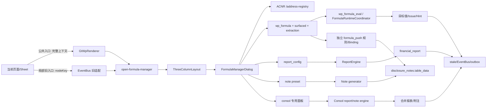

# 公式管理平台全面审计报告（2026-10-17）

**审计快照**：`HEAD 84def65b2561068d428f2a4d0f7b122fa1bf95fc`，分支 `spec/disclosure-note-doc-upload-and-batch-fill`。任务开始时工作树干净；运行时验证期间并行会话新增 `backend/migrations/V189__create_share_change_event_table.sql`、`V190__add_missing_columns_fix_orm_drift.sql`，收尾时另有若干 `.agents/tasks/l*` 历史产物显示为删除，均未触碰。Vitest/Vite 自动改写的两个 `.d.ts` 已精确还原。本文只写本报告，不改生产代码、spec 或业务数据。

> 🔴 **快照绑定声明（复核前必读）**：本报告所有**源码行号锚点与 DB/静态计数均绑定 `84def65b` 这一 commit 的工作树状态**。该分支为多会话并行推进，撰写后 HEAD 已前移（例如复核时实测 HEAD 已是 `e5ee550f`），同一文件的行号可能整体漂移、计数可能变化。复核任一锚点前须先 `git checkout 84def65b`（或 `git worktree add` 一份干净检出）再比对；直接在当前 HEAD 上按行号对照会对不齐。结论性判断（“部分打通 / 未形成闭环”）不依赖具体行号，不受此漂移影响；受影响的只是逐条锚点的精确定位。

> **C1 校准（证据强度口径，2026-10-17 补）**：标题「**全面**审计」里的「全面」指**覆盖广度**——本报告把平台所有公式零件（公式语法、报表求值、静态依赖图、ACNR、stale、formula_push、合并公式）与所有可访问入口都盘了一遍；它**不等于证据深度**。运行时取证期间后端服务多次不可达（见第十一节「审计限制」），Report/TB/Disclosure/Consolidation 四条链仅有**源码 + DB 证据，未全程运行时验证**。因此本文每条结论都标注了「源码/DB/运行时」证据级别，读者须据此分别对待；凡未经运行时坐实者，一律视为「静态/DB 证据，运行时待验」。本次补充（第十一节附录脚本 + 十二 + 十三）同样遵循此口径：所有新数字都可经附录 `fm_audit_db_snapshot.py` 或所列命令重跑复现。

## 一、一页结论：对六个问题逐项回答

| 用户问题 | 结论 | 置信度 | 关键证据 |
|---|---|---:|---|
| ① 不同底稿之间的取数与勾稽是否全打通 | **部分打通，不是全打通** | 高 | 有 425 条 `cross_wp_references`、42,163 条静态 sheet 依赖和 WP/NOTE/TB 执行器；但 V2 resolved 快照只含 107 条，真库 `cross_check_results=0`，D2/E1 中央弹窗展示的是只读说明元数据而非执行结果。源码+DB+运行时。 |
| ② 单个底稿内部的数据提取、公式计算与校对是否全打通 | **部分打通** | 高 | 许多专用 Vue composable 在页面内真实计算；中央弹窗却把 `surfaced` 文案冒充可编辑公式，工作底稿正式公式在所有活跃项目为 0，且“应用自动运算”对底稿基本不可达。源码+DB+运行时。 |
| ③ wp/TB/报表/附注/aux/合并等跨模块是否全打通 | **部分打通；只有报表主链有强实证** | 高 | `report_config` 318 条公式，`financial_report` 492 行带 `formula_used`；但附注 `_formulas/_user_formulas=0`、公式推送 run/state=0、合并公式/run=0、runtime outbox=0，AUX 在报表路径被强制置 0。源码+DB。 |
| ④ 每个实际可访问底稿页面都有“公式管理”按钮吗 | **否** | 高 | 220 个声明 componentType 中公共当前页入口静态覆盖 217，`a1-dashboard`、`univer` 缺失，`redirect-materiality` 条件豁免；真实 208 张底稿样本为 196 直接覆盖、1 缺失、1 重定向、10 分类 404 无法判定。源码+运行时 API。 |
| ⑤ 点击后都能正常弹窗吗 | **部分正常** | 高 | D2、C22、E1 公共按钮都能打开；E1 页内第二个按钮只传 `nodeKey`，实测错误进入 `report` scope，并产生两个 422。D4-33~36 有同形 node-only 入口。源码+运行时。 |
| ⑥ 左侧严格是当前页地址、右侧严格是当前页公式吗 | **不符合** | 很高 | 左栏调用 `/api/acnr/entries` 展示全局树，根本不调用当前 sheet 的 `listCells`；右栏 D2-1 混入 D2-10/D2-12，E1-1 混入 E1-10/E1-14/E1-15。源码+运行时。 |

> **C2 校准（问③ 的否定结论口径，2026-10-17 补）**：问③「wp/TB/报表/附注/aux/合并是否全打通」的否定结论，很大程度由一批 **DB 计数 = 0** 驱动（附注 `_formulas/_user_formulas=0`、`formula_push_run/state=0`、`consol_note_formula/consol_push_run=0`、`cross_check_results=0`、`formula_runtime_outbox=0`；均可经第十一节附录脚本复测）。**count=0 有双重可能**：(a)**链路已断裂**（接线缺失或错误，改之须补/改代码，成本高）；(b)**链路已接线但从未被真实使用**（功能在、只是没人跑过或数据被阻塞，改之只需一次数据运行即可点亮，成本低）。二者整改成本差一个量级。本报告据当前证据只能判为「**未证明打通**」，**不**据 count=0 直接断为「已断裂」。要把每一项从「未证明」推进到「已证伪（确属断裂）」或「已打通（仅数据阻塞）」，**各需一次最小数据运行**：在未删除的 standalone 与 consolidated 项目各造一套隔离公式、触发执行/推送、逐值对拍权威表并观察 run/state/outbox 是否落库。第十三节待办追踪表的「证据强度」「坐实状态」两列据此逐条标注。

**总判断**：平台已经拥有丰富的公式“零件”（公式语法、报表求值、静态依赖图、ACNR、stale、formula_push、合并公式），但“公式管理中心 = 每页统一入口 + 当前页精确地址 + 当前页权威公式 + 可验证执行/校对 + 安全保存/传播”的产品闭环尚未形成。不能据四个已归档 100% spec 宣称“全部打通”。

## 二、当前架构与真实端到端数据流



状态图例：**生产接线**＝已有真实调用方；**旁路生产**＝能运行但不由中央弹窗权威驱动；**占位/展示**＝只显示元数据；**死/错链**＝入口存在但目标错误。

| 链段 | 当前实现与状态 | 证据锚点 |
|---|---|---|
| 当前页→公共按钮 | HTML/skip/confirmation-hub 经 `GtWpRenderer` 公共工具栏，发送 `wpId/projectId/year/wpCode/sheetName/sheetCodes`，生产接线 | `GtWpRenderer.vue:124-138,1193-1220` |
| 局部按钮→中央弹窗 | E1、D4-33~36 仅发 `nodeKey`，丢失实例/项目/sheet，错链 | `GtE1MonetaryFund.vue:280-287`；`D4TabOther*.vue:31-38/167-175` |
| EventBus→弹窗 | `ThreeColumnLayout` 保存 payload 并挂唯一全局弹窗；无 payload 时默认 `report` | `ThreeColumnLayout.vue:321-337,914-925` |
| 左侧地址 | `useAcnr().listSheets()` 构建全局 WP 树；TB/report/note/consol 另拼静态/动态节点；不是当前页坐标清单 | `FormulaManagerDialog.vue:12-34,1569-1754` |
| 工作底稿右侧 | `GET /api/workpapers/{wp_id}/formulas` 合并 `WpFormula.items`、`surfaced`、D/F Tier A/B；生产读，但后两者多为说明文案 | `FormulaManagerDialog.vue:2060-2133`；`wp_formula.py:633-661` |
| 报表公式 | `report_config.formula` 经 `ReportEngine` 写 `financial_report.formula_used/current_period_amount`；这是当前最完整的生产链 | `report_engine.py:1091-1522` |
| 附注公式 | 中央弹窗读模板 `preset-formulas`；独立 `NoteFormulaDialog` 保存 `_user_formulas`，而 apply 只执行 `_formulas/check_presets`，保存与执行互不可见 | `FormulaManagerDialog.vue:2586-2633,3320-3328`；`disclosure_notes.py:1451-1545`；`note_formula_generator.py:380-430` |
| 通用运行协调器 | Draft refresh→`FormulaRuntimeCoordinator`→ValueLoader→adapter；代码接线，但真库 29 条公式全在已删除项目、0 refs/0 computed/outbox=0 | `draft_refresh_orchestrator.py:208-319`；`formula_runtime/coordinator.py:79-455` |
| formula_push | 独立规则/Binding 引擎，81 主编码、267 规则，监听 TB_UPDATED/WORKPAPER_SAVED；不是中央 `wp_formula` 的同一套定义 | `formula_push/triggers.py:1-236`；`formula_push/engine.py:260-580` |
| stale/反向索引 | 多事件 handler 存在；但中央“保存全部”使用系统当前年而非 `props.year`，单行保存不走该调用，且真库 outbox=0 | `FormulaManagerDialog.vue:3614-3664`；`event_handlers/_impl.py:1446-1563` |
| 权限/审计 | formula_push、logic_check、附注较完整；wp_formula/report_config/formula_scope/linkage 多数仅登录，直接 wp_formula CRUD 无哈希链留痕 | 见第七节 |

## 三、三类能力矩阵

### A. 单底稿内部

| 能力 | 入口/源→目标 | 执行与持久化 | UI/测试/运行时 | 结论 |
|---|---|---|---|---|
| 单元格/字段地址发现 | ACNR L1 + legacy 五域注册表 | ACNR 当前仅 WP：1,215 sheet/474 cell；分类表 3,867 sheet/443 wp_code | 左栏只拉 sheet 全局树，不拉当前 sheet cells | **未形成当前页地址面板** |
| 页面内计算 | 各循环 composable、`CYCLE_SHEET_FORMULAS` | 81 base/598 sheet/2,301 条 surfaced 文案，E1 15 sheet/48 条 | D2/E1 页面值和校验真实存在，但中央多为文档化投影 | **页面内部分打通，中心未收敛** |
| 公式编辑/保存 | `FormulaEditDialog`→父组件 | 对 report_config 可写；对工作底稿中央错误写 `/api/report-config/{wp_formula-or-surfaced-id}` | surfaced 标 `readonly` 仍显示“编辑”；运行时可打开编辑器 | **工作底稿中心错链（P0）** |
| 语法/引用校验 | L1 AST/白名单、ACNR save guard | `FormulaEditDialog.onSave` 不校验；report 更新未带 project/year 时跳过 ACNR；wp endpoint 较严格 | 编辑器可装入中文伪公式并准备保存 | **部分，入口不一致** |
| 执行 | 中央“应用自动运算”→report-config batch；wp save 另有即时 evaluator | 中央只回显结果不写页面；wp evaluator只真支持 TB/SUM_TB/WP，其他多阻断或静默 0 | `surfaced` 分类为“计算/取数”而非 `auto_calc`，不会执行 | **部分/名不副实** |
| 校对与差异 | 主表仅显示“计算值”；push panel有当前值/公式值/差异 | logic_check 可落 `cross_check_results`，但真库 0 | D2/E1“逻辑审核”是说明行，计算值均“—” | **普通中心未打通；push 子页部分有** |
| 保存后重载 | report_config、wp_formula、note JSONB 各自存 | 三套权威源；中央 wp 映射还把后端 `category/description` 错读成 `formula_category/formula_description` | 真库活跃项目 wp_formula=0 | **未统一** |

### B. 跨底稿

| 能力 | 当前实现 | 核验证据 | 结论 |
|---|---|---|---|
| 源/目标寻址 | ACNR、legacy URI、CWR、L2/L3 四套并存 | CWR 425/431 targets；resolved snapshot 仅 107（106 hit/1 miss） | **部分，目录漂移** |
| WP()/跨 sheet | `WPExecutor` + `CrossSheetResolver`（BFS/环检测） | D2/E1 in-page 引用活跃；中央展示不等于调用此执行器 | **旁路打通，中心未闭环** |
| 依赖/CCR | 42,163 静态依赖、48,944 nodes/39,421 edges、FormulaReverseIndex | 规则量大，但快照口径不一致且无全链真库结果 | **治理层有，执行证据不足** |
| 变更传播 | WORKPAPER_SAVED/FORMULA_CONFIG_CHANGED→stale engine | 当前样本 208 底稿 stale=0、report stale=2、outbox=0；中央年份写错 | **部分** |
| 勾稽结果 | 7 条 report logic_check + `cross_check_results` | 后端测试绿；真库 0；中央表间审核 GET 少 year 恒 422并退静态示例 | **未证明生产闭环** |
| 项目隔离 | 部分 service 做 ownership，formula_push 端点严格 | 多个中央依赖端点仅 `get_current_user` | **不合格（P0）** |

### C. 跨模块

| 域/链路 | 读路径→写路径/权威源 | 触发与真实消费 | 当前实证 | 结论 |
|---|---|---|---|---|
| TB→report | `TrialBalanceResolver`→`report_config`→`financial_report` | 生成/重算调用 ReportEngine | 318 配置公式；6 项目各 82 行公式落报表 | **已打通主路径** |
| TB/ADJ→wp | prefill、专用组件、wp evaluator、formula_push | 页面打开/刷新、TB_UPDATED、WP_SAVED | D/F2 Tier 开关默认 false；活跃项目正式 wp_formula=0 | **部分** |
| wp→report | 报表公式 `WP()`/权益专用 overlay | 报表生成时消费 | 代码存在，中央 surfaced 不是其权威定义 | **部分** |
| wp/report→note | 前端同步 payload、note generator、formula_push | 保存/推送/附注 apply | 1,069 附注中 `_formulas` 与 `_user_formulas` 均 0；push run=0 | **未证明打通** |
| note→wp/report | `NOTEExecutor`/反向图 | 公式执行时按需预载 | 中央 note 只显示模板预设；用户公式执行断链 | **部分/断链** |
| AUX→其它 | legacy registry + `AUX()` | L1需 `aux_data`；report 显式替换为0，wp编辑拒绝AUX | ACNR catalog 无 aux 条目 | **未打通中央链** |
| consolidation | consolidated report_config + `consol_note_formula` + consol push | 公式变更后推当前项目、抵销审批事件 | 1 个合并项目；consol_note_formula=0、consol_push_run=0、note_data=2 | **代码接线，数据阻塞/未实跑** |
| 其他（audit plan/adjustments/misstatements等） | 425 CWR 中有模块目标；ADJ 净额执行器 | 多为规则/stale，不都在公式中心可配置 | 仅规则证据 | **不应算已打通** |

## 四、全量按钮/弹窗覆盖盘点

多个权威分母语义不同，禁止拼成单一百分比：

| 分母 | 总数 | 直接当前页入口覆盖 | 未覆盖 | 条件覆盖 | 无法判定 | 口径说明 |
|---|---:|---:|---:|---:|---:|---|
| 声明 componentType | 220 | 217 | 2 | 1 | 0 | 216 registry + `skip/confirmation-hub/univer/redirect-materiality`；公共 toolbar 排除 A1，Univer 主路径无入口 |
| `wp_code_overrides.json` 映射 | 1,526 | 1,524 | 1 | 1 | 0 | 1,525 映射到 HTML route，其中 A1 无 toolbar；B15 重定向；该分母含大量 sheet/虚拟码，不等于页面数 |
| 医疗器械真实项目工作底稿 | 208 | 196 | 1 | 1 | 10 | 运行时 classification API：198×200、10×404；A1 缺入口、B15 重定向，其余已解析宿主走公共 toolbar |
| 坐标/渲染分母（非按钮分母） | 3,867 classification rows / 3,453 real；480 render schema；1,215 ACNR sheets | — | — | — | — | 三者覆盖对象与版本不同，ACNR 只覆盖 179 parent wp_code，不能拿 1,215 当“全部页面” |

| 例外/渲染族 | wp_code/宿主 | 实际表现 | 判定 |
|---|---|---|---|
| `a1-dashboard` | A1 / `GtA1Dashboard` | `GtWpRenderer` 明确不渲染公共 toolbar，A1 自管工具栏无公式入口；左侧全局按钮会丢当前页上下文 | **未覆盖** |
| `univer` 主路径 | `WorkpaperEditor` non-HTML / `UniverEditorCore` | 顶部工具栏只有“同步公式”，没有打开 FormulaManager；primary outlet 是空 slot | **未覆盖** |
| `redirect-materiality` | B15 | render-config `redirect=true`，只显示去重要性模块，工作底稿 toolbar 不渲染 | **条件豁免，应单列** |
| classification 404 | 真实项目 10/208 | 路由会落 detail/default fallback；未逐页点击，不能宣称覆盖。**口径须再分两子类**（本轮未逐个交叉判定，列为待办）：若该 wp_code 在 `wp_code_overrides.json` 有映射却 classification 404 = **数据漂移（可修，应落 override 或补 classification 行）**；若本就无映射 = **口径外（真属未建模底稿，不计入分母）**。区分方法：对这 10 个 wp_code 各查一次 override 映射即可一次性归类，不必逐页点击 | **无法判定（可进一步拆分）** |
| 公共 HTML/skip/confirmation | `GtWpRenderer` | 公共按钮存在；但 skip 页/目录页可能只得到全册空态 | **按钮覆盖≠公式闭环** |
| 子组件重复入口 | E1、D4-33~36 | node-only；E1 实测错误 scope。另有 7 个 local formula dialog/drawer，UX/权威源各异 | **接线断裂/碎片化** |
| OnlyOffice | “完整Excel”合成页 | 父级按钮仍在；实测 health/config 与 8080 资源均 200，入口按工作簿级而非 sheet 级 | **工作簿级条件覆盖** |

## 五、左右栏契约核验

| 契约 | 实现/运行时结果 | 结论 |
|---|---|---|
| 左栏只显示当前页面地址坐标 | 左栏标题“数据源”，调用 `/api/acnr/entries`，展示 TB/report/note/wp 全局树及合并、表间审核、数据质量；不调用当前 sheet `/anchors/listCells` | **失败** |
| 右栏只显示当前页面公式 | `matchSheetCode` 为 `a===b || a.includes(b) || b.includes(a)`；D2-1→18 条且含 D2-10/D2-12，E1-1→28 条且含 E1-10/E1-14/E1-15 | **失败（P0）** |
| 展示权威公式而非说明 | 两次 API 均 `items.count=0`，右栏全部来自 `surfaced`，却显示“自定义/编辑/健康度100%” | **失败（误导性成功）** |
| 缺上下文不退全局 | D2目录、C22首页定位失败后明确告警并退全册（42/0）；透明但仍不符合当前页契约 | **部分：有告警，未闭环** |
| 切页/重开/并发 | wp 请求有 sequence guard；但 report/note/cross-check cache 未按 project key，`noteTreeLoaded/reportTypesLoaded/crossCheckLoaded` 切项目不清；观察到一次 ACNR GET abort 后重发200 | **部分，有跨项目陈旧上下文风险** |
| 权限/锁定 | 中央新增、保存、应用按钮无统一 capability gate；设计好的 `createOpenFormulaManagerCommand/decideSaveDraft` 仅被测试调用，生产零调用 | **失败** |

## 六、按钮调用链、请求与运行时验证

| 样本/动作 | 实际结果 | 网络/控制台 | 判定 |
|---|---|---|---|
| 服务/登录 | 用户重启后 `/api/health`、`/livez`、3030 均 200；admin/admin123 登录 200 | 后续服务再次停止，未擅自启动 | 运行时窗口有效但非全程 |
| D2 底稿目录→公共按钮 | 按钮可见、全屏弹窗打开；左全局树；定位目录失败，退“全册公式42”并警告“下表不是本页公式” | bindings/ACNR/formulas 三个 GET 200，0 console error | 弹窗正常，作用域不合格 |
| D2-1→公共按钮 | 显示“本页公式18”，实际混入 D2-10×4、D2-12×3；API `count=0`，全是 surfaced | `/workpapers/{D2}/formulas` 200 | P0 假作用域/假可编辑 |
| D0-2共享页→公共按钮 | 正确落 `底稿>D2>D0-2（共享自D0）`，本页公式0 | GET 200 | 共享页定位修复有效 |
| C22专用 renderer→公共按钮 | 按钮可见、弹窗开；`C22 IT一般控制测试` 不在坐标目录，退全册0并警告 | formulas 200 `{count:0,items:[]}` | 按钮通，内容未通 |
| E1-1页内第二按钮 | 弹窗 scope 标签为“报表”、`本域公式0`，面包屑却写底稿 E1-1 | `/formula-scope?...scope=report` 200；`/report-config/types` 422；`/formula/report-cross-check` 422；2 console errors | P0 node-only 错链 |
| E1-1公共按钮 | 正确落 E1-1，但“本页公式28”混入 E1-10、E1-14、E1-15；API正式 items=0 | formulas/bindings 200 | P0 前缀串页 |
| E1公式推送页 | 展示30条E1规则；最近推送、运行历史、待处理差异均空 | rules/latest/states/runs 全200；DB run/state=0 | UI接线存在，未有真实运行证据 |
| OnlyOffice完整Excel | health、whole-workbook config、8080编辑器资源均200；公共父级按钮仍存在 | 未执行保存/推送 | 外部编辑器可用；公式按全册而非当前原生sheet |
| Report/TB/Disclosure/Consolidation | 源码确认各有专用 mount/context；服务在后续中断前未逐个完成点击 | 无当前运行时证据 | **代码已核验但运行时未验证** |

调用链细节：公共入口禁用条件仅缺 `runtimeProjectId/runtimeWpCode/loading`，不按角色/锁定隐藏；`ThreeColumnLayout` 的左侧全局“公式管理”无 payload 时固定退 `report`。关闭重开会重置 category/search/selection，wp 请求用 `dialogSession/wpRequest` 丢弃慢响应；但 scope/report/note caches 不带 project key。响应信封在当前 GET 200 路径解包正常。`/api/report-config/types` 后端不存在（被 `/{config_id:UUID}` 捕获为422）；report-cross-check 后端强制 `year`，前端未传。

## 七、安全、正确性与事务审计

| 风险 | 证据 | 评级/结论 |
|---|---|---|
| wp_formula / user-formulas 跨项目 IDOR | 路由只有 `{wp_id}`+`get_current_user`，先按 id 加载底稿，再以内含 project_id 操作；未调用项目权限判定 | **P0，高置信静态风险；未做越权写探测** |
| report_config 越权/全局污染 | list/get/clone/update/create/delete/seed/execute-batch 多数仅登录；知道 config UUID 即可改模板或 `project:{id}` 配置 | **P0** |
| 任意项目公式执行/数据提取 | `/api/formula/execute`、report batch 从 body 接 project_id，仅登录；`formula-scope/{project_id}` 也仅登录 | **P0** |
| linkage/地址写操作 | stale impact、override/header-rule、legacy invalidate（含 all）只校验登录；可跨项目标 stale 或改全局解析 | **P0** |
| 保护较好的链路 | formula_push 使用 `require_project_access(readonly/edit)`并有真HTTP 403测试；logic_check、附注CRUD同样按项目；ACNR携 project_id 时显式校验 | 正面基线，应复用 |
| 公式注入/RCE | L1 使用递归AST+函数白名单，危险/外链为 blocked；自定义函数有AST/denylist | 未见直接RCE；但任意登录用户可注册/删除全局自定义函数，仍是P0授权问题 |
| 非法公式落库 | `FormulaEditDialog.onSave` 不调用 validate；中央 report update不带 project/year，后端因此跳过ACNR引用校验 | **P1，安全求值不等于数据正确** |
| 循环/重复计算 | report batch有拓扑循环报错；CrossSheetResolver有BFS/环检测；note拓扑对剩余循环仅追加执行；多引擎并存使双算/0回退仍可能 | 部分防御 |
| 事务原子性 | service多数只flush/router commit；formula_push每底稿SAVEPOINT+CAS较好。中央“保存全部”逐行调用各自commit，半途失败会留下部分成功 | **P1 原子性缺口** |
| 审计追踪 | user-formulas、report execute、formula audit log有留痕；直接 wp_formula CRUD 未见 append_audit_log，当前29行也无computed证据 | **P1** |
| 正负号/双计 | occurrence按末级标准码聚合、ADJ只给净额、合并有五度量模型；但多个旁路和静默0无法由中央统一对拍 | 局部有保障，平台级未闭合 |

现有授权基线测试只对“完整路径含 `{project_id}`”做大盘棘轮，`{wp_id}` 对象型公式端点和 body/query project_id 容易漏检；当前 `_IDENTITY_ONLY_BASELINE=224` 只是“不再增加”，不是“现状安全”。

## 八、测试执行结果与盲区

| 精确命令 | 结果 |
|---|---|
| `rtk npx vitest run src/composables/__tests__/FormulaManagerPageWiring.spec.ts src/components/formula/__tests__/sharedSheetScopeTargeting.spec.ts src/components/formula/__tests__/useFormulaScopeCatalog.spec.ts src/shell/formula/__tests__/openFormulaManagerCommand.spec.ts src/components/workpaper/__tests__/FormulaStatusPanel.spec.ts src/components/workpaper/__tests__/formulaStatusPanelDisplay.spec.ts --reporter=verbose`（cwd `audit-platform/frontend`） | **62 passed / 2 failed / 0 skipped**。RTK外层错误返回exit 0，不能只看退出码。 |
| `rtk ..\.venv\Scripts\python.exe -m pytest tests/test_formula_engine.py tests/test_user_formulas_override.py tests/formula_management/test_formula_scope_query.py tests/formula_management/test_wp_formula_source_scope_binding.py tests/formula_runtime/test_orchestrator_real_mutations.py tests/formula_runtime/test_value_loader.py tests/test_project_endpoint_authorization_baseline.py -q --tb=short -p no:cacheprovider` | **107 passed / 0 failed / 0 skipped，4 warnings** |
| `rtk ..\.venv\Scripts\python.exe -m pytest tests/test_formula_push_rules.py tests/test_formula_push_engine.py tests/test_formula_push_endpoints.py tests/test_formula_push_triggers.py tests/test_formula_push_policy.py tests/test_formula_push_note_writer.py tests/test_formula_push_schema_contract.py -q --tb=short -p no:cacheprovider` | **235 passed / 0 failed / 0 skipped，1164 warnings**，含多条 `Connection._cancel was never awaited` |
| `rtk ..\.venv\Scripts\python.exe -m pytest tests/formula_runtime/test_logic_check_truth.py -q --tb=short -p no:cacheprovider` | **28 passed / 0 failed / 0 skipped，1 warning** |

两个前端失败均揭示“归档100%≠当前可靠”：`FormulaManagerPageWiring` 的一次性 reject 被新增 bindings GET 抢先消费，错误态测试已脆化；`formulaStatusPanelDisplay` 仍要求“HTML面板不可达”这一旧缺口存在，而当前代码已加按钮，守卫变成历史假红。

关键盲区：① `FormulaManagerDialog.spec.ts` 复制纯逻辑而不挂真实组件；② page wiring只测GET/竞态，不测编辑保存端点；③共享页测试只比 D0-2 与 D2-1，未测 D2-1/D2-10 前缀碰撞；④ toolbar E2E允许 `triggerCount>=0`、只数关闭态 dialog≤1，从未点按钮核左右栏；⑤ runtime coordinator大量mock DB/ValueLoader，部分断言允许“有mutation或无failure”；⑥ scope测试人工造现实不存在的 `TB/REPORT/NOTE/CONSOL-*` wp_index，不能证明真实模块存储；⑦ formula_push测试质量较高但为合成SQLite，当前PG运行记录仍为0；⑧没有对象型端点跨项目TestClient用例；⑨没有“surfaced必须只读且不能写report_config”守卫。

## 九、P0/P1/P2 缺口与根因

### P0（阻断宣称“平台核心闭环”）
1. **FM-P0-01 当前sheet串页**（功能/接线）：模糊包含匹配把 `E1-1` 命中 `E1-10/E1-14`，把 `D2-1` 命中 `D2-10/D2-12`；根因是编码身份被当自由文本。
2. **FM-P0-02 surfaced假可编辑+错保存域**（功能/正确性）：后端铁证 —— `wp_formula.py` 下 `E1-surfaced-*`/`{base}-surfaced-*`/Tier B 溯源条目全部硬标 `readonly=true`（已核验，不随 HEAD 漂移）。前端错链为：`onFormulaEditSave` 的"已有行更新"分支是 `if (row.id) → PUT /api/report-config/{row.id}`，并不校验该 id 是否真的是 report_config 行 ⇒ surfaced 行（id 形如 `E1-surfaced-tb-check`）一旦被点开"编辑"并保存，就会把这个伪 id 发给 report-config detail 端点。**口径更正（复核发现）**：在复核 HEAD `e5ee550f` 下，保存链并非"统一写 report_config" —— `tb_detail` 节点已改写 `wizard_state.tb_detail_formulas`、wp 节点新增行因 `activeReportType` 为空而走不到 report-config 分支、「公式看板」分支已显式注释"不把 wp_formula 的 id 发到 report-config 端点"（`FormulaManagerDialog.vue:3959-3964`）。因此本条真正的现存缺陷收窄为两点：**(a) surfaced 可被点开编辑而其后端语义是只读；(b) 任何"有 id 的非报表行"保存时无 kind 校验即发 report-config detail 端点**。"统一写 report_config"是 `84def65b` 时点的更宽描述，当前已部分分流，须在该 commit 复核原始形态。"健康度100%/自定义"仍把说明元数据包装成正式公式。
3. **FM-P0-03 多入口丢上下文**（接线）：E1与D4-33~36直接发nodeKey；设计好的 canonical command/capability/dirty-pin没有进生产。
4. **FM-P0-04 附注用户公式保存后不执行**（功能）：`_user_formulas`与`_formulas`双存储；apply只读后者。中央弹窗甚至不读前者。
5. **FM-P0-05 项目隔离缺失**（安全，**静态高危 · 待动态坐实**）：wp_formula、report_config、执行、scope、linkage/legacy address 等关键端点只 `get_current_user` 不校项目。**定级依据与张力须显式声明**：定为 P0 是基于静态读码（路由只有 `{wp_id}`/body project_id + 仅登录依赖）与平台已有 IDOR 先例（memory 记录的 `t_accounts`/`formula_audit_log` 同型越权）的高置信推断；但本轮**未执行任何跨项目越权读/写/执行探测**（见第六节审计限制与第八节盲区⑧）。因此严格表述为"静态高危、待一条 TestClient 跨项目用例坐实"，而非"已证实可越权"。整改第 5 项与建议门禁第⑦条即为此提供坐实手段；在坐实前，本条是"必须优先验证的高危假设"，不是"已复现的事故"。

### P1（主流程可用但结果/覆盖不可信）
1. 左栏不是当前页地址，ACNR catalog又只有WP且仅1,215/3,453 real-sheet量级；AUX/报表/附注靠另一套动态/静态树。
2. 表间审核入口契约错：GET缺year恒422；响应本是执行结果却被按“规则列表”解析；失败后展示静态示例；新增/编辑规则只改内存，关闭即丢；树父/叶key与规则map还不一致。
3. 公式函数“按钮支持”与运行支持不一致：workpaper UI提供NOTE/REPORT/ROW/AUX/PREV/ADJ，实际多数阻断或空ctx→0；report路径明确把PREV/AUX替换0；中央batch未注入ADJ实时数据。
4. A1、Univer无当前页入口；真实项目另有10个classification 404未判定（第四节已给出"有映射=数据漂移 / 无映射=口径外"的一次性区分法，待交叉判定后再定归属）；目录/C22页面只能退全册。
5. project切换缓存未隔离，单行保存不触发统一stale；保存全部用系统当前年而非项目年；真库outbox=0。
6. 正式运行数据为空：所有29条wp_formula都属于已软删项目“辽宁卫生服务”，且0 computed/refs/source_scope/binding；活跃项目为0。formula_push/cross-check/consol运行表均0。

### P2（治理与可维护性）
1. 至少7套 local formula dialog/drawer 与中央中心并存，按钮同名但能力/权威源不同；确认汇总、D4披露等仍是局部规则说明。
2. 四个直接相关spec均归档100%（library 22/22、runtime 18/18、toolbar 17/17、push rollout 26/26），active spec只有3个且无公式治理；任务状态与运行事实偏离。
3. formula_push套件1164 warnings、前端两条历史红、RTK吞失败退出码，会训练团队忽略门禁。

## 十、最小闭环整改顺序与验收标准（不实施）

1. **先止错（P0）**：用结构化 `stable_sheet_key/sheet_uid` 精确等值替换 `includes`；surfaced/extraction强制只读并去掉保存/应用/“自定义”标签；工作底稿编辑必须调用 `wpFormula.upsert`。验收：E1-1/D2-1前缀反例逐一不串页；对surfaced点击区无编辑按钮。
2. **统一入口**：生产代码真正调用 `createOpenFormulaManagerCommand`，所有公共/局部按钮只提交 `CanonicalWorkpaperLocation`；删除E1/D4 node-only旁路；A1/Univer补同一primary outlet，redirect登记正式豁免。验收：220 componentType每项恰有覆盖或有期限豁免，零未知。
3. **重做左右栏契约**：后端新增/收敛为 `GET formulas?project_id&wp_id&sheet_uid` 与 `GET addresses?project_id&wp_id&sheet_uid`，服务端精确过滤；左栏只显示当前sheet anchors，另设显式“全局浏览”按钮。验收：左右返回每行均带同一 location identity，缺identity fail-closed而非退全局。
4. **收敛权威源和执行语义**：wp正式公式=`wp_formula`；surfaced=文档化只读；note要么让apply消费`_user_formulas`，要么取消可编辑；report=`report_config`；formula_push明确为自动物化层而非“同一公式”。为每个函数维护按执行器的支持矩阵，禁静默0。
5. **补项目鉴权与原子性**：对象id先最小反查project再 `require_project_access`；body/query project_id同样校验；全局模板/自定义函数限admin；批量保存单事务+CAS；直接wp_formula CRUD写哈希审计。验收：跨项目读/写/执行全部403且0副作用。
6. **闭合执行/传播可观测性**：修year、项目缓存键、cross-check API；每次执行写run/issue/hint/outbox/audit并可查询；去掉“执行0条仍成功”。验收：新公式保存→重开一致→执行改变目标→`last_computed_at`更新→stale/outbox/audit均有同一run_id。
7. **最后真实UAT**：在未删除 standalone 与 consolidated 项目各造一套隔离公式，覆盖HTML、OnlyOffice、Univer、report、note、aux、consol，逐值对拍权威表；不接受只看组件或mock API。

### 建议新增的全量自动门禁

建立 `formula-manager-all-accessible-pages.spec.ts`：测试先通过项目API枚举全部可访问 `working_paper`，逐张GET render-config并展开“每个真实sheet + whole_workbook + redirect”，形成运行时权威分母；每项记录 `project_id/wp_id/wp_code/sheet_uid/sheet_code/host/componentType`。非redirect项必须：①恰好一个 `[data-testid=formula-manager-open]`；②点击只出现一个中心；③抓包断言请求带完整location；④左侧返回addr_id全属于精确当前sheet；⑤右侧每条stable_sheet_key精确相等，且surfaced只读；⑥切sheet/项目后集合变化且旧响应不能覆盖；⑦admin/auditor/readonly分别验证view/edit权限；⑧0 console error、0当前请求abort、0 4xx。redirect/不可渲染必须用带owner/reason/expires_at的可伪证豁免。门禁输出JSON矩阵，分母任何新增自动变红；配套变异必须注入 `E1-10`、删除按钮、去掉wp_id、把save改回report_config，四种都应命中指定测试。

> 🔴 **幂等输出（防永红门禁，必须遵守）**：该门禁的权威分母会随项目数据（底稿数 / sheet 数）与代码（componentType 增减）变化，若把分母 JSON 矩阵做成"每次运行写入含时间戳 / 运行序号 / 绝对路径的产物 + `git diff --exit-code` 比对"，则 diff 必然非空、门禁必然恒红，最终被所有人忽略 —— 这正是我们已踩过的坑（见 memory 方法论铁律㉗"有门禁≠门禁生效；非确定性输入=永假门禁=比没门禁更糟"）。要求：①分母 JSON **内容不变则不改时间戳 / 排序稳定 / 不含机器名或绝对路径**（幂等序列化）；②沿用仓库既有 `--check` 约定（漂移 exit 2 并点名新增项），而非 `--write` 后 diff；③子进程捕获输出须 `PYTHONIOENCODING=utf-8` + `errors='replace'` + 断言 stdout 含预期内容（Windows piped stdout 默认 gbk，中文信息按 utf-8 解码会被静默吞成 `None`，只看 returncode 的守卫必假绿，同铁律㉗⑦）。

## 十一、附录：统计口径、关键文件与命令

**当前数据快照（只读PG事务）**：projects 142/active85（standalone11、consolidated1、report_scope空73）；wp_index/working_paper各997、77项目、291 distinct wp_code；wp_formula29（1个已删除项目/29底稿，auto_calc/custom/saved各29，computed/refs/source_scope/binding全0）；report_config1191行/318公式/4标准；financial_report2112行/492 formula_used/6项目；disclosure_notes1069/9项目/stale227，`_formulas=0`、`_user_formulas=0`；cross_check_results=0；formula_runtime_outbox=0；formula_push_run/state=0；consol_note_formula=0；consol_push_run=0；consol_note_data=2。

**静态数据口径**：override 1,526映射/185 componentType；前端 registry 216；ACNR L1 1,215 sheets+474 cells，全部domain=wp，179 parent code；classification 3,867 rows/443 wp_code/3,453 real；render schema 480；prefill mappings306；CWR425 refs/431 targets/96 source wp/81 target wp；L3 dependencies42,163；resolved refs107；unified graph48,944 nodes/39,421 edges；formula_push267 rules/81主码（source102/derived85/note80）；surfaced catalog 81 base/598 sheets/2,301说明公式，另E1 15/48。所有计数均为本轮现扫，不沿用memory旧数。

**关键源码**：`FormulaManagerDialog.vue:12-334,825-1230,1569-1754,1934-2133,2194-2527,2586-2950,3091-3269,3614-3765`；`FormulaEditDialog.vue:445-470,688-936,987-1132,1197-1280`；`GtWpRenderer.vue:124-209,694-717,1193-1220`；`WorkpaperEditor.vue:29-280,540-680,991-1137,1188-1231`；`ThreeColumnLayout.vue:152-159,220-225,321-337,914-925`；`wp_formula.py:633-939`；`wp_formula_service.py:290-625`；`formula_engine.py:861-966,1135-1168`；`report_engine.py:822-953,1091-1522`；`note_formula_service.py:130-208`；`note_formula_generator.py:380-500`；`formula_runtime/coordinator.py`；`formula_push/{engine,triggers,bindings}`；`formula_scope_query.py`；`address_registry.py`、`address_registry_v2.py`、`acnr.py`；`linkage_bus.py`；迁移 `V052/V100/V104/V163/V178`。

**运行时未完成项最小复验**：启动9980/3030后登录admin，依次访问 `/projects/{pid}/reports?year=2025`、`/trial-balance?year=2025`、`/disclosure-notes?year=2025`、合并项目 `/consolidation`；每页选择非默认tab/章节后点本页按钮，核对无 `/report-config/types` 或缺year 422，并对比左右栏随tab变化。合并侧需先种子化公式才可做有数据验证；当前表为0。

**审计限制**：未执行任何保存、应用、推送、dry-run或越权探测；未启动/重启服务；未跑会写历史evidence的E2E；服务在完成D2/C22/E1/OnlyOffice取证后再次不可达，因此Report/TB/Disclosure/Consolidation仅有源码+DB证据，置信度已相应标注。

### 可复现扫描脚本与逐条 SQL（2026-10-17 补）

> 本子节为本节「当前数据快照」与「静态数据口径」每一个计数提供可重跑取证。**不删除/改写上方任何既有结论**，只补复现方式与本轮实测值。下方所有 DB 数字均由只读脚本在 `audit-postgres`/`audit_platform` 现扫产出，可随时重跑验证（幂等，无时间戳）。

**脚本路径**：`backend/scripts/analyze/fm_audit_db_snapshot.py`（正式脚本，长期保留、无 `_` 前缀）。只读（全部 SELECT/COUNT）；凭据只从 `.env` 经 `os.environ` 读取（候选顺序 worktree 根 → worktree backend → `d:/GT_plan/.env` → `d:/GT_plan/backend/.env`，`override=False`，优先 `DATABASE_URL` 去 `+asyncpg` 得同步 URL，否则 `PG_*` 拼装），**绝不把密码写入脚本或输出**（连接提示只打印 `@` 之后的 host/db，且写 stderr）。autocommit 连接 + 每条指标先经 `information_schema` 查表/列存在性，缺失记「表不存在/列不存在」，单条异常被隔离为该指标错误字符串、不影响其余。

**运行命令**：

- cwd = worktree 根（worktree 无独立 venv，统一用主仓库 venv）：
  ```
  chcp 65001
  d:\GT_plan\.venv\Scripts\python.exe backend\scripts\analyze\fm_audit_db_snapshot.py --format table
  d:\GT_plan\.venv\Scripts\python.exe backend\scripts\analyze\fm_audit_db_snapshot.py --format json
  d:\GT_plan\.venv\Scripts\python.exe backend\scripts\analyze\fm_audit_db_snapshot.py --static
  ```
- cwd = `backend`（主仓库 venv 相对 worktree backend 为三级父目录）：
  ```
  chcp 65001
  ..\..\..\.venv\Scripts\python.exe scripts\analyze\fm_audit_db_snapshot.py --format table
  ```
- `--format json` 的 stdout 为纯 JSON（稳定排序、无时间戳/机器名/绝对路径），两次运行逐字节一致，可作未来幂等门禁的 golden。

**TASK 1 — DB 计数 [指标名 → 实际 SQL → 本轮实测值]**（2026-10-17 现扫）：

| 指标名 | 实际 SQL | 实测值 |
|---|---|---:|
| projects.total | `SELECT COUNT(*) FROM projects` | 142 |
| projects.active(未删) | `… WHERE is_deleted=false` | 85 |
| projects.active.report_scope=standalone | `… is_deleted=false AND report_scope='standalone'` | 11 |
| projects.active.report_scope=consolidated | `… is_deleted=false AND report_scope='consolidated'` | 1 |
| projects.active.report_scope IS NULL | `… is_deleted=false AND report_scope IS NULL` | 73 |
| wp_index.rows | `SELECT COUNT(*) FROM wp_index` | 997 |
| wp_index.distinct_project | `SELECT COUNT(DISTINCT project_id) FROM wp_index` | 77 |
| wp_index.distinct_wp_code | `SELECT COUNT(DISTINCT wp_code) FROM wp_index` | 291 |
| working_paper.rows | `SELECT COUNT(*) FROM working_paper` | 997 |
| working_paper.distinct_project | `SELECT COUNT(DISTINCT project_id) FROM working_paper` | 77 |
| wp_formula.total | `SELECT COUNT(*) FROM wp_formula` | 29 |
| wp_formula.refs 非空(jsonb) | `… refs IS NOT NULL AND refs::text NOT IN ('null','[]','{}')` | 0 |
| wp_formula.source_scope 非空(jsonb) | `… source_scope IS NOT NULL AND …` | 0 |
| wp_formula.binding 非空(jsonb) | `… binding IS NOT NULL AND …` | 0 |
| wp_formula.computed(last_computed_at 非空) | `… last_computed_at IS NOT NULL` | 0 |
| wp_formula.列category='auto_calc' | `… category='auto_calc'` | 29 |
| wp_formula.列formula_source='custom' | `… formula_source='custom'` | 29 |
| wp_formula.列lifecycle_state='saved' | `… lifecycle_state='saved'` | 29 |
| wp_formula.所属项目软删 | `… JOIN projects p … WHERE p.is_deleted=true` | 29 |
| wp_formula.所属项目未删 | `… JOIN projects p … WHERE p.is_deleted=false` | 0 |
| report_config.rows | `SELECT COUNT(*) FROM report_config` | 1191 |
| report_config.未删rows | `… WHERE is_deleted=false` | 1191 |
| report_config.含公式(formula 非空非空串) | `… formula IS NOT NULL AND formula<>''` | 318 |
| report_config.distinct_applicable_standard | `SELECT COUNT(DISTINCT applicable_standard) …` | 4 |
| financial_report.rows | `SELECT COUNT(*) FROM financial_report` | 2112 |
| financial_report.formula_used 非空rows | `… formula_used IS NOT NULL AND formula_used<>''` | 492 |
| financial_report.含公式_distinct项目 | `SELECT COUNT(DISTINCT project_id) … WHERE formula_used …` | 6 |
| financial_report.克隆判定_distinct(row_code+formula_used)对 | `SELECT COUNT(*) FROM (SELECT DISTINCT row_code, formula_used … ) t` | 82 |
| financial_report.跨项目公式冲突行数(应为0) | `… GROUP BY row_code HAVING COUNT(DISTINCT formula_used)>1` | 0 |
| disclosure_notes.rows | `SELECT COUNT(*) FROM disclosure_notes` | 1069 |
| disclosure_notes.未删rows | `… WHERE is_deleted=false` | 1069 |
| disclosure_notes.distinct_项目 | `SELECT COUNT(DISTINCT project_id) …` | 9 |
| disclosure_notes.is_stale=true | `… WHERE is_stale=true` | 227 |
| disclosure_notes.table_data 含键 _formulas | `… jsonb_typeof(table_data)='object' AND table_data ? '_formulas'` | 0 |
| disclosure_notes._formulas 非空对象 | `… table_data ? '_formulas' AND jsonb_typeof(…->'_formulas')='object' AND …<>'{}'` | 0 |
| disclosure_notes.table_data 含键 _user_formulas | `… table_data ? '_user_formulas'` | 0 |
| disclosure_notes._user_formulas 非空对象 | `… <>'{}'::jsonb` | 0 |
| disclosure_notes.table_data 含键 check_presets | `… table_data ? 'check_presets'` | 0 |
| projects.wizard_state 含 tb_detail_formulas 的项目数 | `… jsonb_typeof(wizard_state)='object' AND wizard_state ? 'tb_detail_formulas'` | 0 |
| cross_check_results.rows | `SELECT COUNT(*) FROM cross_check_results` | 0 |
| formula_runtime_outbox.rows | `SELECT COUNT(*) FROM formula_runtime_outbox` | 0 |
| formula_push_run.rows | `SELECT COUNT(*) FROM formula_push_run` | 0 |
| formula_push_state.rows | `SELECT COUNT(*) FROM formula_push_state` | 0 |
| consol_note_formula.rows(全部) | `SELECT COUNT(*) FROM consol_note_formula` | 0 |
| consol_note_formula.未删rows | `… WHERE is_deleted=false` | 0 |
| consol_push_run.rows | `SELECT COUNT(*) FROM consol_push_run` | 0 |
| consol_note_data.rows | `SELECT COUNT(*) FROM consol_note_data` | 2 |
| classification.rows | `SELECT COUNT(*) FROM workpaper_sheet_classification` | 3867 |
| classification.distinct_wp_code | `SELECT COUNT(DISTINCT wp_code) …` | 443 |
| classification.is_real_workpaper=true | `… WHERE is_real_workpaper=true` | 3453 |

**口径注（重要，防误读）**：

- `wp_formula` 的 `auto_calc/custom/saved` 三个 29 **来自三个不同列**（`category='auto_calc'`、`formula_source='custom'`、`lifecycle_state='saved'`），**不是同一列的三个值**；三者恰好都 = 全量 29，说明这 29 行同质。所有 29 行 `refs/source_scope/binding/last_computed_at` 全空，且 **29/29 都属 `is_deleted=true` 的项目**（活跃项目正式 wp_formula = 0）。
- `report_config` **无 `project_id` 列**，是按 `applicable_standard`（4 个标准）区分的**全局模板表**；1191 行里 318 行含公式。此事实是第十二节报表链「克隆判定」的前提。
- `financial_report` 492 条含公式行去重 `(row_code + formula_used)` 仅 **82** 对、且无任何 `row_code` 跨项目公式冲突（冲突行数 = 0）→ 6 个项目各 82 行是**同一套模板的 6 份克隆**（详见 12.3）。
- `disclosure_notes` 的 `_formulas/_user_formulas/check_presets` 是 `table_data` JSONB 内的键，用 `table_data ? 'key'` 测存在、`jsonb_typeof(...)='object' AND <> '{}'` 测非空；三键在全库现扫均 0。

**TASK 2 — 静态数据口径 [指标名 → 命令/脚本 → 实测值]**（`--static` 子命令产出；含正则者在脚本内对 `registry/entries/*.ts` 计数，不用 `python -c`）：

| 指标名 | 复现命令/口径 | 实测值 |
|---|---|---|
| override 映射数 | `len(json.load(backend/app/data/wp_code_overrides.json))` | 1526 |
| override distinct componentType | `len(set(overrides.values()))` | 185 |
| 前端 registry componentType | 脚本按正则 `componentType:` 统计 `audit-platform/frontend/src/components/workpaper/registry/entries/*.ts`（registry 由 6 个 entries 数组 spread 装配，membership = 数组本身） | 216（confirmations 22 / core 16 / forms 12 / programs 53 / reports 16 / specialized 97） |
| formula_push rules 总数 | `len(json.load(backend/data/formula_push_rules.json)['rules'])` | 267 |
| formula_push rules 按 stage | `Counter(rule['stage'])` | source 102 / derived 85 / note 80 |
| formula_push distinct page_key | `len(set(rule['page_key']))` | 81 |
| ACNR sheets | `len(json.load(backend/data/acnr/global_catalog.json)['sheets'])` | 1215 |
| ACNR cells | `len(…['cells'])` | 474 |
| render schema yaml 文件数 | `count(**/*.yaml under backend/data/ledger_adapters/wp_render_schema)` | 478 |
| classification rows / wp_code / real | 见上表 DB 段（`workpaper_sheet_classification`） | 3867 / 443 / 3453 |
| CWR refs/targets | **服务派生（`cross_wp_references`）**，非单一文件/表 | 口径未复现，沿用 84def65b 值 425/431（静态证据，运行时待验） |
| L3 dependencies | **服务派生（`address_registry_v2` 依赖图）** | 口径未复现，沿用 84def65b 值 42,163（静态证据，运行时待验） |
| unified graph nodes/edges | **服务派生（统一依赖图）** | 口径未复现，沿用 84def65b 值 48,944/39,421（静态证据，运行时待验） |
| resolved refs | **服务派生（V2 resolved 快照）** | 口径未复现，沿用 84def65b 值 107（静态证据，运行时待验） |
| prefill mappings | **服务派生（prefill）** | 口径未复现，沿用 84def65b 值 306（静态证据，运行时待验） |
| surfaced catalog 81/598/2301 | **`wp_formula.py` 静态目录运行期按 wp_code 组装**，非单一文件/表 | 口径未复现，沿用 84def65b 值 81 base/598 sheet/2,301（静态证据，运行时待验；代码锚点 `wp_formula.py:483-662`） |

> **复核发现（HEAD e5ee550f）**：render schema 真源在 `backend/data/ledger_adapters/wp_render_schema/`（478 个 `.yaml`），**不在** `backend/app/data/wp_render_schema/`（后者仅 3 个示例 yaml）。本次实测 478 与 84def65b 文档的「480」差 2（口径差异，疑为文档把 `.yaml` 外的其它文件或两个版本目录一并计入），作「撰写时 480 / 现扫 478」记录，不改原值。CWR/L3/graph/resolved/prefill/surfaced 等服务派生计数本轮未能用单一文件或表复现，按本报告口径标「静态证据，运行时待验」并沿用 84def65b 原值；要坐实须在运行时调用对应 service 导出。

### 脚本实测值 vs 第十一节既有数字 对账（TASK 5，2026-10-17 补）

> 本报告既有数字反映 **84def65b 撰写时** 的 DB 状态；DB 可能因并行会话已变。下表逐条对照脚本**现在**实测值，差异一律记为「**撰写时 vs 现在**」，**不**表示文档写错。

| 项 | 文档既有值（撰写时） | 脚本现扫值 | 对账结论 |
|---|---|---|---|
| projects total / active | 142 / 85 | 142 / 85 | 一致 |
| projects standalone / consolidated / null | 11 / 1 / 73 | 11 / 1 / 73 | 一致 |
| wp_index / working_paper 行 | 997 / 997 | 997 / 997 | 一致 |
| wp_index distinct project / wp_code | 77 / 291 | 77 / 291 | 一致 |
| wp_formula total | 29 | 29 | 一致 |
| wp_formula refs/source_scope/binding/computed | 全 0 | 全 0 | 一致 |
| wp_formula auto_calc/custom/saved | 各 29 | 各 29 | 一致 |
| wp_formula 所属已删项目 | 29（全部） | 29 | 一致 |
| report_config 行 / 含公式 / 标准数 | 1191 / 318 / 4 | 1191 / 318 / 4 | 一致 |
| financial_report 行 / formula_used / 项目 | 2112 / 492 / 6 | 2112 / 492 / 6 | 一致 |
| financial_report 克隆 distinct 对 | （文档未列具体值，表述「6 项目各 82 行」） | 82 distinct 对、冲突 0 | 脚本有而文档未列：补充克隆判定 82/0（支撑 12.3） |
| disclosure_notes 行 / 项目 / stale | 1069 / 9 / 227 | 1069 / 9 / 227 | 一致 |
| disclosure_notes _formulas/_user_formulas | 0 / 0 | 0 / 0 | 一致 |
| disclosure_notes check_presets | （文档未单列） | 0 | 脚本有而文档未列：补充 check_presets=0 |
| projects.wizard_state 含 tb_detail_formulas | （文档未列） | 0 | 脚本有而文档未列：补充 tb 公式项目数=0（支撑 12.4） |
| cross_check_results | 0 | 0 | 一致 |
| formula_runtime_outbox | 0 | 0 | 一致 |
| formula_push_run / state | 0 / 0 | 0 / 0 | 一致 |
| consol_note_formula / consol_push_run / consol_note_data | 0 / 0 / 2 | 0 / 0 / 2 | 一致 |
| override 映射 / componentType | 1526 / 185 | 1526 / 185 | 一致 |
| 前端 registry | 216 | 216 | 一致 |
| formula_push rules / 主码 | 267 / 81（source 102 / derived 85 / note 80） | 267 / 81（source 102 / derived 85 / note 80） | 一致（文档「81 主码」= distinct page_key；文档「source102/derived85/note80」= 按 stage） |
| ACNR sheets / cells | 1215 / 474 | 1215 / 474 | 一致 |
| classification rows / wp_code / real | 3867 / 443 / 3453 | 3867 / 443 / 3453 | 一致 |
| render schema | 480 | 478 | 不一致：撰写时 480 / 现扫 478（见上「复核发现」口径注，疑目录口径差异，不改原值） |
| CWR / L3 / graph / resolved / prefill / surfaced | 425·431 / 42,163 / 48,944·39,421 / 107 / 306 / 81·598·2301 | 口径未复现 | 文档有而脚本未覆盖：均为服务派生，本轮未复现，沿用原值并标「运行时待验」 |

## 十二、分模块公式管理深化分析与优化建议

> 本节按七个模块逐一深化：底稿 wp / 附注 note / 报表 report / 试算表 tb / 合并报表 consol-report / 合并附注 consol-note / 合并底稿 consol-wp。每个子节都回答**六要素**——①权威源 ②谁读谁写 ③执行器是否真跑 ④校对/勾稽是否落库 ⑤保存后传播（stale/outbox）是否触发 ⑥项目隔离与审计留痕——并给出锚定到端点/函数/数据结构的**可落地**优化。源码锚点格式 `文件:行号`，均绑定 **HEAD e5ee550f**；凡行号与 84def65b 文档不符处加「复核发现（HEAD e5ee550f）」注并保留原结论。所有数字引第十一节附录脚本。

### 12.1 底稿 wp

**现状（HEAD e5ee550f）**：底稿公式呈**三套集合并存**：
- **正式 `wp_formula`**（用户落库网格行）：`list_formulas` 端点 `wp_formula.py:634-662`，经 `wp_formula_service.list_by_wp(..., project_id=wp.project_id)` 读；真库 total=29，且 `refs/source_scope/binding/last_computed_at` 全 0、**29/29 属已软删项目**（附录脚本 `wp_formula.*`）。
- **只读 `surfaced` 投影**：`_build_surfaced_formulas` `wp_formula.py:483-632`，E1 试点在 L513-598 组装 TB 核对/E1-1 审定表跨 sheet 取数/叶子取数，其他循环 L601-632 为静态目录；**每一条都带 `"readonly": True`**（L513/551/561/590/624 逐处可见），挂响应在 `list_formulas` L658-660。
- **D/F 四表提取 `extraction`**（Tier A/B）：`_build_extraction_block`，仅 D 循环 + 灰度开关开启时出现。

页内计算走各循环专用 Vue composable（如 `useE1Adjudication`），中央弹窗是 `FormulaManagerDialog.vue`；二者并行。

**① 权威源**：工作底稿正式公式 = `wp_formula`；`surfaced/extraction` 是**只读投影/文档化目录**，不是权威定义。**② 谁读谁写**：`GET /api/workpapers/{wp_id}/formulas` 合并三套返回（`wp_formula.py:634-662`）；写入应走 `PUT /formulas`（`save_formula` L665）。缺陷：中央 `FormulaEditDialog` 的保存按钮对工作底稿误写 `report_config`（第四节 C 表、第九节 FM-P0-02），且把后端 `category/description` 错读成 `formula_category/formula_description`。**③ 执行器是否真跑**：wp evaluator 只真支持 `TB/SUM_TB/WP`，其余函数多阻断或静默返回 0；`surfaced` 条目分类是「取数/计算/logic_check」而非 `auto_calc`，**根本不会被执行**。**④ 校对/勾稽落库**：logic_check 可落 `cross_check_results`，但真库 = 0（附录脚本）。**⑤ 保存后传播**：`formula_runtime_outbox` 真库 = 0；中央「保存全部」用系统当前年而非 `props.year`，单行保存不走统一 stale 调用。**⑥ 项目隔离与审计留痕**：`list_formulas`/`save_formula` 仅 `Depends(get_current_user)`（`wp_formula.py:637,669,904`），**无 `require_project_access`、无哈希审计链**——知道 `wp_id` 即可跨项目读/写（P0，见第七节、FM-P0-05）。

**可落地优化**（锚到结构）：
1. 右栏匹配用 `wp_formula.stable_sheet_key`（列已存在，见附录 schema）做**精确等值**替换前端 `matchSheetCode` 的模糊 `includes`（直接消除 FM-P0-01 串页）。
2. `surfaced`/`extraction` 在前端强制只读：去掉「编辑/自定义/健康度」标签与保存按钮（后端已标 `readonly:true`，前端只需遵守）。
3. 工作底稿编辑改走 `wpFormula.upsert`（`PUT /formulas`），禁止落 `report_config`。
4. 对象型端点（`{wp_id}`）先按 id 反查 `project_id`，再 `require_project_access("edit"/"readonly")`；直接 `wp_formula` CRUD 写 `append_audit_log` 哈希链。

### 12.2 附注 note

**现状（HEAD e5ee550f）**：附注公式**双存储**于 `disclosure_notes.table_data` JSONB：
- **`_formulas` / `check_presets`**（模板预设，`apply` 执行的对象）：`apply_formulas` 端点 `disclosure_notes.py:1452`，内部调 `execute_note_formulas`（`note_formula_generator.py`），注释明确「公式从 `check_presets` 自动生成（纵向合计/横向平衡/账面价值）」。
- **`_user_formulas`**（用户可编辑保存集）：`upsert_note_formulas` 端点 `disclosure_notes.py:1511`，注释「整体替换该章节的 `_user_formulas` 集」；读列表走 `list_note_formulas` L1487（`note_formula_service.list_by_section`，已保存用户集优先否则 generator 预览）。

真库三键 `_formulas/_user_formulas/check_presets` **全 0**（附录脚本），即当前没有任何附注章节真正落过公式。

**① 权威源**：**冲突**——`apply` 认 `_formulas/check_presets`，可编辑保存认 `_user_formulas`，两者互不可见。**② 谁读谁写**：`NoteFormulaDialog` 经 `list_note_formulas` 读、`upsert_note_formulas` 写 `_user_formulas`；`apply_formulas` 读 `check_presets` 执行、回填 `mode=auto` 单元格。缺陷：用户保存到 `_user_formulas` 的公式，`apply` **从不执行**（FM-P0-04）；中央 `FormulaManagerDialog` 只读模板预设、不读 `_user_formulas`。**③ 执行器是否真跑**：`execute_note_formulas` 只执行 `check_presets` 派生的纵向合计/横向平衡/账面价值；用户公式执行链断。**④ 校对/勾稽落库**：apply 回填 `mode=auto` 单元格到 `table_data`，但真库尚无数据落地。**⑤ 保存后传播**：`upsert`/`apply` 都调 `stamp_section_edit` 盖编辑时间；stale 走 `is_stale` 列（真库附注 stale=227，但这是其它写入方所致，非公式链）。**⑥ 项目隔离与审计留痕**：三端点均挂 `Depends(require_project_access("edit"/"readonly"))`（`disclosure_notes.py:1452,1487,1511`）+ `stamp_section_edit` 记 `user_id` —— **附注层项目隔离与留痕是健全的**。

> **复核发现（HEAD e5ee550f）**：84def65b 第七节把「附注较完整」列为正面基线、同时第三节/第九节暗示附注端点鉴权偏弱；现读确认附注公式三端点 `apply/list/upsert` **都**挂 `require_project_access`，**不是**仅登录。此处据 e5ee550f 坐实「附注层项目隔离健全」，保留 84def65b「附注 CRUD 按项目」的正面判断、不改原结论；FM-P0-05 的项目隔离缺失主要落在 **wp_formula / report_config / execute / scope / linkage** 一侧，不含附注公式端点。

**可落地优化**：
1. 二选一收敛权威源：要么让 `execute_note_formulas` 同时消费 `_user_formulas`（用户公式真执行），要么取消 `_user_formulas` 可编辑、统一回模板预设 + 项目级覆盖。
2. 中央 `FormulaManagerDialog` 的附注节点读 `list_note_formulas`（含用户集）而非只读模板预设，消除「保存后弹窗看不到自己的公式」。

### 12.3 报表 report

**现状（HEAD e5ee550f）**：报表链是平台**最完整的生产链**：`report_config.formula → ReportEngine → financial_report`。`generate_all_reports` `report_engine.py:1091`；写 `financial_report.formula_used` 与 `current_period_amount` 在 L1465-1469（更新）/ L1482-1486（新建）/ 增量重算 L2092-2097。

**① 权威源**：`report_config`（全局模板表，**无 project_id**，按 `applicable_standard` 的 4 个标准区分；1191 行 / 318 含公式，附录脚本）。**② 谁读谁写**：`ReportEngine` 消费 `report_config`，按项目物化写 `financial_report`。**③ 执行器是否真跑**：真跑——真库 `financial_report.formula_used` 非空 492 行、分布 6 个项目。**④ 校对/勾稽落库**：report 侧 7 条 logic_check，`cross_check_results` 真库 0（未见生产勾稽结果）。**⑤ 保存后传播**：`financial_report.is_stale` 标/清由 ReportEngine 管（L2249 增量清 stale）。**⑥ 项目隔离与审计留痕**：report_config 的 list/get/clone/update/create/delete/execute-batch 多数仅登录，知道 config UUID 即可改模板或项目级配置（P0，第七节）。

**克隆判定（DB 证据，复现命令见附录脚本 `financial_report.克隆判定_*`）**：`report_config` 无 project_id、是按 `applicable_standard` 的全局模板。真库 492 条含公式行去重 `(row_code + formula_used)` **只有 82 对**，且**无任何 `row_code` 跨项目公式冲突**（冲突行数 = 0）。因此——

> **「6 项目各 82 行公式落报表」= 同一套模板（同 `applicable_standard`）物化到 6 个项目的 6 份克隆（6×82=492），不是 6 份独立证据。** 独立证据应为「不同 `applicable_standard` / 项目自定义覆盖」产生的差异行，当前为 0。报表链的「生产实证」强度应按 **distinct 模板/标准**计（量级 = 82 条模板公式），**不应**按项目数（6）夸大为 6 倍。本判定为 DB 证据，运行时待验（未在运行时触发一次完整 generate 并逐值对拍）。

**可落地优化**：报表链鉴权补 `require_project_access`（body/query 的 `project_id` 同样校验），全局模板写操作限 admin；「生产实证」口径文案按 distinct 模板计，避免用项目克隆数制造虚高置信。

### 12.4 试算表 tb

**现状（HEAD e5ee550f）**：试算表公式分两处——`tb_summary` 复用 `report_config` 行索引（与报表链共模板）；`tb_detail` 公式存 `projects.wizard_state.tb_detail_formulas` JSONB（**无独立表/迁移**，复用 `aging_config` 的 wizard_state 范式）。端点 `get_tb_detail_formulas` `report_config.py:612`、`save_tb_detail_formulas` `report_config.py:631`。

**① 权威源**：tb_summary = `report_config`（同报表模板）；tb_detail = `projects.wizard_state.tb_detail_formulas`（`{overrides:{code:{...}}, added:[...]}`，默认预设自动生成、支持用户覆盖/新增）。**② 谁读谁写**：`get_tb_detail_formulas` 读 `wizard_state`；`save_tb_detail_formulas` 合并写回（`flag_modified` 保其它字段）。**③ 执行器是否真跑**：tb_detail 公式默认预设 `TB('科目','期末余额')` 只读，用户覆盖后由前端取数面板消费；无独立服务端执行器。**④ 校对/勾稽落库**：无独立 tb 勾稽结果表；真库含 `tb_detail_formulas` 键的项目数 = **0**（附录脚本 `projects.wizard_state 含 tb_detail_formulas`），即当前无任何项目落过 tb_detail 公式覆盖。**⑤ 保存后传播**：写 `wizard_state` 不触发公式 stale/outbox（真库 outbox=0）。**⑥ 项目隔离与审计留痕**：`get_tb_detail_formulas` 仅 `Depends(get_current_user)`（`report_config.py:615`）——**可读任意项目的 tb 公式配置（IDOR）**；`save` 走 `require_role(["admin","partner","signing_partner","manager"])`（`report_config.py:637`）是**角色门控而非项目门控**，有 manager 角色即可改任意项目。无哈希审计链。

> **复核发现（HEAD e5ee550f）**：tb_detail 公式的真库分布此前文档未列，本轮加脚本只读查询坐实「含 `tb_detail_formulas` 键的项目 = 0」。读端 IDOR + 写端仅角色门控（非项目门控）属 FM-P0-05 项目隔离缺失的一部分，补记于此，不改原结论。

**可落地优化**：读/写 tb_detail 公式端点补项目级 `require_project_access`；write 端除角色外叠加项目归属校验；若 tb_detail 公式要进统一传播，保存后发 `FORMULA_CONFIG_CHANGED` 以触发 stale。

### 12.5 合并报表 consol-report

**现状（HEAD e5ee550f）**：合并报表走 consolidated 的 `report_config`（`listed_consolidated` / `soe_consolidated` 两个标准，含公式分别 78/80，见 84def65b 既有数据）+ 合并面板；差额表/抵销分录单源 → `consol_report_values`（前缀口径 + 线性分解 + 五度量恒等式）。

**① 权威源**：consolidated 的 `report_config`（按合并两标准）+ `elimination_entries`（抵销单源）+ `consol_report_values`（读时计算内核）。**② 谁读谁写**：合并引擎消费 consolidated report_config + 抵销分录，按项目口径生成合并六类报表。**③ 执行器是否真跑**：代码接线存在（ADR-CSP 系列、V172/V173），但真库**仅 1 个 consolidated 项目**，`consol_push_run = 0`（附录脚本）。**④ 校对/勾稽落库**：五度量恒等式 P2 在代码层，真库无运行记录。**⑤ 保存后传播**：公式变更后推当前项目 + 抵销审批事件重算（ELIMINATION_APPROVED），真库无 run。**⑥ 项目隔离与审计留痕**：合并侧端点权限随 consolidation 模块（较完整），但无运行数据可实证。

> **数据阻塞 ≠ 断链（0 数据的双重解读）**：真库仅 **1** 个 consolidated 项目、`consol_push_run = 0`。count=0 有两种解读——(a)**已接线但未使用**（功能在、只差数据，整改成本低）；(b)**已断裂**（接线缺失/错误，整改成本高）。当前证据**不能区分**，只能判「未证明」。要从「未证明」推进到「已证伪/已打通」，需**一次最小数据运行**：在未删除的 consolidated 项目造一套隔离合并公式 + 触发推送，逐值对拍 `consol_report_values` 并观察 `consol_push_run` 是否落库。

### 12.6 合并附注 consol-note

**现状（HEAD e5ee550f）**：合并附注公式 = `consol_note_formula` 表（按 `template_type/section_id/row_index/col_index` 存公式）+ consol note 引擎 + 刷新 handler。权威源文件：`consol_note_formula_service.py`、`consol_note_formula_refresh_handler.py`、路由 `consol_note_formulas.py`；数据落 `consol_note_data`（真库 2 行）。

**① 权威源**：`consol_note_formula`（合并附注公式定义，按模板+章节+行列）。**② 谁读谁写**：consol note 引擎读 `consol_note_formula`，执行后写 `consol_note_data`（`last_formula_run_id/last_formula_value/cell_state`）。**③ 执行器是否真跑**：真库 `consol_note_formula`（未删）= **0**、`consol_note_data` = 2（但 2 行未必来自公式执行）；无证据表明合并附注公式被真跑过。**④ 校对/勾稽落库**：无运行记录。**⑤ 保存后传播**：refresh_handler 监听事件重算，真库无 run。**⑥ 项目隔离与审计留痕**：`consol_note_data` 带 `project_id`，隔离随 consolidation 模块；无运行数据实证。

> **数据阻塞 ≠ 断链（0 数据的双重解读）**：`consol_note_formula`（未删）= 0、`consol_push_run` = 0（附录脚本）。同 12.5 的双重解读：可能「已接线未使用」也可能「已断裂」，整改成本不同；需一次最小数据运行（造合并附注公式 + 执行 + 对拍 `consol_note_data`）才能把「未证明」变「已证伪/已打通」。

### 12.7 合并底稿 consol-wp

**现状（HEAD e5ee550f）**：合并底稿侧 = 差额表/抵销分录单源（`elimination_entries`）、读时计算内核 `consol_report_values`、`formula_push/` 上层联动、以及 consolidation services 一揽子。合并底稿不独立存公式网格（不像单体 `wp_formula`），其「公式」体现在差额表引擎的中间节点（Σ子节点 consolidated + 本级抵销调整）。

**① 权威源**：`elimination_entries`（抵销单源）+ `consol_report_values`（读时计算）；差额表只记调整/抵销、不含个别数。**② 谁读谁写**：consolidation 服务读抵销单源 + 各子企业个别数汇总，`consol_amount = individual_sum + consol_adjustment + consol_elimination`。**③ 执行器是否真跑**：代码接线（四阶段已归档、147 测试绿），但真库 1 个合并项目、无运行表数据。**④ 校对/勾稽落库**：五度量恒等式在代码，真库无记录。**⑤ 保存后传播**：`formula_push/` + cascade_refresh + ELIMINATION_APPROVED 重算，真库 `formula_push_run/state = 0`、`consol_push_run = 0`。**⑥ 项目隔离与审计留痕**：随 consolidation 模块（签字冻结/consol_lock 有机制），无运行数据实证。

> **数据阻塞 ≠ 断链（0 数据的双重解读）**：三张合并运行表（`consol_note_formula`/`consol_push_run` = 0，`consol_note_data` = 2）均处数据阻塞态。对三个 consol 子节（12.5/12.6/12.7）统一结论：**0 数据既可能是「已接线但未使用」，也可能是「已断裂」，两者整改成本差一个量级**；本报告只判「未证明」。坐实路径：在**未删除的 standalone 与 consolidated 项目各造一套隔离公式**，覆盖合并报表/附注/底稿，触发推送/重算，逐值对拍 `consol_report_values`、`consol_note_data` 并观察 `consol_push_run` 是否落库——一次最小数据运行即可把三者从「未证明」推进到「已证伪（断裂）」或「已打通（仅阻塞）」。

## 十三、待办追踪表

> 列：缺陷ID | 优先级 | 证据强度[静态/DB/运行时] | 整改步骤号（引第十节 1~7）| 验收门禁 | 坐实状态。**不改既有结论，只追加**。证据强度与坐实状态按当前证据如实填；凡未经运行时坐实者标「运行时待验」。

| 缺陷ID | 优先级 | 证据强度 | 整改步骤号 | 验收门禁 | 坐实状态 |
|---|---|---|---|---|---|
| FM-P0-01 当前 sheet 串页 | P0 | 源码 + 运行时 | 1、3 | E1-1/D2-1 前缀反例逐一不串页；右栏按 `stable_sheet_key` 精确等值 | 已运行时观察到（D2-1 混入 D2-10/D2-12、E1-1 混入 E1-10/14/15）；修复待验 |
| FM-P0-02 surfaced 假可编辑 + 错保存域 | P0 | 源码 + DB | 1、4 | surfaced 点击区无编辑按钮；工作底稿保存走 `wpFormula.upsert` 不写 report_config | 源码坐实（后端 `readonly:true`，前端仍给编辑/保存走 report_config）；运行时待验 |
| FM-P0-03 多入口丢上下文 | P0 | 源码 + 运行时 | 2 | 220 componentType 每项恰有覆盖或期限豁免；删 E1/D4 node-only 旁路 | E1 node-only 错 scope 已运行时观察；canonical command 生产零调用（源码）；修复待验 |
| FM-P0-04 附注用户公式保存后不执行 | P0 | 源码 + DB | 4 | apply 消费 `_user_formulas` 或取消其可编辑；中央弹窗读用户集 | 源码坐实（apply 只读 check_presets）；DB 三键全 0；运行时待验 |
| FM-P0-05 项目隔离缺失 | P0 | 源码（静态风险，未做越权探测） | 5 | 跨项目读/写/执行全部 403 且 0 副作用 | 源码坐实 wp_formula/report_config/execute/scope/linkage/tb-detail 仅登录或仅角色门控；**附注端点已挂 require_project_access（复核发现，不在此列）**；未做越权写探测 |
| P1-左栏非当前页地址 | P1 | 源码 + 运行时 | 3 | 左栏只返当前 sheet anchors，缺 identity fail-closed | 运行时观察左栏调 `/acnr/entries` 全局树；修复待验 |
| P1-表间审核契约错 | P1 | 源码 + 运行时 | 6 | GET 带 year 不再 422；响应按执行结果解析；规则增改落库 | 运行时观察恒 422 退静态示例、新增规则关闭即丢；修复待验 |
| P1-函数按钮 / 运行不一致 | P1 | 源码 | 4 | 每函数按执行器维护支持矩阵，禁静默 0 | 源码坐实（UI 提供 NOTE/REPORT/ROW/AUX/PREV/ADJ，report 路径强制 PREV/AUX=0） |
| P1-A1 / Univer 无入口 | P1 | 源码 + 运行时 | 2 | A1/Univer 补同一 primary outlet；redirect 登记正式豁免 | 源码 + 运行时坐实（A1 自管 toolbar 无入口、Univer 只有「同步公式」）；修复待验 |
| P1-缓存未隔离 / 传播 | P1 | 源码 + DB | 6 | 项目缓存按 key 隔离；单行保存触发统一 stale；保存用项目年 | 源码坐实（report/note/cross-check cache 无 project key、保存全部用系统年）；DB outbox=0；运行时待验 |
| P1-正式运行数据为空 | P1 | DB | 7 | 新公式保存→重开一致→执行改目标→last_computed_at 更新→stale/outbox/audit 同 run_id | DB 坐实（29 wp_formula 全属已删项目、0 computed；push/cross-check/consol run 表全 0）；需一次最小数据运行坐实 |
| P2-局部 dialog 碎片化 | P2 | 源码 | 4 | 至少 7 套 local dialog 收敛或明确分工 | 源码坐实（≥7 套 local formula dialog/drawer 权威源各异） |
| P2-spec 归档 100% ≠ 可靠 | P2 | 源码 + 测试 | — | 任务状态与运行事实对齐；历史假红守卫清理 | 坐实（4 相关 spec 归档 100%，但 2 条前端测试为历史假红/脆化，见第八节） |
| P2-门禁告警噪声 | P2 | 测试 | — | formula_push 套件 1164 warnings 收敛；RTK 吞失败退出码修正 | 坐实（第八节命令输出） |

> **三个 consol 子节（12.5/12.6/12.7）的坐实状态统一**：证据强度 = DB（count=0）；坐实状态 = **未证明（数据阻塞 ≠ 断链）**；整改步骤号 = 7；验收门禁 = 在未删除 standalone + consolidated 项目各造一套隔离合并公式并逐值对拍 `consol_report_values`/`consol_note_data`、观察 `consol_push_run` 落库。一次最小数据运行即可区分「已打通（仅阻塞）」与「已断裂」。