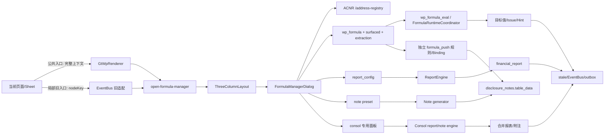

# 公式管理平台全面审计报告（2026-10-17）

**审计快照**：`HEAD 84def65b2561068d428f2a4d0f7b122fa1bf95fc`，分支 `spec/disclosure-note-doc-upload-and-batch-fill`。任务开始时工作树干净；运行时验证期间并行会话新增 `backend/migrations/V189__create_share_change_event_table.sql`、`V190__add_missing_columns_fix_orm_drift.sql`，收尾时另有若干 `.agents/tasks/l*` 历史产物显示为删除，均未触碰。Vitest/Vite 自动改写的两个 `.d.ts` 已精确还原。本文只写本报告，不改生产代码、spec 或业务数据。

## 一、一页结论：对六个问题逐项回答

| 用户问题 | 结论 | 置信度 | 关键证据 |
|---|---|---:|---|
| ① 不同底稿之间的取数与勾稽是否全打通 | **部分打通，不是全打通** | 高 | 有 425 条 `cross_wp_references`、42,163 条静态 sheet 依赖和 WP/NOTE/TB 执行器；但 V2 resolved 快照只含 107 条，真库 `cross_check_results=0`，D2/E1 中央弹窗展示的是只读说明元数据而非执行结果。源码+DB+运行时。 |
| ② 单个底稿内部的数据提取、公式计算与校对是否全打通 | **部分打通** | 高 | 许多专用 Vue composable 在页面内真实计算；中央弹窗却把 `surfaced` 文案冒充可编辑公式，工作底稿正式公式在所有活跃项目为 0，且“应用自动运算”对底稿基本不可达。源码+DB+运行时。 |
| ③ wp/TB/报表/附注/aux/合并等跨模块是否全打通 | **部分打通；只有报表主链有强实证** | 高 | `report_config` 318 条公式，`financial_report` 492 行带 `formula_used`；但附注 `_formulas/_user_formulas=0`、公式推送 run/state=0、合并公式/run=0、runtime outbox=0，AUX 在报表路径被强制置 0。源码+DB。 |
| ④ 每个实际可访问底稿页面都有“公式管理”按钮吗 | **否** | 高 | 220 个声明 componentType 中公共当前页入口静态覆盖 217，`a1-dashboard`、`univer` 缺失，`redirect-materiality` 条件豁免；真实 208 张底稿样本为 196 直接覆盖、1 缺失、1 重定向、10 分类 404 无法判定。源码+运行时 API。 |
| ⑤ 点击后都能正常弹窗吗 | **部分正常** | 高 | D2、C22、E1 公共按钮都能打开；E1 页内第二个按钮只传 `nodeKey`，实测错误进入 `report` scope，并产生两个 422。D4-33~36 有同形 node-only 入口。源码+运行时。 |
| ⑥ 左侧严格是当前页地址、右侧严格是当前页公式吗 | **不符合** | 很高 | 左栏调用 `/api/acnr/entries` 展示全局树，根本不调用当前 sheet 的 `listCells`；右栏 D2-1 混入 D2-10/D2-12，E1-1 混入 E1-10/E1-14/E1-15。源码+运行时。 |

**总判断**：平台已经拥有丰富的公式“零件”（公式语法、报表求值、静态依赖图、ACNR、stale、formula_push、合并公式），但“公式管理中心 = 每页统一入口 + 当前页精确地址 + 当前页权威公式 + 可验证执行/校对 + 安全保存/传播”的产品闭环尚未形成。不能据四个已归档 100% spec 宣称“全部打通”。

## 二、当前架构与真实端到端数据流

状态图例：**生产接线**＝已有真实调用方；**旁路生产**＝能运行但不由中央弹窗权威驱动；**占位/展示**＝只显示元数据；**死/错链**＝入口存在但目标错误。

| 链段 | 当前实现与状态 | 证据锚点 |
|---|---|---|
| 当前页→公共按钮 | HTML/skip/confirmation-hub 经 `GtWpRenderer` 公共工具栏，发送 `wpId/projectId/year/wpCode/sheetName/sheetCodes`，生产接线 | `GtWpRenderer.vue:124-138,1193-1220` |
| 局部按钮→中央弹窗 | E1、D4-33~36 仅发 `nodeKey`，丢失实例/项目/sheet，错链 | `GtE1MonetaryFund.vue:280-287`；`D4TabOther*.vue:31-38/167-175` |
| EventBus→弹窗 | `ThreeColumnLayout` 保存 payload 并挂唯一全局弹窗；无 payload 时默认 `report` | `ThreeColumnLayout.vue:321-337,914-925` |
| 左侧地址 | `useAcnr().listSheets()` 构建全局 WP 树；TB/report/note/consol 另拼静态/动态节点；不是当前页坐标清单 | `FormulaManagerDialog.vue:12-34,1569-1754` |
| 工作底稿右侧 | `GET /api/workpapers/{wp_id}/formulas` 合并 `WpFormula.items`、`surfaced`、D/F Tier A/B；生产读，但后两者多为说明文案 | `FormulaManagerDialog.vue:2060-2133`；`wp_formula.py:633-661` |
| 报表公式 | `report_config.formula` 经 `ReportEngine` 写 `financial_report.formula_used/current_period_amount`；这是当前最完整的生产链 | `report_engine.py:1091-1522` |
| 附注公式 | 中央弹窗读模板 `preset-formulas`；独立 `NoteFormulaDialog` 保存 `_user_formulas`，而 apply 只执行 `_formulas/check_presets`，保存与执行互不可见 | `FormulaManagerDialog.vue:2586-2633,3320-3328`；`disclosure_notes.py:1451-1545`；`note_formula_generator.py:380-430` |
| 通用运行协调器 | Draft refresh→`FormulaRuntimeCoordinator`→ValueLoader→adapter；代码接线，但真库 29 条公式全在已删除项目、0 refs/0 computed/outbox=0 | `draft_refresh_orchestrator.py:208-319`；`formula_runtime/coordinator.py:79-455` |
| formula_push | 独立规则/Binding 引擎，81 主编码、267 规则，监听 TB_UPDATED/WORKPAPER_SAVED；不是中央 `wp_formula` 的同一套定义 | `formula_push/triggers.py:1-236`；`formula_push/engine.py:260-580` |
| stale/反向索引 | 多事件 handler 存在；但中央“保存全部”使用系统当前年而非 `props.year`，单行保存不走该调用，且真库 outbox=0 | `FormulaManagerDialog.vue:3614-3664`；`event_handlers/_impl.py:1446-1563` |
| 权限/审计 | formula_push、logic_check、附注较完整；wp_formula/report_config/formula_scope/linkage 多数仅登录，直接 wp_formula CRUD 无哈希链留痕 | 见第七节 |

## 三、三类能力矩阵

### A. 单底稿内部

| 能力 | 入口/源→目标 | 执行与持久化 | UI/测试/运行时 | 结论 |
|---|---|---|---|---|
| 单元格/字段地址发现 | ACNR L1 + legacy 五域注册表 | ACNR 当前仅 WP：1,215 sheet/474 cell；分类表 3,867 sheet/443 wp_code | 左栏只拉 sheet 全局树，不拉当前 sheet cells | **未形成当前页地址面板** |
| 页面内计算 | 各循环 composable、`CYCLE_SHEET_FORMULAS` | 81 base/598 sheet/2,301 条 surfaced 文案，E1 15 sheet/48 条 | D2/E1 页面值和校验真实存在，但中央多为文档化投影 | **页面内部分打通，中心未收敛** |
| 公式编辑/保存 | `FormulaEditDialog`→父组件 | 对 report_config 可写；对工作底稿中央错误写 `/api/report-config/{wp_formula-or-surfaced-id}` | surfaced 标 `readonly` 仍显示“编辑”；运行时可打开编辑器 | **工作底稿中心错链（P0）** |
| 语法/引用校验 | L1 AST/白名单、ACNR save guard | `FormulaEditDialog.onSave` 不校验；report 更新未带 project/year 时跳过 ACNR；wp endpoint 较严格 | 编辑器可装入中文伪公式并准备保存 | **部分，入口不一致** |
| 执行 | 中央“应用自动运算”→report-config batch；wp save 另有即时 evaluator | 中央只回显结果不写页面；wp evaluator只真支持 TB/SUM_TB/WP，其他多阻断或静默 0 | `surfaced` 分类为“计算/取数”而非 `auto_calc`，不会执行 | **部分/名不副实** |
| 校对与差异 | 主表仅显示“计算值”；push panel有当前值/公式值/差异 | logic_check 可落 `cross_check_results`，但真库 0 | D2/E1“逻辑审核”是说明行，计算值均“—” | **普通中心未打通；push 子页部分有** |
| 保存后重载 | report_config、wp_formula、note JSONB 各自存 | 三套权威源；中央 wp 映射还把后端 `category/description` 错读成 `formula_category/formula_description` | 真库活跃项目 wp_formula=0 | **未统一** |

### B. 跨底稿

| 能力 | 当前实现 | 核验证据 | 结论 |
|---|---|---|---|
| 源/目标寻址 | ACNR、legacy URI、CWR、L2/L3 四套并存 | CWR 425/431 targets；resolved snapshot 仅 107（106 hit/1 miss） | **部分，目录漂移** |
| WP()/跨 sheet | `WPExecutor` + `CrossSheetResolver`（BFS/环检测） | D2/E1 in-page 引用活跃；中央展示不等于调用此执行器 | **旁路打通，中心未闭环** |
| 依赖/CCR | 42,163 静态依赖、48,944 nodes/39,421 edges、FormulaReverseIndex | 规则量大，但快照口径不一致且无全链真库结果 | **治理层有，执行证据不足** |
| 变更传播 | WORKPAPER_SAVED/FORMULA_CONFIG_CHANGED→stale engine | 当前样本 208 底稿 stale=0、report stale=2、outbox=0；中央年份写错 | **部分** |
| 勾稽结果 | 7 条 report logic_check + `cross_check_results` | 后端测试绿；真库 0；中央表间审核 GET 少 year 恒 422并退静态示例 | **未证明生产闭环** |
| 项目隔离 | 部分 service 做 ownership，formula_push 端点严格 | 多个中央依赖端点仅 `get_current_user` | **不合格（P0）** |

### C. 跨模块

| 域/链路 | 读路径→写路径/权威源 | 触发与真实消费 | 当前实证 | 结论 |
|---|---|---|---|---|
| TB→report | `TrialBalanceResolver`→`report_config`→`financial_report` | 生成/重算调用 ReportEngine | 318 配置公式；6 项目各 82 行公式落报表 | **已打通主路径** |
| TB/ADJ→wp | prefill、专用组件、wp evaluator、formula_push | 页面打开/刷新、TB_UPDATED、WP_SAVED | D/F2 Tier 开关默认 false；活跃项目正式 wp_formula=0 | **部分** |
| wp→report | 报表公式 `WP()`/权益专用 overlay | 报表生成时消费 | 代码存在，中央 surfaced 不是其权威定义 | **部分** |
| wp/report→note | 前端同步 payload、note generator、formula_push | 保存/推送/附注 apply | 1,069 附注中 `_formulas` 与 `_user_formulas` 均 0；push run=0 | **未证明打通** |
| note→wp/report | `NOTEExecutor`/反向图 | 公式执行时按需预载 | 中央 note 只显示模板预设；用户公式执行断链 | **部分/断链** |
| AUX→其它 | legacy registry + `AUX()` | L1需 `aux_data`；report 显式替换为0，wp编辑拒绝AUX | ACNR catalog 无 aux 条目 | **未打通中央链** |
| consolidation | consolidated report_config + `consol_note_formula` + consol push | 公式变更后推当前项目、抵销审批事件 | 1 个合并项目；consol_note_formula=0、consol_push_run=0、note_data=2 | **代码接线，数据阻塞/未实跑** |
| 其他（audit plan/adjustments/misstatements等） | 425 CWR 中有模块目标；ADJ 净额执行器 | 多为规则/stale，不都在公式中心可配置 | 仅规则证据 | **不应算已打通** |

## 四、全量按钮/弹窗覆盖盘点

多个权威分母语义不同，禁止拼成单一百分比：

| 分母 | 总数 | 直接当前页入口覆盖 | 未覆盖 | 条件覆盖 | 无法判定 | 口径说明 |
|---|---:|---:|---:|---:|---:|---|
| 声明 componentType | 220 | 217 | 2 | 1 | 0 | 216 registry + `skip/confirmation-hub/univer/redirect-materiality`；公共 toolbar 排除 A1，Univer 主路径无入口 |
| `wp_code_overrides.json` 映射 | 1,526 | 1,524 | 1 | 1 | 0 | 1,525 映射到 HTML route，其中 A1 无 toolbar；B15 重定向；该分母含大量 sheet/虚拟码，不等于页面数 |
| 医疗器械真实项目工作底稿 | 208 | 196 | 1 | 1 | 10 | 运行时 classification API：198×200、10×404；A1 缺入口、B15 重定向，其余已解析宿主走公共 toolbar |
| 坐标/渲染分母（非按钮分母） | 3,867 classification rows / 3,453 real；480 render schema；1,215 ACNR sheets | — | — | — | — | 三者覆盖对象与版本不同，ACNR 只覆盖 179 parent wp_code，不能拿 1,215 当“全部页面” |

| 例外/渲染族 | wp_code/宿主 | 实际表现 | 判定 |
|---|---|---|---|
| `a1-dashboard` | A1 / `GtA1Dashboard` | `GtWpRenderer` 明确不渲染公共 toolbar，A1 自管工具栏无公式入口；左侧全局按钮会丢当前页上下文 | **未覆盖** |
| `univer` 主路径 | `WorkpaperEditor` non-HTML / `UniverEditorCore` | 顶部工具栏只有“同步公式”，没有打开 FormulaManager；primary outlet 是空 slot | **未覆盖** |
| `redirect-materiality` | B15 | render-config `redirect=true`，只显示去重要性模块，工作底稿 toolbar 不渲染 | **条件豁免，应单列** |
| classification 404 | 真实项目 10/208 | 路由会落 detail/default fallback；未逐页点击，不能宣称覆盖 | **无法判定** |
| 公共 HTML/skip/confirmation | `GtWpRenderer` | 公共按钮存在；但 skip 页/目录页可能只得到全册空态 | **按钮覆盖≠公式闭环** |
| 子组件重复入口 | E1、D4-33~36 | node-only；E1 实测错误 scope。另有 7 个 local formula dialog/drawer，UX/权威源各异 | **接线断裂/碎片化** |
| OnlyOffice | “完整Excel”合成页 | 父级按钮仍在；实测 health/config 与 8080 资源均 200，入口按工作簿级而非 sheet 级 | **工作簿级条件覆盖** |

## 五、左右栏契约核验

| 契约 | 实现/运行时结果 | 结论 |
|---|---|---|
| 左栏只显示当前页面地址坐标 | 左栏标题“数据源”，调用 `/api/acnr/entries`，展示 TB/report/note/wp 全局树及合并、表间审核、数据质量；不调用当前 sheet `/anchors/listCells` | **失败** |
| 右栏只显示当前页面公式 | `matchSheetCode` 为 `a===b || a.includes(b) || b.includes(a)`；D2-1→18 条且含 D2-10/D2-12，E1-1→28 条且含 E1-10/E1-14/E1-15 | **失败（P0）** |
| 展示权威公式而非说明 | 两次 API 均 `items.count=0`，右栏全部来自 `surfaced`，却显示“自定义/编辑/健康度100%” | **失败（误导性成功）** |
| 缺上下文不退全局 | D2目录、C22首页定位失败后明确告警并退全册（42/0）；透明但仍不符合当前页契约 | **部分：有告警，未闭环** |
| 切页/重开/并发 | wp 请求有 sequence guard；但 report/note/cross-check cache 未按 project key，`noteTreeLoaded/reportTypesLoaded/crossCheckLoaded` 切项目不清；观察到一次 ACNR GET abort 后重发200 | **部分，有跨项目陈旧上下文风险** |
| 权限/锁定 | 中央新增、保存、应用按钮无统一 capability gate；设计好的 `createOpenFormulaManagerCommand/decideSaveDraft` 仅被测试调用，生产零调用 | **失败** |

## 六、按钮调用链、请求与运行时验证

| 样本/动作 | 实际结果 | 网络/控制台 | 判定 |
|---|---|---|---|
| 服务/登录 | 用户重启后 `/api/health`、`/livez`、3030 均 200；admin/admin123 登录 200 | 后续服务再次停止，未擅自启动 | 运行时窗口有效但非全程 |
| D2 底稿目录→公共按钮 | 按钮可见、全屏弹窗打开；左全局树；定位目录失败，退“全册公式42”并警告“下表不是本页公式” | bindings/ACNR/formulas 三个 GET 200，0 console error | 弹窗正常，作用域不合格 |
| D2-1→公共按钮 | 显示“本页公式18”，实际混入 D2-10×4、D2-12×3；API `count=0`，全是 surfaced | `/workpapers/{D2}/formulas` 200 | P0 假作用域/假可编辑 |
| D0-2共享页→公共按钮 | 正确落 `底稿>D2>D0-2（共享自D0）`，本页公式0 | GET 200 | 共享页定位修复有效 |
| C22专用 renderer→公共按钮 | 按钮可见、弹窗开；`C22 IT一般控制测试` 不在坐标目录，退全册0并警告 | formulas 200 `{count:0,items:[]}` | 按钮通，内容未通 |
| E1-1页内第二按钮 | 弹窗 scope 标签为“报表”、`本域公式0`，面包屑却写底稿 E1-1 | `/formula-scope?...scope=report` 200；`/report-config/types` 422；`/formula/report-cross-check` 422；2 console errors | P0 node-only 错链 |
| E1-1公共按钮 | 正确落 E1-1，但“本页公式28”混入 E1-10、E1-14、E1-15；API正式 items=0 | formulas/bindings 200 | P0 前缀串页 |
| E1公式推送页 | 展示30条E1规则；最近推送、运行历史、待处理差异均空 | rules/latest/states/runs 全200；DB run/state=0 | UI接线存在，未有真实运行证据 |
| OnlyOffice完整Excel | health、whole-workbook config、8080编辑器资源均200；公共父级按钮仍存在 | 未执行保存/推送 | 外部编辑器可用；公式按全册而非当前原生sheet |
| Report/TB/Disclosure/Consolidation | 源码确认各有专用 mount/context；服务在后续中断前未逐个完成点击 | 无当前运行时证据 | **代码已核验但运行时未验证** |

调用链细节：公共入口禁用条件仅缺 `runtimeProjectId/runtimeWpCode/loading`，不按角色/锁定隐藏；`ThreeColumnLayout` 的左侧全局“公式管理”无 payload 时固定退 `report`。关闭重开会重置 category/search/selection，wp 请求用 `dialogSession/wpRequest` 丢弃慢响应；但 scope/report/note caches 不带 project key。响应信封在当前 GET 200 路径解包正常。`/api/report-config/types` 后端不存在（被 `/{config_id:UUID}` 捕获为422）；report-cross-check 后端强制 `year`，前端未传。

## 七、安全、正确性与事务审计

| 风险 | 证据 | 评级/结论 |
|---|---|---|
| wp_formula / user-formulas 跨项目 IDOR | 路由只有 `{wp_id}`+`get_current_user`，先按 id 加载底稿，再以内含 project_id 操作；未调用项目权限判定 | **P0，高置信静态风险；未做越权写探测** |
| report_config 越权/全局污染 | list/get/clone/update/create/delete/seed/execute-batch 多数仅登录；知道 config UUID 即可改模板或 `project:{id}` 配置 | **P0** |
| 任意项目公式执行/数据提取 | `/api/formula/execute`、report batch 从 body 接 project_id，仅登录；`formula-scope/{project_id}` 也仅登录 | **P0** |
| linkage/地址写操作 | stale impact、override/header-rule、legacy invalidate（含 all）只校验登录；可跨项目标 stale 或改全局解析 | **P0** |
| 保护较好的链路 | formula_push 使用 `require_project_access(readonly/edit)`并有真HTTP 403测试；logic_check、附注CRUD同样按项目；ACNR携 project_id 时显式校验 | 正面基线，应复用 |
| 公式注入/RCE | L1 使用递归AST+函数白名单，危险/外链为 blocked；自定义函数有AST/denylist | 未见直接RCE；但任意登录用户可注册/删除全局自定义函数，仍是P0授权问题 |
| 非法公式落库 | `FormulaEditDialog.onSave` 不调用 validate；中央 report update不带 project/year，后端因此跳过ACNR引用校验 | **P1，安全求值不等于数据正确** |
| 循环/重复计算 | report batch有拓扑循环报错；CrossSheetResolver有BFS/环检测；note拓扑对剩余循环仅追加执行；多引擎并存使双算/0回退仍可能 | 部分防御 |
| 事务原子性 | service多数只flush/router commit；formula_push每底稿SAVEPOINT+CAS较好。中央“保存全部”逐行调用各自commit，半途失败会留下部分成功 | **P1 原子性缺口** |
| 审计追踪 | user-formulas、report execute、formula audit log有留痕；直接 wp_formula CRUD 未见 append_audit_log，当前29行也无computed证据 | **P1** |
| 正负号/双计 | occurrence按末级标准码聚合、ADJ只给净额、合并有五度量模型；但多个旁路和静默0无法由中央统一对拍 | 局部有保障，平台级未闭合 |

现有授权基线测试只对“完整路径含 `{project_id}`”做大盘棘轮，`{wp_id}` 对象型公式端点和 body/query project_id 容易漏检；当前 `_IDENTITY_ONLY_BASELINE=224` 只是“不再增加”，不是“现状安全”。

## 八、测试执行结果与盲区

| 精确命令 | 结果 |
|---|---|
| `rtk npx vitest run src/composables/__tests__/FormulaManagerPageWiring.spec.ts src/components/formula/__tests__/sharedSheetScopeTargeting.spec.ts src/components/formula/__tests__/useFormulaScopeCatalog.spec.ts src/shell/formula/__tests__/openFormulaManagerCommand.spec.ts src/components/workpaper/__tests__/FormulaStatusPanel.spec.ts src/components/workpaper/__tests__/formulaStatusPanelDisplay.spec.ts --reporter=verbose`（cwd `audit-platform/frontend`） | **62 passed / 2 failed / 0 skipped**。RTK外层错误返回exit 0，不能只看退出码。 |
| `rtk ..\.venv\Scripts\python.exe -m pytest tests/test_formula_engine.py tests/test_user_formulas_override.py tests/formula_management/test_formula_scope_query.py tests/formula_management/test_wp_formula_source_scope_binding.py tests/formula_runtime/test_orchestrator_real_mutations.py tests/formula_runtime/test_value_loader.py tests/test_project_endpoint_authorization_baseline.py -q --tb=short -p no:cacheprovider` | **107 passed / 0 failed / 0 skipped，4 warnings** |
| `rtk ..\.venv\Scripts\python.exe -m pytest tests/test_formula_push_rules.py tests/test_formula_push_engine.py tests/test_formula_push_endpoints.py tests/test_formula_push_triggers.py tests/test_formula_push_policy.py tests/test_formula_push_note_writer.py tests/test_formula_push_schema_contract.py -q --tb=short -p no:cacheprovider` | **235 passed / 0 failed / 0 skipped，1164 warnings**，含多条 `Connection._cancel was never awaited` |
| `rtk ..\.venv\Scripts\python.exe -m pytest tests/formula_runtime/test_logic_check_truth.py -q --tb=short -p no:cacheprovider` | **28 passed / 0 failed / 0 skipped，1 warning** |

两个前端失败均揭示“归档100%≠当前可靠”：`FormulaManagerPageWiring` 的一次性 reject 被新增 bindings GET 抢先消费，错误态测试已脆化；`formulaStatusPanelDisplay` 仍要求“HTML面板不可达”这一旧缺口存在，而当前代码已加按钮，守卫变成历史假红。

关键盲区：① `FormulaManagerDialog.spec.ts` 复制纯逻辑而不挂真实组件；② page wiring只测GET/竞态，不测编辑保存端点；③共享页测试只比 D0-2 与 D2-1，未测 D2-1/D2-10 前缀碰撞；④ toolbar E2E允许 `triggerCount>=0`、只数关闭态 dialog≤1，从未点按钮核左右栏；⑤ runtime coordinator大量mock DB/ValueLoader，部分断言允许“有mutation或无failure”；⑥ scope测试人工造现实不存在的 `TB/REPORT/NOTE/CONSOL-*` wp_index，不能证明真实模块存储；⑦ formula_push测试质量较高但为合成SQLite，当前PG运行记录仍为0；⑧没有对象型端点跨项目TestClient用例；⑨没有“surfaced必须只读且不能写report_config”守卫。

## 九、P0/P1/P2 缺口与根因

### P0（阻断宣称“平台核心闭环”）
1. **FM-P0-01 当前sheet串页**（功能/接线）：模糊包含匹配把 `E1-1` 命中 `E1-10/E1-14`，把 `D2-1` 命中 `D2-10/D2-12`；根因是编码身份被当自由文本。
2. **FM-P0-02 surfaced假可编辑+错保存域**（功能/正确性）：后端明确 `readonly=true`，前端仍给编辑按钮；保存统一写 report_config；“健康度100%/自定义”把说明元数据包装成正式公式。
3. **FM-P0-03 多入口丢上下文**（接线）：E1与D4-33~36直接发nodeKey；设计好的 canonical command/capability/dirty-pin没有进生产。
4. **FM-P0-04 附注用户公式保存后不执行**（功能）：`_user_formulas`与`_formulas`双存储；apply只读后者。中央弹窗甚至不读前者。
5. **FM-P0-05 项目隔离缺失**（安全）：wp_formula、report_config、执行、scope、linkage/legacy address等关键端点只登录不校项目。

### P1（主流程可用但结果/覆盖不可信）
1. 左栏不是当前页地址，ACNR catalog又只有WP且仅1,215/3,453 real-sheet量级；AUX/报表/附注靠另一套动态/静态树。
2. 表间审核入口契约错：GET缺year恒422；响应本是执行结果却被按“规则列表”解析；失败后展示静态示例；新增/编辑规则只改内存，关闭即丢；树父/叶key与规则map还不一致。
3. 公式函数“按钮支持”与运行支持不一致：workpaper UI提供NOTE/REPORT/ROW/AUX/PREV/ADJ，实际多数阻断或空ctx→0；report路径明确把PREV/AUX替换0；中央batch未注入ADJ实时数据。
4. A1、Univer无当前页入口；真实项目另有10个classification 404未判定；目录/C22页面只能退全册。
5. project切换缓存未隔离，单行保存不触发统一stale；保存全部用系统当前年而非项目年；真库outbox=0。
6. 正式运行数据为空：所有29条wp_formula都属于已软删项目“辽宁卫生服务”，且0 computed/refs/source_scope/binding；活跃项目为0。formula_push/cross-check/consol运行表均0。

### P2（治理与可维护性）
1. 至少7套 local formula dialog/drawer 与中央中心并存，按钮同名但能力/权威源不同；确认汇总、D4披露等仍是局部规则说明。
2. 四个直接相关spec均归档100%（library 22/22、runtime 18/18、toolbar 17/17、push rollout 26/26），active spec只有3个且无公式治理；任务状态与运行事实偏离。
3. formula_push套件1164 warnings、前端两条历史红、RTK吞失败退出码，会训练团队忽略门禁。

## 十、最小闭环整改顺序与验收标准（不实施）

1. **先止错（P0）**：用结构化 `stable_sheet_key/sheet_uid` 精确等值替换 `includes`；surfaced/extraction强制只读并去掉保存/应用/“自定义”标签；工作底稿编辑必须调用 `wpFormula.upsert`。验收：E1-1/D2-1前缀反例逐一不串页；对surfaced点击区无编辑按钮。
2. **统一入口**：生产代码真正调用 `createOpenFormulaManagerCommand`，所有公共/局部按钮只提交 `CanonicalWorkpaperLocation`；删除E1/D4 node-only旁路；A1/Univer补同一primary outlet，redirect登记正式豁免。验收：220 componentType每项恰有覆盖或有期限豁免，零未知。
3. **重做左右栏契约**：后端新增/收敛为 `GET formulas?project_id&wp_id&sheet_uid` 与 `GET addresses?project_id&wp_id&sheet_uid`，服务端精确过滤；左栏只显示当前sheet anchors，另设显式“全局浏览”按钮。验收：左右返回每行均带同一 location identity，缺identity fail-closed而非退全局。
4. **收敛权威源和执行语义**：wp正式公式=`wp_formula`；surfaced=文档化只读；note要么让apply消费`_user_formulas`，要么取消可编辑；report=`report_config`；formula_push明确为自动物化层而非“同一公式”。为每个函数维护按执行器的支持矩阵，禁静默0。
5. **补项目鉴权与原子性**：对象id先最小反查project再 `require_project_access`；body/query project_id同样校验；全局模板/自定义函数限admin；批量保存单事务+CAS；直接wp_formula CRUD写哈希审计。验收：跨项目读/写/执行全部403且0副作用。
6. **闭合执行/传播可观测性**：修year、项目缓存键、cross-check API；每次执行写run/issue/hint/outbox/audit并可查询；去掉“执行0条仍成功”。验收：新公式保存→重开一致→执行改变目标→`last_computed_at`更新→stale/outbox/audit均有同一run_id。
7. **最后真实UAT**：在未删除 standalone 与 consolidated 项目各造一套隔离公式，覆盖HTML、OnlyOffice、Univer、report、note、aux、consol，逐值对拍权威表；不接受只看组件或mock API。

### 建议新增的全量自动门禁

建立 `formula-manager-all-accessible-pages.spec.ts`：测试先通过项目API枚举全部可访问 `working_paper`，逐张GET render-config并展开“每个真实sheet + whole_workbook + redirect”，形成运行时权威分母；每项记录 `project_id/wp_id/wp_code/sheet_uid/sheet_code/host/componentType`。非redirect项必须：①恰好一个 `[data-testid=formula-manager-open]`；②点击只出现一个中心；③抓包断言请求带完整location；④左侧返回addr_id全属于精确当前sheet；⑤右侧每条stable_sheet_key精确相等，且surfaced只读；⑥切sheet/项目后集合变化且旧响应不能覆盖；⑦admin/auditor/readonly分别验证view/edit权限；⑧0 console error、0当前请求abort、0 4xx。redirect/不可渲染必须用带owner/reason/expires_at的可伪证豁免。门禁输出JSON矩阵，分母任何新增自动变红；配套变异必须注入 `E1-10`、删除按钮、去掉wp_id、把save改回report_config，四种都应命中指定测试。

## 十一、附录：统计口径、关键文件与命令

**当前数据快照（只读PG事务）**：projects 142/active85（standalone11、consolidated1、report_scope空73）；wp_index/working_paper各997、77项目、291 distinct wp_code；wp_formula29（1个已删除项目/29底稿，auto_calc/custom/saved各29，computed/refs/source_scope/binding全0）；report_config1191行/318公式/4标准；financial_report2112行/492 formula_used/6项目；disclosure_notes1069/9项目/stale227，`_formulas=0`、`_user_formulas=0`；cross_check_results=0；formula_runtime_outbox=0；formula_push_run/state=0；consol_note_formula=0；consol_push_run=0；consol_note_data=2。

**静态数据口径**：override 1,526映射/185 componentType；前端 registry 216；ACNR L1 1,215 sheets+474 cells，全部domain=wp，179 parent code；classification 3,867 rows/443 wp_code/3,453 real；render schema 480；prefill mappings306；CWR425 refs/431 targets/96 source wp/81 target wp；L3 dependencies42,163；resolved refs107；unified graph48,944 nodes/39,421 edges；formula_push267 rules/81主码（source102/derived85/note80）；surfaced catalog 81 base/598 sheets/2,301说明公式，另E1 15/48。所有计数均为本轮现扫，不沿用memory旧数。

**关键源码**：`FormulaManagerDialog.vue:12-334,825-1230,1569-1754,1934-2133,2194-2527,2586-2950,3091-3269,3614-3765`；`FormulaEditDialog.vue:445-470,688-936,987-1132,1197-1280`；`GtWpRenderer.vue:124-209,694-717,1193-1220`；`WorkpaperEditor.vue:29-280,540-680,991-1137,1188-1231`；`ThreeColumnLayout.vue:152-159,220-225,321-337,914-925`；`wp_formula.py:633-939`；`wp_formula_service.py:290-625`；`formula_engine.py:861-966,1135-1168`；`report_engine.py:822-953,1091-1522`；`note_formula_service.py:130-208`；`note_formula_generator.py:380-500`；`formula_runtime/coordinator.py`；`formula_push/{engine,triggers,bindings}`；`formula_scope_query.py`；`address_registry.py`、`address_registry_v2.py`、`acnr.py`；`linkage_bus.py`；迁移 `V052/V100/V104/V163/V178`。

**运行时未完成项最小复验**：启动9980/3030后登录admin，依次访问 `/projects/{pid}/reports?year=2025`、`/trial-balance?year=2025`、`/disclosure-notes?year=2025`、合并项目 `/consolidation`；每页选择非默认tab/章节后点本页按钮，核对无 `/report-config/types` 或缺year 422，并对比左右栏随tab变化。合并侧需先种子化公式才可做有数据验证；当前表为0。

**审计限制**：未执行任何保存、应用、推送、dry-run或越权探测；未启动/重启服务；未跑会写历史evidence的E2E；服务在完成D2/C22/E1/OnlyOffice取证后再次不可达，因此Report/TB/Disclosure/Consolidation仅有源码+DB证据，置信度已相应标注。